# stellarator-design

**Stellarator-Spulen mit offenen Werkzeugen und KI-Agenten: vom benötigten Magnetfeld über die Spulenbahn und ein
parametrisches FreeCAD-Gehäuse bis zur Spannungsrechnung in ElmerFEM.**

*Stellarator coils with open tools and AI agents: from the required magnetic field via coil paths and parametric
FreeCAD casings to structural analysis in ElmerFEM.*

> 🛠️ **Ein Hobbyprojekt, aus Neugier entstanden.**
> Ich bin kein Fusionsforscher. Dieses Projekt ist privat und aus reiner Neugier entstanden: Wie funktioniert
> ein Stellarator, und wie weit kommt man mit offenen Werkzeugen und KI-Unterstützung (Claude Code, Hermes Agent)?
> Es gibt keine Verbindung zu einem Forschungsinstitut oder Unternehmen. Die Ergebnisse sind nicht
> begutachtet, enthalten vereinfachende Annahmen und können Fehler haben. Sie sind **keine**
> Auslegung einer realen Anlage. Hinweise und Korrekturen sind willkommen.
>
> *A hobby project, born out of curiosity. Not affiliated with any research institution or company;
> results are not peer-reviewed, contain simplifying assumptions and may contain errors. They are **not** the
> design of a real device. Feedback and corrections are welcome.*

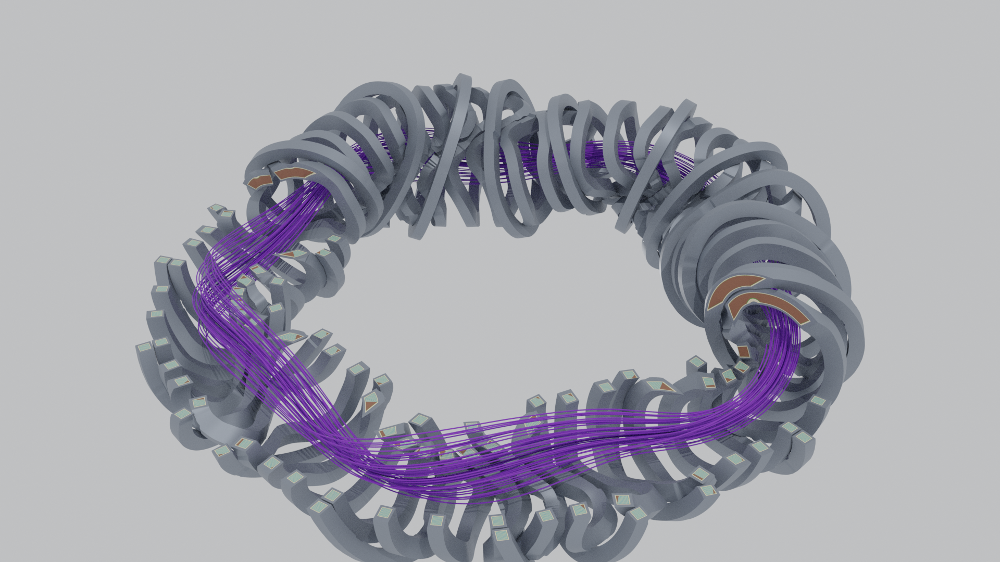

### Vorstellung (Deutsch)

Ein Stellarator hält ein Fusionsplasma allein mit äußeren, räumlich verwundenen Magnetspulen. Diese Spulen sind
anspruchsvolle 3D-Bauteile: Ihre Bahn gibt die Physik vor, die Kräfte entstehen aus Strom und Magnetfeld, und die
Tragstruktur muss dazwischen Platz finden. Das Projekt baut dafür eine durchgängige, nachvollziehbare Kette mit
freier Software auf:

- **Physik:** Plasmaform (DESC) und Spulen (simsopt) entwerfen oder die öffentlichen Spulenbahnen von
  Wendelstein 7-X übernehmen; Feldlinien, Flussflächen, Kräfte und Abstände unabhängig prüfen.
- **Konstruktion:** Spulengehäuse als voll parametrisches FreeCAD-Modell (Variable Section Sweep, Parametertabelle,
  Symmetrie-Klone, Verbinder, kollisionsfrei per Nachbarschnitt).
- **Berechnung:** Magnetfeld → Lorentzkraft → Spannung in einem gekoppelten ElmerFEM-Lauf, mit einem robusten
  Rechenweg, der das Netz direkt aus den Bahndaten erzeugt (ohne CAD-Kern).
- **Anschauung:** 3D-Schnittmodell mit Verguss, Isolierung und Supraleitern, Leiterdetail, ParaView und Blender.
- **Kühlung:** Plasmagefäß mit Gyroid-Kühlkern (PicoGK), Strömung in einem Segment mit FluidX3D, Filme in Blender.

Gebaut wurde das in wenigen Tagen mit zwei KI-Agenten: [Hermes Agent](https://github.com/NousResearch/hermes-agent)
(lokal; Recherche, Projektpflege, lange Läufe) und [Claude Code](https://www.anthropic.com/claude-code)
(Programmierung). Die Irrwege sind offen dokumentiert, in `BEFUNDE.md` und in den Berichten unten.

### About (English)

A stellarator confines a fusion plasma using only external, three-dimensionally twisted magnet coils. These
coils are demanding 3D parts: physics dictates their path, current and field create large forces, and the
support structure has to fit in between. This project builds a transparent end-to-end pipeline with open
software:

- **Physics:** design a plasma shape (DESC) and coils (simsopt), or use the public Wendelstein 7-X coil paths;
  independently check field lines, flux surfaces, forces and clearances.
- **Design:** coil casings as a fully parametric FreeCAD model (variable section sweep, spreadsheet parameters,
  symmetry clones, connectors, collision-free via neighbour subtraction).
- **Analysis:** magnetic field → Lorentz force → stress in one coupled ElmerFEM run, using a robust path that
  meshes directly from the coil data (no CAD kernel).
- **Visualisation:** 3D cut-away model with potting, insulation and superconductors, conductor detail, ParaView
  and Blender.
- **Cooling:** plasma vessel with a gyroid cooling core (PicoGK), flow through one segment with FluidX3D, films in
  Blender.

It was built in a few days with two AI agents: [Hermes Agent](https://github.com/NousResearch/hermes-agent)
(local; research, bookkeeping, long runs) and [Claude Code](https://www.anthropic.com/claude-code) (coding).
Dead ends are documented openly in `BEFUNDE.md` (German) and in the reports below. Code and most documentation are
in German; the English report gives the full story.

## Projektbericht / Project report

Wie das Projekt entstanden ist, mit allen Irrwegen (Recherche, falsches erstes Modell, direkte
Netzerzeugung, parametrisches FreeCAD-Modell, paralleler Rechenweg, 3D-Modell). Alle Quellen einzeln geprüft.
*How the project came about, including the dead ends. All references individually verified.*

- **Deutsch, für Maschinenbauer:** [Spulengehäuse eines Stellarators (PDF)](bericht/projektbericht/projektbericht.pdf)
- **Für KI-interessierte Maschinenbauer (wenig Zahlen, was alles geht):** [Was KI-Agenten im Maschinenbau heute schon können (PDF)](bericht/projektbericht/ki_im_maschinenbau.pdf)
- **English, for IT folks:** [Two AI Agents, One Stellarator (PDF)](bericht/projektbericht/project_report_en.pdf)
- Ältere Fachauslegung (1 GW, v0.3): [bericht/v0.3/bericht_v0.3.pdf](bericht/v0.3/bericht_v0.3.pdf)

---

## Worum geht es?

Ein Stellarator schließt ein heißes Plasma allein mit äußeren, verdrillten Magnetspulen ein. Ob
das gelingt, entscheidet die Form des Magnetfelds, also Flussflächen, Rotationstransformation iota
und Einschlusseigenschaften. Die Spulen sind nur das Mittel dazu. Dieses Projekt baut deshalb
einen durchgehenden, nachvollziehbaren Rechenweg auf:

0. **Wie groß muss die Anlage sein?** Aus der Netzleistung (z. B. 1 GW) folgen über eine
   Leistungsbilanz die Fusionsleistung, die Größe R0 und das Feld B0, je nach Supraleiter.
1. **Welches Magnetfeld wird gebraucht?** Aus physikalischen Zielen wird eine Plasmaform optimiert.
   Ziele sind Quasisymmetrie, Seitenverhältnis und iota.
2. **Welche Spulen erzeugen dieses Feld?** Spulenkurven werden so optimiert, dass das Feld
   tangential zum Plasmarand verläuft (B·n ≈ 0). Dabei gelten technische Grenzen:
   Länge, Krümmung und Abstände.
3. **Stimmt es, und lässt es sich bauen?** Eine unabhängige Prüfung umfasst
   - Biot-Savart, Feldlinien und Poincaré-Schnitte,
   - iota, intakte Flussflächen, Spiegelverhältnis, B_max an den Spulen und Lorentzkräfte,
   - die Spaltprüfung zwischen den Wickelpaketen,
   - die Volumengeometrie (STL/STEP) und die FEM-Magnetostatik in ElmerFEM.

Als Referenz und zur Validierung dient der reale Spulensatz von **Wendelstein 7-X** (70 Spulen).
Erstes Entwurfsziel ist ein **kompakter, quasi-axisymmetrischer Stellarator** mit 2 Feldperioden.

Die Werkzeugkette ist für die Steuerung durch KI-Agenten gebaut (Hermes, PI, Claude Code):
- Jeder Schritt ist ein Kommandozeilenaufruf mit JSON-Ein- und Ausgabe.
- Lange Rechnungen laufen losgelöst.
- Befunde und Übergaben stehen in `BEFUNDE.md` und `ERINNERUNGEN.md`.

> **Hinweis:** Hobby- und Lernprojekt (siehe oben). Die Ergebnisse sind keine Auslegung einer realen Anlage.
> Die Leistungsbilanz ist eine 0-D-Abschätzung; Stützstruktur und Strukturmechanik sind noch nicht ausgelegt.

---

## Ergebnisse

### Auslegung auf 1 GW ins Netz (Stufe 0 → 3)

Ein Kraftwerk mit **1000 MW netto** braucht rund **3 GW Fusionsleistung**. 80 % davon tragen Neutronen
ins Blanket (Wärme → Dampf → Turbine), 20 % die Alpha-Teilchen, die das Plasma heizen.
Stufe 0 (`invers/stufe0_bilanz.py`, 0-D-Leistungsbilanz) sucht die kleinste Anlage, die Wandlast,
Plasmadruck (β), Dichte (Sudo), Einschluss (ISS04) und das Leiterfeld der Supraleiter einhält.
Stufe 3 prüft das Ergebnis mit den realen Spulen in voller Größe.


| | HTS (Hochtemperatur-Supraleiter) | Nb₃Sn (erprobt) |
|---|---|---|
| großer Radius R0 / kleiner Radius a | **12,1 m** / 2,0 m | **22,2 m** / 3,7 m |
| Feld auf der Achse B0 | **7,5 T** | **4,8 T** |
| Feld am Leiter (Stufe 3) | 17,7 T (Grenze 20 T) | 11,6 T (Grenze 12 T) |
| Strom je Spule, Wickelpaket | 31 MA, 0,88 × 0,88 m | 36 MA, 1,56 × 1,56 m |
| Spalt zwischen Wickelpaketen | 0,58 m | 1,13 m |
| Netto-Kraft je Spule (max.) | 2200 MN | 3000 MN |
| begrenzt durch | Einschluss + Neutronen-Wandlast | Einschluss + Leiterfeld |

Feldlinien und Flussflächen bleiben beim Hochskalieren intakt (12/12, iota 0,422 → 0,411).
**Offen ist vor allem die Stützstruktur**: Die Kräfte sind etwa 1000-mal so groß wie bei W7-X.
Ein kleineres Seitenverhältnis würde die Anlage verkleinern (HTS: A = 4 → R0 ≈ 10 m).
Zur Einordnung: Das ist eine 0-D-Abschätzung (±30 %), kein Kraftwerksentwurf.


### Kompaktere Form A = 4,5 und Stützstruktur


| 1 GW netto | A = 6, HTS | A = 6, Nb₃Sn | **A = 4,5, HTS** | **A = 4,5, Nb₃Sn** |
|---|---|---|---|---|
| R0 / B0 | 12,1 m / 7,5 T | 22,2 m / 4,8 T | **10,4 m / 6,5 T** | **12,4 m / 5,7 T** |
| Feld am Leiter | 17,7 T | 11,6 T | 14,7 T | 10,9 T |
| Spalt Wickelpakete | 0,58 m | 1,13 m | 0,55 m | 0,19 m |
| Kraft je Spule (max.) | 2200 MN | 3000 MN | 1200 MN | 1300 MN |

**Stützschale in ElmerFEM** (ein gekoppelter Lauf: Magnetfeld → Lorentzkraft J×B → Spannung),
A = 6 mit HTS: Stahlschale 1,48 m dick (~51 kt), 99 % der Schale unter 587 MPa (zulässig ~667 MPa,
netzkonvergiert), örtliche Spitzen bis ~1000 MPa auf der Torus-Innenseite, Verformung 36 mm.
Elmer und Biot-Savart liefern dieselbe Kraft je Spule (2,9 % Abweichung).
Eine durchgehende Schale lässt sich für A = 4,5 nicht sauber bauen (Flächen durch die Spulen falten sich).


**Spulengehäuse als „Variable Section Sweep“ in FreeCAD** (Idee aus der CAD-Praxis, wie das
gleichnamige Creo-Feature): Je Spule eine geschlossene 3D-Kurve durch Punkte als *Innenseite* des
Gehäuses, 40 Skizzen senkrecht dazu, ein Loft hindurch. Alles wächst nur nach außen, deshalb
überschneidet sich auf der engen Plasmaseite nichts. Das Modell ist parametrisch: Eine Tabelle
„Parameter“ steuert Wandstärken und Wickelpaket. Die Außenwand ist dort dicker, wo die Lorentzkraft
groß ist. 12 der 16 Gehäuse sind Symmetrie-Klone der 4 Basisspulen.
A = 4,5 mit HTS: 16 gültige Volumenkörper, keine Überlappung, ~3,6 kt Stahl, Abweichung zwischen
Loft und Spule ≤ 15 mm. Benachbarte Gehäuse sind durch 160 Verbinder gekoppelt (ebenfalls Lofts,
5 eigene Paare, Rest Symmetrie-Klone).


Erste Elmer-Rechnung dazu (gleiche Kette wie oben, Geometrie als STEP aus FreeCAD): Sie läuft durch,
aber die geschätzten Wandstärken (0,1 m, zusammen ~5 kt Stahl) sind viel zu dünn. Im Mittel 1150 MPa,
99 % unter ~5100 MPa, Verformung bis 0,65 m. Am stärksten belastet sind die Torus-Innenseite und die
Anschlüsse der Verbinder. Die Wandstärken müssen also noch ausgelegt werden.


### Eigene kompakte Plasmaform `qa_nfp2` (Stufe 1 + 2)

| | |
|---|---|
|  |  |
| **Stufe 1 (DESC):** nfp = 2, A = 6, Quasisymmetrie-Fehler 1,3·10⁻⁵ (Referenz precise QA: 5,8·10⁻⁵), iota 0,423 → 0,415 | **Stufe 2 (simsopt):** 16 Spulen, \|B·n\|/\|B\| 0,11 % Mittel, 0,40 % max. |

### Referenzform precise QA (Verifikation der inversen Kette)

Zielform: DESC-Referenz *precise QA* (nfp = 2, Seitenverhältnis 6, iota ≈ 0,42), skaliert auf R0 = 1 m und B0 = 1 T.

| | |
|---|---|
|  |  |
| **Stufe 2:** 16 Spulen (4 Basisspulen + Symmetrie), Restfehler \|B·n\|/\|B\| im Mittel 0,24 %, max. 1,0 % | **Stufe 3:** geschachtelte Flussflächen, iota 0,421 → 0,415 (Ziel 0,42) |


| Kennzahl | Wert |
|---|---|
| Restfehler \|B·n\|/\|B\| auf dem Plasmarand | 0,24 % (Mittel), 1,0 % (max.) |
| iota Achse → Rand (unabhängige Feldlinienrechnung) | 0,421 → 0,415 |
| Spiegelverhältnis auf der Achse | 0,16 % (Kennzeichen der Quasi-Axisymmetrie) |
| Spule–Plasma / Spule–Spule (Mittellinie) | 0,30 m / 0,10 m |
| Gesamtlänge der 4 Basisspulen, kleinster Biegeradius | 18,0 m, 0,18 m |

### Wendelstein 7-X (Validierung mit realen Spulen)

| | |
|---|---|
|  |  |
| 70 Wickelpakete (0,192 × 0,160 m), kollisionsfrei, min. Spalt 68 mm | Bohnenförmige Flussflächen, 5/5-Inselkette bei iota = 1 |

| Kennzahl (Standardkonfiguration, mittleres \|B\| auf der Achse = 2,5 T) | Wert |
|---|---|
| Strom je Windung (NPC, 108 Windungen) | 13,49 kA |
| \|B\| auf der Achse min / Mittel / max | 2,40 / 2,50 / 2,62 T |
| iota Achse → letzte intakte Fläche (r_eff 0,57 m) | 0,858 → 0,921 |
| B_max an der Wickeloberfläche (Filament-Biot-Savart) | 4,52 T |
| Netto-Lorentzkraft NPC1 | 2,05 MN |
| kleinster Spalt zwischen Wickelpaketen | 68 mm (NPC2–NPC3) |

**ElmerFEM gegen Biot-Savart (alle 70 Spulen, 3,28 Mio. Tetraeder):** |B| auf der Achse 2,504 T gegenüber
2,501 T, Abweichung im Median 0,24 % und höchstens 1,1 %. Nahe den Spulen liegt sie bei etwa 5 %, das
entspricht der Netzweite von 5 cm.

| | |
|---|---|
|  |  |

Weitere Bilder: [Voxel-FFT-Solver gegen Biot-Savart](docs/bilder/w7x_voxelsolver_validierung.png),
[Poincaré Biot-Savart/Voxel](docs/bilder/w7x_poincare_biotsavart_voxel.png),
[PicoGK-Gehäuse](docs/bilder/w7x_picogk_gehaeuse.png) (frühe Voxel-Variante, heute nicht mehr nötig).

### W7-X: Spulengehäuse und Spannung (zwei Wege)

Die Gehäuse entstehen auf zwei parallelen Wegen: als **parametrisches FreeCAD-Modell** (Konstruktionsstand,
kollisionsfrei per Nachbarschnitt) und als **Rechenmodell ohne CAD-Kern** (zwei Rechteckrohre je Spule direkt auf
der Bahn, Wände nach Kraft und Freiraum, automatische Entflechtung). Der zweite Weg ist robust vernetzbar und
liefert die Spannungen.

| | |
|---|---|
| 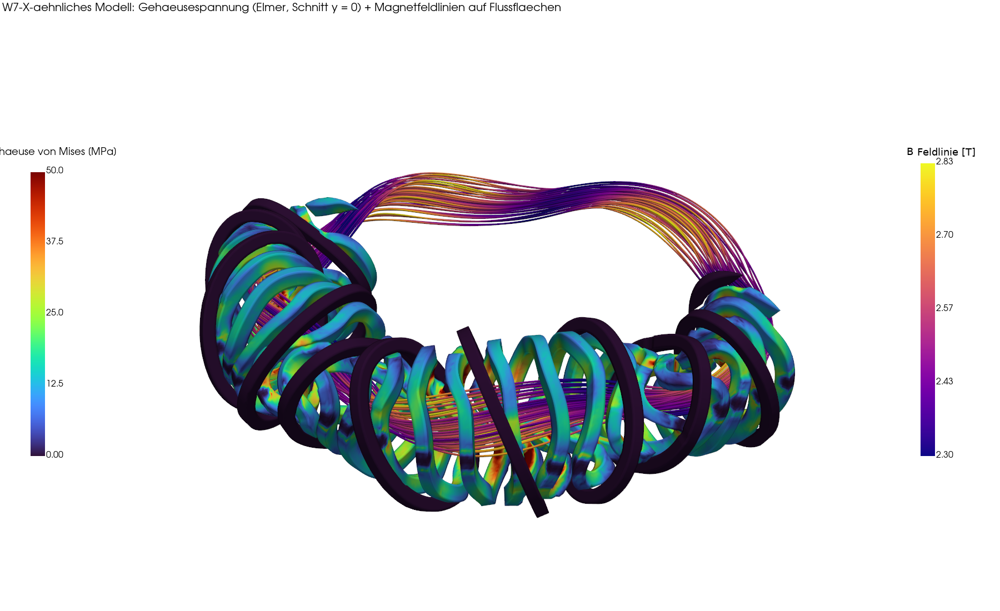 | 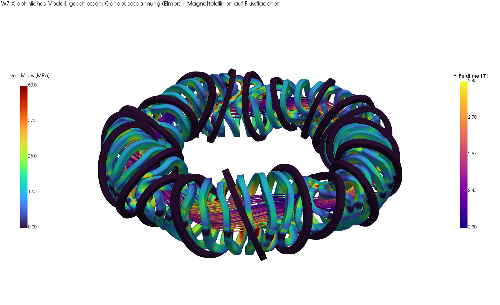 |
| Vergleichsspannung im Gehäuse (Elmer) mit Feldlinien, aufgeschnitten | geschlossenes Modell |

| Kennzahl (Rechenweg ohne CAD-Kern) | Wert |
|---|---|
| Netz / Lösung | 3,02 Mio. Tetraeder in 78 s / 55 min, ~14 GB |
| Stahl | 33,4 m³ ≈ 264 t |
| Kraft je Spule Elmer / Biot-Savart | 2,42 / 2,39 MN (+1 %) |
| von Mises Gehäuse | Mittel 11 MPa, 99 % < 43 MPa, max. 110 MPa; Verformung < 1 mm |

Vereinfachungen: je Gehäuse ein eingespannter Bereich statt Verbinder und Tragring, kein Verguss, Wände
stellenweise nur 3 mm. Das ist ein durchgängiger Rechenweg, **kein** Festigkeitsnachweis.

### 3D-Modell: Schichten und Leiter

| | |
|---|---|
| 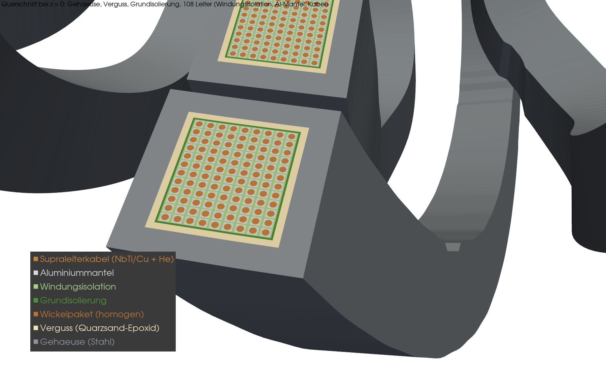 | 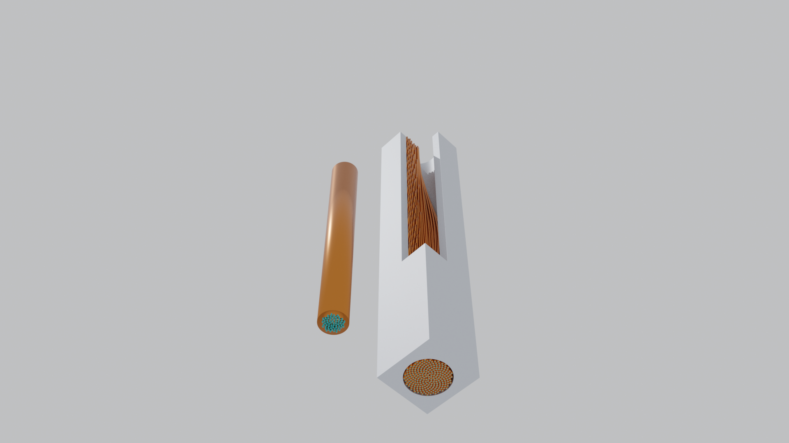 |
| Gehäuse, Verguss, Grundisolierung, 108 Leiter je Spule (Windungsisolation, Al-Mantel, Kabel) | CICC-Leiter: Strom im NbTi (türkis), Kupfer als Stabilisator, Al-Mantel und Helium stromlos |

Weitere Bilder: [Querschnitt (SVG)](docs/bilder/w7x_spule_querschnitt.svg),
[Schnitt](docs/bilder/w7x_torus3d_schnitt.png), [Sektor](docs/bilder/w7x_torus3d_sektor.png),
[geschlossen](docs/bilder/w7x_torus3d_geschlossen.png).

### Plasmagefäß mit Gyroid-Kühlkern (PicoGK, Blender)

Idee aus Neugier: die Wand des Plasmagefäßes der 1-GW-Auslegung als 0,9 m dicke Doppelhaut mit Gyroid-Kern
(Zelle 0,6 m, rund 25 % Stahl), in dem Kühlwasser durch zwei getrennte Kanalnetze laufen könnte. Erzeugt mit
PicoGK (Voxel 30 mm, je 10°-Segment ein Lauf), gerendert in Blender. Spulengehäuse farbig nach Vergleichsspannung
aus dem Surrogat (1000 MW), Feldlinien nach Biot-Savart; drei Spulen über dem Ausschnitt ausgeblendet,
Verbinder weggelassen. Reine Darstellung, keine Auslegung der Kühlung.

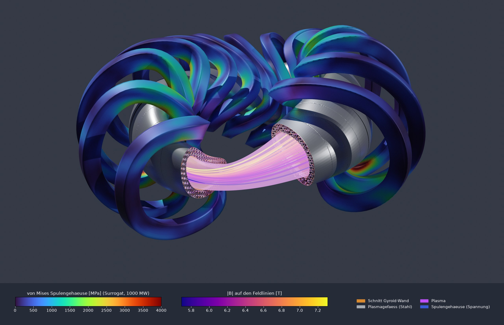

| | |
|---|---|
| 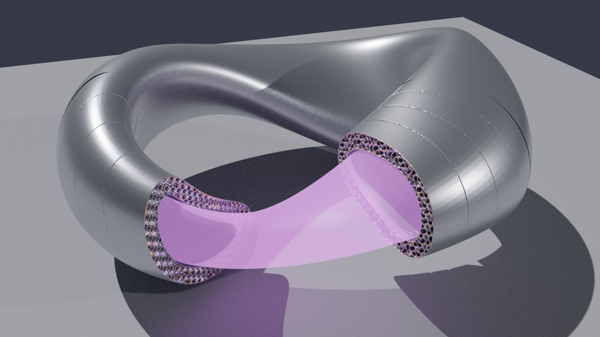 | 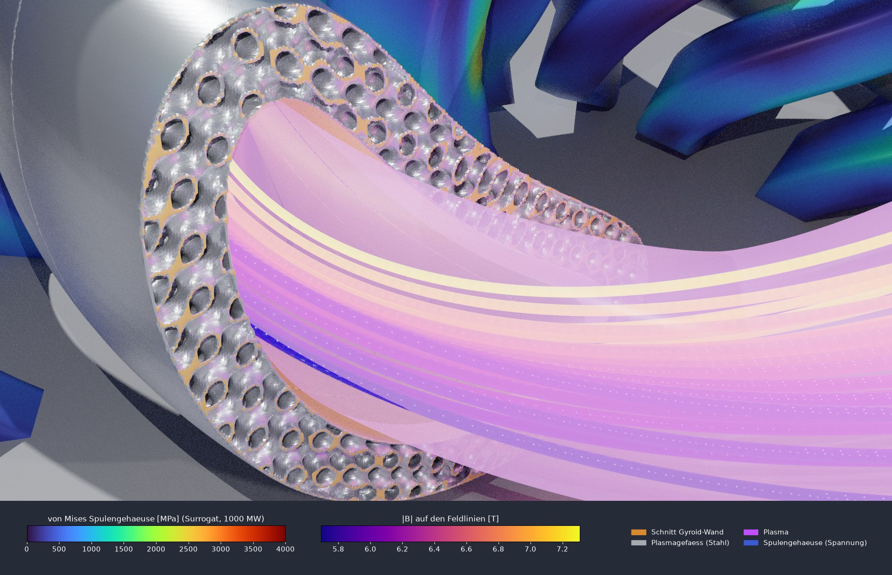 |
| Gefäß allein in Einbaulage, Schnittflächen orange | Schnittfläche: Gyroid-Filamente zwischen Innen- und Außenhaut |

Dazu ein geschlossenes Kühlsegment (1,0 × 0,4 m, Gyroid-Kern 0,2 m, je ein Ein- und Austrittsrohr) als
Fluidgebiet für eine spätere Strömungsrechnung: [Bild](docs/bilder/gyroid_kuehlsegment.jpg).
Skripte: `stellarator/gyroid_gefaess.py`, `thorus_schnitt.py`, `blender_thorus.py`, `kuehlsegment.py`;
schwere Läufe über `stellarator/speicherwaechter.py` (eigene systemd-Einheit mit Speichergrenze).

### Kühlung des Plasmagefäßes: ein Segment durchströmt (PicoGK, FluidX3D, Blender)

Aus der Darstellung wurde eine erste Rechnung. Ein 10°-Segment der Gefäßwand (85–95°) bekam einen Wasserweg:
Eintritt innen, Austritt außen, dazwischen ein Gyroid-Kern zwischen zwei schrägen Ebenen mit keilförmigen
Verteil- und Sammelkammern (Z-Verteiler). Zur Plasmaseite hin ist der Gyroid feiner (Schicht 130 mm, Zelle 100 mm).
Die Geometrie baut PicoGK, die Strömung rechnet [FluidX3D](https://github.com/ProjectPhysX/FluidX3D)
(Lattice-Boltzmann auf der GPU, 8-mm-Gitter, 259 Mio. Zellen), die Filme entstehen in Blender.
Annahme: 0,5 MW/m² auf der Plasmaseite, 13,3 MW je Segment, 10 K Erwärmung, also 319 l/s.

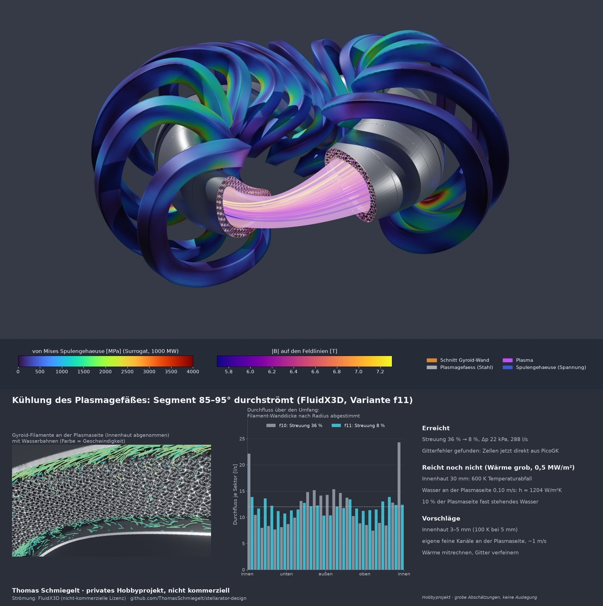

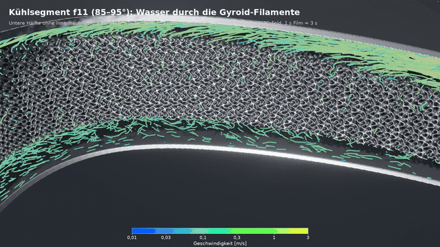

Filme: [durchsichtiges Segment](docs/filme/kuehlung_f11_durchsichtig.mp4) ·
[Fahrt in die Gyroid-Filamente](docs/filme/kuehlung_f11_gyroid.mp4) (Teilchen im berechneten Feld, 1 s Film ≈ 3 s).

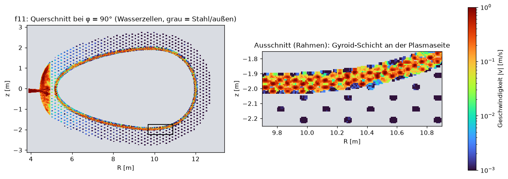

| Variante | Änderung | Streuung über den Umfang | Druckverlust |
|---|---|---|---|
| f1 | Wasser durch die Filamente statt durch ein Lochblech | 141 % | |
| f5 | Z-Verteiler nach Skizze des Nutzers | 20 % | 7,9 kPa |
| f10 | Gitterzellen direkt aus PicoGK (Fehler im Rechengitter behoben) | 36 % | 22,6 kPa |
| **f11** | **Wanddicke der vorderen Filamente nach Radius (4,9–5,8 mm)** | **8 %** | **22,0 kPa** |

**Was gelernt wurde:**
- Die Verteilung lässt sich über die Wanddicke der Filamente abgleichen (f11: 10,3–13,9 l/s je Sektor). Sie
  reagiert aber sehr steil: grob Faktor 3,7 im Durchfluss je Millimeter Wand.
- Zwei Bänder ohne Wasser (f6–f9) waren kein Konstruktionsfehler. FluidX3D hatte beim Umwandeln des feinen
  Gyroid-Netzes in Gitterzellen eine ganze Lage zu Stahl gemacht. Seit f10 liefert PicoGK die Zellen direkt.
- **Die Kühlung reicht so noch nicht** (grobe 1D-Abschätzung, `stellarator/kuehlung_waerme.py`):
  - Die 30 mm dicke Innenhaut allein kostet 600 K.
  - An der Plasmaseite fließt das Wasser nur mit 0,10 m/s (h ≈ 1200 W/m²K).
  - Auf 10 % der Plasmaseite steht es fast still.

**Verbesserungsvorschläge:**
1. Innenhaut 3–5 mm, eventuell mit Schutzschicht aus Wolfram.
2. Plasmaseite schneller durchströmen: dünnere vordere Schicht oder eigener Erstwand-Kreislauf mit feinen
   Kanälen und etwa 1 m/s.
3. Totwassergebiete finden und beseitigen.
4. Robuster abgleichen, mit Drosseln statt Wanddicke.
5. Wärme gekoppelt mitrechnen.
6. Gitterstudie mit 4–6 mm.

Mehr dazu im Projektbericht (Abschnitt „Kühlung“). Wie Mensch und KI dabei zusammengearbeitet haben, einschließlich
Skizzen als Eingabe und der Fehlersuche, steht in [docs/kuehlsegment_prozess.md](docs/kuehlsegment_prozess.md).
Das Skizzen-Werkzeug gibt es auch allgemein als eigenes Repo:
[sketch-to-prompt](https://github.com/ThomasSchmiegelt/sketch-to-prompt).

> **FluidX3D-Lizenz:** FluidX3D ist kostenlos nur für nicht kommerzielle Nutzung, der
> Quelltext ist einsehbar, es ist aber **keine** Open-Source-Lizenz und nicht MIT. Es ist hier nicht enthalten.
> Die geänderten Dateien (`setup.cpp`, `defines.hpp`) liegen gekennzeichnet mit Originallizenz in
> [fluidx3d/](fluidx3d/). Quellen: siehe unten.

Skripte: `stellarator/kuehlung_segment.py` (Auslegung, Geometrie über `picogk/SegmentKuehlung`),
`kuehlung_cfd.py` (FluidX3D, Auswertung), `kuehlung_waerme.py`, `stroemung_animation.py` +
`blender_stroemung.py` (Filme, Schnitt mit `picogk/StlSchnitt`), `gesamtbild_kuehlung.py`; Skizzen:
`skizze.py`/`skizze.html`, `draufsicht.py`, `modell_ansicht.py`.

### Doppeltes Filament, Platz zu den Spulen, Flüssigblei (grobe Abschätzungen)

Aus den Vorschlägen oben: Die Plasmaseite bekommt eigene feine Kanäle (innen, Kühlung), dahinter trägt ein
**trockener** Gyroid (außen, Steifigkeit). Beides ist getrennt.

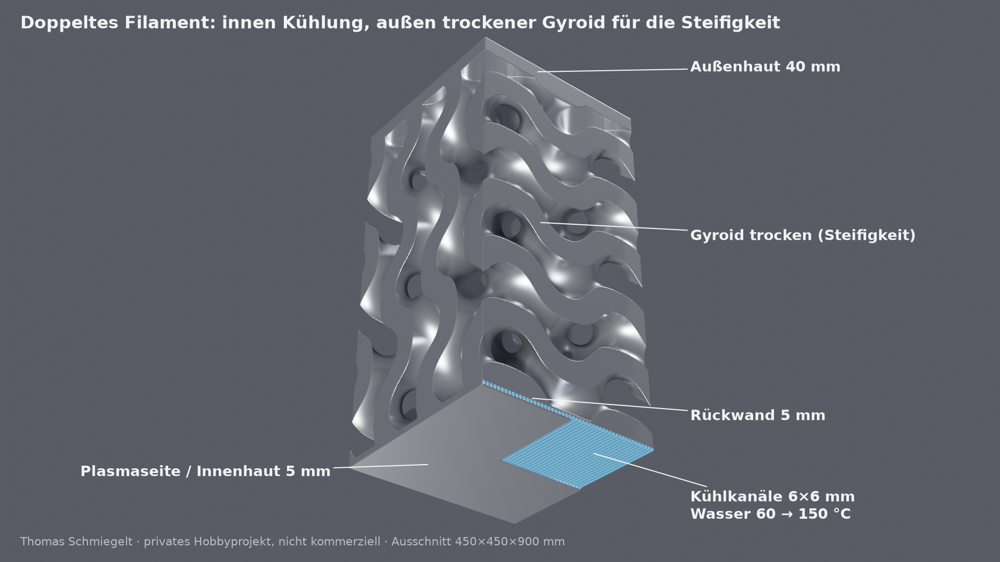

- **Wasser 60 → 150 °C bei 2 MPa** (`stellarator/erstwand_kanal.py`, 1D + Elmer-Querschnitt):
  - Kanäle 6×6 mm, je 3 hintereinander geschaltet, 1–2 m/s, Druckverlust 49 kPa.
  - Stahl höchstens 300 °C, Kanalwand 202 °C, also unter der Siedetemperatur von 212 °C.
  - Nachteil: Wärme mit 150 °C lässt sich kaum verstromen.
- **Platz zu den Spulen** (`stellarator/gefaess_abstand.py`):
  - Vom Plasmarand zum Spulengehäuse mindestens 1,25 m, zu den Verbindern 1,70 m, im gerechneten Segment 1,88 m.
  - Wand mit Spalt (1,05 m) plus 5 cm Sicherheitsabstand passt überall.

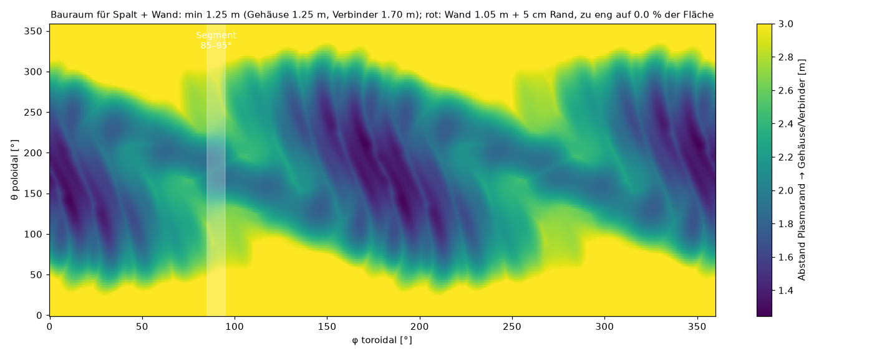

- **Flüssiges Blei oder Bleilithium statt Wasser** (`stellarator/blei_kanal.py`):
  - Wärmetauscher Blei → Wasser **nicht** in der Wand:
    - Blei erstarrt bei 327 °C am kalten Wasser.
    - Ein Leck direkt am Plasma wäre gefährlich.
    - Das Blei bringt die Wärme stattdessen zu einem Dampferzeuger außerhalb der Spulen.
  - Im Magnetfeld (6 T) bremsen induzierte Ströme das Metall, wenn es quer zum Feld fließt:
    - Toroidal laufende Kanäle liegen fast entlang des Feldes: 247 kPa mit Stahlwand, 27 kPa mit isolierender Schicht.
    - Poloidal sind es 21 MPa, durch einen Gyroid 14 MPa. **Ein Gyroid eignet sich für Flüssigmetall nicht.**
  - Variante b5:
    - Kanäle 10×10 mm, Innenhaut 3 mm, Blei 340 → 420 °C.
    - Stahl höchstens 537 °C.
    - Pumpleistung etwa 0,2 % der Wärme.
  - Nicht enthalten: Zusatzverluste in Kehren und Verteilern, Korrosion. Die Stoffwerte sind nicht an Quellen
    geprüft.

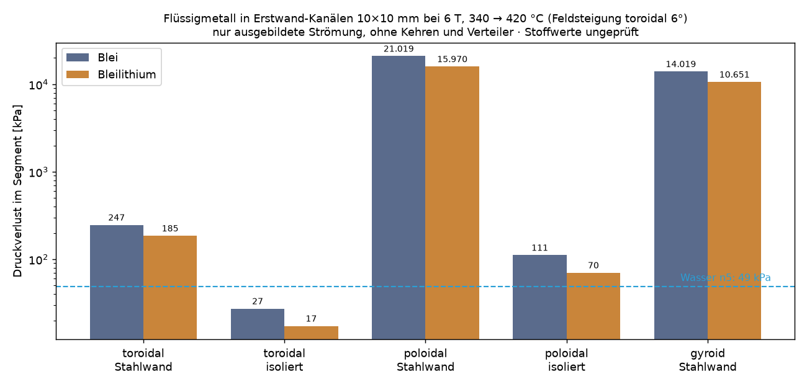

---

## Aufbau

```
stellarator/                 Bestandspipeline (.venv)
  spulen.py                  Spulensätze (W7-X aus Fourier-Daten oder Datei), Biot-Savart (numba),
                             Kalibrierung, Wickelpaket-Netz
  feldlinien.py              Feldlinienverfolgung (RK4 in phi), Poincaré, iota
  bewerte.py                 Bewertungsfunktion Fall → Kennzahlen (~4–10 s), Schnittstelle für Optimierer/Agenten
  ansicht.py                 3D-Feldlinien + Spulen → ParaView (.vtm) und PNG
  cad.py                     Wickelpakete als STL/STEP (gmsh/OpenCASCADE), Spaltprüfung, Elmer-Netz
  elmer.py                   ElmerFEM-Magnetostatik (CoilSolver + WhitneyAV), Vergleich mit Biot-Savart
  struktur.py                Stützschale: Elmer Magnetfeld → Lorentzkraft → Spannung (ein Lauf)
  gehaeuse.py, freecad_vss.py  Spulengehäuse + Verbinder als parametrisches FreeCAD-Modell (Variable Section Sweep / Loft)
  gehaeuse_fem.py            Gehäuse (STEP) → gmsh → Elmer: Lorentzkraft → Spannung
  freecad_*.py, aufbau.py    FreeCAD: Ansicht, Reparatur über die Parametertabelle, Vereinigen; Aufbauprüfung mit Video
  gehaeuse_netz.py           Gehäuse OHNE CAD-Kern (Rechteckrohre, Entflechtung) → Elmer-Spannung (robuster Weg)
  torus3d.py, leiter3d.py    3D-Schnittmodell (Schichten, 108 Leiter je Spule) und CICC-Leiterdetail, glTF-Export
  blender_szene.py           glTF → Blender (Materialien, Licht, Kamera, Cycles-Render)
  paraview_feldlinien.py     ParaView: Gehäusespannung + Feldlinien; bild_querschnitt.py: Querschnitt als SVG
  bericht.py                 Bericht (LaTeX/PDF) automatisch aus den Ergebnisdateien
  lauf.py                    Gesamtpipeline W7-X (Geometrie → PicoGK-Voxel → FFT-Solver → Feldlinien → Kräfte)
  voxelsolver.py, picogk_bruecke.py   FFT-Voxel-Feldlöser, Anbindung an PicoGK
  faelle/*.json              Falldateien (Eingabe)
  daten/W7-X.dat             W7-X-Spulenfilamente (aus simsopt, MIT), siehe daten/QUELLE.md
invers/                      Inverser Entwurf (.venv-opt)
  stufe0_bilanz.py           Stufe 0: Leistungsbilanz P_netz → R0, B0 (je Supraleiter), Falldateien
  stufe1_desc.py             Stufe 1: Plasmaform mit DESC (GPU)
  stufe2_spulen.py           Stufe 2: Spulenoptimierung mit simsopt
  beispiele/                 precise QA (Referenz) und qa_nfp2 (eigene Form: wout, Spulen, 1-GW-Bilanz)
picogk/StellaratorVoxel/     PicoGK-Headless-App (C#/.NET 9): Voxelkörper, Gehäuse, SDF
picogk/SegmentKuehlung/      PicoGK: Kühlsegment (Gyroid-Kern, Kammern, Rohre), Belegung der Gitterzellen für FluidX3D
picogk/StlSchnitt/           PicoGK: Bauteil aufschneiden, Innenhaut abnehmen (für die Filme)
picogk/GyroidTest/           PicoGK: Prüfwürfel Gyroid-Wandanteil gegen Formel
fluidx3d/                    geänderte FluidX3D-Dateien (FluidX3D-Lizenz, NICHT MIT)
sim/pipeline/gerader_draht/  Validierung ElmerFEM gegen analytischen Draht (2D)
forschung/                   Recherche und Analysen
docs/bilder/                 Bilder für dieses README
BEFUNDE.md                   Befund-Log: Beobachtung, Messung, Fundstelle, Status (inkl. gefundener Fehler)
ERINNERUNGEN.md              Entscheidungen, nächste Schritte, Übergabe an Agenten
```

Rechenergebnisse (`sim/stellarator/`, `sim/invers/`) sind nicht im Repository. Sie sind groß und lassen sich reproduzieren.

## Installation

Linux, Python 3.12. Für Stufe 1 ist eine NVIDIA-GPU empfohlen.

```bash
# Bestandspipeline
python3 -m venv .venv && .venv/bin/pip install -r requirements.txt
# Inverser Entwurf: EIGENE Umgebung (andere numpy/JAX-Versionen)
python3 -m venv .venv-opt && .venv-opt/bin/pip install -r requirements-opt.txt
```

Systemwerkzeuge:
- **ElmerFEM 9.0** (Ubuntu-PPA `elmer-csc-ubuntu`), für `stellarator.elmer`,
- **ParaView** zum Ansehen,
- **FreeCAD 1.1** (AppImage von github.com/FreeCAD/FreeCAD/releases, abgelegt als
  `~/Applications/FreeCAD_1.1.4.AppImage`), für `stellarator.gehaeuse`,
- optional **PicoGK** mit .NET 9, für `stellarator.lauf` im Voxelmodus.

Referenzrechner: 32 GB RAM, RTX 3090 (24 GB).

## Schnellstart

```bash
# W7-X bewerten (Feldlinien, iota, Kräfte, Spalt) – ~10 s
.venv/bin/python -m stellarator.bewerte stellarator/faelle/w7x_standard.json --bild
# Variante: Planarspulen bestromen
.venv/bin/python -m stellarator.bewerte stellarator/faelle/w7x_standard.json --name pc_plus --bild \
    --setze spulen.stroeme_Awdg.PCA=200000 --setze spulen.stroeme_Awdg.PCB=200000
# 3D-Feldlinien ansehen
.venv/bin/python -m stellarator.ansicht stellarator/faelle/w7x_standard.json --oeffnen

# Inverse Kette: kompakter QA-Stellarator
.venv-opt/bin/python invers/stufe1_desc.py --name qa_nfp2                     # Plasmaform (GPU, ~20–40 min)
.venv-opt/bin/python invers/stufe2_spulen.py --wout sim/invers/qa_nfp2/wout_qa_nfp2.nc --name qa_nfp2_spulen
.venv/bin/python -m stellarator.bewerte stellarator/faelle/ref_precise_QA.json --bild   # Prüfung des mitgelieferten Beispiel-Spulensatzes
# Auslegung auf 1 GW netto (R0, B0 je Supraleiter) und Prüfung in voller Größe
.venv-opt/bin/python invers/stufe0_bilanz.py --name qa_nfp2_1GW --form invers/beispiele/qa_nfp2 \
    --spulen invers/beispiele/qa_nfp2/spulen.json --fall_vorlage stellarator/faelle/qa_nfp2.json \
    --k_B Nb3Sn=2.5,HTS=2.42 --f_I 1.09
.venv/bin/python -m stellarator.bewerte stellarator/faelle/qa_nfp2_1GW_HTS.json --bild

# Spulengehäuse parametrisch in FreeCAD (~35 s; FreeCAD-AppImage unter ~/Applications)
.venv/bin/python -m stellarator.gehaeuse stellarator/faelle/qa_nfp2_A45_1GW_HTS.json --oeffnen

# FEM: ElmerFEM mit allen 70 W7-X-Spulen (~12 min, ~10 GB RAM)
.venv/bin/python -m stellarator.elmer sim/stellarator/elmer_w7x_70 --spulen 70 --B0 2.5 --h_spule 0.05 --h_luft 0.8
```

## Validierung und gefundene Fehler

Das Projekt dokumentiert offen, was geprüft wurde und was sich als falsch herausgestellt hat (`BEFUNDE.md`):

- **Analytisch:** ElmerFEM gegen den geraden Draht (2D). Der Elmer-Referenzfall läuft durch (TEST.PASSED), Abweichung ≤ 2 %.
- **Voxel-FFT-Solver gegen Biot-Savart:** auf den Flussflächen Median 0,25 %.
- **ElmerFEM 3D gegen Biot-Savart:** Einzelspule mit Netzkonvergenz 7 % → 2,8 % → 1,9 %. Alle 70 Spulen: 0,24 % auf der Achse.
- **B-011:** Ein früheres parametrisches Modell war keine Stellarator-Topologie. Es wurde verworfen und durch die realen W7-X-Filamente ersetzt.
- **B-016:** Die übernommene Referenzachse hatte in Z das falsche Vorzeichen. Dadurch war die Stromkalibrierung um 10 % zu niedrig (12,18 statt 13,49 kA). Die Achse wird jetzt als Fixpunkt der Feldlinienabbildung bestimmt.
- **B-016:** Der Elmer-CoilSolver ignoriert das Vorzeichen der Stromvorgabe. Mittelpunkt und Normale je Spule werden deshalb jetzt explizit vorgegeben, und die Stromrichtung wird automatisch geprüft.

## Stand und nächste Schritte

- [x] W7-X: Geometrie, Feld, Feldlinien, Kräfte, Spalt, CAD/STL, ElmerFEM (70 Spulen)
- [x] Bewertungsfunktion als Optimierungsschnittstelle
- [x] Inverse Kette Plasmaform → Spulen → Prüfung (an der Referenz precise QA verifiziert)
- [x] Eigene Plasmaform optimieren (Stufe 1 `qa_nfp2`), Spulen dazu
- [x] Größe (R0) und Feld (B0) aus 1 GW netto ableiten (Stufe 0), Wickelpakete aus Stromdichte
- [x] Kleineres Seitenverhältnis (A = 4,5) → HTS 10,4 m, Nb₃Sn 12,4 m
- [x] Stützschale in Elmer (A = 6): Spannungen aus Lorentzkräften
- [x] Spulengehäuse für A = 4,5 als parametrisches FreeCAD-Modell (Variable Section Sweep)
- [x] Gehäuse verbinden, STEP → gmsh → Elmer-Spannungen für A = 4,5 (Kette läuft)
- [x] W7-X-Gehäuse kollisionsfrei (CAD: Nachbarschnitt) und Spannungsrechnung über den Rechenweg ohne CAD-Kern
- [x] 3D-Schnittmodell mit Verguss, Isolierung und Supraleitern; Leiterdetail; ParaView und Blender
- [x] Projektberichte (de/en, drei Zielgruppen) mit geprüften Quellen
- [x] Kühlsegment des Plasmagefäßes: Gyroid-Wasserweg (PicoGK), Strömung (FluidX3D), Verteilung 8 % Streuung
- [ ] Erstwand-Kühlung: dünne Innenhaut, schnelle Kanäle, Wärme gekoppelt rechnen
- [ ] Wandstärken und Verbinder auslegen (zulässige Spannung einhalten)
- [ ] Verguss (Quarzsand-Epoxid) zwischen Wickelpaket und Gehäuse in Geometrie und Rechnung
- [ ] Verbinder und Tragring im Rechenweg statt eingespannter Bereiche; Keil und Gehäuse aus einem Stück
- [ ] Stufe 0 genauer: Divertor-Wärmelast, Zyklotronstrahlung, Blanket-Dicke aus Neutronik
- [ ] Studien-Runner (Agent wählt Ziele, numerischer Optimierer rechnet)
- [ ] Allgemeiner Weg STL → STEP

## Quellen und Danksagung

- W7-X-Spulenfilamente und Referenzachse: [simsopt](https://github.com/hiddenSymmetries/simsopt) (MIT), Spulensatz `w7x_v001` (IPP).
- Plasmaform-Optimierung: [DESC](https://github.com/PlasmaControl/DESC). Spulenoptimierung: simsopt.
- FEM: [ElmerFEM](https://www.elmerfem.org). Netze: [gmsh](https://gmsh.info). CAD: [FreeCAD](https://www.freecad.org).
- Visualisierung: [PyVista](https://pyvista.org), [ParaView](https://www.paraview.org), [Blender](https://www.blender.org).
- KI-Agenten: [Hermes Agent](https://github.com/NousResearch/hermes-agent) (Nous Research, MIT), [Claude Code](https://www.anthropic.com/claude-code) (Anthropic).
- Voxel-Geometrie (Gyroid-Kern, Kühlsegment): [PicoGK](https://github.com/leap71/PicoGK) (LEAP 71, Apache 2.0).
- Strömung: [FluidX3D](https://github.com/ProjectPhysX/FluidX3D) v3.8 (Lizenz nur nicht
  kommerziell, nicht Open Source; geänderte Dateien in [fluidx3d/](fluidx3d/)). Zitiert nach Vorgabe der Lizenz:
  - M. Lehmann: Computational study of microplastic transport at the water-air interface with a memory-optimized lattice Boltzmann method. PhD thesis, Univ. Bayreuth (2023). [doi:10.15495/EPub_UBT_00006977](https://doi.org/10.15495/EPub_UBT_00006977)
  - M. Lehmann: Esoteric Pull and Esoteric Push: Two Simple In-Place Streaming Schemes for the Lattice Boltzmann Method on GPUs. Computation 10, 92 (2022). [doi:10.3390/computation10060092](https://doi.org/10.3390/computation10060092)
  - M. Lehmann, M. Krause, G. Amati, M. Sega, J. Harting, S. Gekle: Accuracy and performance of the lattice Boltzmann method with 64-bit, 32-bit, and customized 16-bit number formats. Phys. Rev. E 106, 015308 (2022)
  - M. Lehmann: Combined scientific CFD simulation and interactive raytracing with OpenCL. IWOCL'22: International Workshop on OpenCL, 3, 1–2 (2022)
  - M. Lehmann, L. M. Oehlschlägel, F. Häusl, A. Held, S. Gekle: Ejection of marine microplastics by raindrops: a computational and experimental study. Micropl. & Nanopl. 1, 18 (2021). [doi:10.1186/s43591-021-00018-8](https://doi.org/10.1186/s43591-021-00018-8)
  - M. Lehmann: High Performance Free Surface LBM on GPUs. Master's thesis, Univ. Bayreuth (2019). [doi:10.15495/EPub_UBT_00005400](https://doi.org/10.15495/EPub_UBT_00005400)
  - M. Lehmann, S. Gekle: Analytic Solution to the Piecewise Linear Interface Construction Problem and Its Application in Curvature Calculation for Volume-of-Fluid Simulation Codes. Computation 10, 21 (2022). [doi:10.3390/computation10020021](https://doi.org/10.3390/computation10020021)
- Fachliteratur: siehe Literaturverzeichnisse der [Projektberichte](bericht/projektbericht/).

## Lizenz

[MIT](LICENSE) © 2026 Thomas Schmiegelt

Ausnahme: Der Ordner [fluidx3d/](fluidx3d/) enthält geänderte FluidX3D-Dateien unter der FluidX3D-Lizenz (nicht MIT).
*Exception: the folder `fluidx3d/` holds altered FluidX3D files under the FluidX3D licence (not MIT).*
