# stellarator-design

**Stellarator-Entwurf mit offenen Werkzeugen: vom benötigten Magnetfeld zur Spulengeometrie, geprüft mit Feldlinien, FEM und CAD.**

> 🛠️ **Ein Hobbyprojekt, aus Neugier entstanden.**
> Ich bin kein Fusionsforscher. Dieses Projekt ist privat und aus reiner Neugier entstanden: Wie funktioniert
> ein Stellarator, und wie weit kommt man mit offenen Werkzeugen und KI-Unterstützung (Claude Code, Hermes)?
> Es gibt keine Verbindung zu einem Forschungsinstitut oder Unternehmen. Die Ergebnisse sind nicht
> begutachtet, enthalten vereinfachende Annahmen und können Fehler haben. Sie sind **keine**
> Auslegung einer realen Anlage. Hinweise und Korrekturen sind willkommen.
>
> *A hobby project, born out of curiosity. Not affiliated with any research institution or company;
> results are not peer-reviewed and may contain errors.*

*English summary:* Open-source workflow for stellarator magnet design. Instead of starting from coils, the
design question is inverted: *which magnetic field is needed, and which coil geometry produces it?*
Stage 1 optimizes the plasma boundary (DESC, GPU), stage 2 finds coils that produce that field
(simsopt), stage 3 independently verifies field lines, rotational transform, forces and coil
clearances, builds the winding-pack geometry (STL/STEP) and runs 3-D magnetostatics in ElmerFEM.
Validated on the real Wendelstein 7-X coil set. Documentation is in German.

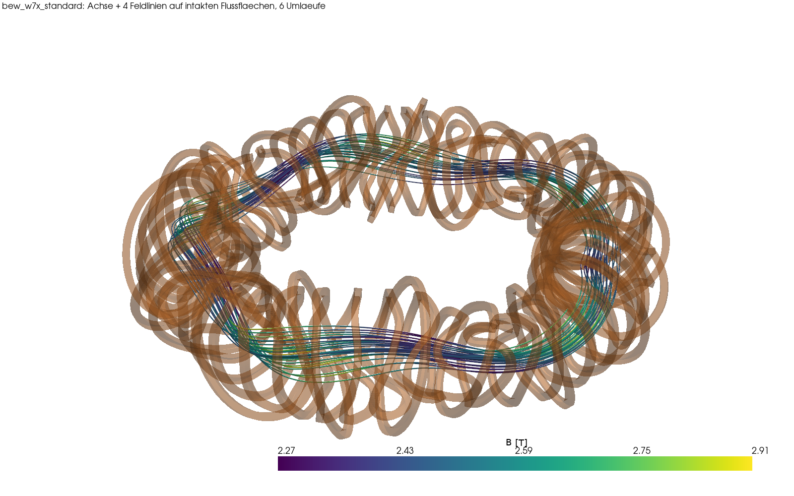

---

## Worum geht es?

Ein Stellarator schließt ein heißes Plasma allein mit äußeren, verdrillten Magnetspulen ein. Ob
das gelingt, entscheidet die Form des Magnetfelds, also Flussflächen, Rotationstransformation iota
und Einschlusseigenschaften. Die Spulen sind nur das Mittel dazu. Dieses Projekt baut deshalb
einen durchgehenden, nachvollziehbaren Rechenweg auf:

0. **Wie groß muss die Anlage sein?** Aus der Netzleistung (z. B. 1 GW) folgen über eine
   Leistungsbilanz die Fusionsleistung, die Größe R0 und das Feld B0, je nach Supraleiter.
1. **Welches Magnetfeld wird gebraucht?** Aus physikalischen Zielen wird eine Plasmaform optimiert.
   Ziele sind Quasisymmetrie, Seitenverhältnis und iota.
2. **Welche Spulen erzeugen dieses Feld?** Spulenkurven werden so optimiert, dass das Feld
   tangential zum Plasmarand verläuft (B·n ≈ 0). Dabei gelten technische Grenzen:
   Länge, Krümmung und Abstände.
3. **Stimmt es, und lässt es sich bauen?** Eine unabhängige Prüfung umfasst
   - Biot-Savart, Feldlinien und Poincaré-Schnitte,
   - iota, intakte Flussflächen, Spiegelverhältnis, B_max an den Spulen und Lorentzkräfte,
   - die Spaltprüfung zwischen den Wickelpaketen,
   - die Volumengeometrie (STL/STEP) und die FEM-Magnetostatik in ElmerFEM.

Als Referenz und zur Validierung dient der reale Spulensatz von **Wendelstein 7-X** (70 Spulen).
Erstes Entwurfsziel ist ein **kompakter, quasi-axisymmetrischer Stellarator** mit 2 Feldperioden.

Die Werkzeugkette ist für die Steuerung durch KI-Agenten gebaut (Hermes, PI, Claude Code):
- Jeder Schritt ist ein Kommandozeilenaufruf mit JSON-Ein- und Ausgabe.
- Lange Rechnungen laufen losgelöst.
- Befunde und Übergaben stehen in `BEFUNDE.md` und `ERINNERUNGEN.md`.

> **Hinweis:** Hobby- und Lernprojekt (siehe oben). Die Ergebnisse sind keine Auslegung einer realen Anlage.
> Die Leistungsbilanz ist eine 0-D-Abschätzung; Stützstruktur und Strukturmechanik sind noch nicht ausgelegt.

---

## Ergebnisse

### Auslegung auf 1 GW ins Netz (Stufe 0 → 3)

Ein Kraftwerk mit **1000 MW netto** braucht rund **3 GW Fusionsleistung**. 80 % davon tragen Neutronen
ins Blanket (Wärme → Dampf → Turbine), 20 % die Alpha-Teilchen, die das Plasma heizen.
Stufe 0 (`invers/stufe0_bilanz.py`, 0-D-Leistungsbilanz) sucht die kleinste Anlage, die Wandlast,
Plasmadruck (β), Dichte (Sudo), Einschluss (ISS04) und das Leiterfeld der Supraleiter einhält.
Stufe 3 prüft das Ergebnis mit den realen Spulen in voller Größe.

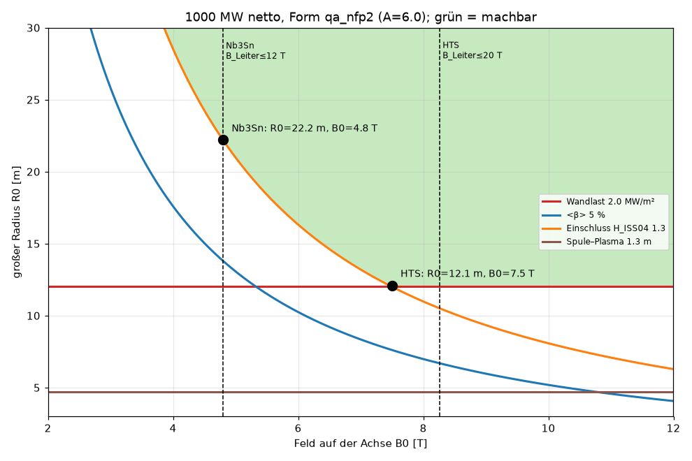

| | HTS (Hochtemperatur-Supraleiter) | Nb₃Sn (erprobt) |
|---|---|---|
| großer Radius R0 / kleiner Radius a | **12,1 m** / 2,0 m | **22,2 m** / 3,7 m |
| Feld auf der Achse B0 | **7,5 T** | **4,8 T** |
| Feld am Leiter (Stufe 3) | 17,7 T (Grenze 20 T) | 11,6 T (Grenze 12 T) |
| Strom je Spule, Wickelpaket | 31 MA, 0,88 × 0,88 m | 36 MA, 1,56 × 1,56 m |
| Spalt zwischen Wickelpaketen | 0,58 m | 1,13 m |
| Netto-Kraft je Spule (max.) | 2200 MN | 3000 MN |
| begrenzt durch | Einschluss + Neutronen-Wandlast | Einschluss + Leiterfeld |

Feldlinien und Flussflächen bleiben beim Hochskalieren intakt (12/12, iota 0,422 → 0,411).
**Offen ist vor allem die Stützstruktur**: Die Kräfte sind etwa 1000-mal so groß wie bei W7-X.
Ein kleineres Seitenverhältnis würde die Anlage verkleinern (HTS: A = 4 → R0 ≈ 10 m).
Zur Einordnung: Das ist eine 0-D-Abschätzung (±30 %), kein Kraftwerksentwurf.

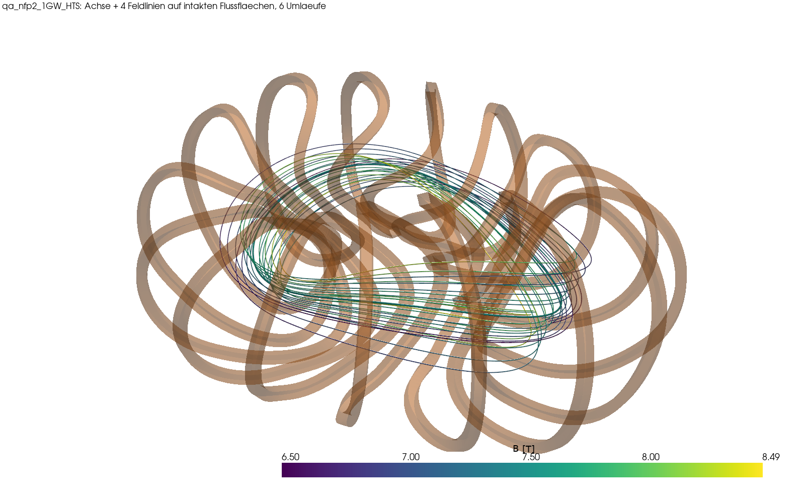

### Kompaktere Form A = 4,5 und Stützstruktur

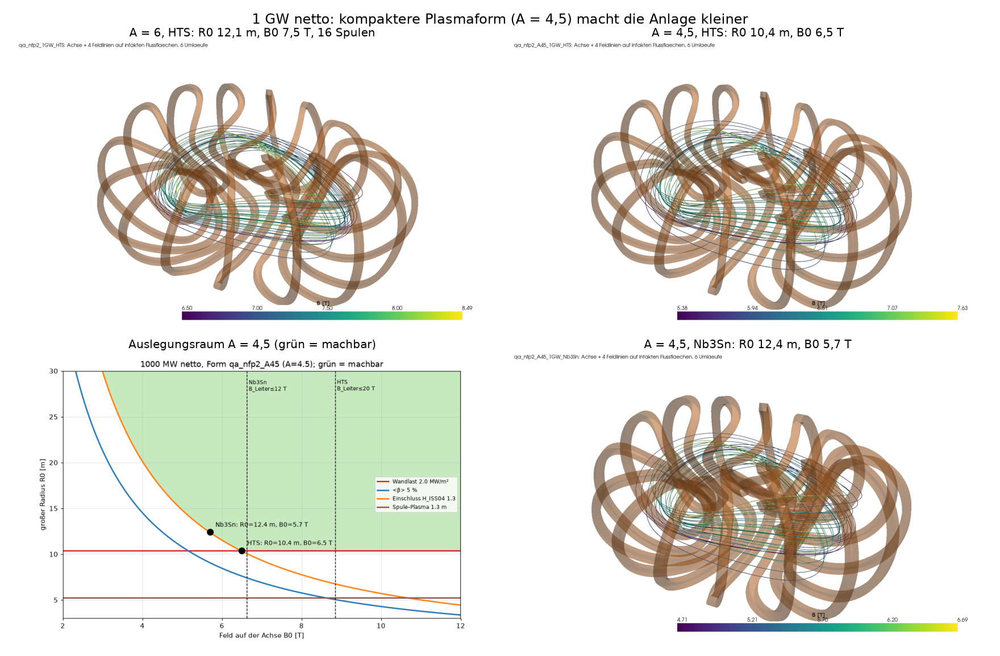

| 1 GW netto | A = 6, HTS | A = 6, Nb₃Sn | **A = 4,5, HTS** | **A = 4,5, Nb₃Sn** |
|---|---|---|---|---|
| R0 / B0 | 12,1 m / 7,5 T | 22,2 m / 4,8 T | **10,4 m / 6,5 T** | **12,4 m / 5,7 T** |
| Feld am Leiter | 17,7 T | 11,6 T | 14,7 T | 10,9 T |
| Spalt Wickelpakete | 0,58 m | 1,13 m | 0,55 m | 0,19 m |
| Kraft je Spule (max.) | 2200 MN | 3000 MN | 1200 MN | 1300 MN |

**Stützschale in ElmerFEM** (ein gekoppelter Lauf: Magnetfeld → Lorentzkraft J×B → Spannung),
A = 6 mit HTS: Stahlschale 1,48 m dick (~51 kt), 99 % der Schale unter 587 MPa (zulässig ~667 MPa,
netzkonvergiert), örtliche Spitzen bis ~1000 MPa auf der Torus-Innenseite, Verformung 36 mm.
Elmer und Biot-Savart liefern dieselbe Kraft je Spule (2,9 % Abweichung).
Eine durchgehende Schale lässt sich für A = 4,5 nicht sauber bauen (Flächen durch die Spulen falten sich).

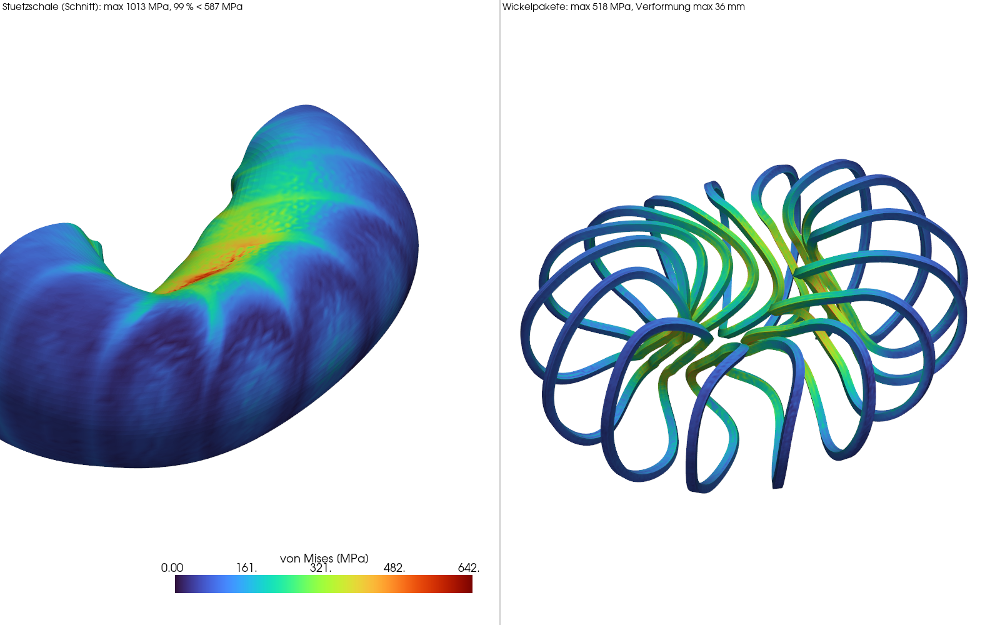

**Spulengehäuse als „Variable Section Sweep“ in FreeCAD** (Idee aus der CAD-Praxis, wie das
gleichnamige Creo-Feature): Je Spule eine geschlossene 3D-Kurve durch Punkte als *Innenseite* des
Gehäuses, 40 Skizzen senkrecht dazu, ein Loft hindurch. Alles wächst nur nach außen, deshalb
überschneidet sich auf der engen Plasmaseite nichts. Das Modell ist parametrisch: Eine Tabelle
„Parameter“ steuert Wandstärken und Wickelpaket. Die Außenwand ist dort dicker, wo die Lorentzkraft
groß ist. 12 der 16 Gehäuse sind Symmetrie-Klone der 4 Basisspulen.
A = 4,5 mit HTS: 16 gültige Volumenkörper, keine Überlappung, ~3,6 kt Stahl, Abweichung zwischen
Loft und Spule ≤ 15 mm. Benachbarte Gehäuse sind durch 160 Verbinder gekoppelt (ebenfalls Lofts,
5 eigene Paare, Rest Symmetrie-Klone).

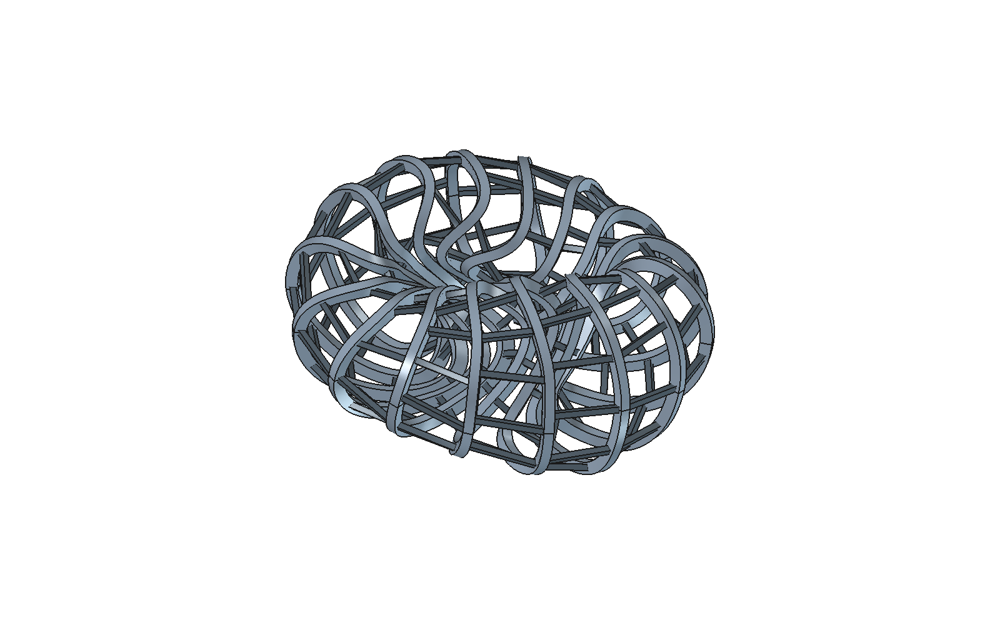

Erste Elmer-Rechnung dazu (gleiche Kette wie oben, Geometrie als STEP aus FreeCAD): Sie läuft durch,
aber die geschätzten Wandstärken (0,1 m, zusammen ~5 kt Stahl) sind viel zu dünn. Im Mittel 1150 MPa,
99 % unter ~5100 MPa, Verformung bis 0,65 m. Am stärksten belastet sind die Torus-Innenseite und die
Anschlüsse der Verbinder. Die Wandstärken müssen also noch ausgelegt werden.

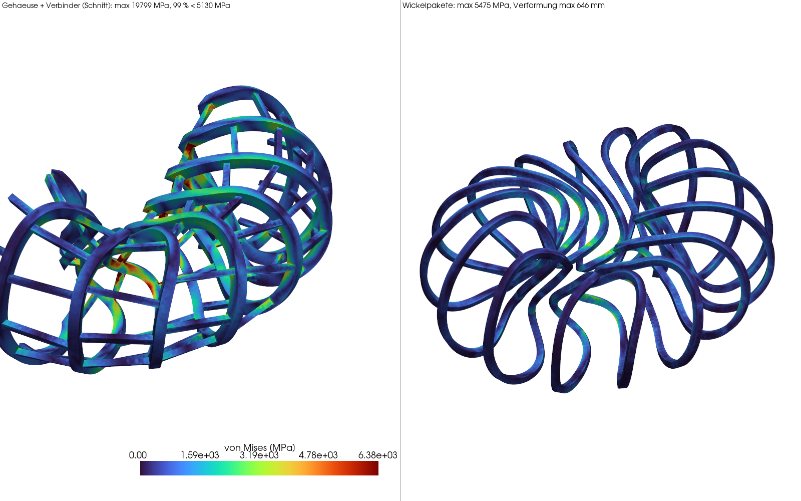

### Eigene kompakte Plasmaform `qa_nfp2` (Stufe 1 + 2)

| | |
|---|---|
| 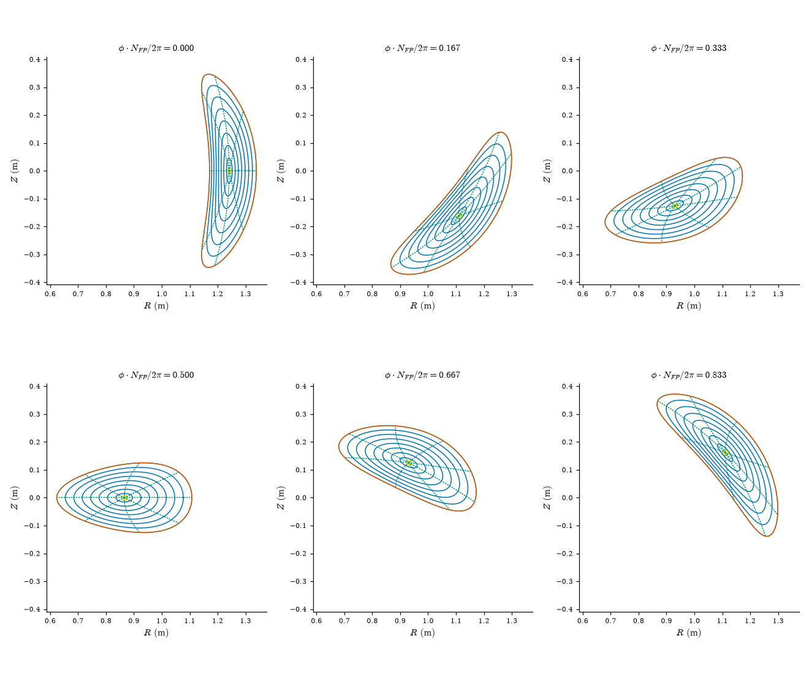 | 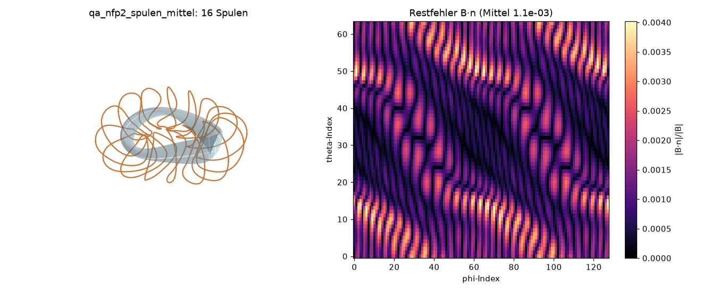 |
| **Stufe 1 (DESC):** nfp = 2, A = 6, Quasisymmetrie-Fehler 1,3·10⁻⁵ (Referenz precise QA: 5,8·10⁻⁵), iota 0,423 → 0,415 | **Stufe 2 (simsopt):** 16 Spulen, \|B·n\|/\|B\| 0,11 % Mittel, 0,40 % max. |

### Referenzform precise QA (Verifikation der inversen Kette)

Zielform: DESC-Referenz *precise QA* (nfp = 2, Seitenverhältnis 6, iota ≈ 0,42), skaliert auf R0 = 1 m und B0 = 1 T.

| | |
|---|---|
| 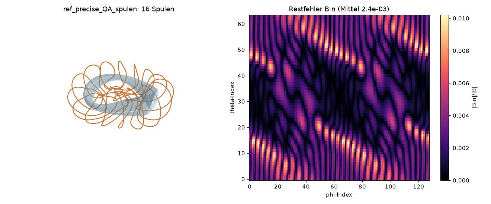 | 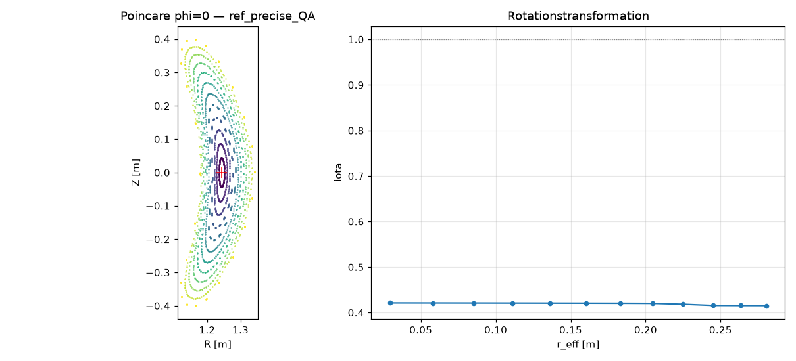 |
| **Stufe 2:** 16 Spulen (4 Basisspulen + Symmetrie), Restfehler \|B·n\|/\|B\| im Mittel 0,24 %, max. 1,0 % | **Stufe 3:** geschachtelte Flussflächen, iota 0,421 → 0,415 (Ziel 0,42) |

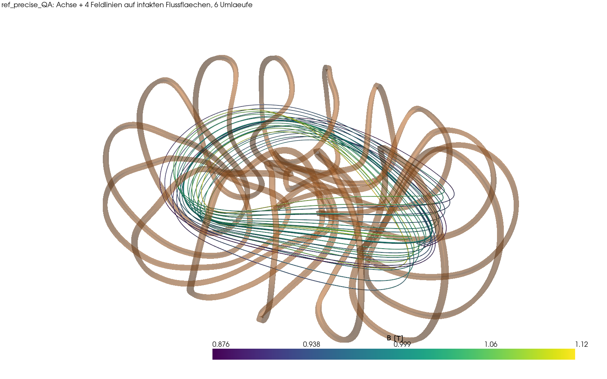

| Kennzahl | Wert |
|---|---|
| Restfehler \|B·n\|/\|B\| auf dem Plasmarand | 0,24 % (Mittel), 1,0 % (max.) |
| iota Achse → Rand (unabhängige Feldlinienrechnung) | 0,421 → 0,415 |
| Spiegelverhältnis auf der Achse | 0,16 % (Kennzeichen der Quasi-Axisymmetrie) |
| Spule–Plasma / Spule–Spule (Mittellinie) | 0,30 m / 0,10 m |
| Gesamtlänge der 4 Basisspulen, kleinster Biegeradius | 18,0 m, 0,18 m |

### Wendelstein 7-X (Validierung mit realen Spulen)

| | |
|---|---|
| 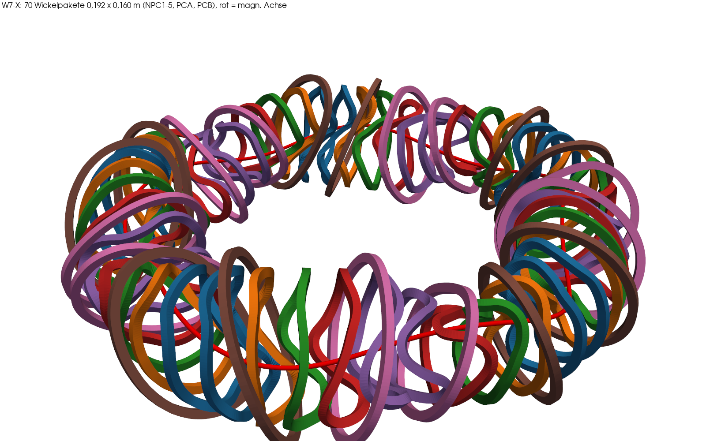 | 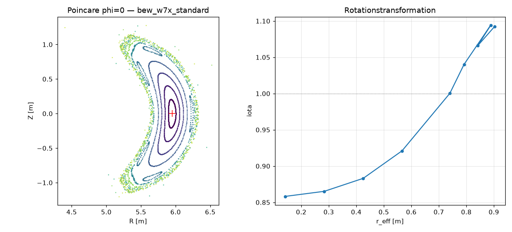 |
| 70 Wickelpakete (0,192 × 0,160 m), kollisionsfrei, min. Spalt 68 mm | Bohnenförmige Flussflächen, 5/5-Inselkette bei iota = 1 |

| Kennzahl (Standardkonfiguration, mittleres \|B\| auf der Achse = 2,5 T) | Wert |
|---|---|
| Strom je Windung (NPC, 108 Windungen) | 13,49 kA |
| \|B\| auf der Achse min / Mittel / max | 2,40 / 2,50 / 2,62 T |
| iota Achse → letzte intakte Fläche (r_eff 0,57 m) | 0,858 → 0,921 |
| B_max an der Wickeloberfläche (Filament-Biot-Savart) | 4,52 T |
| Netto-Lorentzkraft NPC1 | 2,05 MN |
| kleinster Spalt zwischen Wickelpaketen | 68 mm (NPC2–NPC3) |

**ElmerFEM gegen Biot-Savart (alle 70 Spulen, 3,28 Mio. Tetraeder):** |B| auf der Achse 2,504 T gegenüber
2,501 T, Abweichung im Median 0,24 % und höchstens 1,1 %. Nahe den Spulen liegt sie bei etwa 5 %, das
entspricht der Netzweite von 5 cm.

| | |
|---|---|
| 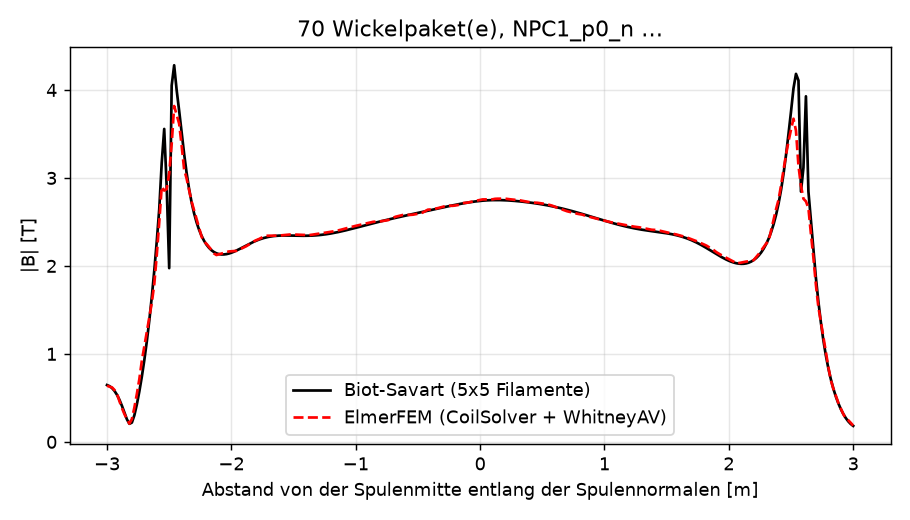 | 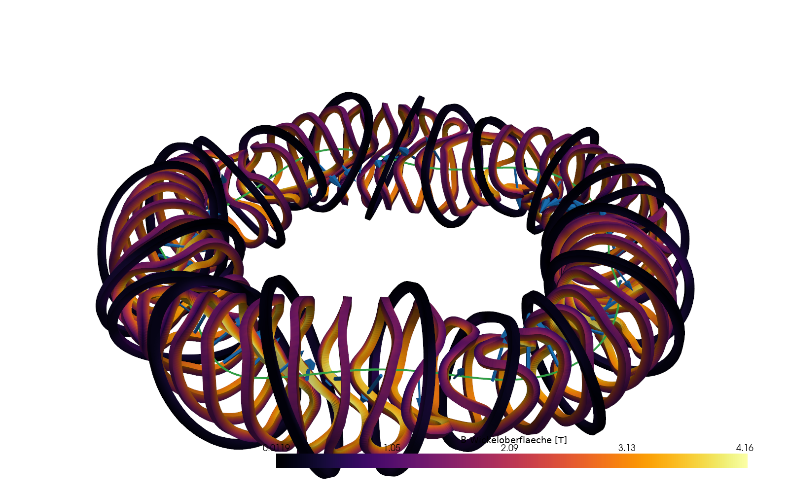 |

Weitere Bilder: [Voxel-FFT-Solver gegen Biot-Savart](docs/bilder/w7x_voxelsolver_validierung.png),
[Poincaré Biot-Savart/Voxel](docs/bilder/w7x_poincare_biotsavart_voxel.png),
[PicoGK-Gehäuse](docs/bilder/w7x_picogk_gehaeuse.png).

---

## Aufbau

```
stellarator/                 Bestandspipeline (.venv)
  spulen.py                  Spulensätze (W7-X aus Fourier-Daten oder Datei), Biot-Savart (numba),
                             Kalibrierung, Wickelpaket-Netz
  feldlinien.py              Feldlinienverfolgung (RK4 in phi), Poincaré, iota
  bewerte.py                 Bewertungsfunktion Fall → Kennzahlen (~4–10 s), Schnittstelle für Optimierer/Agenten
  ansicht.py                 3D-Feldlinien + Spulen → ParaView (.vtm) und PNG
  cad.py                     Wickelpakete als STL/STEP (gmsh/OpenCASCADE), Spaltprüfung, Elmer-Netz
  elmer.py                   ElmerFEM-Magnetostatik (CoilSolver + WhitneyAV), Vergleich mit Biot-Savart
  struktur.py                Stützschale: Elmer Magnetfeld → Lorentzkraft → Spannung (ein Lauf)
  gehaeuse.py, freecad_vss.py  Spulengehäuse + Verbinder als parametrisches FreeCAD-Modell (Variable Section Sweep / Loft)
  gehaeuse_fem.py            Gehäuse (STEP) → gmsh → Elmer: Lorentzkraft → Spannung
  bericht.py                 Bericht (LaTeX/PDF) automatisch aus den Ergebnisdateien
  lauf.py                    Gesamtpipeline W7-X (Geometrie → PicoGK-Voxel → FFT-Solver → Feldlinien → Kräfte)
  voxelsolver.py, picogk_bruecke.py   FFT-Voxel-Feldlöser, Anbindung an PicoGK
  faelle/*.json              Falldateien (Eingabe)
  daten/W7-X.dat             W7-X-Spulenfilamente (aus simsopt, MIT), siehe daten/QUELLE.md
invers/                      Inverser Entwurf (.venv-opt)
  stufe0_bilanz.py           Stufe 0: Leistungsbilanz P_netz → R0, B0 (je Supraleiter), Falldateien
  stufe1_desc.py             Stufe 1: Plasmaform mit DESC (GPU)
  stufe2_spulen.py           Stufe 2: Spulenoptimierung mit simsopt
  beispiele/                 precise QA (Referenz) und qa_nfp2 (eigene Form: wout, Spulen, 1-GW-Bilanz)
picogk/StellaratorVoxel/     PicoGK-Headless-App (C#/.NET 9): Voxelkörper, Gehäuse, SDF
sim/pipeline/gerader_draht/  Validierung ElmerFEM gegen analytischen Draht (2D)
forschung/                   Recherche und Analysen
docs/bilder/                 Bilder für dieses README
BEFUNDE.md                   Befund-Log: Beobachtung, Messung, Fundstelle, Status (inkl. gefundener Fehler)
ERINNERUNGEN.md              Entscheidungen, nächste Schritte, Übergabe an Agenten
```

Rechenergebnisse (`sim/stellarator/`, `sim/invers/`) sind nicht im Repository. Sie sind groß und lassen sich reproduzieren.

## Installation

Linux, Python 3.12. Für Stufe 1 ist eine NVIDIA-GPU empfohlen.

```bash
# Bestandspipeline
python3 -m venv .venv && .venv/bin/pip install -r requirements.txt
# Inverser Entwurf: EIGENE Umgebung (andere numpy/JAX-Versionen)
python3 -m venv .venv-opt && .venv-opt/bin/pip install -r requirements-opt.txt
```

Systemwerkzeuge:
- **ElmerFEM 9.0** (Ubuntu-PPA `elmer-csc-ubuntu`), für `stellarator.elmer`,
- **ParaView** zum Ansehen,
- **FreeCAD 1.1** (AppImage von github.com/FreeCAD/FreeCAD/releases, abgelegt als
  `~/Applications/FreeCAD_1.1.4.AppImage`), für `stellarator.gehaeuse`,
- optional **PicoGK** mit .NET 9, für `stellarator.lauf` im Voxelmodus.

Referenzrechner: 32 GB RAM, RTX 3090 (24 GB).

## Schnellstart

```bash
# W7-X bewerten (Feldlinien, iota, Kräfte, Spalt) – ~10 s
.venv/bin/python -m stellarator.bewerte stellarator/faelle/w7x_standard.json --bild
# Variante: Planarspulen bestromen
.venv/bin/python -m stellarator.bewerte stellarator/faelle/w7x_standard.json --name pc_plus --bild \
    --setze spulen.stroeme_Awdg.PCA=200000 --setze spulen.stroeme_Awdg.PCB=200000
# 3D-Feldlinien ansehen
.venv/bin/python -m stellarator.ansicht stellarator/faelle/w7x_standard.json --oeffnen

# Inverse Kette: kompakter QA-Stellarator
.venv-opt/bin/python invers/stufe1_desc.py --name qa_nfp2                     # Plasmaform (GPU, ~20–40 min)
.venv-opt/bin/python invers/stufe2_spulen.py --wout sim/invers/qa_nfp2/wout_qa_nfp2.nc --name qa_nfp2_spulen
.venv/bin/python -m stellarator.bewerte stellarator/faelle/ref_precise_QA.json --bild   # Prüfung des mitgelieferten Beispiel-Spulensatzes
# Auslegung auf 1 GW netto (R0, B0 je Supraleiter) und Prüfung in voller Größe
.venv-opt/bin/python invers/stufe0_bilanz.py --name qa_nfp2_1GW --form invers/beispiele/qa_nfp2 \
    --spulen invers/beispiele/qa_nfp2/spulen.json --fall_vorlage stellarator/faelle/qa_nfp2.json \
    --k_B Nb3Sn=2.5,HTS=2.42 --f_I 1.09
.venv/bin/python -m stellarator.bewerte stellarator/faelle/qa_nfp2_1GW_HTS.json --bild

# Spulengehäuse parametrisch in FreeCAD (~35 s; FreeCAD-AppImage unter ~/Applications)
.venv/bin/python -m stellarator.gehaeuse stellarator/faelle/qa_nfp2_A45_1GW_HTS.json --oeffnen

# FEM: ElmerFEM mit allen 70 W7-X-Spulen (~12 min, ~10 GB RAM)
.venv/bin/python -m stellarator.elmer sim/stellarator/elmer_w7x_70 --spulen 70 --B0 2.5 --h_spule 0.05 --h_luft 0.8
```

## Validierung und gefundene Fehler

Das Projekt dokumentiert offen, was geprüft wurde und was sich als falsch herausgestellt hat (`BEFUNDE.md`):

- **Analytisch:** ElmerFEM gegen den geraden Draht (2D). Der Elmer-Referenzfall läuft durch (TEST.PASSED), Abweichung ≤ 2 %.
- **Voxel-FFT-Solver gegen Biot-Savart:** auf den Flussflächen Median 0,25 %.
- **ElmerFEM 3D gegen Biot-Savart:** Einzelspule mit Netzkonvergenz 7 % → 2,8 % → 1,9 %. Alle 70 Spulen: 0,24 % auf der Achse.
- **B-011:** Ein früheres parametrisches Modell war keine Stellarator-Topologie. Es wurde verworfen und durch die realen W7-X-Filamente ersetzt.
- **B-016:** Die übernommene Referenzachse hatte in Z das falsche Vorzeichen. Dadurch war die Stromkalibrierung um 10 % zu niedrig (12,18 statt 13,49 kA). Die Achse wird jetzt als Fixpunkt der Feldlinienabbildung bestimmt.
- **B-016:** Der Elmer-CoilSolver ignoriert das Vorzeichen der Stromvorgabe. Mittelpunkt und Normale je Spule werden deshalb jetzt explizit vorgegeben, und die Stromrichtung wird automatisch geprüft.

## Stand und nächste Schritte

- [x] W7-X: Geometrie, Feld, Feldlinien, Kräfte, Spalt, CAD/STL, ElmerFEM (70 Spulen)
- [x] Bewertungsfunktion als Optimierungsschnittstelle
- [x] Inverse Kette Plasmaform → Spulen → Prüfung (an der Referenz precise QA verifiziert)
- [x] Eigene Plasmaform optimieren (Stufe 1 `qa_nfp2`), Spulen dazu
- [x] Größe (R0) und Feld (B0) aus 1 GW netto ableiten (Stufe 0), Wickelpakete aus Stromdichte
- [x] Kleineres Seitenverhältnis (A = 4,5) → HTS 10,4 m, Nb₃Sn 12,4 m
- [x] Stützschale in Elmer (A = 6): Spannungen aus Lorentzkräften
- [x] Spulengehäuse für A = 4,5 als parametrisches FreeCAD-Modell (Variable Section Sweep)
- [x] Gehäuse verbinden, STEP → gmsh → Elmer-Spannungen für A = 4,5 (Kette läuft)
- [ ] Wandstärken und Verbinder auslegen (zulässige Spannung einhalten)
- [ ] Stufe 0 genauer: Divertor-Wärmelast, Zyklotronstrahlung, Blanket-Dicke aus Neutronik
- [ ] Studien-Runner (Agent wählt Ziele, numerischer Optimierer rechnet)
- [ ] Allgemeiner Weg STL → STEP

## Quellen und Danksagung

- W7-X-Spulenfilamente und Referenzachse: [simsopt](https://github.com/hiddenSymmetries/simsopt) (MIT), Spulensatz `w7x_v001` (IPP).
- Plasmaform-Optimierung: [DESC](https://github.com/PlasmaControl/DESC). Spulenoptimierung: simsopt.
- FEM: [ElmerFEM](https://www.elmerfem.org). Netze/CAD: [gmsh](https://gmsh.info). Voxel: [PicoGK](https://github.com/leap71/PicoGK).

## Lizenz

[MIT](LICENSE) © 2026 Thomas Schmiegelt
