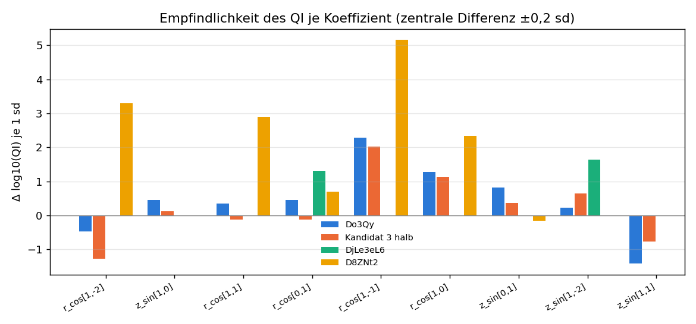
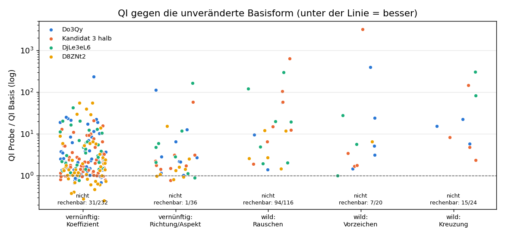
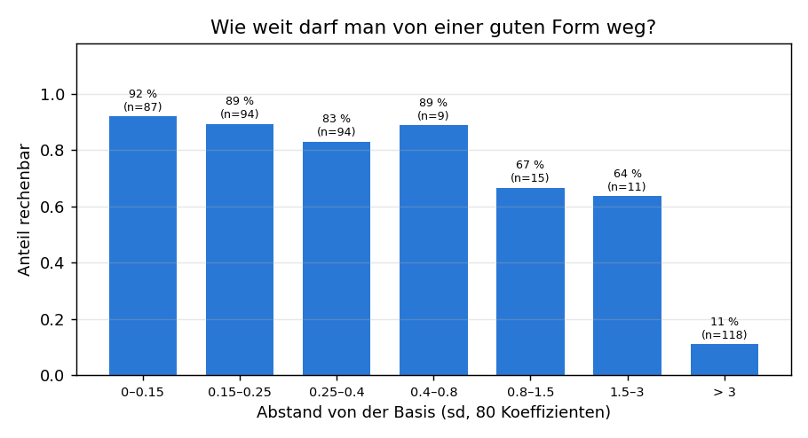
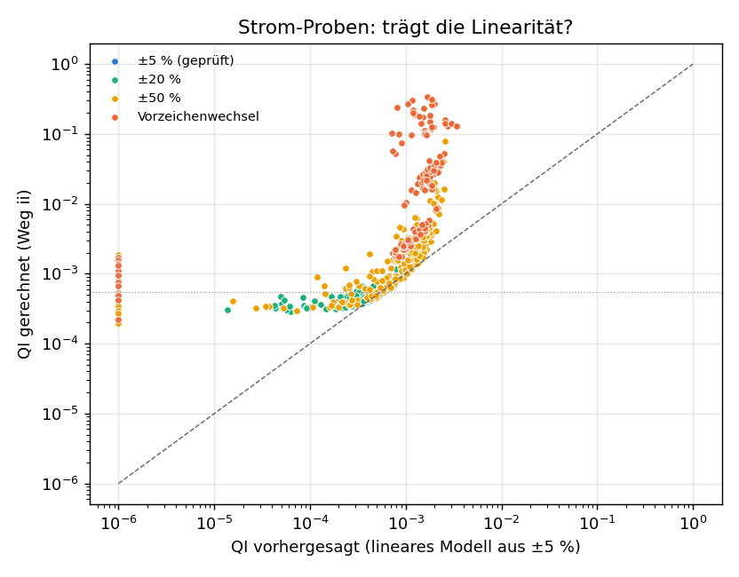

# Experimentmatrix: vernünftige und wilde Proben (automatische Auswertung)

Stand 2026-11-06 20:41. Erzeugt von `stellarator/qi_experiment.py auswertung` (Ereignisprotokoll F-252). Fertig: 432 von 432 Formproben, 850 von 850 Strom-Proben, 400 von 400 Datensatzproben. Alle Zahlen stammen aus den Ergebnisdateien; Deutungen sind als Folgerung markiert.

Nutzerwunsch (wörtlich, rechtschreiblich korrigiert): „Vielleicht kannst du das so machen, dass es vernunftbasierte Parameter in der Matrix gibt und auch einige wilde oder zufällige, einfach um Verständnis und Daten zu generieren.“

## Lesehilfe

- **QI** (Quasi-Isodynamik-Fehler): eine Zahl ohne Einheit, wie weit das Magnetfeld vom idealen Feld abweicht; 0 = ideal, kleiner ist besser. Aufgabe 3 der Rangliste verlangt QI ≤ 0,00032, Aufgabe 2 QI ≤ 0,0001 (B-051).
- **Basisform:** eine bekannte gute Plasmaform, von der aus verändert wird: Do3Qy (beste Datensatzform), Kandidat 3 halb (eigene Abwandlung), DjLe3eL6 (Form mit Spulensatz), D8ZNt2 (Startform der Filtersuche).
- **Koeffizient:** Die Plasmaoberfläche ist eine Summe von Wellen (Fourier-Reihe, r_cos und z_sin mit Index [m,n]: m Wellen ums Rohr, n Wellen den Ring entlang je Periode). Ein Koeffizient ist die Amplitude einer Welle.
- **sd (Standardabweichung):** typische Streuung eines Koeffizienten im Datensatz. 0,2 sd ist eine kleine, 2 sd eine sehr große Änderung.
- **vernünftig:** begründete Richtung (Grund steht in jeder Ergebnisdatei im Feld `grund`). **wild:** Zufall, nur für Daten und Verständnis.
- **rechenbar:** VMEC++ (der Gleichgewichtsrechner) liefert ein Ergebnis. Nicht rechenbar ist auch ein Datum (Form physikalisch/numerisch unbrauchbar).
- **Verhältnis zur Basis:** QI der Probe geteilt durch QI der unveränderten Basisform (gleich gerechnet). < 1 = besser.
- **zulässig:** jede normierte Verletzung der Aufgabe ≤ 0,01 (constellaration/problems.py), dann ist die Wertung > 0.
- **Weg ii (Strom-Proben):** Spulenfeld auf den festen Magnetflächen der offiziellen Rechnung; gegen die freie Grenze (Weg i) nur bis ±5 % Strom geprüft (B-053). Alles darüber ist ausdrücklich **außerhalb des geprüften Bereichs**.
- **R²:** Anteil der Streuung, den ein Modell erklärt (1 = alles, 0 = nichts, negativ = schlechter als der Mittelwert). LOO = jede Probe einmal weggelassen und vorhergesagt (ehrlicher als die Anpassung).

## 1 Formproben: Anteil rechenbar, QI gegen die Basis

| Basisform | QI Basis | Modus | Proben | rechenbar | besser als Basis | innerhalb Faktor 3 | ≥ 10× schlechter | Median Verhältnis | bestes Verhältnis | zul. P3 | zul. P2 |
|---|---|---|---|---|---|---|---|---|---|---|---|
| Do3Qy | 6.147e-05 | vernunft | 67 | 100 % | 13 % | 61 % | 21 % | 2.22 | 0.667 | 0 | 0 |
| Do3Qy | 6.147e-05 | wild | 40 | 28 % | 0 % | 18 % | 45 % | 9.48 | 1.4 | 0 | 0 |
| Kandidat 3 halb | 4.718e-05 | vernunft | 67 | 99 % | 15 % | 70 % | 9 % | 1.88 | 0.775 | 0 | 0 |
| Kandidat 3 halb | 4.718e-05 | wild | 40 | 38 % | 0 % | 27 % | 47 % | 8.22 | 1.69 | 0 | 0 |
| DjLe3eL6 | 0.0004475 | vernunft | 67 | 66 % | 5 % | 50 % | 23 % | 3.02 | 0.775 | 0 | 0 |
| DjLe3eL6 | 0.0004475 | wild | 40 | 30 % | 0 % | 25 % | 58 % | 19.5 | 1.01 | 0 | 0 |
| D8ZNt2 | 0.001781 | vernunft | 67 | 88 % | 29 % | 71 % | 12 % | 1.41 | 0.254 | 0 | 0 |
| D8ZNt2 | 0.001781 | wild | 40 | 15 % | 0 % | 50 % | 33 % | 4.64 | 1.45 | 0 | 0 |
| **alle** | | **vernunft** | 268 | 88 % | 16 % | 64 % | 16 % | 2.1 | 0.254 | 0 | 0 |
| **alle** | | **wild** | 160 | 28 % | 0 % | 27 % | 48 % | 8.85 | 1.01 | 0 | 0 |
| **alle** | | **wild >= 1 sd / Kreuzung** | 85 | 13 % | 0 % | 9 % | 64 % | 22.4 | 2.37 | 0 | 0 |

Basis-Pruefstein (unveraenderte Form neu gerechnet): D8ZNt2 0.00178141, DjLe3eL6 0.000447541, Do3Qy 6.14706e-05, Kandidat 3 halb 4.71768e-05.

### Je Art der Veränderung

| Modus | Art | Proben | rechenbar | besser als Basis | Median Verhältnis | Median Abstand (sd) | typische Fehlermeldung |
|---|---|---|---|---|---|---|---|
| vernunft | aspekt | 8 | 100 % | 38 % | 1.06 | 0.33 | – |
| vernunft | koef | 232 | 87 % | 16 % | 2.09 | 0.20 | RuntimeError:  VMEC++ did not converge (27×) |
| vernunft | richtung | 24 | 96 % | 4 % | 2.51 | 0.20 | RuntimeError:  VMEC++ did not converge (1×) |
| vernunft | richtung_orth | 4 | 100 % | 25 % | 4.81 | 0.20 | – |
| wild | gauss 0.5 | 24 | 12 % | 0 % | 121 | 4.40 | RuntimeError:  Thread 0 (13×) |
| wild | gauss 1.0 | 32 | 6 % | 0 % | 200 | 8.84 | RuntimeError:  Thread 0 (29×) |
| wild | gauss 2.0 | 20 | 0 % | – | – | 17.72 | RuntimeError:  Thread 0 (19×) |
| wild | kreuz | 12 | 8 % | 0 % | 148 | 7.98 | RuntimeError:  Thread 0 (9×) |
| wild | logskala | 40 | 42 % | 0 % | 6.49 | 1.75 | RuntimeError:  Thread 0 (12×) |
| wild | misch | 12 | 67 % | 0 % | 11.8 | 4.99 | RuntimeError:  Thread 0 (2×) |
| wild | vorzeichen | 20 | 65 % | 0 % | 5.12 | 1.18 | RuntimeError:  VMEC++ did not converge (6×) |

## 2 Empfindlichkeit je Parameter (vernünftige Proben)

Zahl = Änderung von log10(QI) je 1 sd Schritt (zentrale Differenz aus +0,2 und −0,2 sd). +0,30 heißt: 1 sd in Plusrichtung verdoppelt QI; −0,30 halbiert. Leer = eine der beiden Proben nicht rechenbar.

| Koeffizient | Do3Qy | Kandidat 3 halb | DjLe3eL6 | D8ZNt2 |
|---|---|---|---|---|
| r_cos[1,-2] | -0.48 | -1.29 | – | +3.30 |
| z_sin[1,0] | +0.45 | +0.12 | – | – |
| r_cos[1,1] | +0.35 | -0.12 | – | +2.89 |
| r_cos[0,1] | +0.46 | -0.13 | +1.30 | +0.69 |
| r_cos[1,-1] | +2.29 | +2.02 | – | +5.16 |
| r_cos[1,0] | +1.28 | +1.13 | – | +2.33 |
| z_sin[0,1] | +0.82 | +0.36 | – | -0.16 |
| z_sin[1,-2] | +0.22 | +0.64 | +1.64 | -0.03 |
| z_sin[1,1] | -1.42 | -0.77 | – | – |

Linearität (wichtigster Koeffizient r_cos[1,-2]): Verhältnis zur Basis bei −0,3 / −0,2 / −0,1 / +0,1 / +0,2 / +0,3 sd

| Basisform | −0,3 | −0,2 | −0,1 | +0,1 | +0,2 | +0,3 |
|---|---|---|---|---|---|---|
| Do3Qy | 10.3 | 6.23 | 2.54 | 1.37 | 4 | 18.9 |
| Kandidat 3 halb | 9.31 | 5.75 | 2.8 | 0.975 | 1.76 | 5.2 |
| DjLe3eL6 | – | – | – | 1.49 | 4.77 | 20.3 |
| D8ZNt2 | 1.96 | 1.43 | 1.02 | 5.92 | 29.8 | 55.3 |

Lesehilfe Bild: je Koeffizient (waagerecht) vier Balken, einer je Basisform. Balken nach oben: Vergrößern des Koeffizienten verschlechtert QI; nach unten: verbessert. Fehlt ein Balken, war eine Probe nicht rechenbar.

## 3 Begründete Richtungen: vorhergesagt (lineares Datensatzmodell) gegen gerechnet

| Basisform | Probe | Abstand (sd) | rechenbar | QI-Verhältnis | Spiegel gerechnet (Basis) | Spiegel linear erwartet Δ | Elong. | Dreieck. | iota/nfp | max. Verl. P3 | zul. P3 |
|---|---|---|---|---|---|---|---|---|---|---|---|
| D8ZNt2 | aspekt f=0.95 | 0.32 | ja | 1.09 | 0.209 (0.208) | – | 4.85 | 0.407 | 0.285 | 0.225 | nein |
| D8ZNt2 | aspekt f=1.05 | 0.32 | ja | 0.923 | 0.207 (0.208) | – | 4.85 | 0.407 | 0.284 | 0.205 | nein |
| D8ZNt2 | richtung ziel=elongation vz=-1 schritt=0.2 | 0.20 | ja | 15.4 | 0.155 (0.208) | -0.014 | 5.43 | 0.432 | 0.284 | 0.554 | nein |
| D8ZNt2 | richtung ziel=dreieck vz=1 schritt=0.2 | 0.20 | ja | 1.42 | 0.198 (0.208) | +0.006 | 4.94 | 0.405 | 0.286 | 0.258 | nein |
| D8ZNt2 | richtung ziel=dreieck vz=-1 schritt=0.2 | 0.20 | ja | 0.81 | 0.219 (0.208) | -0.006 | 4.76 | 0.392 | 0.282 | 0.188 | nein |
| D8ZNt2 | richtung ziel=spiegel vz=-1 schritt=0.1 | 0.10 | ja | 1.35 | 0.2 (0.208) | -0.044 | 4.69 | 0.411 | 0.275 | 0.251 | nein |
| D8ZNt2 | richtung ziel=spiegel vz=-1 schritt=0.3 | 0.30 | ja | 2.51 | 0.189 (0.208) | -0.133 | 4.4 | 0.403 | 0.255 | 0.329 | nein |
| D8ZNt2 | richtung_orth ziel=spiegel vz=-1 schritt=0.2 | 0.20 | ja | 0.984 | 0.229 (0.208) | -0.078 | 4.6 | 0.415 | 0.275 | 0.213 | nein |
| D8ZNt2 | richtung ziel=iota vz=1 schritt=0.2 | 0.20 | ja | 1.61 | 0.182 (0.208) | -0.030 | 4.67 | 0.394 | 0.274 | 0.274 | nein |
| DjLe3eL6 | aspekt f=0.95 | 0.05 | ja | 1.14 | 0.359 (0.357) | – | 6.5 | -0.499 | 0.0905 | 1.227 | nein |
| DjLe3eL6 | aspekt f=1.05 | 0.05 | ja | 0.895 | 0.355 (0.357) | – | 6.49 | -0.499 | 0.0903 | 1.048 | nein |
| DjLe3eL6 | richtung ziel=elongation vz=-1 schritt=0.2 | 0.20 | ja | 6 | 0.326 (0.357) | -0.033 | 5.67 | -0.481 | 0.0818 | 1.131 | nein |
| DjLe3eL6 | richtung ziel=dreieck vz=1 schritt=0.2 | 0.20 | nein | – | – (0.357) | +0.037 | – | – | – | – | nein |
| DjLe3eL6 | richtung ziel=dreieck vz=-1 schritt=0.2 | 0.20 | ja | 2.09 | 0.345 (0.357) | -0.037 | 6.79 | -0.535 | 0.0894 | 1.146 | nein |
| DjLe3eL6 | richtung ziel=spiegel vz=-1 schritt=0.1 | 0.10 | ja | 4.79 | 0.269 (0.357) | -0.052 | 5.78 | -0.492 | 0.0879 | 1.155 | nein |
| DjLe3eL6 | richtung ziel=spiegel vz=-1 schritt=0.3 | 0.30 | ja | 164 | 0.173 (0.357) | -0.157 | 4.77 | -0.47 | 0.0821 | 1.249 | nein |
| DjLe3eL6 | richtung_orth ziel=spiegel vz=-1 schritt=0.2 | 0.20 | ja | 11.8 | 0.333 (0.357) | -0.072 | 6.68 | -0.51 | 0.0857 | 1.193 | nein |
| DjLe3eL6 | richtung ziel=iota vz=1 schritt=0.2 | 0.20 | ja | 2.82 | 0.306 (0.357) | -0.015 | 6.03 | -0.497 | 0.0956 | 1.171 | nein |
| Do3Qy | aspekt f=0.95 | 0.34 | ja | 1.15 | 0.404 (0.405) | – | 7.19 | -0.212 | 0.0872 | 0.810 | nein |
| Do3Qy | aspekt f=1.05 | 0.34 | ja | 1.02 | 0.405 (0.405) | – | 7.2 | -0.212 | 0.0898 | 0.794 | nein |
| Do3Qy | richtung ziel=elongation vz=-1 schritt=0.2 | 0.20 | ja | 2.86 | 0.414 (0.405) | -0.006 | 6.37 | -0.206 | 0.0831 | 0.668 | nein |
| Do3Qy | richtung ziel=dreieck vz=1 schritt=0.2 | 0.20 | ja | 2.19 | 0.416 (0.405) | +0.008 | 6.76 | -0.172 | 0.0944 | 0.687 | nein |
| Do3Qy | richtung ziel=dreieck vz=-1 schritt=0.2 | 0.20 | ja | 2.16 | 0.415 (0.405) | -0.008 | 7.7 | -0.236 | 0.0828 | 0.932 | nein |
| Do3Qy | richtung ziel=spiegel vz=-1 schritt=0.1 | 0.10 | ja | 2.69 | 0.359 (0.405) | -0.034 | 7.86 | -0.207 | 0.091 | 0.931 | nein |
| Do3Qy | richtung ziel=spiegel vz=-1 schritt=0.3 | 0.30 | ja | 113 | 0.262 (0.405) | -0.102 | 9.68 | -0.198 | 0.0959 | 1.247 | nein |
| Do3Qy | richtung_orth ziel=spiegel vz=-1 schritt=0.2 | 0.20 | ja | 6.47 | 0.367 (0.405) | -0.048 | 8.9 | -0.211 | 0.0964 | 1.142 | nein |
| Do3Qy | richtung ziel=iota vz=1 schritt=0.2 | 0.20 | ja | 12.6 | 0.342 (0.405) | -0.039 | 8.25 | -0.201 | 0.0974 | 0.993 | nein |
| Kandidat 3 halb | aspekt f=0.95 | 0.34 | ja | 1.44 | 0.449 (0.447) | – | 7.15 | -0.218 | 0.0869 | 0.808 | nein |
| Kandidat 3 halb | aspekt f=1.05 | 0.34 | ja | 0.775 | 0.447 (0.447) | – | 7.15 | -0.218 | 0.0896 | 0.791 | nein |
| Kandidat 3 halb | richtung ziel=elongation vz=-1 schritt=0.2 | 0.20 | ja | 2.26 | 0.453 (0.447) | -0.007 | 6.36 | -0.196 | 0.0821 | 0.810 | nein |
| Kandidat 3 halb | richtung ziel=dreieck vz=1 schritt=0.2 | 0.20 | ja | 1.74 | 0.457 (0.447) | +0.008 | 6.73 | -0.178 | 0.0938 | 0.828 | nein |
| Kandidat 3 halb | richtung ziel=dreieck vz=-1 schritt=0.2 | 0.20 | ja | 1.78 | 0.458 (0.447) | -0.008 | 7.77 | -0.243 | 0.0829 | 0.923 | nein |
| Kandidat 3 halb | richtung ziel=spiegel vz=-1 schritt=0.1 | 0.10 | ja | 1.5 | 0.402 (0.447) | -0.034 | 7.8 | -0.212 | 0.0904 | 0.900 | nein |
| Kandidat 3 halb | richtung ziel=spiegel vz=-1 schritt=0.3 | 0.30 | ja | 57.6 | 0.308 (0.447) | -0.102 | 9.57 | -0.202 | 0.0948 | 1.230 | nein |
| Kandidat 3 halb | richtung_orth ziel=spiegel vz=-1 schritt=0.2 | 0.20 | ja | 3.14 | 0.412 (0.447) | -0.048 | 8.82 | -0.217 | 0.096 | 1.154 | nein |
| Kandidat 3 halb | richtung ziel=iota vz=1 schritt=0.2 | 0.20 | ja | 3.14 | 0.385 (0.447) | -0.039 | 8.16 | -0.206 | 0.0969 | 0.983 | nein |

## 4 Beste und schlechteste gerechnete Formen

| Rang | Probe | QI | Verhältnis Basis | A | Spiegel | iota/nfp | f (P3) | zul. P3 | zul. P2 |
|---|---|---|---|---|---|---|---|---|---|
| 1 | k3_vernunft_56_aspekt_s20261261 | 3.655e-05 | 0.775 | 7.76 | 0.447 | 0.0896 | 1.6924 | nein | nein |
| 2 | k3_vernunft_34_koef_s20261239 | 3.706e-05 | 0.785 | 7.52 | 0.462 | 0.0935 | 1.8297 | nein | nein |
| 3 | k3_vernunft_32_koef_s20261237 | 3.796e-05 | 0.805 | 7.66 | 0.478 | 0.0987 | 1.9196 | nein | nein |
| 4 | do3_vernunft_32_koef_s20261137 | 4.099e-05 | 0.667 | 7.69 | 0.433 | 0.0987 | 1.5978 | nein | nein |
| 5 | do3_vernunft_34_koef_s20261139 | 4.197e-05 | 0.683 | 7.56 | 0.418 | 0.0936 | 1.5642 | nein | nein |
| 6 | k3_vernunft_40_koef_s20261245 | 4.49e-05 | 0.952 | 7.39 | 0.448 | 0.0882 | 1.7594 | nein | nein |
| 7 | k3_vernunft_51_koef_s20261256 | 4.525e-05 | 0.959 | 7.37 | 0.471 | 0.0811 | 1.9887 | nein | nein |
| 8 | k3_vernunft_28_koef_s20261233 | 4.581e-05 | 0.971 | 7.46 | 0.472 | 0.0948 | 1.9667 | nein | nein |
| 9 | k3_vernunft_38_koef_s20261243 | 4.59e-05 | 0.973 | 7.39 | 0.45 | 0.088 | 1.8366 | nein | nein |
| 10 | k3_vernunft_03_koef_s20261208 | 4.598e-05 | 0.975 | 7.39 | 0.437 | 0.0922 | 1.6515 | nein | nein |
| … | | | | | | | | | |
| 280 | d8z_vernunft_05_koef_s20261410 | 0.09842 | 55.3 | 11.1 | 0.291 | 0.268 | 0.5349 | nein | nein |
| 281 | d8z_vernunft_106_koef_s20261511 | 0.09842 | 55.3 | 11.1 | 0.291 | 0.268 | 0.5349 | nein | nein |
| 282 | dje_wild_73_gauss_s20261378 | 0.1323 | 296 | 6.15 | 0.84 | 0.112 | 21.4835 | nein | nein |
| 283 | dje_wild_92_misch_s20261397 | 0.1351 | 302 | 8.92 | 0.227 | 0.148 | 2.6604 | nein | nein |
| 284 | k3_wild_87_vorzeichen_s20261292 | 0.149 | 3.16e+03 | 8.05 | 0.355 | 0.0375 | 3.2967 | nein | nein |

Kleinste Verletzungssumme f (Aufgabe 3) über alle Form- und Datensatzproben: d8z_vernunft_28_koef_s20261433 f = 0.0224 (max. Verletzung 0.120); d8z_vernunft_34_koef_s20261439 f = 0.0231 (max. Verletzung 0.152); d8z_vernunft_16_koef_s20261421 f = 0.0241 (max. Verletzung 0.154); d8z_vernunft_24_koef_s20261429 f = 0.0252 (max. Verletzung 0.159); d8z_vernunft_20_koef_s20261425 f = 0.0311 (max. Verletzung 0.176).

**Zulässige Proben:** Aufgabe 3: 0, Aufgabe 2: 0 (keine).

Lesehilfe Bild: jeder Punkt eine gerechnete Probe, Farbe = Basisform. Senkrecht das QI-Verhältnis zur Basis (logarithmisch: jede Teilung Faktor 10). Die gestrichelte Linie ist die Basis; Punkte darunter sind besser. Unten steht, wie viele Proben der Gruppe VMEC++ nicht rechnen konnte.

Lesehilfe Bild: Proben nach ihrem Abstand von der Basisform gruppiert (Abstand = Länge der Änderung über alle 80 freien Koeffizienten, in sd). Balkenhöhe = Anteil, den VMEC++ rechnen konnte.

## 5 Datensatz-Zufallsstichprobe

- 400 Formen gerechnet, davon 352 mit QI (88 %); im Datensatz ohne QI-Wert waren 48.
- Nachrechnung gegen den Datensatzwert: Median relative Abweichung 2.91e-07, größte 5.16e-03.
- Rand ist die schlechteste Fläche bei 271 von 351 Formen (Vergleich B-052 und Profil-Serie).
- QI der Stichprobe: Median 0.0175, 10.–90. Perzentil 0.0025 bis 0.0575 (Bezug: wie gut ist eine beliebige Datenform gegen die wilden Proben).
- Zulässig nach Aufgabe 3: 0, nach Aufgabe 2: 0.

## 6 Strom-Proben (DjLe3eL6, Weg ii): wie linear ist QI in den Strömen?

QI am Rand der Basis (Weg ii): 0.000554422 (B-053: 0,000554). Proben gerechnet: 819 von 850; im geprüften Bereich ±5 %: 150, außerhalb: 669.

| Menge | Proben | R² linear (Anpassung) | R² linear (LOO) | R² log10 (LOO) | R² mit Modell aus ±5 % vorhergesagt | QI < Basis | bestes QI | dazu Faktoren |
|---|---|---|---|---|---|---|---|---|
| ±5 % (geprüft) | 150 | 0.969 | 0.966 | 0.972 | 0.969 | 76 | 0.0003919 | 1.050, 1.019, 0.991, 1.017, 0.960 |
| ±20 % (außerhalb) | 250 | 0.823 | 0.812 | 0.934 | 0.662 | 107 | 0.0002634 | 1.164, 1.175, 0.855, 0.966, 0.800 |
| ±50 % (außerhalb) | 250 | 0.289 | 0.225 | 0.889 | 0.027 | 99 | 0.0001916 | 1.192, 1.390, 0.750, 0.627, 0.501 |
| Vorzeichenwechsel (außerhalb) | 169 | 0.804 | 0.790 | 0.971 | -0.365 | 10 | 0.0002236 | 1.162, 1.167, 1.025, 1.114, -0.804 |

Lineares Modell aus ±5 % (QI = a + Σ b_g · Faktor_g): b_S1 = -0.00111, b_S2 = -0.000444, b_S3 = -0.000639, b_S4 = -0.000388, b_S5 = +0.00282 (a = 0.000319). Hinweis: Alle Ströme gemeinsam ändern QI nicht (Skaleninvarianz), daher ist die Summe der b nahe 0 zu erwarten.

Gezielte Richtungen (vernünftig):

| Probe | Grund | Faktoren S1..S5 | QI Rand | gegen Basis | Spiegel Rand |
|---|---|---|---|---|---|
| basis | Bezug (kalibrierte Stroeme) | 1.000, 1.000, 1.000, 1.000, 1.000 | 0.00055442 | +0.0% | 0.3588 |
| alle1.05 | Pruefstein: alle gemeinsam aendert QI nicht (B-053) | 1.050, 1.050, 1.050, 1.050, 1.050 | 0.00055442 | +0.0% | 0.3588 |
| b053opt | Optimum B-053 (L-BFGS-B, +-5 %) | 1.000, 1.050, 1.015, 0.980, 0.950 | 0.00040751 | -26.5% | 0.3756 |
| b054flecken | Trimmung schlechteste 5 % (B-054) | 1.000, 1.050, 1.050, 1.050, 0.950 | 0.00041254 | -25.6% | 0.3708 |
| s5_0.95 | staerkster Hebel S5 -5 % (B-053) | 1.000, 1.000, 1.000, 1.000, 0.950 | 0.00041782 | -24.6% | 0.3698 |
| grad_ab_voll | gegen die lineare QI-Ableitung je Gruppe (B-053), groesster Schritt 5 % | 1.014, 1.008, 1.015, 1.017, 0.950 | 0.00040356 | -27.2% | 0.3721 |
| grad_ab_halb | gegen die Ableitung, halber Schritt (Linearitaet) | 1.007, 1.004, 1.008, 1.009, 0.975 | 0.00044669 | -19.4% | 0.3651 |
| grad_auf_voll | mit der Ableitung (Verschlechterung, Linearitaet) | 0.986, 0.992, 0.985, 0.983, 1.050 | 0.00072275 | +30.4% | 0.3509 |

Lesehilfe Bild: waagerecht die Vorhersage des einfachen Modells, das nur aus den ±5-%-Proben gelernt wurde, senkrecht der gerechnete Wert. Liegen die Punkte auf der gestrichelten Linie, ist QI dort linear in den Strömen. Punkte links am Rand: Modell sagt QI ≤ 0 vorher (unmöglich, die Linearität ist dort gebrochen). Gepunktete Linie: QI der Basis. Außerhalb ±5 % ist schon das Werkzeug (Weg ii) nicht geprüft.

## 7 Erwartung F-252 gegen Ergebnis (automatisch verglichen)

| Erwartung (vorher) | gemessen | Urteil |
|---|---|---|
| vernünftig zu 85–95 % rechenbar | 88 % | getroffen |
| vernünftig: QI innerhalb Faktor 3 der Basis (Großteil) | 64 % der rechenbaren | getroffen |
| vernünftig: 10–30 % besser als die Basis | 16 % | getroffen |
| wild (≥ 1 sd, Kreuzung) nur 20–50 % rechenbar | 13 % | verfehlt |
| wild: QI meist 10- bis 1000-fach schlechter (Median) | Median 22.4 | getroffen |
| keine wilde Probe zulässig nach Aufgabe 3 | 0 | getroffen |
| Strom ±5 %: lineares Modell R² > 0,95 | 0.966 (LOO) | getroffen |
| Strom ±50 %: R² deutlich niedriger | 0.225 (LOO) | getroffen |
| Strom ±50 %: einzelne Proben mit QI < Basis | 99 | getroffen |

## 8 Belegt, Folgerung, offen

**Belegt** (gemessen, aus den Dateien):

- Anteil rechenbar: vernünftig 88 %, wild gesamt 28 %, wild ≥ 1 sd/Kreuzung 13 %.
- Besser als die eigene Basis: vernünftig 16 %, wild 0 % der rechenbaren Proben.
- Zulässige Formen: Aufgabe 3 0, Aufgabe 2 0.
- Strom: lineares Modell im geprüften Bereich R² (LOO) 0.966, bei ±50 % 0.225.

**Folgerung** (Deutung, regelbasiert erzeugt; vom Menschen prüfen):

- Vernünftige Proben sind mindestens so oft besser wie wilde: lokales Suchen um gute Formen bleibt der richtige Weg; Zufall liefert vor allem Daten über die Grenzen der Rechenbarkeit.
- Die Linearität bricht schon bei ±20 % ein: Weg ii nicht für Optimierungen über ±5 % nutzen, ohne Gegenprüfung mit freier Grenze (Weg i).
- Die Wirkung einzelner Koeffizienten unterscheidet sich je Basisform (Tabelle Abschnitt 2); eine allgemeine Regel ‚Koeffizient X senken hilft‘ gibt es nur, wenn alle vier Vorzeichen gleich sind.

**Offen:**

- Strom-Proben außerhalb ±5 % mit freier Grenze (Weg i, VMEC++ free-boundary) gegenprüfen; erst dann sind sie physikalisch belastbar.
- Die CSV `sim/qi_flaeche/experiment/alle_proben.csv` (alle Proben, Koeffizienten, Kennzahlen, Verletzungen, Fehler) als Lerndaten nutzen: z. B. Klassifikator ‚rechenbar ja/nein‘ und Surrogat nahe der Basisformen.
- Beste Proben (Abschnitt 4) als Startformen für eine weitere lokale Suche prüfen; Spulen für neue Formen fehlen.

## English summary

Experiment matrix requested by the user (reasoned plus wild/random parameter variations, for understanding and data, not for the optimum). Shape probes around four base plasmas (Do3Qy, candidate 3 half step, DjLe3eL6, D8ZNt2) were evaluated with VMEC++ at the official high-fidelity settings; coil-current probes use the fixed-surface perturbation model (way ii) for DjLe3eL6, validated only within ±5 %. Completed: 432/432 shape probes, 850/850 current probes, 400/400 random dataset shapes. Computable: reasoned 88 %, wild 28 % (≥ 1 sd or crossover 13 %). Better than their base: reasoned 16 %, wild 0 %. Feasible for problem 3 (MHD-stable QI): 0; problem 2: 0. Linear model QI ~ currents: R² (leave-one-out) 0.966 within ±5 %, 0.225 at ±50 % (outside the validated range). All samples, coefficients, metrics, violations and error messages are in sim/qi_flaeche/experiment/alle_proben.csv. Interpretations are rule-generated and need human review.

