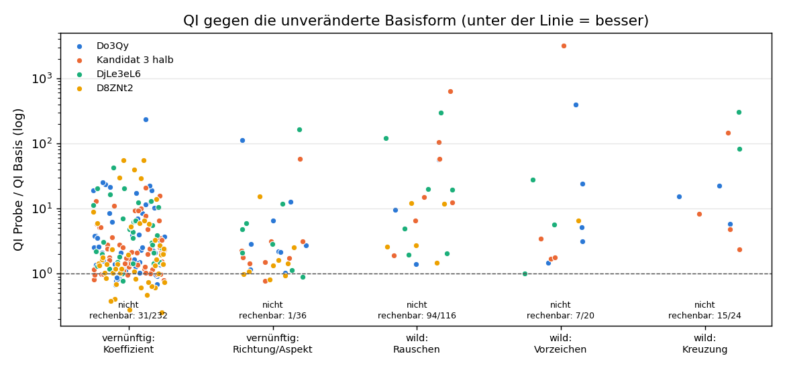
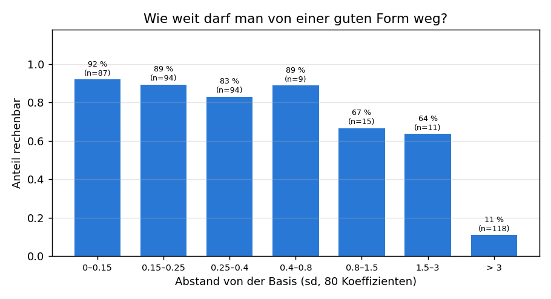
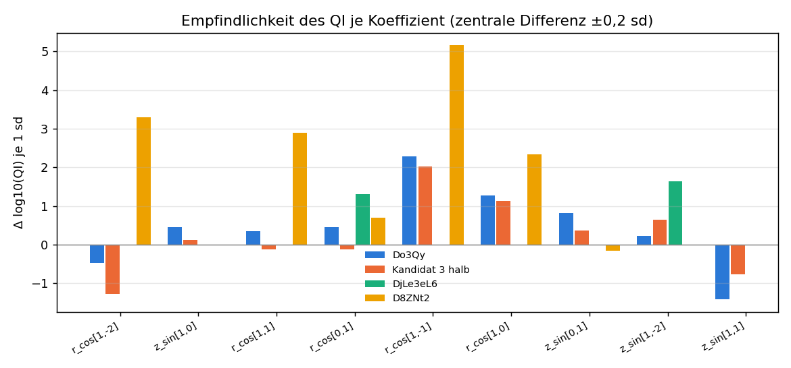
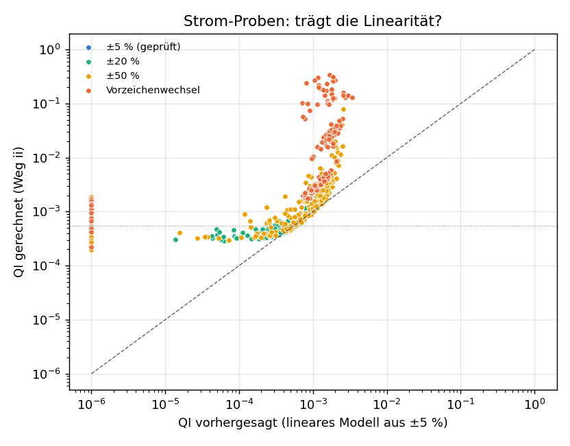

# Bericht: Die Experimentmatrix – 1 682 Proben, ein Rechenvorgang (2026-11-06)

*English summary at the end.*

> **Korrektur 2026-11-07 (Prüfung durch Opus, B-061).** Vier Aussagen der ersten Fassung waren falsch oder irreführend und sind unten berichtigt: (1) Das Empfindlichkeitsbild zeigt keine Stellschrauben-Richtung: Bei 18 von 27 Koeffizienten wird QI nach beiden Seiten schlechter. (2) f ist keine Summe der Verletzungen, sondern die Summe ihrer Quadrate. (3) Die Stromverbesserung erkauft man mit einem schlechteren Spiegelverhältnis. (4) Die Faustregel „bis 1 sd sicher rechenbar“ gaben die Daten nicht her.

Dieser Bericht beschreibt den Rechenvorgang „Experimentmatrix“ (Ereignisprotokoll F-252, F-253), seine Ergebnisse und die vier Bilder der automatischen Auswertung. Die vollständigen Tabellen stehen in `qi_experiment.md` (gleicher Ordner). Jede Aussage ist als **belegt** (aus den Ergebnisdateien), **Folgerung** (Deutung) oder **offen** gekennzeichnet. Die Bilder habe ich einzeln angesehen; was ich darauf sehe und was nicht, steht jeweils dabei.

## 1 Wozu das Ganze?

Die vorherigen Suchen (B-051) fanden keine Plasmaform, die die Bedingungen der Aufgaben 2 und 3 erfüllt. Statt weiter blind zu suchen, sollte eine große, **ohne Aufsicht laufende Rechenmatrix** Daten erzeugen, mit denen man verstehen kann,

1. wie empfindlich QI auf einzelne Formparameter reagiert,
2. wie weit man von einer guten Form wegdarf, bevor die Rechnung scheitert,
3. wie linear QI in den Spulenströmen ist (damit man weiß, wie weit man dem einfachen Modell trauen darf).

Der Nutzerwunsch dazu (rechtschreiblich korrigiert): „Vielleicht kannst du das so machen, dass es vernunftbasierte Parameter in der Matrix gibt und auch einige wilde oder zufällige, einfach um Verständnis und Daten zu generieren.“ Es geht also ausdrücklich **nicht** um das Optimum, sondern um Daten und Verständnis.

## 2 Was wurde gerechnet?

| Teil | Anzahl | Was |
|---|---|---|
| Formproben | 432 | Vier Basisformen (Do3Qy, Kandidat 3 halb, DjLe3eL6, D8ZNt2), je 67 „vernünftige“ und 40 „wilde“ Veränderungen. |
| Strom-Proben | 850 (819 gerechnet) | Verhältnisse der fünf Spulengruppen S1–S5 bei DjLe3eL6, von ±5 % bis ±50 % und mit Vorzeichenwechsel. |
| Datensatz-Proben | 400 (352 mit QI) | Zufällig gezogene Formen aus dem Datensatz als Vergleichsmaßstab. |

**Vernünftig** heißt: jede Probe hat eine Begründung (Feld `grund` in der Ergebnisdatei), z. B. „Spiegelverhältnis senken“. **Wild** heißt: Zufall (Rauschen auf allen Koeffizienten, zufällige Vorzeichen, Kreuzung zweier Formen), nur für Daten.

Jede Form wurde mit **VMEC++** (Gleichgewichtsrechner) gerechnet und dann das QI bestimmt. Dazu kommt die **unveränderte Basisform als Prüfstein**: Do3Qy 6,147e-05, Kandidat 3 halb 4,718e-05, DjLe3eL6 4,475e-04, D8ZNt2 1,781e-03. Alle vier Prüfsteine stimmten mit den früheren Werten überein.

Alles lief ohne Aufsicht in Stufen (8 Stufen, 4 Jobs parallel, pausierbar, nach jeder Probe gespeichert). Gesamtzahl der Jobs: rund 1 700.

## 3 Erwartung vorher gegen Ergebnis

Die Erwartung stand vor der Rechnung im Ereignisprotokoll (F-252). Ergebnis: **8 von 9 getroffen.**

| Erwartung | gemessen | Urteil |
|---|---|---|
| vernünftig zu 85–95 % rechenbar | 88 % | getroffen |
| vernünftig: QI innerhalb Faktor 3 der Basis (Großteil) | 64 % | getroffen |
| vernünftig: 10–30 % besser als die Basis | 16 % | getroffen |
| **wild (≥ 1 sd) nur 20–50 % rechenbar** | **13 %** | **verfehlt** |
| wild: QI meist 10- bis 1000-fach schlechter | Median 22,4 | getroffen |
| keine wilde Probe zulässig nach Aufgabe 3 | 0 | getroffen |
| Strom ±5 %: lineares Modell R² > 0,95 | 0,966 | getroffen |
| Strom ±50 %: R² deutlich niedriger | 0,225 | getroffen |
| Strom ±50 %: einzelne Proben besser als Basis | 99 | getroffen |

Verfehlt: Ich habe die Rechenbarkeit der wilden Proben überschätzt. Der Rechner VMEC++ konvergiert bei großen Zufallsänderungen fast nie (typische Fehlermeldungen: „did not converge“, „Thread 0“). Das ist selbst eine Aussage über die Form des Suchraums: Die gute Zone ist klein und von Unlösbarem umgeben.

## 4 Die Bilder

**Begriffe vorab.** *sd (Standardabweichung)*: die typische Streuung eines Koeffizienten im Datensatz; 0,2 sd ist eine kleine, 2 sd eine sehr große Änderung. *Koeffizient*: Die Plasmaoberfläche ist eine Summe von Wellen; ein Koeffizient ist die Höhe einer Welle (`r_cos[m,n]`: radiale Welle, `z_sin[m,n]`: Höhenwelle; m = Wellen ums Rohr, n = Wellen den Ring entlang). *rechenbar*: VMEC++ liefert ein Ergebnis.

### 4.1 Bild „QI gegen die unveränderte Basisform“ (`qi_experiment/verteilung.png`)

**Lesehilfe.** Jeder Punkt ist eine gerechnete Probe. Waagerecht stehen fünf Gruppen von Veränderungen, senkrecht das Verhältnis „QI der Probe geteilt durch QI der unveränderten Basis“ in logarithmischer Skala (jede Teilung = Faktor 10). Die gestrichelte Linie bei 1 ist die Basis: **Punkte darunter sind besser, darüber schlechter.** Die Farbe zeigt die Basisform. Unter jeder Gruppe steht, wie viele Proben **nicht rechenbar** waren (diese fehlen im Bild).

**Was ich sehe.**
- Links („vernünftig: Koeffizient“, 232 Proben, davon 31 nicht rechenbar) bilden die Punkte eine dichte Wolke zwischen etwa 1 und 10, mit Ausläufern bis 20–50 und wenigen Ausreißern bei 200. Ein Teil liegt unter der Linie (die besten bei etwa 0,25).
- „Richtung/Aspekt“ (36 Proben, 1 nicht rechenbar) liegt ebenfalls meist zwischen 1 und 10, mit zwei Punkten um 100.
- Die drei wilden Gruppen sind fast leer: Rauschen 94 von 116 nicht rechenbar, Vorzeichen 7 von 20, Kreuzung 15 von 24. Was gerechnet werden konnte, liegt fast nur bei Faktor 2 bis 1000, ein Punkt bei über 3000. **Kein einziger wilder Punkt liegt unter der Linie.**

**Deutung (Folgerung).** Kleine, begründete Schritte um eine gute Form sind gut rechenbar und werden zu einem kleinen Teil (16 %) besser. Zufall liefert vor allem Daten über die Grenzen. Das stützt das lokale Suchen um gute Formen.

**Grenze des Bildes.** Es mischt vier Basisformen mit sehr verschiedenem QI; das Verhältnis macht sie vergleichbar, sagt aber nichts über den absoluten Wert. Keine Probe ist nach Aufgabe 2 oder 3 zulässig (Tabelle 1 in `qi_experiment.md`).

### 4.2 Bild „Wie weit darf man von einer guten Form weg?“ (`qi_experiment/rechenbar_abstand.png`)

**Lesehilfe.** Jede Säule fasst Proben mit ähnlichem Abstand von ihrer Basisform zusammen. Der Abstand ist die Länge der gesamten Änderung über alle 80 freien Koeffizienten, in sd. Die Höhe ist der Anteil, den VMEC++ rechnen konnte. Über jeder Säule stehen der Prozentwert und die Probenzahl n.

**Was ich sehe.**
- Bis 0,8 sd Abstand sind 83–92 % rechenbar (n = 87, 94, 94, 9).
- Ab 0,8 sd fällt der Anteil auf 67 % und 64 % (n = 15 und 11).
- Über 3 sd sind nur noch **11 % rechenbar, bei 118 Proben**. Das sind überwiegend wilde Proben.

**Deutung (Folgerung).** Bis etwa 0,8 sd sind die Proben fast immer rechenbar, zwischen 0,8 und 3 sd noch rund zwei Drittel, darüber bricht der Anteil ein. Das ist ein Hinweis für die Schrittweite einer Suche. **Vorsicht:** Die mittleren Säulen enthalten nur 9 bis 15 Proben, die Kante zwischen „rechenbar“ und „nicht rechenbar“ ist daher grob, nicht scharf. Und nicht rechenbar bedeutet nicht „schlecht“, sondern „Rechner liefert nichts“.

### 4.3 Bild „Empfindlichkeit des QI je Koeffizient“ (`qi_experiment/empfindlichkeit.png`)

**Lesehilfe.** Je Koeffizient (waagerecht) und Basisform (Farbe) steht ein Balken. Gerechnet wurde ein Schritt von +0,2 sd und −0,2 sd, daraus die Steigung, hochgerechnet auf 1 sd. Die Höhe ist die Änderung von log10(QI): **+0,30 heißt, QI verdoppelt sich; −0,30 heißt, QI halbiert sich; +1 heißt Faktor 10.** Balken nach oben = QI wird schlechter, wenn der Koeffizient wächst; nach unten = besser. **Fehlt ein Balken, war eine der beiden Proben nicht rechenbar.**

**Was ich sehe.**
- Der Koeffizient `r_cos[1,-1]` ist bei allen drei Formen mit Balken der empfindlichste (Do3Qy +2,3, Kandidat 3 +2,0, D8ZNt2 +5,2).
- `r_cos[1,0]` ist ebenfalls bei allen drei Formen mit Balken deutlich positiv (+1,1 bis +2,3).
- Dieselben Koeffizienten haben bei verschiedenen Formen **verschiedene Vorzeichen**: `r_cos[1,-2]` ist bei Do3Qy (−0,5) und Kandidat 3 (−1,3) negativ, bei D8ZNt2 stark positiv (+3,3). `z_sin[1,1]` ist bei den zwei Formen mit Balken negativ (−1,4 und −0,8).
- Bei DjLe3eL6 (grün) fehlen die meisten Balken: Hier waren die Nachbarproben oft nicht rechenbar (Formproben 66 % rechenbar).

**Deutung (korrigiert 2026-11-07).** Das Bild darf nicht als Richtung gelesen werden. Die Steigung kommt aus den Punkten +0,2 und −0,2 sd, und bei 18 von 27 Koeffizienten ist QI an **beiden** Punkten schlechter als die Basis (Do3Qy 6 von 9, Kandidat 3 halb 7 von 9, DjLe3eL6 2 von 2, D8ZNt2 3 von 7). Die Basis liegt dort unten in einem engen Tal; der Balken misst nur, welche Talwand steiler ist. Das Vorzeichen sagt also nicht, in welche Richtung man drehen soll, und die verschiedenen Vorzeichen sind kein Beleg für verschiedene Wirkung. Echte Richtungen gibt es nur, wo eine Seite besser wird, vor allem bei der schlechten Startform D8ZNt2 (`r_cos[1,-1]` −0,2 sd: QI × 0,25). Maschinenbaubild: Die guten Formen sitzen wie eine eingepasste Welle im Minimum, jedes Verstellen in fast jede Richtung verschlechtert. Als Rangfolge, wie eng das Tal je Koeffizient ist, taugt das Bild; das ist die eigentliche Aussage.

### 4.4 Bild „Strom-Proben: trägt die Linearität?“ (`qi_experiment/strom_linear.png`)

**Lesehilfe.** Jeder Punkt ist eine Probe mit anderem Verhältnis der fünf Spulenströme. **Waagerecht** steht, was ein einfaches lineares Modell vorhersagt, das nur aus den Proben mit ±5 % Stromänderung gelernt wurde. **Senkrecht** steht, was die Rechnung tatsächlich ergibt (Weg ii). Beide Achsen sind logarithmisch. Die gestrichelte Diagonale ist die perfekte Vorhersage: Punkte darauf = das Modell stimmt. **Punkte über der Diagonale = in Wirklichkeit schlechter als vorhergesagt.** Die gepunktete waagerechte Linie ist das QI der Basis (0,000554). Farben: ±5 % (blau, geprüft), ±20 % (grün), ±50 % (gelb), Vorzeichenwechsel (rot). Die Punkte ganz links bei 10⁻⁶ sind Proben, bei denen das Modell ein QI von null oder weniger vorhersagt (unmöglich) und deshalb am Rand eingetragen wird.

**Was ich sehe.**
- Die blauen ±5-%-Punkte sind im Bild nicht zu erkennen; sie liegen unter den anderen (ob das nur Überdeckung ist, habe ich nicht gesondert geprüft). Der Wert R² = 0,966 steht im Bericht, im Bild erkenne ich ihn nicht.
- Grüne (±20 %) und gelbe (±50 %) Punkte hängen links an einem **Boden bei etwa 3·10⁻⁴**: Das Modell sagt kleinere Werte voraus (bis 10⁻⁵), die Rechnung gibt aber nie weniger als etwa 2–3·10⁻⁴. Das Modell ist dort zu optimistisch.
- Nach rechts biegen die Punkte steil nach oben ab: Wo das Modell 10⁻³ sagt, gibt die Rechnung 10⁻² bis 3·10⁻¹. Die roten Punkte (Vorzeichenwechsel) liegen am höchsten.
- Ganz links bei 10⁻⁶ stehen viele Punkte untereinander; ihr wirkliches QI reicht von 2·10⁻⁴ bis 2·10⁻³.

**Deutung (Folgerung).** Das lineare Modell trägt nur im geprüften Bereich ±5 %. Darüber nimmt die Aussagekraft ab (R² bei ±20 % 0,82, bei ±50 % 0,23). Ein Modell auf log10(QI) bleibt deutlich besser (R² bei ±50 % 0,89), das hatte die erste Fassung weggelassen. Die beste gerechnete Stromprobe (QI 0,000192) liegt bei ±50 %; die freie Grenze bricht dort ab (B-061), der Wert ist **nicht erreichbar**. **Nachtrag: Die Verbesserung ist nicht umsonst.** Im Bereich ±5 % hängen QI und Spiegelverhältnis gegenläufig zusammen (Korrelation −0,81): 262 von 292 Proben mit besserem QI haben ein schlechteres Spiegelverhältnis, und genau das ist eine der Bedingungen, an denen die Formen scheitern. Der Boden bei 3·10⁻⁴ ist ein Hinweis, dass sich allein durch Ströme vermutlich kein beliebig kleines QI erreichen lässt; das ist noch nicht untersucht.

## 5 Was haben wir gelernt?

**Belegt.**
- Vernünftig verändert: 88 % rechenbar, 16 % besser als die Basis, 64 % innerhalb Faktor 3.
- Wild verändert: 28 % rechenbar (13 % bei ≥ 1 sd oder Kreuzung), 0 % besser als die Basis.
- Zulässige Formen nach Aufgabe 2 oder 3: **keine** unter 832 Form- und Datensatzproben. Das kleinste f (Summe der **Quadrate** der Verletzungen, Aufgabe 3) ist 0,0224 bei einer größten Einzelverletzung von 0,12. Zulässig heißt: jede Verletzung höchstens 0,01, also f höchstens 0,0005. Die beste Probe ist damit 12-mal über der Grenze.
- Datensatz-Stichprobe: Median-QI 0,0175; der Rand ist bei 271 von 351 Formen die schlechteste Fläche.
- Strom: Linear im Bereich ±5 % (R² 0,966, jede Probe einmal weggelassen), bei ±50 % nicht (0,225).

**Folgerung (nicht von mir nachgeprüft: die regelbasierten Deutungen im Bericht).**
- Lokale Suche in kleinen Schritten um gute Formen ist der richtige Weg; Zufall bringt Daten über Grenzen, keine Treffer.
- Die guten Formen liegen in engen Tälern: Kleine Änderungen einzelner Koeffizienten verschlechtern QI meist nach beiden Seiten (18 von 27).
- Für Stromänderungen über ±5 % braucht jede Aussage eine Gegenprüfung mit der freien Grenze.

**Offen.**
- Erledigt 2026-11-07 (B-061): Probe 008 frei 0,000397 (Weg ii 0,000392), bestätigt. Die ±50-%-Proben (0,000192) brechen auch mit richtigen Einstellungen ab; ihr Wert ist nicht erreichbar.
- Aus den Daten (`alle_proben.csv`, rund 1 700 neue Proben plus 158 685 Datensatzformen) ein Surrogat bauen und kleine Schritte vergleichen, dann gezielt suchen und mit VMEC++ nachrechnen (Opus-Agent, vom Nutzer freigegeben).
- Das „nachgeführte Rohr“ (Nutzerhinweis) ist noch nicht geklärt.

## 6 Was ging schief?

Die letzte Auswertung (`AUSW_EXPERIMENT`) brach nach rund 1 700 Rechnungen ab, weil das Feld `fehler` in einigen Ergebnisdateien ein dict statt Text war. Behoben mit `str(...)`, von Hand neu gerechnet (F-253). Lehre: Auswertungsskripte vorher an echten Teilmengen testen.

## English summary

**What was done.** An unattended matrix of about 1 700 VMEC++ runs: 432 shape probes (four base plasma shapes, 268 "reasonable" and 160 "wild" changes), 850 coil-current probes (819 computed) and 400 random dataset shapes (352 with QI). The aim was data and understanding, not the optimum.

**Result.** 8 of 9 pre-stated expectations were met; the miss was that only 13 % of strongly changed ("wild", ≥ 1 sd) shapes could be computed (expected 20–50 %). Reasonable small changes: 88 % computable, 16 % better than the base. Wild changes: none better. **No feasible shape for task 2 or 3 was found.**

**Figures.** (1) *Distribution:* reasonable steps cluster around 1–10 times the base QI, wild ones are mostly not computable and never better. (2) *Computable vs distance:* 83–92 % up to about 0.8 sd, only 11 % beyond 3 sd (middle bins have few samples). (3) *Sensitivity:* the effect of a coefficient depends on the base shape; the sign differs between shapes, so there is no general rule. (4) *Current linearity:* a linear model fitted on ±5 % current changes predicts well inside that range (R² 0.966) but fails beyond it (R² 0.23 at ±50 %); the model is too optimistic and the real QI seems to have a floor near 3·10⁻⁴.

**Corrections 2026-11-07 (B-061).** The sensitivity figure is not a direction: for 18 of 27 coefficients QI gets worse on both sides, so good shapes sit in narrow valleys. f is a sum of squares; the best probe still violates a constraint by 0.12 (allowed 0.01). Current trimming trades QI against mirror ratio (correlation −0.81 within ±5 %). The ±50 % probe (QI 0.000192) fails in the free-boundary computation and is not reachable; probe 008 is confirmed at 0.000397.
