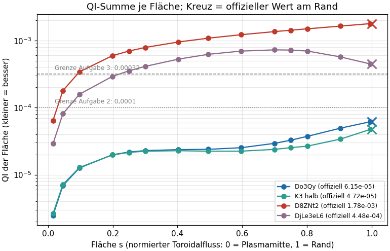
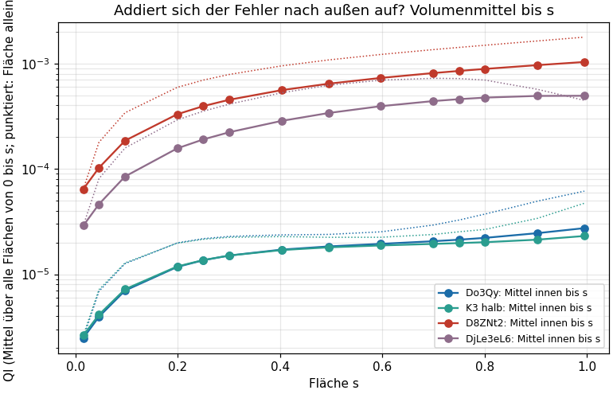
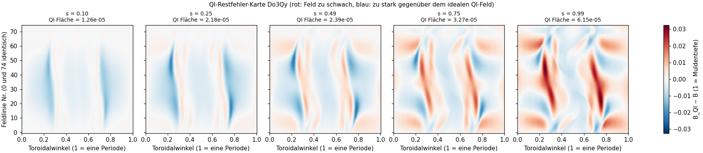
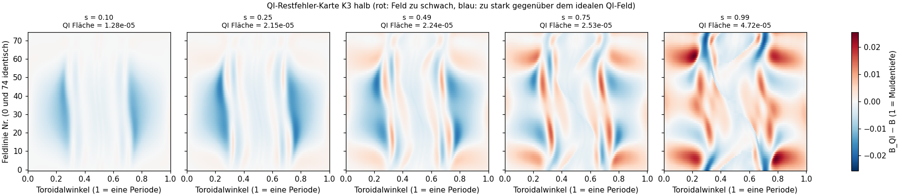
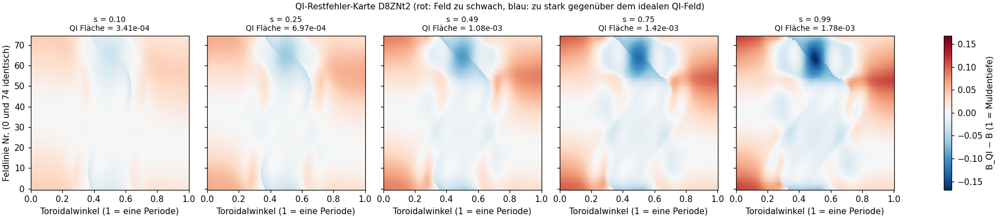
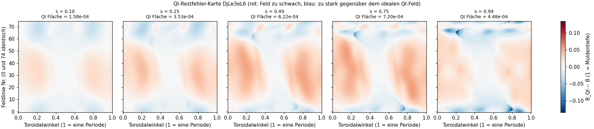
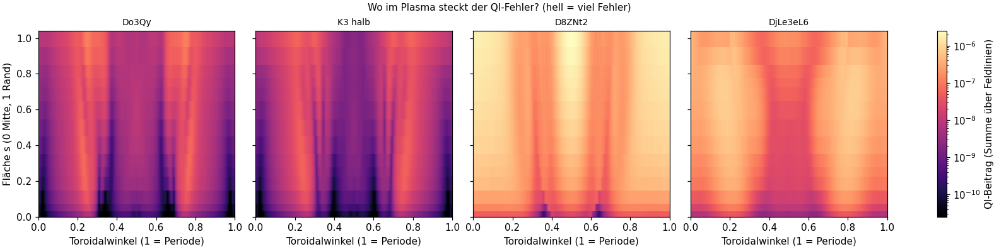
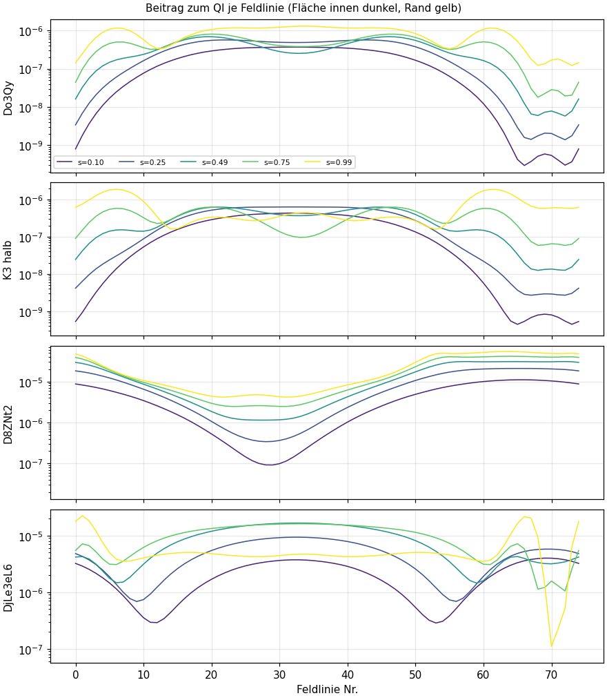
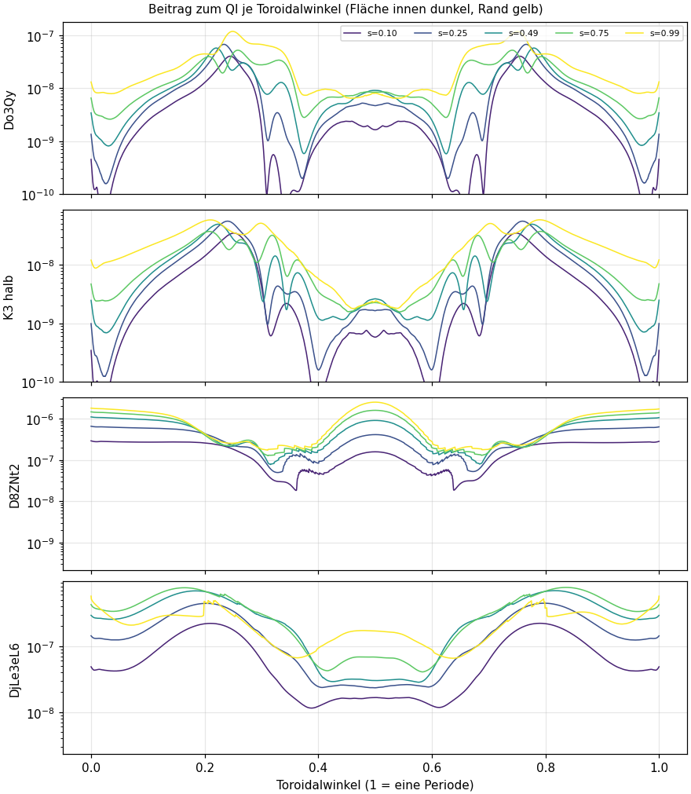

# QI-Karte über mehrere Flächen im Plasma (Opus-Agent, 2026-11-05)

Auftrag des Nutzers: „QI für jeden Punkt im Plasma generieren, um zu sehen, ob sich da etwas aufaddiert und einen großen Fehler bildet.“ Die offizielle Kennzahl QI der ConStellaration-Challenge wird nur auf **einer** Fläche berechnet, dem Plasmarand. Hier wird sie für 14 Flächen von der Plasmamitte bis zum Rand berechnet und als Karte gezeigt. Nichts hochgeladen, nichts committet. Ereignisprotokoll F-243 (Erwartung) und F-244 (Ergebnis), Befund B-052.

Skript: `stellarator/qi_karte.py` (`eins <form>` je Form, `bilder` für die Bilder). Lauf: `sim/qi_flaeche/karte/lauf.sh` (je Form ein pausierbarer Scope mit 6 GB Grenze, zwei Formen gleichzeitig, fertige Formen werden übersprungen). Bilder und Zusammenfassung: Ordner `qi_karte/` neben diesem Bericht.

## Kurzfassung

- **Prüfstein bestanden:** Die Summe der Quadrate auf der Randfläche ist bei allen vier Formen **exakt** gleich dem offiziellen QI aus `forward_model` (relative Abweichung 0, alle 16 Stellen). Eine zweite, eigene Boozer-Rechnung nur am Rand (wie im Paket) ergibt ebenfalls exakt denselben Wert. Gegen die im Datensatz gespeicherten Werte: D8ZNt2 auf 6 Stellen, Do3Qy auf 4 Stellen (0,00006147057 statt 0,00006146820, Abweichung 0,004 %; vermutlich andere Rechnerversion bei der Datensatzerzeugung).
- **Gemessen:** Bei drei von vier Formen (Do3Qy, Kandidat 3 halber Schritt, D8ZNt2) wächst der QI-Fehler von innen nach außen und ist **am Rand am größten**. Nahe der Achse ist er 20- bis 30-mal kleiner als am Rand.
- **Gemessen, Ausnahme:** Bei DjLe3eL6 liegt das Maximum **im Inneren** bei s ≈ 0,7 (QI 0,00072), also 62 % über dem offiziellen Randwert 0,00045. Zwischen s = 0,4 und 0,9 ist jede Fläche schlechter als der Rand. Die offizielle Kennzahl unterschätzt diese Form.
- **Hypothese des Nutzers, ehrlich beantwortet:** Ein **Aufaddieren** im Sinne von „Fehler werden von innen nach außen weitergereicht und summieren sich“ gibt es nicht: Jede Fläche wird im Verfahren für sich bewertet, aus dem Magnetfeld genau dieser Fläche. Der Gedanke dahinter, dass sich im Inneren ein großer Fehler verstecken kann, den der Randwert nicht zeigt, bestätigt sich aber **teilweise**: bei einer von vier Formen (DjLe3eL6), nicht bei den besten Formen.
- **Folgerung:** Für Do3Qy und Kandidat 3 ist der Randwert eine sichere Obergrenze; das Innere ist besser. Die Reihenfolge der Formen bleibt auf jeder Fläche gleich (Do3Qy und K3 sind auf jeder Fläche mindestens 7-mal, bis zu 57-mal besser als DjLe3eL6 und D8ZNt2). Kandidat 3 ist ab s = 0,2 auf jeder Fläche besser als Do3Qy (bei s = 0,8 bis 0,9 um 29 bis 31 %), innen (s < 0,2) praktisch gleich (bis 6 % schlechter).

## 1 Was berechnet wurde

**Begriffe für Nicht-Physiker.** Ein Stellarator hält das Plasma in ineinander geschachtelten, schlauchförmigen Magnetflächen, wie die Schalen einer Zwiebel. Die Flächen werden mit **s** nummeriert (normierter Toroidalfluss): s = 0 ist die Plasmamitte (magnetische Achse), s = 1 der Rand. Auf jeder Fläche laufen **Feldlinien** schraubenförmig um den Torus. Entlang einer Feldlinie schwankt die Magnetfeldstärke B: Es gibt „Mulden“ (schwaches Feld), in denen Teilchen hin und her pendeln. **Quasi-Isodynamik (QI)** heißt: Diese Mulden sehen auf allen Feldlinien einer Fläche gleich aus (gleich tief, gleich breit), dann driften die gefangenen Teilchen im Mittel nicht aus dem Plasma. Der **QI-Restfehler** misst, wie weit die echte Feldstärke vom nächstgelegenen idealen QI-Feld abweicht (Verfahren nach Goodman et al. 2023, J. Plasma Phys. 89, 905890504). Je kleiner, desto besser.

**Rechnung.** Je Form: VMEC++ mit der Einstellung der Rangliste (`ConstellarationSettings.default_high_fidelity()`, 99 Flächen) liefert das Gleichgewicht und den offiziellen QI. Auf **demselben** Gleichgewicht wird die Umrechnung in Boozer-Koordinaten (booz_xform) für die Flächen s = 0,02; 0,05; 0,1; 0,2; 0,25; 0,3; 0,4; 0,5; 0,6; 0,7; 0,75; 0,8; 0,9; 1,0 gemacht; booz_xform nimmt jeweils die nächste VMEC-Fläche (z. B. 0,995 statt 1,0, genau wie die offizielle Rechnung). Dann wird die Funktion des Pakets `quasi_isodynamicity_residual` je Fläche einzeln aufgerufen und das volle Feld der Restfehler behalten: 75 Feldlinien × 2000 Punkte entlang des Toroidalwinkels je Fläche. Die offizielle Kennzahl ist die Summe der Quadrate dieser Werte; hier wird sie je Fläche, je Feldlinie und je Winkel aufgeschlüsselt.

Befürchteter Fehler „Minimum of B is at the boundary“ (Muldenboden am Rand des Rechenbereichs) trat bei keiner Form und keiner Fläche auf, auch nicht bei s = 0,015. Vorsorglich wird jede Fläche getrennt gerechnet, damit ein solcher Fehler nur diese Fläche verwirft.

Formen:

| Kürzel | Form | nfp | QI offiziell (Rand) |
|---|---|---|---|
| Do3Qy | Do3QyJbtRhtGhrTiBSBbyKM, beste Datensatzform | 2 | 0,0000615 |
| K3 halb | Kandidat 3, halber Schritt (eigene Form, B-050) | 2 | 0,0000472 |
| D8ZNt2 | D8ZNt2qFQLQQxMVitWaeCid, Startform der lokalen Suche (Filter 138) | 2 | 0,00178 |
| DjLe3eL6 | Datensatzform mit Spulen (Proxima-Brücke) | 4 | 0,000448 |

Rechenzeit je Form 2,6 bis 5,1 Minuten (VMEC++ samt offizieller Kennzahlen 1,8 bis 4,4 Minuten, Boozer und die 14 Flächen zusammen etwa 45 s).

## 2 Ergebnisse in Zahlen

QI je Fläche (Summe der Quadrate auf dieser Fläche):

| s | Do3Qy | K3 halb | D8ZNt2 | DjLe3eL6 |
|---|---|---|---|---|
| 0,015 | 0,0000025 | 0,0000026 | 0,000064 | 0,000029 |
| 0,10 | 0,0000126 | 0,0000128 | 0,000341 | 0,000158 |
| 0,25 | 0,0000218 | 0,0000215 | 0,000697 | 0,000353 |
| 0,49 | 0,0000239 | 0,0000224 | 0,001082 | 0,000622 |
| 0,70 | 0,0000293 | 0,0000238 | 0,001355 | **0,000725** (Maximum) |
| 0,75 | 0,0000327 | 0,0000253 | 0,001423 | 0,000720 |
| 0,90 | 0,0000493 | 0,0000339 | 0,001638 | 0,000570 |
| 0,995 (Rand) | **0,0000615** | **0,0000472** | **0,001781** | 0,000448 |
| Volumenmittel | 0,0000275 | 0,0000232 | 0,001038 | 0,000494 |
| Volumenmittel / Rand | 0,45 | 0,49 | 0,58 | 1,10 |

Volumenmittel = Mittel über s von 0 bis 1 (s ist proportional zum eingeschlossenen Volumen, daher entspricht das einem Mittel über das Plasmavolumen).

Nahe der Achse wächst der Fehler etwa proportional zu s (Do3Qy: 0,0000025 → 0,0000069 → 0,0000126 bei s = 0,015 → 0,046 → 0,097). Das passt zur Theorie in Achsennähe: Die störenden Feldanteile wachsen mit dem Abstand von der Achse, ihr Quadrat also mit s. Das ist ein Plausibilitätszeichen.

## 3 Bilder mit Lesehilfe

### 3.1 QI je Fläche (`qi_karte/qi_ueber_s.png`)

Was man sieht: waagerecht die Fläche s von der Plasmamitte (links) bis zum Rand (rechts), senkrecht der QI-Fehler dieser Fläche in logarithmischem Maßstab (jede Gitterlinie ein Faktor). Jede Farbe ist eine Form; das Kreuz rechts ist der offizielle Wert. Die gestrichelten Linien sind die Grenzen der Challenge (Aufgabe 3: 0,00032; Aufgabe 2: 0,0001). Gut heißt: Kurve tief unten. Das Kreuz sitzt bei allen vier Formen genau auf dem letzten Punkt (Prüfstein). Drei Kurven steigen bis zum Rand an; die violette (DjLe3eL6) hat einen Buckel bei s ≈ 0,7 und fällt zum Rand wieder ab.

### 3.2 Volumenmittel bis s (`qi_karte/qi_kumuliert.png`)

Diese Darstellung beantwortet die Frage „addiert sich etwas auf?“ direkt: Durchgezogen ist der mittlere Fehler aller Flächen von der Mitte bis s, punktiert der Fehler der Fläche s allein. Würden sich Fehler nach außen aufsummieren, müsste die durchgezogene Kurve über die punktierte steigen. Das tut sie bei Do3Qy, K3 und D8ZNt2 nirgends; bei DjLe3eL6 liegt das Volumenmittel am Ende knapp über dem Randwert (Faktor 1,10), weil die Flächen bei s = 0,4 bis 0,9 schlechter sind als der Rand.

### 3.3 Karten je Form (`qi_karte/karte_do3.png`, `karte_k3.png`, `karte_d8z.png`, `karte_dje.png`)

Was man sieht: fünf Felder für fünf Flächen (s = 0,1 bis Rand). In jedem Feld ist waagerecht der Weg entlang des Torus über eine Feldperiode aufgetragen (0 und 1 = Stelle des stärksten Feldes, 0,5 = Muldenboden), senkrecht die 75 Feldlinien der Fläche (Feldlinie 0 und 74 sind dieselbe, siehe Abschnitt 4). Die Farbe zeigt die Abweichung vom idealen QI-Feld als Bruchteil der Muldentiefe: **weiß = keine Abweichung (gut)**, **rot = echtes Feld schwächer als ideal**, **blau = echtes Feld stärker als ideal**. Die Farbskala ist je Form gleich für alle fünf Felder, die Formen untereinander haben aber unterschiedliche Skalen (Do3Qy/K3 bis ±0,03, D8ZNt2/DjLe3eL6 bis ±0,15).

Deutung: Bei Do3Qy und K3 sitzt der Fehler an den **Flanken der Mulde** (Winkel 0,2 bis 0,3 und 0,7 bis 0,8); innen glatt und blau (Flanken etwas zu steil), nach außen kommen rote Streifen und Flecken an einzelnen Feldlinien (5 bis 15 und 55 bis 65) hinzu. Am Muldenboden (0,5) und an den Maxima (0 und 1) ist die Abweichung durch das Verfahren nahe null. Bei D8ZNt2 liegt der Fehler bei den Maxima (rot an den Rändern 0 und 1: die Feldspitze sitzt nicht auf allen Feldlinien an derselben Stelle) und als blauer Fleck bei Feldlinie 55 bis 70 in der Muldenmitte. Bei DjLe3eL6 sind innen zwei große rote Bereiche (Flanken zu flach, Mulde zu breit), die bis s ≈ 0,75 stärker werden; am Rand werden sie schwächer, dafür treten scharfe blaue Kanten an einzelnen Feldlinien auf. Die Vorzeichen sind plausibel: Das Verfahren rechnet B_QI − B mit auf 0 (Muldenboden) bis 1 (Spitze) normiertem B.

### 3.4 Wo im Plasma steckt der Fehler? (`qi_karte/uebersicht_s_winkel.png`)

Was man sieht: je Form ein Feld, waagerecht der Winkel entlang des Torus, senkrecht die Fläche s (unten Mitte, oben Rand). Die Farbe ist der QI-Beitrag, über alle Feldlinien summiert, logarithmisch: **dunkel = wenig Fehler (gut), hell = viel Fehler**. Alle vier Felder haben dieselbe Skala. Do3Qy und K3 sind fast überall dunkel, die hellen Bänder an den Muldenflanken werden nach oben (außen) heller. D8ZNt2 ist fast überall hell. Bei DjLe3eL6 ist das hellste Band in der Mitte der Höhe (s ≈ 0,5 bis 0,8), nicht oben.

### 3.5 Beitrag je Feldlinie und je Winkel (`qi_karte/beitrag_feldlinie.png`, `beitrag_winkel.png`)

Was man sieht: je Form eine Zeile; jede Kurve ist eine Fläche (dunkelblau innen, gelb am Rand). Waagerecht die Feldlinie bzw. der Winkel, senkrecht der Beitrag zum QI (logarithmisch, tiefer = besser). Je Feldlinie: Bei Do3Qy und K3 tragen innen vor allem die mittleren Feldlinien (15 bis 50) bei; am Rand kommen zwei Spitzen bei Feldlinie ≈ 6 und ≈ 62 dazu. Bei DjLe3eL6 sind die gelbe Randkurve in der Mitte (Feldlinie 15 bis 55) **niedriger** als die grünen Kurven von s = 0,5 und 0,75; das ist der innere Buckel. Je Winkel: Bei allen Formen ist der Muldenboden (0,5) und bei Do3Qy/K3 auch die Spitze (0 und 1) arm an Fehler; die Flanken tragen am meisten bei. Die Kurven je Winkel sind spiegelsymmetrisch um 0,5, wie es die Stellarator-Symmetrie verlangt; auch das ist ein Plausibilitätszeichen.

## 4 Nebenbefund zum Verfahren

Das Paket legt die 75 Feldlinien mit `np.linspace(theta_start, theta_start + 2π, 75)` fest, also **einschließlich** des Endpunkts. Feldlinie 0 und Feldlinie 74 sind daher dieselbe (gemessen: gleich bis 1e-13). Eine Feldlinie zählt doppelt, effektiv werden 74 verschiedene Feldlinien bewertet. Die Wirkung ist klein (eine von 75 Feldlinien mit doppeltem Gewicht), verändert aber den offiziellen Wert leicht. Für den Vergleich mit der Rangliste ist das gleichgültig, weil alle Formen gleich behandelt werden.

## 5 Erwartung (vorher, F-243) und Vergleich

| Erwartung | Ergebnis | Urteil |
|---|---|---|
| QI-Summe am Rand nicht am größten | Bei 3 von 4 Formen ist der Rand die schlechteste Fläche; nur DjLe3eL6 hat das Maximum innen (s ≈ 0,7, Faktor 1,62) | **verfehlt** (nur 1 von 4) |
| innen schlechter bzw. unregelmäßiger | Innen deutlich besser (an der Achse 20- bis 30-mal kleiner) und glatter; die Unregelmäßigkeiten (scharfe Kanten, Flecken an einzelnen Feldlinien) treten außen auf | **verfehlt** |
| keine einfache Aufsummierung nach außen | Jede Fläche wird für sich bewertet; das Volumenmittel bleibt bei 3 von 4 Formen unter dem Randwert (Faktor 0,45 bis 0,58) | **getroffen** |
| Randwert reproduziert offiziellen QI auf ≥ 5 Stellen | exakt (16 Stellen) gegen `forward_model`; gegen Datensatz 4 bis 6 Stellen | **getroffen** |

Warum die Erwartung falsch lag: Ich hatte angenommen, dass optimierte Formen nur am Rand gut gemacht sind und das Innere „mitgeschleppt“ wird. Tatsächlich entstehen die QI-Störungen durch Feldanteile, die mit dem Abstand von der Achse wachsen; nahe der Achse ist jedes Feld fast QI. Die Erwartung beruhte auf einer Vermutung, nicht auf Literatur.

## 6 Offene Punkte

- DjLe3eL6: Woher kommt der innere Buckel? Möglich ist ein Einfluss der Rotationstransformation (iota fällt von 0,51 an der Achse auf 0,36 am Rand und kreuzt dabei vielleicht eine rationale Fläche). Nicht geprüft.
- Ob der innere Fehler von DjLe3eL6 den Einschluss der schnellen Teilchen spürbar verschlechtert, sagt QI nicht direkt; dafür wäre eine Bahnrechnung (z. B. Verlustanteil der Alphateilchen) nötig.
- Die Suche (B-051) bewertet nur den Rand. Für eine robuste Auswahl könnte man das Volumenmittel oder das Maximum über s als Zusatzbedingung nehmen; für die beiden besten Formen ändert das nichts.
- Nur vier Formen; ob „Rand ist die schlechteste Fläche“ für den ganzen Datensatz gilt, ist nicht geprüft.

## English summary

The official ConStellaration QI metric is evaluated on the plasma boundary only. We evaluated the same residual (Goodman et al. 2023) on 14 flux surfaces (s = 0.015 to 0.995) for four shapes and kept the full residual field (75 field lines × 2000 toroidal points). Check: the sum of squares on the boundary equals the official `forward_model` QI exactly for all four shapes. Result: for three of four shapes (Do3Qy, candidate 3 half-step, D8ZNt2) the QI error grows monotonically from the axis (20–30× smaller) to the edge, so the boundary value is a conservative bound. For DjLe3eL6 the error peaks inside (s ≈ 0.7, 1.62× the boundary value), so the official metric underestimates that shape. There is no accumulation mechanism: every surface is assessed independently. The user's hypothesis (errors adding up to a large hidden error) is not confirmed as accumulation, but partially confirmed in the sense that a larger interior error can exist (1 of 4 shapes). Our prior expectation (edge not worst, interior worse) was wrong for 3 of 4 shapes. Side finding: the package's field-line grid includes the endpoint, so field line 0 and 74 are identical and counted twice.
