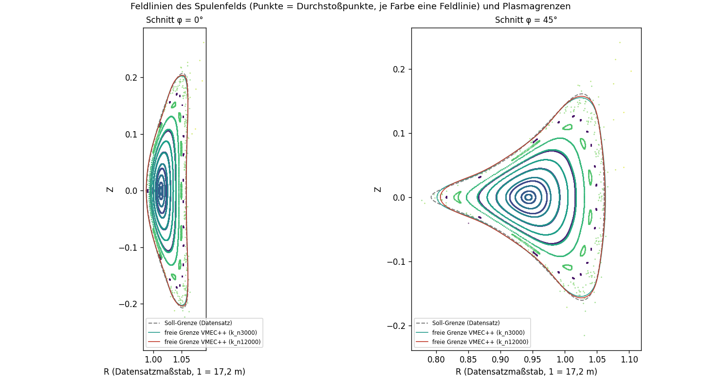
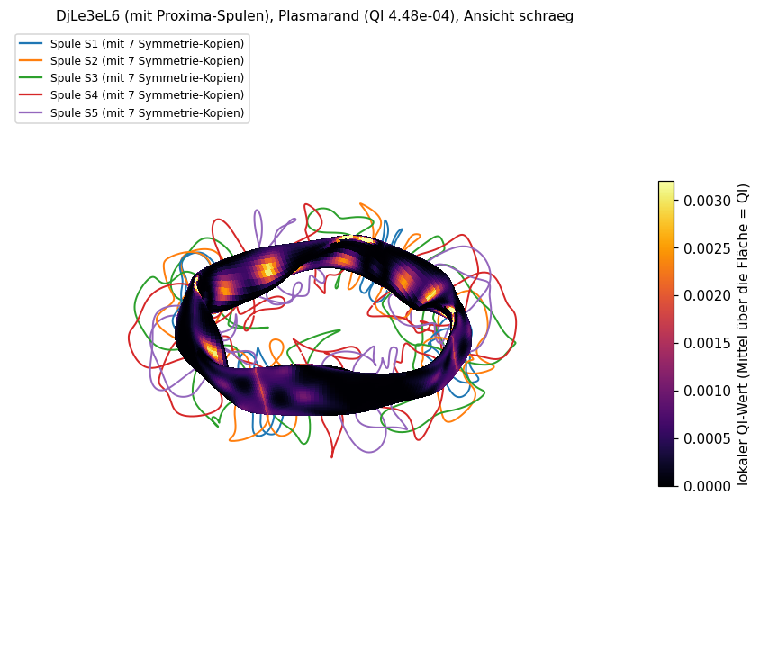
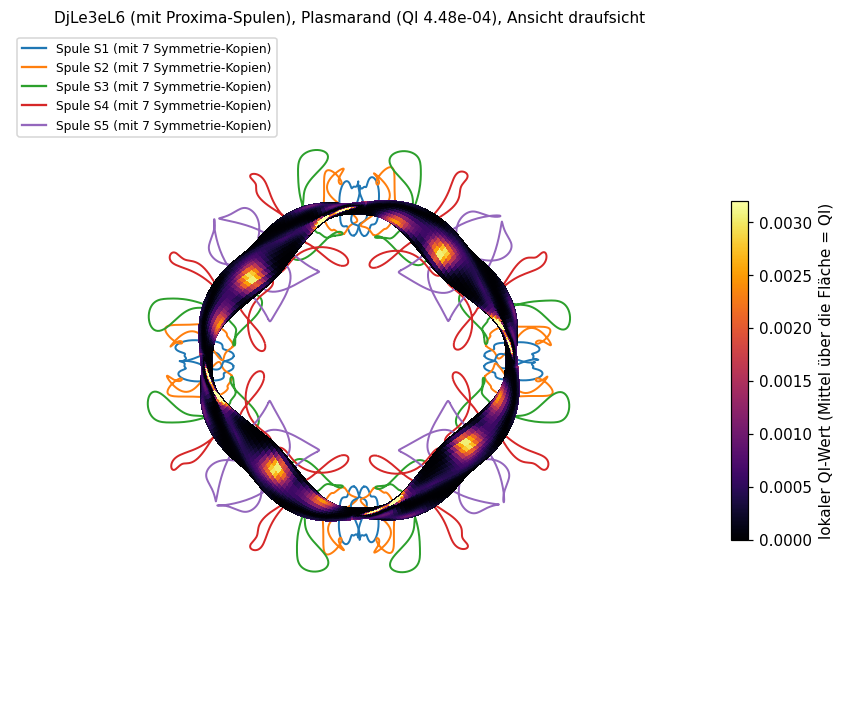
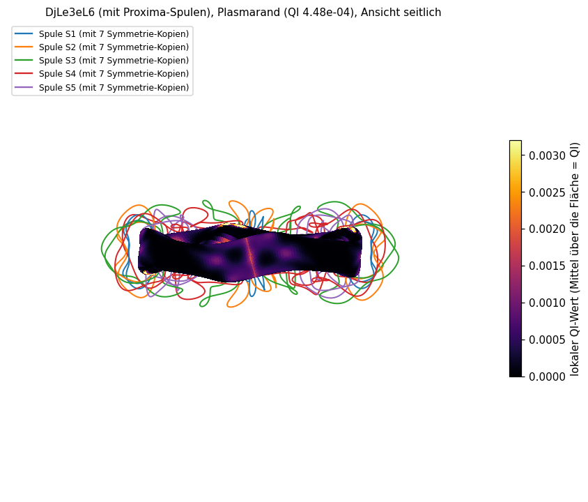
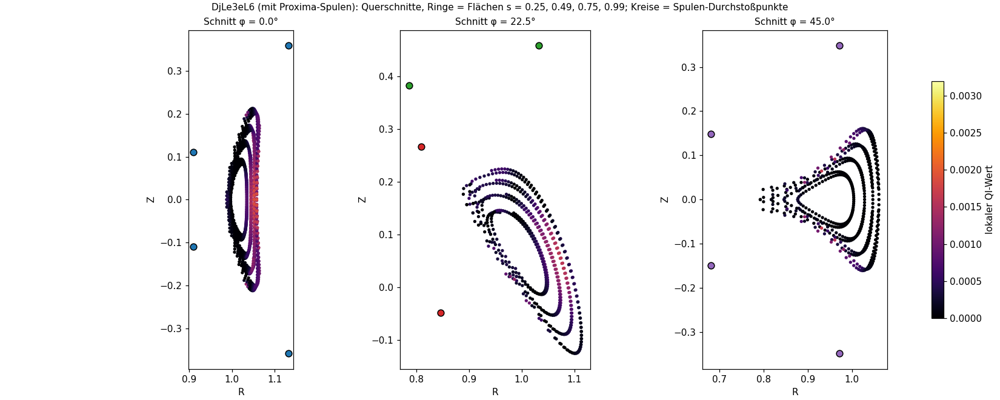
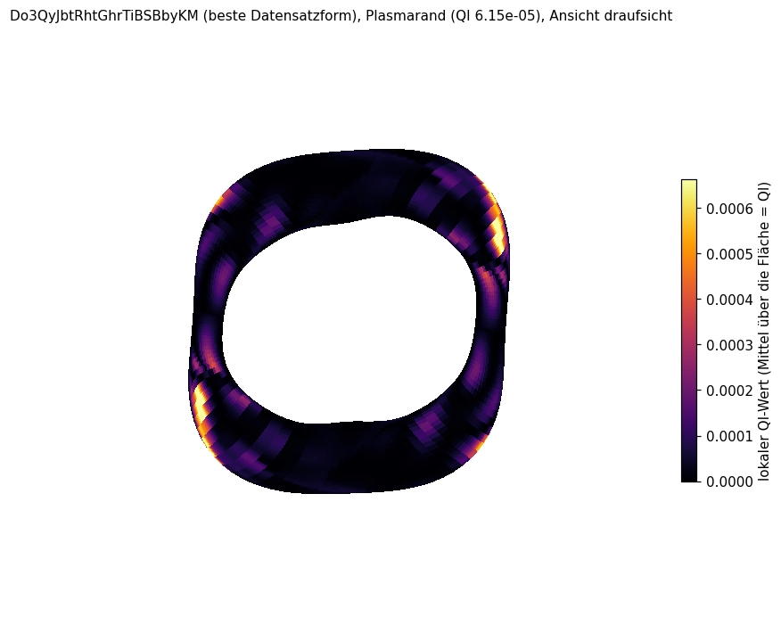
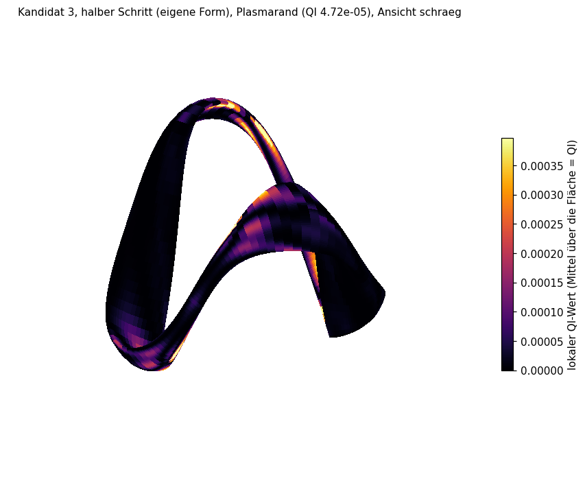
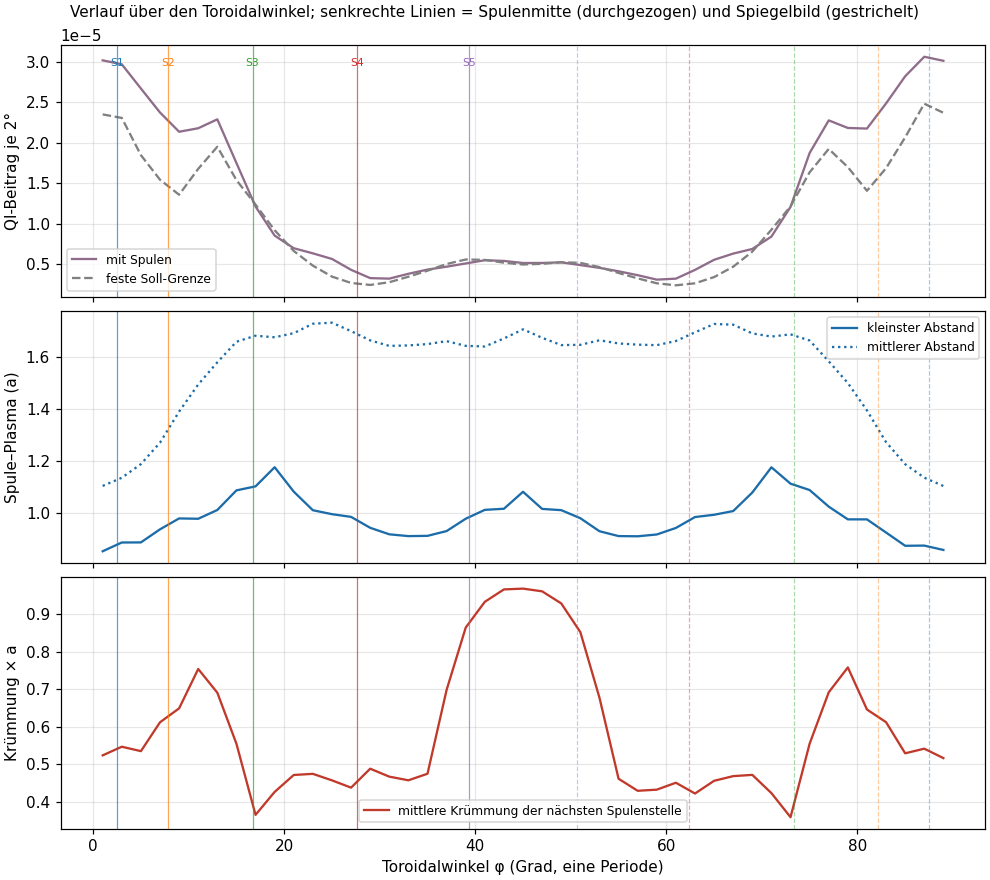

# QI und Spulen: Wie die Spulen die QI-Güte bestimmen (Opus-Agent, 2026-11-05)

Wunsch des Nutzers: den Zusammenhang zwischen QI und Spulen verstehen. Reihenfolge nach Priorität: (3) Strom je Spule ändern und die QI-Wirkung messen, (2) Spulen leicht verschieben oder verdrehen, dazu eine Darstellung, auf der QI-Verteilung und Spulen gemeinsam zu sehen sind; nachgereicht: die QI-Werte als Farbe auf der echten 3D-Plasmafläche mit den Spulen. Form: DjLe3eL6 mit Proximas Spulensatz (5 Basisspulen, 4 Feldperioden, 40 Spulen). Ereignisprotokoll F-245 (Erwartung) und F-246 (Ergebnis), Befund B-053. Nichts hochgeladen, nichts committet.

Skripte: `stellarator/qi_spulen.py` (Werkzeug Spulen → Feld → QI, Strom- und Lagestudie, Feldlinien), `stellarator/qi_3d.py` (3D-Darstellung). Ergebnisse im Ordner `sim/qi_spulen/` bzw. `sim/qi_flaeche/karte3d/`, Bilder im Ordner `qi_spulen/` neben diesem Bericht.

## Kurzfassung

- **Werkzeug (Teil A), zwei Wege.** (i) VMEC++ mit freier Plasmagrenze, angetrieben vom Feld unserer Spulen: rechnet, aber der Randwert von QI wird nicht stabil (er wandert mit der Schrittzahl von 0,000579 nach 0,000671). (ii) Störungsmodell: Flächen der offiziellen Rechnung festhalten, dort die Feldstärke der Spulen einsetzen und QI mit der Paketfunktion rechnen. (ii) ist geprüft (gibt mit dem Feld der offiziellen Rechnung exakt den offiziellen QI) und stimmt in allen geprüften Stromänderungen bis ±5 % mit (i) überein.
- **Prüfstein:** QI mit den echten Spulen ist am Rand **0,000554 (ii) bis 0,00058 bis 0,00067 (i)** statt 0,000448 ohne Spulen, also **+24 % bis +50 %**. Innen fast unverändert (s = 0,5: −0,4 % bis +2 %). Ursache: Die Spulen erzeugen das Soll-Feld nicht genau (Feldstärke auf dem Rand im Mittel 0,19 % daneben, Querfeld 0,24 %); das trifft vor allem den Rand.
- **Neuer Befund, warum (i) nicht konvergiert:** Feldlinien des reinen Spulenfelds zeigen **Inselketten im Plasma** (bei ι = 4/9 und 8/19) und einen **stochastischen Saum** genau an der Soll-Grenze; die letzte geschlossene Fläche liegt außen bis 0,07 a innerhalb der Soll-Grenze, die scharfe Innenspitze bei halber Periode wird nicht gefüllt. VMEC++ setzt geschachtelte Flächen voraus und kann das nicht abbilden.
- **Strom (Teil B):** Alle Ströme gemeinsam ändern QI nicht (gemessen auf 5 Stellen gleich, wenn der Plasmafluss mitgeht). Je Spulengruppe ändert schon 1 % Strom QI um 1,4 bis 10 %, 5 % um 5 bis 25 %. **Stärkster Hebel ist S5** (bei 39° nahe der halben Periode): −5 % Strom senkt QI am Rand um 25 % (Weg i: −27 %). S1 bis S4 wirken in die Gegenrichtung (mehr Strom = besser). Bessere QI wird mit höherem Spiegelverhältnis erkauft (+3 %).
- **Stromverhältnisse optimiert (±5 % erlaubt):** QI am Rand −27 % (Weg ii) bzw. −28 % (Weg i), ohne eine Spule zu bewegen; Preis: Spiegelverhältnis +5 %.
- **Lage (Teil C):** 5 mm Lagefehler (W7-X-Toleranz) ändern QI um höchstens 2,7 % (S5 senkrecht), linear; Strom ist der viel stärkere Hebel.
- **3D-Darstellung:** QI als Farbe auf der echten Plasmafläche, Spulen als Linien; interaktiv (`qi_spulen/qi_3d_dje.html`, Fläche wählbar) und als feste Ansichten.

## 1 Begriffe

- **Plasmagrenze, Flächen s:** Das Plasma liegt in ineinander geschachtelten Magnetflächen wie Zwiebelschalen; s = 0 ist die Mitte, s = 1 der Rand. Die offizielle QI-Kennzahl wird nur am Rand berechnet.
- **Feste und freie Grenze:** Die offizielle Rechnung gibt die Form des Randes **vor** (feste Grenze) und rechnet das Feld innen; Spulen kommen nicht vor. Bei der freien Grenze geben wir die **Spulen** vor; der Rand stellt sich so ein, wie das Spulenfeld es zulässt.
- **Feldfehler der Spulen:** Kein Spulensatz trifft das Soll-Feld exakt. Proximas Spulen für DjLe3eL6 haben im Mittel 0,24 % Querfeld (Feld, das durch die Soll-Fläche hindurchtritt, statt an ihr entlangzulaufen).
- **Inselkette:** Wo eine Feldlinie nach einer ganzzahligen Anzahl von Umläufen genau auf sich selbst trifft (rationale Rotationstransformation ι, etwa 4/9), kann schon ein kleiner Feldfehler die Fläche in eine Kette kleiner Schläuche („Inseln“) aufreißen. Im Bild sieht man dann statt eines Rings eine Perlenkette.
- **Stochastischer Saum:** Bereich, in dem Feldlinien keine Fläche mehr bilden, sondern regellos wandern und schließlich das Plasma verlassen.
- **ι (Rotationstransformation):** Wie oft eine Feldlinie je Umlauf um den Ring um das Rohr herumläuft (Gewindesteigung).
- **Spiegelverhältnis:** (stärkstes − schwächstes Feld)/(Summe) auf einer Fläche; Maß für die Tiefe der Feldmulden.

## 2 Werkzeug Spulen → Feld → QI (Teil A)

### 2.1 Gemeinsame Grundlage
Spulen: Proxima CoilStellaration DjLe3eL6KjahKZboHs6o7rc, Kurven wie in `proxima_spulen.py` (Fourier-Kurven Ordnung 7), Datensatzmaßstab (Hauptradius ≈ 1; 1 Längeneinheit = 17,2 m in unserer Anlage, kleiner Radius a = 0,105 = 1,79 m). Feld je **Spulengruppe** (eine Basisspule mit ihren 7 Symmetrie-Kopien) für 1 A mit Biot-Savart (simsopt) gerechnet. Ströme gemeinsam so skaliert, dass der Spulenfluss durch den Soll-Querschnitt gleich dem offiziellen Fluss ist (Faktor 0,694, mittleres Feld am Rand 1,08 T). Kontrollen (gemessen): Querfeld auf dem Soll-Rand im Mittel 0,0024069, gleich dem Wert unserer Kette (stufe2.json); Gesamtfluss in 12 Schnitten konstant auf 0,1 %.

Lage der Spulen (Toroidalwinkel der Spulenmitte; halbe Periode = 45°; kleinster Abstand zum Plasma in a): S1 2,5° (0,85 a), S2 7,8° (0,96 a), S3 16,7° (1,08 a), S4 27,6° (0,91 a), S5 39,4° (1,00 a).

### 2.2 Weg (i): VMEC++ mit freier Grenze
VMEC++ (Version 0.4.11) kann die freie Grenze; das Feld der Spulen wird als Tabelle je Stromkreis im Speicher übergeben, sodass eine Stromänderung keine neue Feldrechnung braucht. Die übrige Rechnung ist die offizielle (`forward_model` mit `default_high_fidelity`, nur der VMEC-Aufruf ist ausgetauscht). Gegenprobe ohne Spulen in derselben Kette: QI = 0,0004475408751634689, exakt der offizielle Wert.

Was dabei auffiel (gemessen):
1. Mit der offiziellen Auflösung (24 Punkte je Periode in Toroidalrichtung) bleibt die Restkraft bei 3e-7 bis 1e-6 stehen. Ursache: 10 Spulen je Periode erzeugen eine Feldwelligkeit genau an der Auflösungsgrenze. Mit 48 Punkten fällt die Restkraft auf 1e-10 bis 4e-12 (feste Rechnung mit 48 Punkten: QI 0,000446, −0,4 % gegen offiziell, also vergleichbar).
2. Die Zieltoleranz 1e-15 wird trotzdem nicht erreicht, und **der Randwert wandert**: 3000 Schritte 0,000579, 12000 Schritte 0,000671. Die inneren Flächen bleiben stabil (s = 0,5: 0,000634 → 0,000631). Gleich beim kleineren Plasma (Fluss ×0,9): 0,000612 → 0,000739. Die freie Grenze bekommt hohe Fourier-Moden (Anteile bis m = 9 von 2 bis 5 % von a; bei der festen Grenze null) und eine örtliche Delle an der Innenspitze bei halber Periode (bis 10 % von a).
3. Grund (Abschnitt 2.4): Inseln und stochastischer Saum im Spulenfeld; dafür gibt es in VMEC++ keine konvergente Lösung mit geschachtelten Flächen.

Folgerung: Weg (i) ist für **Unterschiede** zwischen Rechnungen gleicher Schrittzahl brauchbar (Abschnitt 3.3), für einen absoluten Randwert nicht.

### 2.3 Weg (ii): Störungsmodell auf festen Flächen
Die Flächen und Boozer-Winkel der offiziellen Rechnung bleiben; an jedem Punkt wird die Feldstärke |B| der Spulen eingesetzt, in die Boozer-Fourier-Reihe zurückgerechnet und dieselbe Paketfunktion `quasi_isodynamicity_residual` aufgerufen. Vernachlässigt wird, dass die Feldlinien des Spulenfelds die Fläche um das Querfeld verlassen. Da das Feld linear im Strom ist, kostet eine Stromkombination 8 s.

Kontrollen (gemessen): mit dem Feld der offiziellen Rechnung statt der Spulen kommt **exakt** der offizielle QI heraus (0,00044754087516, Rest 1e-14), innen die Werte der QI-Karte (0,000622 bei s = 0,5, 0,000720 bei s = 0,75). Lage der Punkte auf der Fläche: 0,8 mm im Datensatzmaßstab (0,8 % von a).

### 2.4 Feldlinien des reinen Spulenfelds (`qi_spulen/poincare.png`)

Lesehilfe: Links der Querschnitt bei φ = 0° (bohnenförmig, schmal), rechts bei 45° (dreieckig). Jede Farbe ist **eine** Feldlinie des Spulenfelds, die 300-mal um den Ring läuft; jeder Punkt ist ein Durchstoßpunkt durch die Schnittebene. Bildet eine Feldlinie eine geschlossene Kurve, liegt sie auf einer guten Magnetfläche. Kleine geschlossene Ovale in einer Reihe sind eine **Inselkette**, verstreute Punkte ein **stochastischer** Bereich. Grau gestrichelt: Soll-Grenze (offizielle Rechnung); farbige Linien: freie Grenze aus VMEC++.

Gemessen: Achse bei ι = 0,507. Hellgrüne Kette aus 9 Inseln bei ι = 0,444 = 4/9, feine violette Kette bei ι = 0,4205 ≈ 8/19; beide passen zur Periodenzahl 4 (Zähler Vielfaches von 4). Außen ab etwa 0,02 bis 0,07 a innerhalb der Soll-Grenze (bei φ = 0, außen) verlassen die Feldlinien nach wenigen Umläufen das Gebiet. Bei 45° erreicht keine geschlossene Fläche die Innenspitze (R ≈ 0,80); dort liegt die freie Grenze innerhalb der Soll-Grenze.

Deutung (Folgerung): Proximas Spulensatz ist auf kleines Querfeld optimiert, nicht auf Flächengüte am Rand. Für eine Anlage zählt das Spulenfeld; danach wäre die nutzbare Plasmagrenze etwas kleiner als die Soll-Grenze. Ob ein Plasma mit Druck und Strom die Inseln heilt oder vergrößert, ist offen.

### 2.5 Prüfstein

| Rechnung | s = 0,5 | s = 0,75 | Rand | gegen ohne Spulen (Rand) |
|---|---|---|---|---|
| ohne Spulen (offiziell, feste Grenze) | 0,000622 | 0,000720 | **0,000448** | – |
| (ii) Spulenfeld auf festen Flächen | 0,000620 | 0,000733 | **0,000554** | +24 % |
| (i) freie Grenze, 3000 Schritte | 0,000634 | 0,000765 | 0,000579 | +29 % |
| (i) freie Grenze, 12000 Schritte | 0,000631 | 0,000788 | 0,000671 | +50 % (nicht konvergiert) |

Abweichung erklärt: Feldfehler der Spulen (|B| auf dem Rand 0,19 % Streuung gegen das Soll-Feld) wirken am Rand am stärksten; dazu kommen die Inseln am Rand, die nur Weg (i) teilweise spürt.

## 3 Strom je Spulengruppe (Teil B)

Eine Spulengruppe ist eine Basisspule mit ihren 7 Symmetrie-Kopien. Einzelne der 40 Spulen lassen sich in beiden Wegen nicht allein ändern, weil VMEC++ und das QI-Verfahren die Wiederholung über die Perioden voraussetzen.

### 3.1 Alle Ströme gemeinsam (a)
Gemessen, Weg (ii): ×0,95 und ×1,05 ändern QI um weniger als 1e-8 (Rundung). Weg (i): ×1,05 mit mitgeführtem Plasmafluss gleich auf 5 Stellen (0,000579). Erwartung getroffen. Bei **festem** Fluss wird das Plasma bei mehr Strom kleiner (Volumen −5 %), weil derselbe Fluss in einen kleineren Querschnitt passt; das ist eine Eigenheit der Rechnung (welche Fläche als Rand gilt), keine Änderung des Feldes. Die Randwerte (×1,05: −8,6 %; ×0,95: −5,9 %) sind nicht monoton und zeigen die Streuung des unkonvergierten Randes in Weg (i).

### 3.2 Je Gruppe ±1 %, ±5 % (b), Weg (ii)

Änderung von QI gegen den Grundwert (0,000554 am Rand):

| Gruppe | −5 % | −1 % | +1 % | +5 % | Ableitung je 1 % (Rand) | s = 0,5 bei +5 % |
|---|---|---|---|---|---|---|
| S1 (2,5°) | +12,8 % | +2,5 % | −2,4 % | −11,3 % | −2,4 % | −9,9 % |
| S2 (7,8°) | +6,9 % | +1,4 % | −1,4 % | −7,1 % | −1,4 % | −7,1 % |
| S3 (16,7°) | +8,5 % | +2,5 % | −2,9 % | −10,8 % | −2,7 % | −10,7 % |
| S4 (27,6°) | +4,8 % | +2,6 % | −3,4 % | −9,8 % | −3,0 % | −10,8 % |
| **S5 (39,4°)** | **−24,6 %** | −10,2 % | +7,4 % | **+23,5 %** | **+8,8 %** | +30,2 % |

Rangfolge der Empfindlichkeit: S5 ≫ S4 ≈ S3 ≈ S1 > S2. Die Summe der Ableitungen ist nahe null (−0,7 % je 1 %), wie es sein muss, weil alle gemeinsam nichts ändern. Folgerung: Es zählt das **Verhältnis** von S5 zu den anderen. Spiegelverhältnis am Rand (Grundwert 0,359): S5 −5 % → 0,370, S1 +5 % → 0,369, S5 +5 % → 0,352. Bessere QI geht also mit tieferen Mulden einher (wie bei Kandidat 3 in B-050).

### 3.3 Gegenprobe mit Weg (i) (3000 Schritte, Fluss folgt dem Spulenfluss)

| Fall | s = 0,5 (i) / (ii) | s = 0,75 (i) / (ii) | Rand (i) / (ii) | ι Rand/nfp (i) | Spiegel (i) |
|---|---|---|---|---|---|
| Grundwert | 0,000634 | 0,000765 | 0,000579 | 0,0963 | 0,359 |
| S5 −5 % | −18 % / −24 % | −7 % / −21 % | **−27 % / −25 %** | 0,0984 | 0,369 |
| S5 +5 % | +26 % / +30 % | +12 % / +12 % | **+23 % / +24 %** | 0,0943 | 0,352 |
| S1 +5 % | −7,5 % / −9,9 % | −9,6 % / −9,0 % | **−11 % / −11 %** | 0,0976 | 0,370 |

Am Rand stimmen beide Wege auf 1 bis 2 Prozentpunkte überein, innen meist auf wenige Punkte (Ausreißer s = 0,75 bei S5 −5 %). Die Plasmagrenze verschiebt sich dabei im Mittel um weniger als 0,3 % von a; ι am Rand ändert sich um ±2 %.

### 3.4 Optimierung der Stromverhältnisse (c)
Weg (ii), S1 fest, S2 bis S5 frei. Ohne Schranken lief das Suchverfahren (Nelder-Mead, 120 Auswertungen) zu Faktoren bis 2,2 und **negativen** Strömen (QI 0,00009); das ist physikalisch unbrauchbar, weil das Störungsmodell nur bis ±5 % geprüft ist (Warnbeispiel, gespeichert als `c_frei_ohne_schranken`). Mit Schranken 0,95 bis 1,05 (L-BFGS-B, 140 Auswertungen):

| | S1 | S2 | S3 | S4 | S5 | QI s = 0,5 | QI s = 0,75 | QI Rand | Spiegel Rand |
|---|---|---|---|---|---|---|---|---|---|
| Grundwert | 1 | 1 | 1 | 1 | 1 | 0,000620 | 0,000733 | 0,000554 | 0,359 |
| Optimum (ii) | 1 | 1,05 | 1,015 | 0,980 | 0,95 | 0,000460 (−26 %) | 0,000561 (−24 %) | **0,000408 (−27 %)** | 0,376 |

Zwei Faktoren liegen an der Schranke; der Gewinn ist kaum größer als S5 −5 % allein (−25 %). Folgerung: Der Hebel ist praktisch eine einzige Richtung, „S5 schwächer gegenüber den anderen“. Ohne eine Spule zu bewegen, kommt QI mit Spulen so wieder in die Nähe des Wertes ohne Spulen (0,000448) und darunter. Preis: Spiegelverhältnis +5 %. Gegenprobe Weg (i) (3000 Schritte, Fluss folgt): Rand 0,000415 (**−28 %**, Weg ii −27 %), s = 0,5 −18 % (ii −26 %), s = 0,75 −7 % (ii −24 %); ι am Rand 0,0963 → 0,1004, Spiegelverhältnis 0,359 → 0,377. Am Rand bestätigt, innen ist der Gewinn in Weg (i) kleiner.

## 4 Lage der Spulen (Teil C)
Weg (ii). Jede Basisspule mit ihren 7 Symmetrie-Kopien um 5 mm (Anlagenmaßstab, W7-X-Toleranz 3 bis 5 mm; im Datensatzmaßstab 0,29 mm) verschoben (radial r, toroidal t, senkrecht z; die gespiegelten Kopien bewegen sich gegengleich) bzw. um die Achsen r, t, z durch den Spulenschwerpunkt so gedreht, dass sich der entfernteste Spulenpunkt um 5 mm bewegt (bei Drehung um z bewegen sich die Punkte nur 2,7 bis 4,4 mm, weil die Spule flach ist). Jeweils + und −.

Gemessen: Alle Änderungen sind linear (+ und − fast spiegelgleich) und klein. Größte Änderung von QI am Rand je Spule:

| Spule | größte Änderung (Rand) | bei | zweitgrößte |
|---|---|---|---|
| **S5** | **2,7 %** | senkrecht | toroidal 1,3 %, Drehung um t 1,3 % |
| S1 | 1,0 % | Drehung um die radiale Achse | toroidal 0,45 % |
| S3 | 0,45 % | radial | Drehung um r 0,33 % |
| S2 | 0,38 % | senkrecht | radial 0,25 % |
| S4 | 0,30 % | radial | Drehung um z 0,30 % |

Einordnung: 5 mm Lagefehler an S5 wirken wie etwa 0,3 % Strom an S5. Bei der W7-X-Toleranz ändert sich QI also um höchstens wenige Prozent; der Strom ist der viel stärkere Stellhebel. Rangfolge gleich wie beim Strom: S5 zuerst. Nicht geprüft: Lagefehler einzelner Spulen (bricht die Periodizität, siehe 3) und Gegenprobe mit Weg (i) (die Änderung ist kleiner als die Streuung des Randes in Weg (i)).

## 5 QI auf der 3D-Plasmafläche mit Spulen

Verfahren (`stellarator/qi_3d.py`): Der QI-Restfehler liegt im Verfahren auf 75 Feldlinien × 2000 Winkeln je Fläche. Jeder dieser Punkte hat einen festen Ort auf der Fläche (Boozer-Winkel; Feldlinie α: θ = α + ι·φ). Daraus wird ein **lokaler QI-Wert** gebildet: Quadrat des Restfehlers mal Punktzahl. So ist das **Mittel des lokalen Wertes über die Fläche genau der QI-Wert der Fläche**. Der Ort im Raum kommt aus der Boozer-Umrechnung (R, Z und Winkelversatz ν).

Kontrollen (gemessen): Gittermittel gegen QI der Fläche: DjLe3eL6 0,06 bis 2,7 % Abweichung (größte am Rand: 0,000436 statt 0,000448), Do3Qy und K3 0,1 bis 1,6 %. Stellarator-Symmetrie q(θ, φ) = q(−θ, −φ), die das Verfahren nicht erzwingt: auf 0,1 bis 2,9 % erfüllt. Periodizität: in der Draufsicht wiederholt sich das Muster bei DjLe3eL6 viermal, bei Do3Qy zweimal.

Lesehilfe für alle 3D-Bilder: Die Farbe ist der lokale QI-Wert auf der Plasmaoberfläche. **Schwarz/dunkelviolett = Feld dort fast ideal, gelb/hell = viel Abweichung vom idealen QI-Feld.** Die farbigen Linien sind die Spulen (je Farbe eine Spulengruppe, also eine Basisspule und ihre 7 Kopien). Eine dünne helle Naht bei φ = 0°, 90°, 180°, 270° (an den Spulen S1) ist eine Eigenheit des Verfahrens: Es wertet jede Periode ab dem Feldmaximum einzeln aus, an dieser Stelle stoßen zwei Auswertungen aneinander.

Was man sieht (gemessen über die Periode gemittelt, Boozer-Toroidalwinkel): Der Fehler ist am größten bei 10° bis 25° und spiegelbildlich bei 65° bis 80° (Bereich der Spule S3, zwischen S2 und S4; größter Einzelwert bei 71°), also an den Muldenflanken. Am kleinsten ist er bei 25° bis 35° und 50° bis 60°; die Periodenmitte (45°, schwächstes Feld, bei S5) liegt dazwischen. Die interaktive Fassung `qi_spulen/qi_3d_dje.html` (offline im Browser öffnen, mit der Maus drehen; Auswahl oben links: Flächen s = 0,25 / 0,5 / 0,75 / Rand) zeigt, dass der Fehler innen bei s = 0,5 bis 0,75 größer ist als am Rand (vgl. QI-Karte B-052).

Lesehilfe Querschnitte: drei Schnitte durch den Torus (0°, 22,5°, 45°). Die Ringe sind die vier Flächen (innen s = 0,25, außen Rand), ihre Farbe der lokale QI-Wert. Farbige Kreise: Stellen, an denen Spulen den Schnitt durchstoßen. Bei 0° und 22,5° ist der Fehler auf der Außenseite (große R) am höchsten.

Do3Qy und Kandidat 3 (ohne Spulensatz, nur Fläche):

Die Farbskala ist je Form eigen (Do3Qy bis 0,0007, DjLe3eL6 bis 0,003); Do3Qy ist rund siebenmal besser.

## 6 Zusammenhang QI und Spulenform
Hinweise, kein Beleg (eine Form, die Punkte auf der Fläche sind nicht unabhängig):

- Lokaler QI-Beitrag im Spulenfeld gegen Abstand zur nächsten Spule: Rangkorrelation −0,24; aber auch **ohne Spulen** (offizielle Rechnung) −0,32. Der Zusammenhang kommt also vor allem von der Form: wo die Fläche stark geformt ist, sitzen die Spulen näher und der Formfehler ist größer.
- Zusatzfehler durch die Spulen (Quadrat mit − ohne Spulen, an denselben Punkten): punktweise kein Zusammenhang mit dem Abstand (0,05), aber je 2° Toroidalwinkel mit dem kleinsten Abstand −0,45: an Winkeln mit nahen Spulen kommt mehr Fehler hinzu. 75 % der Punkte werden durch die Spulen schlechter.
- Krümmung der nächsten Spulenstelle: kein Zusammenhang (höchstens 0,10).
- Der Zusatzfehler sitzt bei 0° bis 15° und 75° bis 90° (zylindrischer Winkel), also bei S1/S2, wo die Spulen am nächsten sind (0,85 a). Der stärkste **Stellhebel** ist aber S5 bei der Periodenmitte: Der Fehler entsteht an den Muldenflanken nahe S1/S2, korrigieren lässt er sich über die Muldenform, die S5 am Muldenboden bestimmt (Folgerung).

Lesehilfe: oben der QI-Beitrag je 2° Toroidalwinkel über eine Periode (violett mit Spulenfeld, grau gestrichelt ohne Spulen); Mitte der kleinste (durchgezogen) und mittlere (punktiert) Abstand der Spulen zum Plasma in kleinen Radien a; unten die Krümmung der nächstgelegenen Spulenstelle. Senkrechte Linien: Spulenmitten (durchgezogen) und ihre Spiegelbilder (gestrichelt).

## 7 Erwartung (F-245) und Vergleich
| Erwartung (F-245) | Ergebnis | Urteil |
|---|---|---|
| (A) QI mit Spulen 0,0003 bis 0,0009 (höchstens Faktor 2) | 0,000554 (ii), 0,000579 bis 0,000671 (i) | getroffen |
| (A) freie Grenze im Mittel ≤ 1 % a, höchstens ≤ 4 % a daneben | 1,1 bis 1,25 % a im Mittel, 7 bis 10 % a höchstens (Innenspitze, Inseln) | verfehlt |
| (A) ι und Spiegelverhältnis am Rand ≤ 5 % daneben | ι +6,6 % (0,0963 statt 0,0904), Spiegel +0,7 % | knapp verfehlt / getroffen |
| (B a) alle ×1,05 mit Fluss: QI gleich (≤ 0,1 %) | gleich auf 5 Stellen; Weg (ii) < 1e-8 | getroffen |
| (B a) fester Fluss ×1,05: QI etwa +10 % | −8,6 %; ×0,95 ebenfalls −5,9 % (nicht monoton, Streuung des unkonvergierten Randes) | verfehlt |
| (B b) ±1 %: 1 bis 10 %; ±5 %: 5 bis 50 %, überwiegend linear | 1,4 bis 10,2 %; 4,8 bis 24,6 %; linear, S5 etwas schief | getroffen |
| (B b) stärkste Spule S1 (kleinster Abstand) | S5 (Periodenmitte), S1 nur Platz 2 bis 4 | verfehlt |
| (B c) Stromverhältnisse: QI −10 bis −30 % | −27 % (ii), −28 % (i) am Rand | getroffen |
| (A, Deutung) Werkzeug tragfähig, wenn innerhalb Faktor 2 | Weg (ii) tragfähig und gegen (i) bestätigt; Weg (i) nur für Unterschiede | teilweise |

Für Teil C wurde vorab keine Zahl festgelegt (Versäumnis); er wird hier nur berichtet. Warum die Erwartung bei S1 falsch lag: Ich habe „nahe Spule = großer Einfluss“ angenommen. Gemessen ist die Muldenform entscheidend: S5 sitzt nahe dem Feldminimum und verschiebt die ganze Mulde, die nahe S1 verändert vor allem die Flanken örtlich. Warum die freie Grenze schlechter lag als erwartet: Inseln und stochastischer Saum waren nicht bedacht.

## 8 Belegt, Folgerung, offen
**Belegt (gemessen):**
- Gegenprobe ohne Spulen in der eigenen Kette = offizieller QI exakt; Weg (ii) mit VMEC-Feld = offizieller QI exakt.
- QI mit Proximas Spulen am Rand 0,000554 (ii) bzw. 0,00058 bis 0,00067 (i, nicht konvergiert) statt 0,000448; innen kaum verändert.
- Das Spulenfeld hat Inselketten bei ι = 4/9 und 8/19 und einen stochastischen Saum an der Soll-Grenze (Feldlinienrechnung, unabhängig von VMEC++).
- Gemeinsame Stromänderung ändert QI nicht; je Gruppe ±1 % → 1,4 bis 10 %, ±5 % → 5 bis 25 %; S5 stärkster Hebel (+8,8 % je 1 % Strom), S1 bis S4 entgegengesetzt; Weg (i) bestätigt am Rand auf 1 bis 2 Prozentpunkte.
- Mit Stromverhältnissen innerhalb ±5 % sinkt QI am Rand um 27 bis 28 % (beide Wege), Spiegelverhältnis steigt um 5 %.
- 5 mm Lagefehler: höchstens 2,7 % (S5 senkrecht), linear.
- 3D-Darstellung: Flächenmittel des lokalen Werts = QI der Fläche (0,1 bis 2,7 %), Symmetrie und Periodizität erfüllt.

**Folgerung:**
- Für die QI-Güte einer echten Anlage zählt das Verhältnis der Spulenströme stark; eine Trimmung um wenige Prozent kann den Spulenfehler am Rand ausgleichen. Lagetoleranzen nach W7-X-Maß sind für QI zweitrangig.
- Die nutzbare Plasmagrenze ist bei diesem Spulensatz etwas kleiner als die Soll-Grenze (letzte geschlossene Fläche).
- Der Zusammenhang „nahe Spule → mehr Fehler“ ist schwach und großteils ein Formeffekt.

**Offen:**
- Weg (i) am Rand konvergent machen (höhere Poloidalauflösung, oder kleineres Plasma innerhalb der letzten geschlossenen Fläche bestimmen) und dann den absoluten Randwert neu messen.
- Ob Druck und Plasmastrom die Inseln verändern; ob die Inseln bei optimierten Strömen kleiner werden (Feldlinienrechnung mit den optimierten Strömen).
- Weg (ii) gilt geprüft nur bis ±5 % Strom; Lagefehler nicht mit Weg (i) gegengeprüft.
- Einzelspulen (Symmetriebruch) brauchen ein Verfahren ohne Periodizität (nfp = 1).
- Do3Qy und Kandidat 3 haben keinen Spulensatz; dort nur die Fläche.
- Die Krümmung der Spulen wurde nur als Zusammenhang geprüft, nicht als Stellgröße.

## English summary

We built two tools to go from coils to QI for DjLe3eL6 with Proxima's coil set. (i) Free-boundary VMEC++ driven by our own Biot-Savart response table runs, but needs 48 instead of 24 toroidal points and its edge QI does not self-converge (0.000579 → 0.000671 with 3000 → 12000 iterations). Field-line tracing of the pure coil field explains why: island chains at iota = 4/9 and 8/19 inside the plasma and a stochastic layer at the target boundary. (ii) A perturbative model (coil |B| on the fixed-boundary Boozer surfaces, package QI function) reproduces the official QI exactly with the VMEC field and agrees with (i) within 1–2 points at the edge for ±5 % current changes. With coils, edge QI is 0.000554 (ii) instead of 0.000448 (+24 %). Scaling all currents leaves QI unchanged; per coil group, 1 % current changes QI by 1.4–10 %, 5 % by 5–25 %; coil S5 near the half period is the strongest lever (−5 % current → −25 % QI, confirmed by (i): −27 %). Bounded current-ratio optimisation (±5 %) lowers edge QI by 27–28 % at +5 % mirror ratio. 5 mm position errors change QI by at most 2.7 %. QI is shown as colour on the 3D plasma surface together with the coils (interactive HTML and static views); surface means reproduce the surface QI within 0.1–2.7 %.
