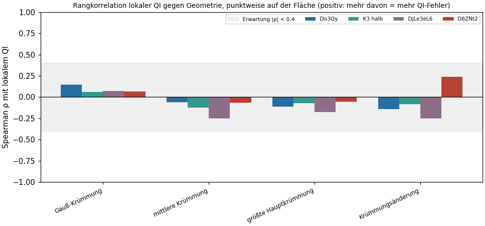
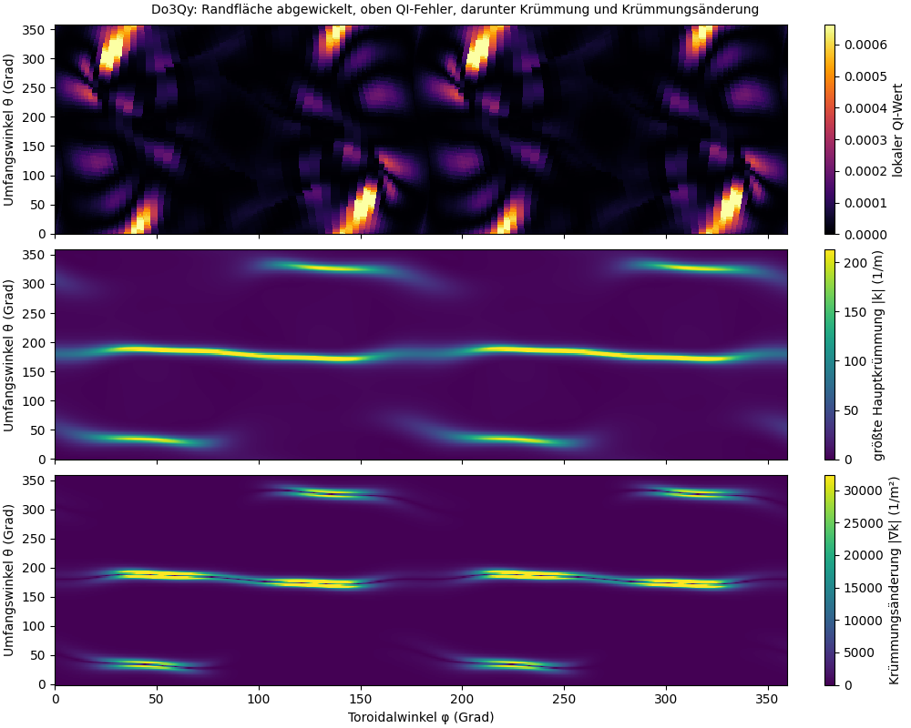
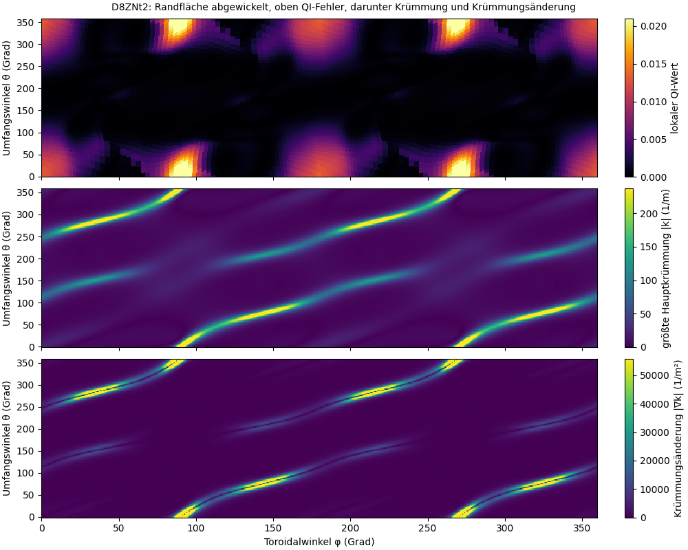
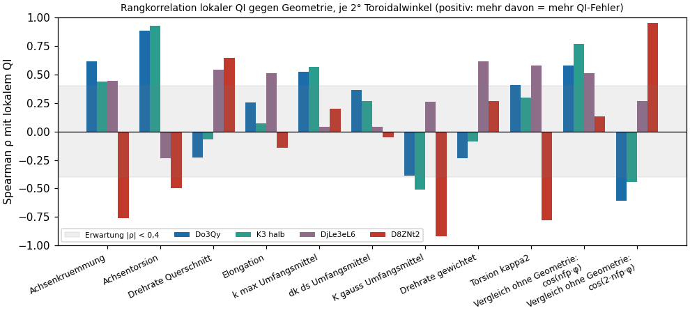
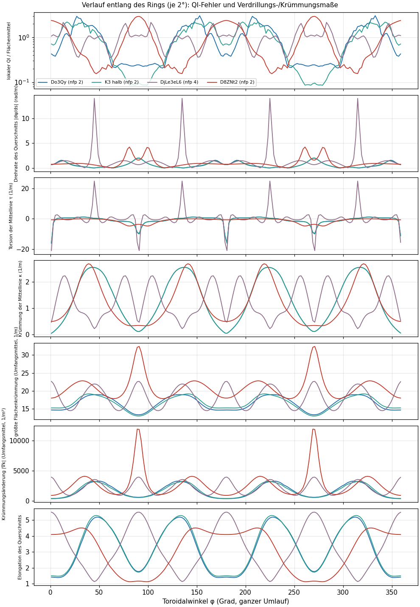
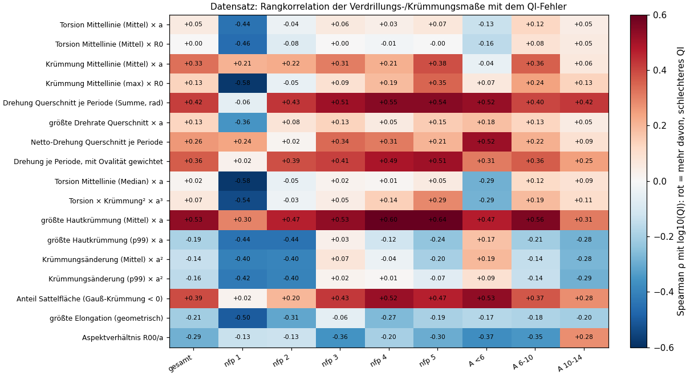
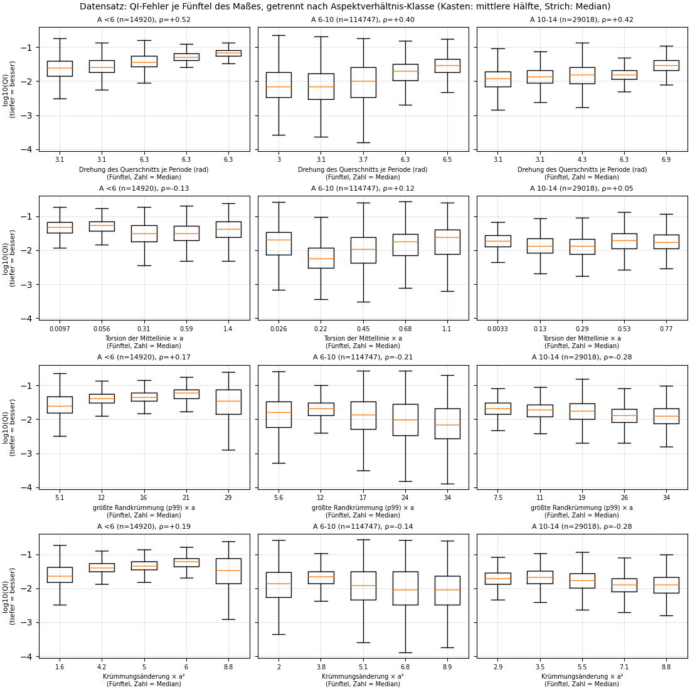
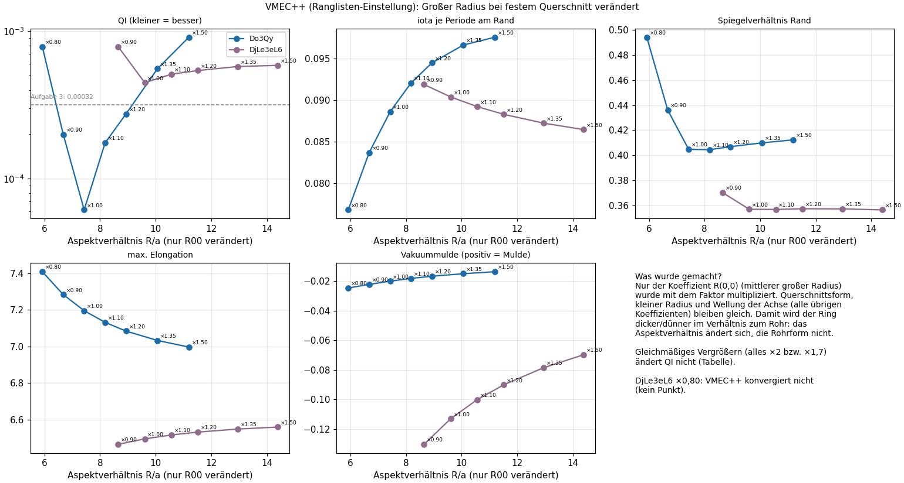

# QI und Verdrillung des Plasmas: Hilft ein großer Durchmesser? (Opus-Agent, 2026-11-05)

Ereignisprotokoll F-247 (Erwartung vorher) und F-250 (Ergebnis), Befund B-055. Skript `stellarator/qi_verdrillung.py`, Lauf `sim/qi_flaeche/verdrillung/lauf.sh`, Bilder im Ordner `qi_verdrillung/` neben diesem Bericht. Nichts hochgeladen, nichts committet.

**Hypothese des Nutzers (wörtlich):** „Gibt es eine Korrelation zwischen lokalem QI und Verdrillung des Plasmas? Ein großer Durchmesser sollte dann helfen, da wir dem Plasma mehr Raum geben, die Verdrillung auszuführen. In der Geometrie wäre das krümmungsstetiger.“

Kennzeichnung: **belegt** = selbst gemessen/gerechnet oder in der Quelle gelesen; **Folgerung** = daraus abgeleitet; **offen** = nicht geprüft.

## Kurzfassung

**Antwort auf die Hypothese: teilweise bestätigt, im Kern (großer Durchmesser hilft, krümmungsstetiger ist besser) nicht.**

- **Maßstab (belegt):** QI ist maßstabsfrei. Ganze Form ×2 oder ×1,7: QI gleich auf 7 bis 16 Stellen. „Großer Durchmesser“ kann nur als Verhältnis wirken (Aspektverhältnis R/a).
- **Großer Durchmesser bei gleichem Rohr (belegt, VMEC++, 2 Formen):** Beide Formen sind bei ihrem Originalradius am besten. Do3Qy: ±10 % am großen Radius machen QI 2,8- bis 3,2-mal schlechter, +50 % 15-mal. DjLe3eL6: −10 % +76 %, +10 % +14 %, +50 % +31 %. Größer hilft nicht, kleiner auch nicht; die Formen sind auf ihr Aspektverhältnis abgestimmt. DjLe3eL6 ×0,8 konvergiert nicht.
- **Verdrillung im Datensatz (belegt, 158 685 Formen):** Die Drehung des Querschnitts je Periode hängt mäßig mit QI zusammen (ρ +0,42, stabil über Periodenzahlen 2 bis 5 und Aspektklassen): Formen mit einer ganzen Umdrehung je Periode sind praktisch nie gut, halbe Umdrehung oder Pendeln schon. Ein Teil davon ist der bekannte iota-Einfluss (ohne iota +0,28, ohne alle Kennzahlen +0,19). Die Verdrillung der Mittellinie (Torsion) hängt **nicht** mit QI zusammen (ρ ≈ 0).
- **Krümmungsstetigkeit (belegt):** nicht bestätigt, eher umgekehrt: mehr Krümmungsänderung geht leicht mit **besserem** QI einher (ρ −0,14), weil gute QI-Formen stark oval mit scharfen Kanten sind. Eine im Mittel flachere Haut geht dagegen mit besserem QI einher (ρ +0,53 für die mittlere Krümmung).
- **Lokal auf der Fläche (belegt, 4 Formen):** Punkt für Punkt kein Zusammenhang (|ρ| ≤ 0,25, Vorzeichen wechselnd). Entlang des Rings große Werte (bis 0,93), aber nicht größer als bei einer geometriefreien Cosinus-Welle (bis 0,95) und mit wechselndem Vorzeichen: Symmetrie, keine Ursache. Die QI-Fehler liegen als schräge Streifen entlang der Feldlinien, nicht auf den Kanten.
- **Theorie (Literatur, im Volltext gelesen):** QI verlangt, dass die Mittellinie an den Stellen größter und kleinster Feldstärke **gerade** ist (Krümmung null; Plunk, Landreman & Helander 2019). Unsere guten Formen zeigen das. Gefordert ist also Krümmung **an den richtigen Stellen**, nicht gleichmäßig wenig Krümmung.
- **Zusätzliche Erklärungskraft** der Verdrillungs-/Krümmungsmaße zu den bekannten Kennzahlen: +2,9 Prozentpunkte R² (0,897 → 0,925).

## 0 Begriffe in Werkstattsprache

- **Plasmafläche (Rand):** die äußere Haut des Plasmaschlauchs. Sie ist kein glatter Donut, sondern ein verbeulter, verdrehter Schlauch, der sich nach einer Periode (nfp-mal je Umlauf) wiederholt, wie das Profil eines Zahnrads.
- **Verdrillung:** wie stark sich der Schlauch beim Umlauf um die eigene Achse dreht, vergleichbar mit der **Schraubensteigung eines Bohrers**: Die Spannut läuft schraubenförmig um den Schaft. Hier wurde sie auf zwei Arten gemessen: (1) **Drehrate des Querschnitts**: Man schneidet den Schlauch bei jedem Winkel quer und schaut, wie sich die lange Achse des (meist ovalen) Querschnitts von Schnitt zu Schnitt dreht, in Grad je Meter Weg; (2) **Torsion der Mittellinie**: wie stark die Mittellinie selbst aus ihrer Ebene herausschraubt (wie eine gezogene Schraubenfeder).
- **Krümmung:** wie eng eine Kurve gebogen ist (1/Biegeradius). Auf einer Fläche gibt es zwei **Hauptkrümmungen** (stärkste und schwächste Biegung an einem Punkt). Ihr Produkt ist die **Gauß-Krümmung** (positiv = Kuppe, negativ = Sattel), ihr Mittel die **mittlere Krümmung**.
- **Krümmungsstetig:** wie ein Straßenverlauf ohne Knicke, bei dem auch die Lenkradstellung nicht springt (Klothoide im Straßenbau). Gemessen als **Krümmungsänderung**: wie schnell sich die Krümmung entlang der Fläche ändert (1/m²). Kleine Werte = krümmungsstetig.
- **Lokaler QI-Wert:** Die offizielle Kennzahl QI ist eine Summe von Abweichungsquadraten über 75 Feldlinien × 2000 Punkte (Rundlaufmaß des Feldes, siehe `qi_einflussgroessen_erklaert.md`). Behält man die Einzelbeiträge, weiß man, **wo** auf der Fläche das Feld vom Ideal abweicht. Das Flächenmittel des lokalen Werts ist wieder der QI der Fläche (B-053).
- **Aspektverhältnis A = R/a:** großer Radius des Rings (Ringmitte bis Rohrmitte) durch kleinen Radius (Rohrradius). Schlanker Ring = großes A.
- **Spearman-Rangkorrelation ρ:** misst, ob „mehr von X“ meistens mit „mehr von Y“ einhergeht (+1), mit „weniger“ (−1) oder gar nicht (0); nur die Reihenfolge zählt, nicht die Zahlenwerte.

## 1 Vorab: Warum „großer Durchmesser“ nur als Verhältnis wirken kann (belegt)

QI ist **dimensionslos**: Das Verfahren normiert die Feldstärke auf jeder Feldlinie auf 0 (Muldenboden) bis 1 (Spitze) und vergleicht die Form der Kurve mit der idealen Mulde. Weder Meter noch Tesla kommen darin vor. Ohne Plasmadruck (so rechnet die Rangliste) ist das Feld eine Lösung der Laplace-Gleichung; sie hat keine eingebaute Länge. Vergrößert man **alles** gleichmäßig um den Faktor 2 (wie eine maßstäbliche Zeichnung), wird das Feld nur gleichmäßig schwächer, seine Form bleibt gleich und damit auch QI. Das wurde hier nachgerechnet (Abschnitt 4.2).

Folgerung für die Hypothese: „Mehr Raum für die Verdrillung“ kann nur bedeuten, dass sich das **Verhältnis** ändert: Der Ring wird im Durchmesser größer, der Rohrquerschnitt bleibt gleich. Das ist ein größeres Aspektverhältnis. Genau das wurde in Teil 3 getestet: nur der große Radius R(0,0) wurde verändert, alle anderen Formkoeffizienten blieben gleich.

Früherer Befund B-036 (Datensatz): Der Zusammenhang Aspektverhältnis ↔ QI wechselt bei etwa A = 10 das Vorzeichen (darunter ist größer besser, darüber schlechter).

## 2 Teil 1: Lokal auf der Plasmafläche (vier Formen)

### 2.1 Vorgehen
Für die vier Formen mit lokaler QI-Karte (Do3Qy, Kandidat 3 halber Schritt, DjLe3eL6, D8ZNt2; die Karte von D8ZNt2 wurde hier nachgerechnet, Flächenmittel trifft QI auf 1,3 %, Symmetrieprüfung 0,1 %) wurde die Geometrie der Randfläche **analytisch** aus der Fourier-Darstellung des Randes berechnet (r_cos, z_sin; Ableitungen exakt, Gitter 180 × 720 über den ganzen Umlauf): Hauptkrümmungen, Gauß- und mittlere Krümmung, Krümmungsänderung; je Schnittwinkel Schwerpunkt, Elongation und Winkel der langen Achse des Querschnitts (aus den Flächenträgheitsmomenten wie bei einem Profil); Krümmung und Torsion der Mittellinie (Linie der Querschnittsschwerpunkte). Prüfung am Torus (Kreisquerschnitt): Gauß-Krümmung außen 0,25, innen −0,5, mittlere Krümmung 0,625 und 0,25, Querschnittsfläche π, alles exakt; rotierende Ellipse: Winkel dreht genau wie vorgegeben.

Der lokale QI-Wert (Boozer-Gitter, Fläche s = 0,995) wurde dem nächstgelegenen Geometriepunkt im Raum zugeordnet (mittlerer Abstand 9 bis 20 mm bei kleinem Radius 85 bis 133 mm; das ist die Maschenweite des QI-Gitters). Dann Rangkorrelation (a) Punkt für Punkt auf der Fläche und (b) nach Mittelung über den Umfang je 2° Toroidalwinkel. Zusätzlich Teilkorrelation bei herausgerechneter Elongation des Querschnitts.

### 2.2 Ergebnis Punkt für Punkt (belegt)

| Maß | Do3Qy | K3 halb | DjLe3eL6 | D8ZNt2 |
|---|---|---|---|---|
| Gauß-Krümmung | +0,15 | +0,06 | +0,07 | +0,07 |
| mittlere Krümmung | −0,06 | −0,12 | −0,25 | −0,07 |
| größte Hauptkrümmung | −0,11 | −0,07 | −0,17 | −0,06 |
| Krümmungsänderung | −0,14 | −0,08 | −0,25 | **+0,24** |
| … mit herausgerechneter Elongation | −0,10 | −0,06 | −0,24 | +0,24 |

Alle Werte |ρ| ≤ 0,25, die Krümmungsänderung wechselt das Vorzeichen zwischen den Formen. **An scharf gebogenen Stellen der Haut ist der QI-Fehler weder systematisch größer noch kleiner.**

Lesehilfe: Je Geometriemaß vier Balken (eine Farbe je Form). Balken nach oben = an Stellen mit mehr davon ist der QI-Fehler größer; nach unten = kleiner. Das graue Band ist die vorher festgelegte Erwartung (|ρ| < 0,4 = schwacher Zusammenhang). Alle Balken liegen im Band.

Lesehilfe: Die Randfläche ist wie ein aufgeschnittener und flach gelegter Schlauch gezeigt: waagerecht einmal um den Ring (Toroidalwinkel 0 bis 360°), senkrecht einmal um das Rohr (Umfangswinkel). Oben der lokale QI-Fehler (hell = viel Abweichung), Mitte die größte Krümmung (hell = scharfe Kante des ovalen Querschnitts), unten die Krümmungsänderung (hell = Krümmung ändert sich schnell). Bei Do3Qy liegen die hellen QI-Flecken als **schräge Streifen** quer über die Fläche, also entlang der schraubenförmigen Feldlinien, und **nicht** auf den Kanten (gelbe Bänder in der Mitte und unten). Bei D8ZNt2 fällt ein heller QI-Fleck (φ ≈ 90° und 270°, oben/unten) mit der Stelle zusammen, an der die scharfe Kante über den Umfangswinkel 0 läuft; das erklärt die einzige positive Korrelation (+0,24). Die blockige Struktur oben ist die Maschenweite des QI-Gitters (Zuordnung zum nächsten Punkt), keine Physik.

### 2.3 Ergebnis entlang des Rings, je 2° gemittelt (belegt, aber mit großer Vorsicht zu lesen)

| Maß | Do3Qy | K3 halb | DjLe3eL6 | D8ZNt2 |
|---|---|---|---|---|
| Krümmung der Mittellinie | +0,62 | +0,44 | +0,44 | −0,76 |
| Torsion der Mittellinie | +0,88 | +0,93 | −0,23 | −0,50 |
| Drehrate des Querschnitts | −0,23 | −0,07 | +0,54 | +0,65 |
| Drehrate, gewichtet mit Ovalität | −0,23 | −0,09 | +0,61 | +0,26 |
| größte Flächenkrümmung (Umfangsmittel) | +0,52 | +0,57 | +0,04 | +0,20 |
| Krümmungsänderung (Umfangsmittel) | +0,37 | +0,27 | +0,04 | −0,05 |
| Elongation | +0,25 | +0,07 | +0,51 | −0,14 |
| **Vergleich ohne Geometrie: cos(nfp·φ)** | +0,58 | +0,77 | +0,51 | +0,13 |
| **Vergleich ohne Geometrie: cos(2·nfp·φ)** | −0,61 | −0,44 | +0,27 | **+0,95** |

Lesehilfe Balkenbild: wie oben, aber jede Größe ist vorher über den Umfang gemittelt (eine Zahl je 2°-Scheibe des Rings). Die beiden rechten Gruppen sind **reine Cosinus-Wellen ohne jede Geometrie**, als Vergleichsmaßstab. Lesehilfe Verlaufsbild: sieben übereinanderliegende Kurven entlang des Rings; oben der QI-Fehler je Scheibe (logarithmisch, 1 = Flächenmittel), darunter die Geometriemaße. Do3Qy (blau) und K3 (grün) liegen fast übereinander, weil K3 nur ein halber Schritt von Do3Qy ist; sie sind keine unabhängigen Formen.

Deutung (Folgerung): Die großen Werte (bis 0,93) sehen nach starkem Zusammenhang aus, sind es aber nicht:
1. **Symmetrie erzwingt Gleichlauf.** Jede Größe wiederholt sich nfp-mal und ist spiegelsymmetrisch (Stellarator-Symmetrie). In einer halben Periode läuft jede glatte Größe im Wesentlichen nur von einem Symmetriepunkt (φ = 0) zum anderen (φ = halbe Periode). Zwei solche Kurven korrelieren deshalb fast immer stark positiv oder stark negativ. Eine reine Cosinus-Welle erreicht ebenso große Werte (bis 0,95 bei D8ZNt2). Im Kern liefert jede Form nur eine Ja/Nein-Information: „Ist der QI-Fehler dort groß, wo auch die Geometriegröße groß ist?“
2. **Vorzeichen wechseln zwischen den Formen.** Torsion: +0,88/+0,93 bei Do3Qy/K3, −0,23 und −0,50 bei DjLe3eL6 und D8ZNt2. Krümmung der Mittellinie: dreimal positiv, einmal −0,76. Drehrate des Querschnitts: zweimal leicht negativ, zweimal positiv. Eine allgemeine Regel „mehr Verdrillung = mehr QI-Fehler“ lässt sich daraus nicht ableiten.
3. **Die Verdrillungsmaße haben Spitzen, die Messartefakte sind.** Die Drehrate des Querschnitts springt bei DjLe3eL6 (14 rad/m bei φ = 45°), weil der Querschnitt dort fast rund ist (Elongation 1,15): Die Lage der langen Achse einer fast runden Ellipse ist schlecht bestimmt, ein Viertelkreis-Umschlag wird zur Drehratenspitze. Die Torsion der Mittellinie springt dort, wo die Mittellinie fast gerade ist (Krümmung nahe null), denn Torsion ist dort mathematisch schlecht bestimmt. Gewichtete Varianten (Drehrate × Ovalität, Torsion × Krümmung²) ändern das Bild nicht grundsätzlich.

### 2.4 Ein belegter Zusammenhang aus der Theorie: Die Mittellinie muss an den Feldextremen gerade sein

In der Theorie nahe der magnetischen Achse (Plunk, Landreman & Helander 2019, „Direct construction of optimized stellarator shapes. Part 3. Omnigenity near the magnetic axis“, J. Plasma Phys. 85, doi 10.1017/S002237781900062X; Abschnitt 7 in der arXiv-Fassung 1909.08919 im Volltext gelesen) gilt für QI-Felder: „the curvature must indeed be zero at extrema of B“, also: **die Krümmung der Achse muss an den Stellen null sein, wo die Feldstärke auf der Achse ihr Maximum oder Minimum hat.** Unsere Formen zeigen genau das (Verlaufsbild, vierte Kurve): Die Krümmung der Mittellinie geht bei Do3Qy/K3 bei φ = 0°, 90°, 180°, 270° fast auf null (0,05 bis 0,1 1/m gegen bis 2,5 1/m dazwischen), bei DjLe3eL6 sind die Minima an Periodenmitte und -grenze weniger tief (0,25 und 0,5 1/m gegen bis 2,2 1/m), dort ist die Bedingung also nur ungefähr erfüllt (DjLe3eL6 hat auch den 7-mal schlechteren QI). An diesen geraden Stellen dreht sich das Achsensystem schnell (Torsionsspitzen). Folgerung: QI verlangt **nicht** weniger Verdrillung oder überall sanfte Krümmung, sondern Krümmung und Verdrillung **an den richtigen Stellen** (gerade Stücke an den Feldextremen, dazwischen gebogen). Eine solche Achse ist eher das Gegenteil von „gleichmäßig krümmungsstetig“: Sie hat bewusst Wechsel zwischen fast geraden und stark gebogenen Abschnitten (wie eine Rennbahn mit Geraden und Kurven; die genannte Arbeit beschreibt ihre Beispielachse selbst als „racetrack oval“).

### 2.5 Urteil Teil 1
Punktweise: kein Zusammenhang (|ρ| ≤ 0,25, Vorzeichen wechselnd). Entlang des Rings: große Werte, aber nicht stärker als bei einer geometriefreien Cosinus-Welle und mit wechselndem Vorzeichen; daraus folgt keine Regel. Die Spulen spielen hier keine Rolle (QI im Paket kennt keine Spulen). Nur vier Formen, davon zwei fast gleich: das ist ein Hinweis, kein Beweis.

## 3 Teil 2: Im ganzen Datensatz (158 685 Formen, ohne VMEC)

### 3.1 Vorgehen
Für jede gültige Form (QI > 0) wurden aus den Randkoeffizienten mit denselben analytischen Formeln wie in Teil 1 (Gitter 48 × 48 je Periode) folgende Maße berechnet, alle **dimensionslos** gemacht (mit dem kleinen Radius a bzw. dem großen Radius R00), damit sie zur maßstabsfreien Kennzahl QI passen:
- Verdrillung: **Drehung des Querschnitts je Periode** (Summe der Winkeländerungen der langen Achse, in rad; π = halbe Umdrehung), dieselbe mit Ovalität gewichtet (fast runde Querschnitte zählen kaum), Netto-Drehung je Periode, größte Drehrate × a; **Torsion der Mittellinie** (Mittel und Median × a, Mittel × R00, Torsion × Krümmung² als robuste Variante).
- Krümmung: Krümmung der Mittellinie (Mittel × a, Maximum × R00); größte Hautkrümmung (Flächenmittel und 99-%-Wert × a); Anteil Sattelfläche.
- Krümmungsstetigkeit: **Krümmungsänderung** (Flächenmittel und 99-%-Wert × a²).
Rechenzeit 28 min. Dann Rangkorrelation mit log10(QI), gesamt, je Periodenzahl und je Aspektverhältnis-Klasse (< 6: 14 920 Formen; 6–10: 114 747; 10–14: 29 018; über 14 gibt es im Datensatz keine 200 Formen, Klasse entfällt). Modelle (Gradient Boosting, 20 % der Daten zurückgehalten): (A) bekannte Kennzahlen + Periodenzahl, (B) A + alle neuen Maße, (C) nur neue Maße + Periodenzahl + Aspektverhältnis, (D) nur Periodenzahl + Aspektverhältnis. Teilkorrelationen (Einfluss anderer Größen herausgerechnet, Ränge linear bereinigt).

### 3.2 Ergebnis (belegt)

| Maß | ρ gesamt | Spanne je nfp (1 / 2–5) | Spanne je A-Klasse | ρ ohne Einfluss von iota | ρ ohne alle Kennzahlen |
|---|---|---|---|---|---|
| Drehung des Querschnitts je Periode | **+0,42** | −0,06 / +0,43 bis +0,55 | +0,40 bis +0,52 | +0,28 | +0,19 |
| dieselbe, mit Ovalität gewichtet | +0,36 | +0,02 / +0,39 bis +0,51 | +0,25 bis +0,36 | +0,15 | +0,14 |
| Torsion der Mittellinie × a | +0,05 | −0,44 / −0,04 bis +0,07 | −0,13 bis +0,12 | +0,12 | +0,11 |
| Torsion der Mittellinie × R00 | +0,00 | −0,46 / −0,08 bis +0,00 | −0,16 bis +0,08 | +0,07 | +0,11 |
| Krümmung der Mittellinie × a | +0,33 | +0,21 / +0,21 bis +0,38 | −0,04 bis +0,36 | +0,39 | +0,11 |
| größte Hautkrümmung, Mittel × a | **+0,53** | +0,30 / +0,47 bis +0,64 | +0,31 bis +0,56 | +0,52 | +0,17 |
| größte Hautkrümmung, p99 × a | −0,19 | −0,44 / −0,44 bis +0,03 | −0,28 bis +0,17 | −0,19 | +0,07 |
| **Krümmungsänderung** × a² | **−0,14** | −0,40 / −0,40 bis +0,07 | −0,28 bis +0,19 | −0,14 | +0,10 |
| Anteil Sattelfläche | +0,39 | +0,02 / +0,20 bis +0,52 | +0,28 bis +0,53 | +0,22 | +0,15 |

Positiv = mehr davon geht mit schlechterem QI einher. „Ohne alle Kennzahlen“: iota (Rand, Achse), Elongation, Aspektverhältnis, Periodenzahl, beide Spiegelverhältnisse, Dreieckigkeit, Vakuummulde herausgerechnet.

Modelle, R² auf zurückgehaltenen Daten: (A) bekannte Kennzahlen 0,897; (B) zusätzlich die neuen Maße 0,925 (**+0,029**); (C) nur neue Maße + nfp + A 0,880; (D) nur nfp + A 0,291.

**Die Drehung je Periode ist gestuft.** Weil sich die Form nach jeder Periode wiederholt, dreht sich der Querschnitt je Periode netto um ein Vielfaches einer halben Umdrehung (0, π oder 2π). Im Datensatz:

| Netto-Drehung je Periode | Formen | Median QI | Anteil mit QI ≤ 0,00032 (Aufgabe 3) | unter den besten 1 % |
|---|---|---|---|---|
| 0 (pendelt hin und her) | 34 961 | 0,0157 | 0,17 % | 487 |
| π (halbe Umdrehung) | 77 814 | 0,0112 | 0,08 % | 1 071 |
| 2π (ganze Umdrehung) | 45 470 | 0,0296 | 0,00 % | 14 |

(Weitere 412 Formen liegen zwischen den Stufen.) Do3Qy und K3 drehen sich je Periode eine halbe Umdrehung, DjLe3eL6 und D8ZNt2 pendeln (netto 0).

Lesehilfe: Jede Zeile ein Maß, jede Spalte eine Gruppe (alle, je Periodenzahl, je Aspektverhältnis-Klasse). Die Zahl im Feld ist ρ; rot = mehr davon, schlechteres QI; blau = mehr davon, besseres QI; weiß = kein Zusammenhang. Eine durchgehend rote Zeile (Drehung je Periode, mittlere Hautkrümmung) ist ein über alle Gruppen stabiler Zusammenhang. Die Spalte nfp 1 weicht oft ab (eigene Formfamilie).

Lesehilfe: Zeilen = vier Maße, Spalten = drei Aspektverhältnis-Klassen. Die Formen jeder Klasse sind nach dem Maß in fünf gleich große Gruppen (Fünftel) sortiert, von wenig (links) nach viel (rechts); die Zahl darunter ist der Median der Gruppe. Jeder Kasten zeigt die mittlere Hälfte der QI-Werte der Gruppe (log10, tiefer = besser), der orange Strich den Median, die Striche oben und unten die Spannweite ohne Ausreißer. Steigen die Kästen nach rechts, schadet „mehr davon“. Obere Zeile (Drehung je Periode): Kästen steigen in allen Klassen, die Mediane springen von 3,1 (halbe Umdrehung) auf 6,3 (ganze). Zweite Zeile (Torsion der Mittellinie): kein Trend. Untere zwei Zeilen (größte Randkrümmung, Krümmungsänderung): bei A 6–14 eher fallend, also bessere QI bei **mehr** Krümmungsänderung, bei A < 6 uneinheitlich.

### 3.3 Deutung (Folgerung)
1. **Verdrillung des Querschnitts: ja, mäßig.** Formen, deren Querschnitt sich je Periode eine ganze Umdrehung dreht, erreichen praktisch nie gutes QI; halbe Umdrehung oder Pendeln ist der Bereich der guten Formen. Ein Teil davon ist der bekannte Einfluss von iota (die Drehung des ovalen Querschnitts erzeugt die Gewindesteigung der Feldlinien wie eine Schraube; Korrelation Drehung ↔ iota +0,58 bis +0,79). Nach Herausrechnen bleibt ρ +0,28, nach allen Kennzahlen +0,19.
2. **Verdrillung der Mittellinie (Torsion): nein** (ρ ≈ 0, je A-Klasse höchstens ±0,16; nur nfp 1 −0,44, dort aber im umgekehrten Sinn: mehr Torsion, besseres QI).
3. **Krümmungsstetigkeit: nein, eher umgekehrt.** Mehr Krümmungsänderung geht leicht mit **besserem** QI einher (−0,14, bei nfp 1 und 2 −0,40). Das hängt fast ganz an der Elongation (ρ Krümmungsänderung ↔ Elongation +0,57; nach Herausrechnen der Elongation 0,04). Gute QI-Formen sind stark oval mit scharfen Kanten (Elongation 5 bis 7, B-047); scharfe Kanten bedeuten große Krümmungsänderung.
4. **Mittlere Hautkrümmung: ja, deutlich** (+0,53, in allen Gruppen +0,30 bis +0,64, nach iota/Elongation/A/nfp noch +0,37): Formen mit im Mittel flacherer Haut (bezogen auf den Rohrradius) haben besseres QI. Das ist **nicht** dasselbe wie „krümmungsstetig“: Flache Seiten mit scharfen Kanten haben eine kleine mittlere Krümmung, aber eine große Krümmungsänderung.
5. **Zusätzliche Erklärungskraft klein:** Die neuen Maße heben das Modell von 0,897 auf 0,925 (+2,9 Prozentpunkte). Sie erklären aber fast ebenso viel **allein** (0,880), weil sie aus denselben Koeffizienten folgen wie die Kennzahlen. Es ist also eine andere Sicht auf dieselbe Information, keine neue Ursache.
6. Wichtig: Alles ist Korrelation in einem Datensatz, dessen Formen nach bestimmten Verfahren erzeugt wurden; keine Ursache.

## 4 Teil 3: Ursache und Wirkung mit VMEC++ (zwei Formen)

### 4.1 Was genau gemacht wurde
Die Randform ist eine Fourier-Reihe R(θ, φ) = Σ r_cos[m, n] cos(mθ − n·nfp·φ), Z = Σ z_sin[m, n] sin(…). Der Koeffizient **r_cos[0, 0] = R00** ist der mittlere große Radius (Ringmitte bis Rohrmitte). Er wurde mit dem Faktor 0,8 / 0,9 / 1,0 / 1,1 / 1,2 / 1,35 / 1,5 multipliziert, **alle anderen Koeffizienten blieben unverändert**. Damit bleiben Rohrquerschnitt (Form, Größe, Drehung je Periode) und die Wellung der Mittellinie in Metern gleich; nur der Ring wird im Durchmesser größer oder kleiner. Das Aspektverhältnis ändert sich etwa proportional zum Faktor. Ein Nebeneffekt, der dazugehört: Die gleiche Verdrillung (eine halbe Drehung des Querschnitts je Periode) verteilt sich auf einen längeren Weg, die Verdrillung je Meter sinkt, genau wie es die Hypothese („mehr Raum für die Verdrillung“) meint. Je Stufe `forward_model` mit `ConstellarationSettings.default_high_fidelity()` (Einstellung der Rangliste), 85 bis 173 s je Rechnung.

Zweiter Satz (Prüfstein): alle Koeffizienten mal 2 (und mal 1,7, siehe unten), also maßstäbliche Vergrößerung.

### 4.2 Ergebnis (belegt)

Tabelle (Zahlen mit Dezimalpunkt, direkt aus der Rechnung; „Vakuummulde“ negativ = keine Mulde):

| Form | Faktor R00 | QI | Aspektverhältnis | iota/nfp Rand | Spiegel Rand | max. Elongation | Vakuummulde | Rechenzeit s | Fehler |
|---|---|---|---|---|---|---|---|---|---|
| Do3Qy | 0.80 | 0.0007844 | 5.92 | 0.0768 | 0.494 | 7.41 | -0.0246 | 85 | – |
| Do3Qy | 0.90 | 0.0001996 | 6.68 | 0.0837 | 0.436 | 7.28 | -0.0222 | 91 | – |
| Do3Qy | 1.00 | 6.147e-05 | 7.43 | 0.0886 | 0.405 | 7.20 | -0.0200 | 91 | – |
| Do3Qy | 1.10 | 0.0001749 | 8.18 | 0.0921 | 0.404 | 7.13 | -0.0182 | 103 | – |
| Do3Qy | 1.20 | 0.000275 | 8.93 | 0.0945 | 0.407 | 7.08 | -0.0167 | 102 | – |
| Do3Qy | 1.35 | 0.0005563 | 10.06 | 0.0966 | 0.410 | 7.03 | -0.0150 | 118 | – |
| Do3Qy | 1.50 | 0.0009093 | 11.19 | 0.0975 | 0.412 | 7.00 | -0.0136 | 119 | – |
| Do3Qy | alles ×1.70 | 6.147056155e-05 (×1: 6.147056689e-05, rel. 8.7e-08) | 7.4286 | 0.088580 | 0.404702 | 7.1961 | -0.020005 | 94 | – |
| Do3Qy | alles ×2.00 | 6.147056689e-05 (×1: 6.147056689e-05, rel. 0.0e+00) | 7.4286 | 0.088580 | 0.404702 | 7.1961 | -0.020005 | 96 | – |
| DjLe3eL6 | 0.80 | – | – | – | – | – | – | 541 | RuntimeError: VMEC++ did not converge |
| DjLe3eL6 | 0.90 | 0.0007859 | 8.65 | 0.0919 | 0.370 | 6.47 | -0.1304 | 173 | – |
| DjLe3eL6 | 1.00 | 0.0004475 | 9.61 | 0.0904 | 0.357 | 6.50 | -0.1131 | 142 | – |
| DjLe3eL6 | 1.10 | 0.0005107 | 10.56 | 0.0892 | 0.357 | 6.52 | -0.1002 | 150 | – |
| DjLe3eL6 | 1.20 | 0.000541 | 11.52 | 0.0883 | 0.357 | 6.53 | -0.0901 | 152 | – |
| DjLe3eL6 | 1.35 | 0.0005761 | 12.95 | 0.0872 | 0.357 | 6.55 | -0.0786 | 162 | – |
| DjLe3eL6 | 1.50 | 0.0005865 | 14.39 | 0.0864 | 0.356 | 6.56 | -0.0699 | 165 | – |
| DjLe3eL6 | alles ×1.70 | 0.0004475408457 (×1: 0.0004475408752, rel. 6.6e-08) | 9.6073 | 0.090369 | 0.356901 | 6.4950 | -0.113140 | 142 | – |
| DjLe3eL6 | alles ×2.00 | 0.0004475408752 (×1: 0.0004475408752, rel. 0.0e+00) | 9.6073 | 0.090369 | 0.356901 | 6.4950 | -0.113140 | 147 | – |

Lesehilfe: Sechs Felder, waagerecht immer das Aspektverhältnis (rechts = schlankerer Ring = größerer Durchmesser bei gleichem Rohr), die Beschriftung ×0,80 … ×1,50 ist der Faktor auf R00. Links oben QI (logarithmisch, tiefer = besser, gestrichelt die Grenze der Aufgabe 3), daneben iota (Gewindesteigung der Feldlinien), Spiegelverhältnis (Verengung der „Düse“), größte Elongation (Ovalität) und Vakuummulde (positiv wäre stabil). Blau Do3Qy, violett DjLe3eL6.

Was man sieht:
- **Beide Formen sind bei ihrem Originalradius am besten.** Do3Qy: ×1,0 QI 0,0000615; schon ±10 % machen es 2,8- bis 3,2-mal schlechter, ±20 % 4,5- bis 13-mal, ×1,5 15-mal. DjLe3eL6: ×1,0 0,000448; ×0,9 +76 %, ×1,1 +14 %, danach flacht es ab (×1,5 +31 %). Größerer Durchmesser **verschlechtert** QI bei festem Querschnitt in beiden Formen, kleinerer ebenfalls.
- iota ändert sich nur um wenige Prozent (Do3Qy steigt, DjLe3eL6 fällt), Spiegelverhältnis und Elongation kaum, außer bei Do3Qy ×0,8/×0,9 (Spiegel 0,44 bis 0,49). Die Vakuummulde wird mit größerem Durchmesser etwas besser (weniger negativ), bleibt aber negativ.
- **DjLe3eL6 ×0,8 konvergiert nicht** (VMEC++ „did not converge“ nach 541 s). Keine Zahl dafür; nicht geraten.

**Gleichmäßige Vergrößerung (Prüfstein):** Alles ×2: alle zwölf Kennzahlen bitgenau gleich (QI 0,00006147056689 bzw. 0,0004475408752). Faktor 2 ist im Rechner allerdings ein Sonderfall (Zweierpotenz, Multiplikation in Gleitkomma exakt), daher zusätzlich ×1,7: QI gleich auf 7 Stellen (relative Abweichung 8,7·10⁻⁸ bzw. 6,6·10⁻⁸, das ist die Rechengenauigkeit von VMEC++), Aspektverhältnis, iota, Spiegelverhältnis, Elongation und Vakuummulde ebenso. **Belegt: Die Größe der Anlage allein ändert QI nicht.**

### 4.3 Deutung (Folgerung)
Die Formen im Datensatz sind für ihr Aspektverhältnis ausgelegt (optimiert). Ändert man nur eine Größe, passen die übrigen Koeffizienten nicht mehr zusammen, das Feldmuster verstimmt sich, und QI wird schlechter, egal in welche Richtung. Das ist dasselbe Muster wie bei der Surrogat-Suche (B-050: Formen vertragen nur kleine Schritte). Die Stärke ist sehr verschieden: Do3Qy (sehr gut, QI 0,00006) liegt in einem schmalen, tiefen Tal, DjLe3eL6 (7-mal schlechter) in einem flachen. Das spricht dafür, dass sehr gute QI-Formen empfindlich auf ihr Aspektverhältnis abgestimmt sind.

Was der Test **nicht** zeigt: ob eine Form, die bei größerem Aspektverhältnis **neu optimiert** wird, besser sein kann. Die Theorie nahe der Achse wird mit größerem Aspektverhältnis genauer (die störenden Terme wachsen mit a/R), dort ist QI grundsätzlich leichter zu erreichen; der Datensatz (B-036, B-047) zeigt aber die besten Formen bei A ≈ 7,5 bis 9,7 und einen Vorzeichenwechsel bei etwa 10. Beides zusammen: Ein großer Durchmesser ist kein Hebel, den man an einer fertigen Form ziehen kann; er wäre ein neuer Entwurfspunkt, der neu optimiert werden müsste (offen).

## 5 Gesamturteil zur Hypothese

| Teilaussage | Ergebnis | Urteil |
|---|---|---|
| Lokaler QI hängt mit der Verdrillung zusammen | punktweise nein; entlang des Rings nicht von Symmetrie zu trennen; im Datensatz: Drehung des Querschnitts je Periode ja (mäßig, +0,42), Torsion der Mittellinie nein | **teilweise** |
| Großer Durchmesser hilft | Maßstab allein: wirkungslos (belegt). Großer Radius bei festem Querschnitt: QI schlechter in beiden Formen (belegt). Neu optimiert bei großem A: offen; der Datensatz zeigt die besten Formen bei A 7,5 bis 9,7 | **nicht bestätigt** (für fertige Formen) |
| Mehr Raum für die Verdrillung | Die Drehung je Periode ist eine Stufenzahl (0, π, 2π) und ändert sich mit dem Durchmesser nicht; nur die Drehung je Meter sinkt, und Meter kommen in QI nicht vor | **nicht bestätigt** (Mechanismus greift nicht) |
| Krümmungsstetiger ist besser | Krümmungsänderung ρ −0,14 (eher umgekehrt), lokal kein Zusammenhang; QI verlangt gerade Stücke an den Feldextremen und dazwischen Biegung | **nicht bestätigt** |
| Weniger Verdrillung ist besser | ganze Umdrehung je Periode fast nie gut; halbe Umdrehung oder Pendeln gut | **teilweise** (zu viel schadet, weniger ist nicht automatisch besser) |

Der richtige Kern der Idee: Die **Geometrie** der Plasmahaut bestimmt QI vollständig (ohne Spulen), und **zu viel Verdrehung** des Querschnitts schadet. Die Folgerung „größer und runder gebogen ist besser“ trägt aber nicht, weil QI maßstabsfrei ist und gute QI-Formen gerade bewusst abwechselnd fast gerade und stark gebogene Abschnitte haben (wie eine Rennbahn).

## 6 Erwartung (vorher, F-247) und Vergleich

| Erwartung | Ergebnis | Urteil |
|---|---|---|
| (a) lokal \|ρ\| < 0,4 und nicht in allen Formen gleiches Vorzeichen | punktweise alle \|ρ\| ≤ 0,25, Vorzeichen wechselnd; je 2° dagegen bis 0,93 (Symmetrieeffekt), Vorzeichen wechselnd | **teilweise getroffen**: Vorzeichen ja; Betrag nur punktweise, je 2° verfehlt |
| (b1) reine Verdrillung im Datensatz \|ρ\| < 0,3 | Torsion der Mittellinie 0,00 bis 0,05 (getroffen); Drehung des Querschnitts +0,42 (verfehlt) | **teilweise getroffen** |
| (b2) zusätzliche Erklärung < 5 % R² | +2,9 Prozentpunkte | **getroffen** |
| (c1) R00 größer: nicht monoton, erst gleich/besser bis Optimum, dann schlechter | Optimum genau beim Original (×1,0), schon ×1,1 schlechter; kein „erst besser“ | **teilweise getroffen** (nicht monoton ja, Lage des Optimums falsch: es lag nicht bei größerem R) |
| (c2) gleichmäßige Skalierung: QI auf ≥ 6 Stellen gleich | ×2: bitgenau; ×1,7: 7 Stellen | **getroffen** |

Was verfehlt wurde und warum: Bei (a) hatte ich die Wirkung der Stellarator-Symmetrie auf Korrelationen entlang des Rings nicht bedacht; erst der Vergleich mit reinen Cosinus-Wellen hat gezeigt, dass große Werte dort wenig bedeuten. Bei (b1) hatte ich die gestufte Drehung je Periode nicht vorhergesehen. Bei (c1) hatte ich erwartet, dass ein etwas größerer Radius zunächst nicht schadet; tatsächlich sitzen die Formen genau in ihrem Optimum.

## 7 Offene Punkte

- **Neu optimieren bei großem Aspektverhältnis:** Ob eine Form, die bei A = 12 bis 14 neu ausgelegt wird, besseres QI erreicht als Do3Qy, sagt dieser Test nicht. Das wäre der eigentliche Test von „großer Durchmesser“ (VMEC++-Optimierung, aufwendig).
- **Mit nachgeführtem Querschnitt skalieren:** Variante, bei der mit R00 auch die Wellung der Mittellinie (r_cos[0, n], z_sin[0, n]) im gleichen Verhältnis wächst, damit die Achsenform maßstäblich bleibt und nur der Rohrquerschnitt relativ kleiner wird. Nicht gerechnet.
- **Lokale Zuordnung:** nächster Nachbar auf dem QI-Gitter (Maschenweite 9 bis 20 mm). Eine Interpolation in Boozer-Winkeln wäre genauer; am Urteil (|ρ| ≤ 0,25) ändert das vermutlich nichts.
- **Verdrillungsmaße** sind bei fast runden Querschnitten (Drehrate) und fast geraden Mittellinien (Torsion) schlecht bestimmt; die gewichteten Varianten mildern das, ersetzen aber kein sauberes Maß (z. B. Verdrillung im mitgeführten Bezugssystem der Achse).
- Nur zwei Formen im kausalen Test, nur vier (davon zwei fast gleiche) lokal.

## English summary

User hypothesis: local QI correlates with the twist of the plasma; a larger diameter should help by giving the plasma more room to twist, i.e. a geometry with smoother curvature. Checks: (1) QI is dimensionless and scale invariant: scaling the whole boundary by 2 or 1.7 leaves QI unchanged to 16 resp. 7 digits (VMEC++, ranking settings). "Larger diameter" can only act through the aspect ratio. (2) Causal test with VMEC++: multiplying only R00 (major radius) by 0.8 to 1.5 at fixed cross-section makes QI worse in both directions for both shapes; the original radius is optimal (Do3Qy: ±10 % gives 2.8–3.2× worse QI, +50 % 15×; DjLe3eL6: −10 % +76 %, +10 % +14 %, +50 % +31 %; ×0.8 did not converge). (3) Dataset (158,685 shapes, analytic geometry from boundary coefficients): cross-section rotation per field period correlates moderately with log QI (Spearman +0.42, stable across nfp 2–5 and aspect classes; +0.28 after removing iota, +0.19 after all known metrics); rotation is quantised (0, π, 2π per period) and a full turn per period almost never gives good QI. Magnetic-axis torsion does not correlate (≈0). Curvature variation (smoothness) correlates weakly in the opposite direction (−0.14, explained by elongation). Mean surface curvature correlates +0.53. Added explanatory power over known metrics: +0.029 R². (4) Locally on the surface (4 shapes): pointwise |ρ| ≤ 0.25 with changing signs; toroidally averaged correlations up to 0.93 are no larger than for a pure cosine (stellarator symmetry), signs change between shapes. Near-axis theory (Plunk, Landreman & Helander 2019) requires zero axis curvature at the extrema of B, which our good shapes show: QI needs curvature in the right places, not uniformly smooth curvature. Verdict: partially confirmed (too much cross-section twist is bad), not confirmed for "larger diameter helps" and "smoother curvature is better". Prior expectations: (a) partly met, (b) partly met (twist correlation 0.42 > 0.3), (b2) met, (c1) partly met (non-monotonic, but optimum exactly at the original radius), (c2) met.
