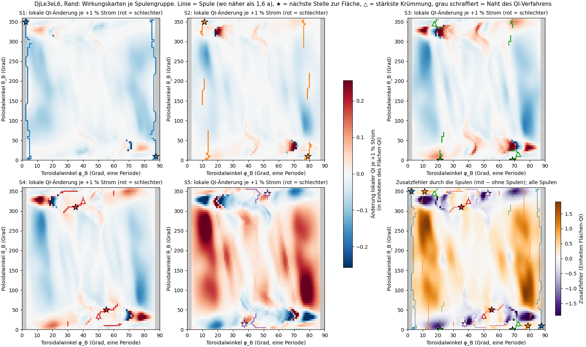
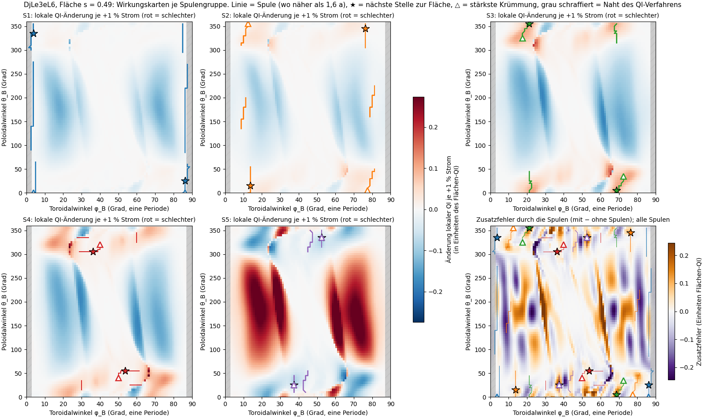
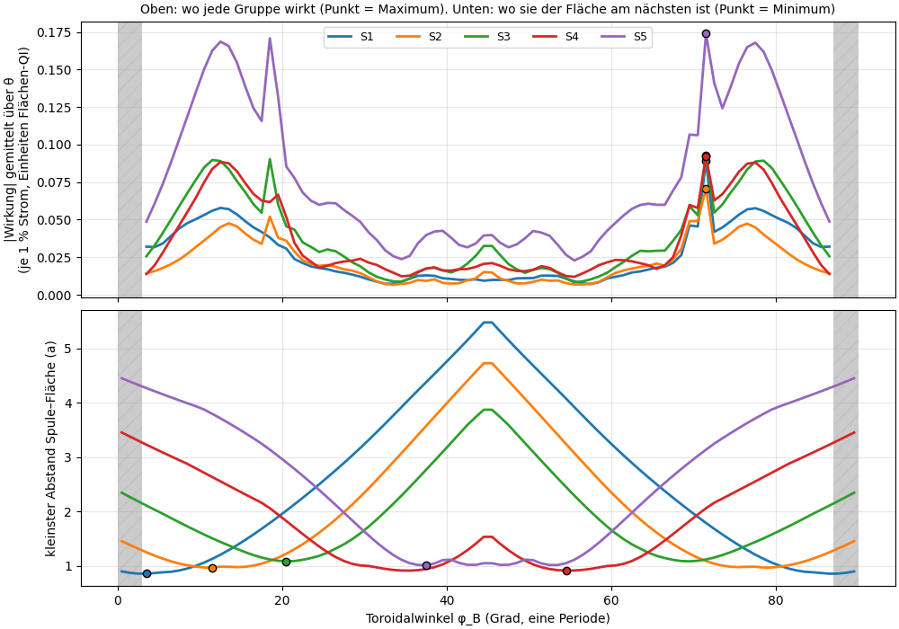
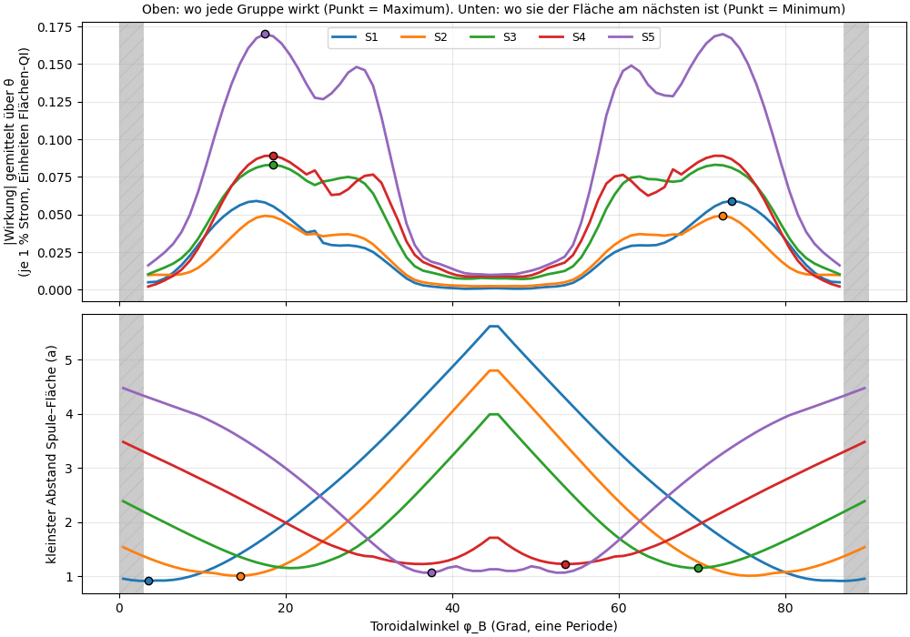
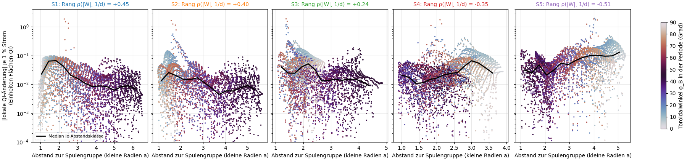
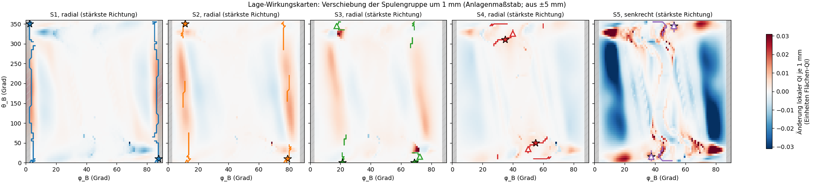
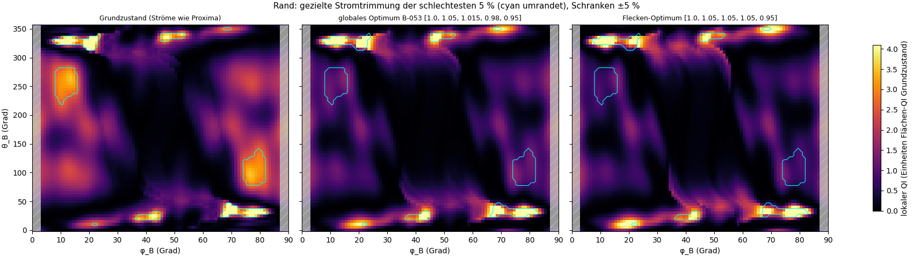
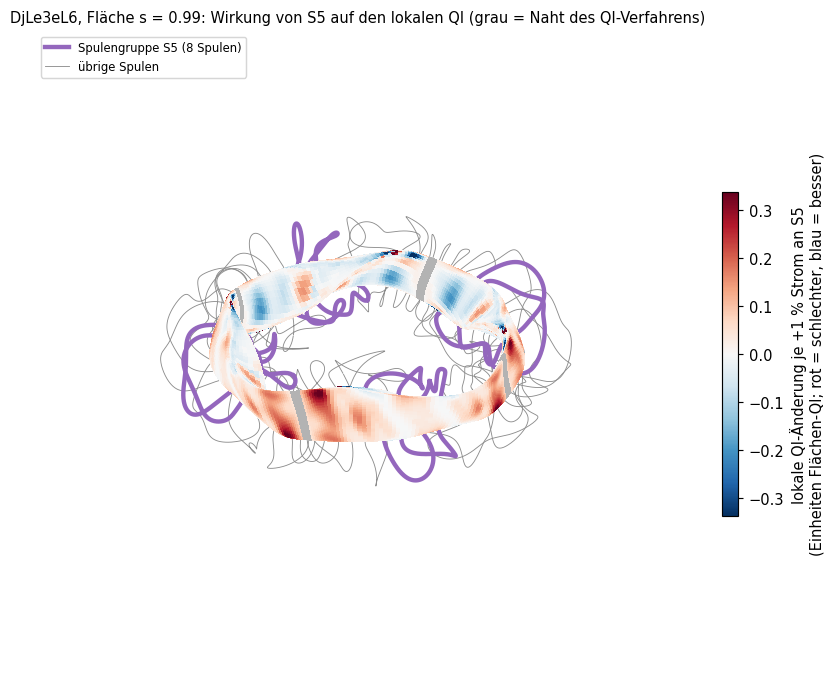
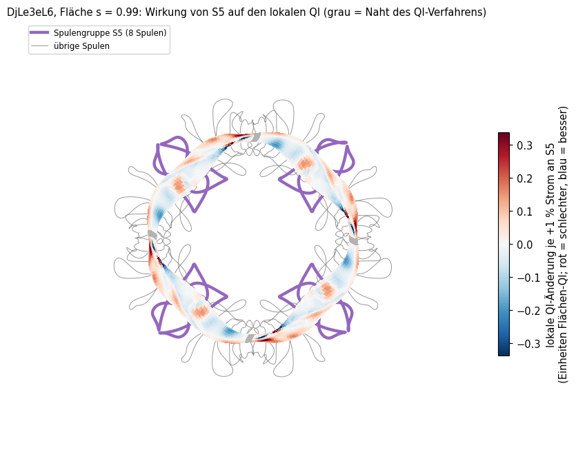

# Wirkungskarte: Wo wirkt welche Spule auf das QI? (Opus-Agent, 2026-11-05)

Beobachtung des Nutzers (wörtlich, rechtschreiblich korrigiert): „Das QI kann ich deutlich auf der Fläche sehen ... es scheint auch einen Zusammenhang mit den Spulen zu geben. Vielleicht kannst du die Werte mit den Spulen und der Position der Spulen in Verbindung bringen.“

Form DjLe3eL6 mit Proximas Spulensatz (5 Basisspulen S1 bis S5, je 7 Symmetrie-Kopien, also 40 Spulen, 4 Feldperioden). Ereignisprotokoll F-248 (Erwartung) und F-249 (Ergebnis), Befund B-054. Vorarbeit: Bericht `qi_spulen.md` (B-053). Nichts hochgeladen, nichts committet.

Skripte: `stellarator/qi_wirkung.py` (Rechnung, Geometrie, Auswertung, Optimierung), `stellarator/qi_wirkung_bilder.py` (Bilder, interaktive Seite). Ergebnisse im Ordner `sim/qi_wirkung/`, Bilder im Ordner `qi_wirkungskarte/` neben diesem Bericht.

## Kurzfassung

- **Die Beobachtung stimmt, aber anders als gedacht.** Die Spulen hängen mit dem QI-Bild zusammen, aber **nicht über die Nähe**. Alle fünf Spulengruppen wirken am stärksten an **denselben Stellen**, den Muldenflanken bei φ ≈ 10° bis 20° und 70° bis 80° (eine Periode = 90°). Das gilt auch für S5, die der Fläche bei 38° und 52° am nächsten kommt und an den Flanken 3,5 bis 4 a entfernt ist. Wo eine Spule wirkt, bestimmt die Form der Feldmulde, nicht der Ort der Spule.
- **Nähe zählt nur für die Spulen an den Flanken.** Rangkorrelation „Wirkung gegen Nähe“ am Rand: S1 +0,45, S2 +0,40, S3 +0,24, S4 −0,35, S5 **−0,51** (S5 wirkt also umso stärker, je weiter weg). Bei 5 mm Verschiebung ist die Wirkung örtlicher (S1 +0,58, S2 +0,48: ein Streifen direkt neben der Spule), bei S5 wieder entgegengesetzt (−0,58).
- **Abstand als Vorhersage taugt nicht.** Ein lineares Modell „Zusatzfehler = Summe der Gruppen × Funktion des Abstands“ erklärt am Rand 19 % der Streuung, bei Prüfung an zurückgehaltenen Toroidalwinkel-Abschnitten **nichts** (R² −0,36). Mit den fünf **Stromwirkungskarten** statt des Abstands erklärt dasselbe Modell 69 % (Abschnitts-Prüfung 46 %): Der Spulenfehler sieht aus wie eine Verstimmung der Stromverhältnisse.
- **Zwei Arten heller Flecken.** (1) Die **scharfen, hellsten Streifen** (bei θ ≈ 30° und 330°) gibt es auch ohne Spulen: alle hellsten 2 % liegen ohne Spulen unter den hellsten 10 %. Sie kommen von der **Form**, und Strom ändert sie wenig (−27 %). (2) Die **breiten Flecken** (φ ≈ 12°/θ ≈ 250° und spiegelbildlich) erzeugen die **Spulen** (ohne Spulen −57 %). Eine Stromtrimmung innerhalb ±5 % beseitigt sie fast (−73 %).
- **Gezielte Trimmung der schlechtesten 5 %:** S2, S3, S4 auf 1,05, S5 auf 0,95 (alle an der Schranke). Die Flecken werden um 38 % schwächer (globales Optimum B-053: −26 %), der Gesamt-QI am Rand sinkt um 26 % (B-053: −27 %). Preis: Spiegelverhältnis 0,359 → 0,371; mit freier Grenze (Weg i) gegengeprüft: QI −24 %, iota/nfp 0,0963 → 0,0991 (+2,9 %).
- **Erwartung F-248:** (a) Nähe > 0,3 für jede Gruppe: verfehlt (2 von 5), (b) Abstandsmodell 30 bis 60 %: verfehlt (keine Vorhersagekraft), (c) helle Flecken versetzt zu den nächsten Spulenstellen, Formeffekt: getroffen.

## 1 Zwei Dinge, die beide stimmen: QI als Zahl und QI als Bild

Die QI-Kennzahl ist **eine Zahl ohne Einheit** für die ganze Fläche: Sie misst, wie weit das Magnetfeld vom idealen quasi-isodynamischen Feld abweicht (0 = ideal). Diese Zahl ist aber ein **Mittelwert**: Das Verfahren berechnet die Abweichung an 75 Feldlinien × 2000 Stellen, quadriert sie und mittelt. Jede dieser Stellen hat einen festen Ort auf der Plasmaoberfläche. Trägt man den Einzelbeitrag an seinem Ort als Farbe auf, entsteht das **Ortsbild**, das der Nutzer auf der Fläche sieht: helle Flecken = dort trägt die Fläche viel zum Gesamtfehler bei. Das Mittel aller Farbwerte ist genau die QI-Zahl. Die Zahl ist also dimensionslos, ihr Ortsbild ist trotzdem echt und gibt an, *wo* der Fehler entsteht. Diese Untersuchung fragt, ob dieses Ortsbild mit Ort und Lage der Spulen zusammenhängt.

## 2 Begriffe

- **Spulengruppe S1 bis S5:** eine Basisspule mit ihren 7 Kopien (Drehung um 90° und Spiegelung). Einzelspulen lassen sich im Verfahren nicht allein ändern (es setzt die Wiederholung über die Perioden voraus).
- **Lokaler QI-Wert q:** Beitrag einer Stelle zum Gesamt-QI (Quadrat des Restfehlers × Punktzahl). Mittel über die Fläche = QI der Fläche.
- **Restfehler r:** Abweichung der Feldstärke vom idealen QI-Feld an einer Stelle, mit Vorzeichen (1 = ganze Muldentiefe). q ist r².
- **Wirkungskarte W_g:** Wie stark sich q an jeder Stelle ändert, wenn der Strom der Gruppe g um 1 % steigt. Aus ±5 % gerechnet (Sekante). Einheit: QI der Fläche, also 0,05 heißt „an dieser Stelle ändert sich der Beitrag um 5 % des Flächen-QI je 1 % Strom“. Rot = schlechter, blau = besser.
- **Zusatzfehler:** q mit Spulenfeld minus q mit dem Soll-Feld der offiziellen Rechnung (ohne Spulen), an denselben Stellen. Zeigt, wo die Spulen den Fehler erzeugen.
- **Abwicklung:** Die Torusfläche aufgeschnitten und flach gelegt: waagerecht der Toroidalwinkel φ_B (den Ring entlang, eine Periode = 90°), senkrecht der Poloidalwinkel θ_B (einmal ums Rohr, 360°). Beide sind Boozer-Winkel (an das Magnetfeld angepasste Winkel; φ_B weicht vom geometrischen Winkel um wenige Grad ab).
- **Naht:** Das QI-Verfahren wertet jede Periode ab dem Feldmaximum bei φ_B = 0° (bzw. 90°, 180°, 270°) einzeln aus. An dieser Stelle stoßen zwei Auswertungen aneinander, es entsteht eine helle Linie, die nichts mit den Spulen zu tun hat. In allen Bildern grau schraffiert, in allen Zahlen ausgeblendet (±3°, 6,7 % der Fläche).
- **Rangkorrelation ρ (Spearman):** +1 = je näher, desto stärker; 0 = kein Zusammenhang; −1 = je näher, desto schwächer. Wir korrelieren immer gegen 1/Abstand, positives ρ heißt also „wirkt stärker, wo die Spule nahe ist“.
- **R² und Block-Kreuzvalidierung:** R² ist der Anteil der Streuung, den ein Modell erklärt (1 = alles, 0 = nichts, negativ = schlechter als der bloße Mittelwert). Bei der Block-Kreuzvalidierung lernt das Modell auf 4 von 5 Toroidalwinkel-Abschnitten und muss den fünften vorhersagen. Weil benachbarte Punkte fast gleiche Werte haben, würde eine zufällige Aufteilung das Modell besser aussehen lassen, als es ist; die Blöcke verhindern das. Die Blöcke sind über die Spiegelsymmetrie gefaltet (φ und 90° − φ im selben Block), sonst stünde das Spiegelbild eines Prüfpunkts in der Lernmenge.

## 3 Verfahren

1. Weg (ii) aus B-053 (Störungsmodell): Magnetflächen der offiziellen Rechnung festhalten, an jeder Stelle die Feldstärke unserer Spulen einsetzen, QI mit der Paketfunktion `quasi_isodynamicity_residual` rechnen. Feld je Gruppe für 1 A einmal gerechnet; eine Stromkombination kostet 6 s.
2. Lokaler Wert wie in `qi_3d.py`: Restfehler der 75 × 2000 Feldlinienpunkte auf ein regelmäßiges Gitter 72 (θ) × 90 (φ, 1°) je Periode interpoliert. Flächen s = 0,5 und Rand.
3. 42 Fälle: Grundzustand, ohne Spulen, je Gruppe Strom ×0,95 und ×1,05, je Gruppe 5 mm Verschiebung radial, toroidal, senkrecht (+ und −; Anlagenmaßstab, im Datensatzmaßstab 0,29 mm).
4. Geometrie: Ort jedes Gitterpunkts im Raum, kürzester Abstand zu jeder Gruppe (alle 8 Kopien), Spur jeder Spule auf der Abwicklung (wo sie näher als 1,6 a vorbeiläuft), Stelle größter Nähe (★) und stärkster Krümmung im plasmanahen Teil (△) je Spule.
5. Auswertung: Rangkorrelationen, lineare Antwortmodelle mit Block-Kreuzvalidierung, helle Flecken (oberste 2 % von q), gezielte Stromtrimmung.

Prüfstein (gemessen): Grundzustand QI Rand 0,00055442, ohne Spulen 0,00044754 (= offizieller Wert, alle Stellen gleich wie B-053), s = 0,5: 0,00061975 bzw. 0,00062217. Gittermittel gegen Flächen-QI: 1,2 % (Rand) bzw. 0,7 % (s = 0,5) Abweichung. Strom S2 −5 %: +6,9 % wie B-053; S5 senkrecht ±5 mm: ±2,4 % (B-053: 2,7 %). Die Flächenmittel der Wirkungskarten ergeben die Sekanten aus B-053 (S1 −2,5 %, S5 +5,0 % je 1 %).

Hinweis zur Ableitung: Aus ±1 % (B-053) hat S5 +8,8 % je 1 %, aus ±5 % nur +4,8 %. Das QI-Verfahren ist also deutlich nichtlinear (es sucht Feldmaxima und -minima). Die Wirkungskarten hier sind Sekanten über ±5 %.

## 4 Wirkungskarten je Spulengruppe

Lesehilfe: Sechs Abwicklungen der Randfläche, je Feld eine Periode (waagerecht φ_B 0° bis 90°, senkrecht θ_B 0° bis 360°). Felder 1 bis 5: Wirkungskarte der Gruppen S1 bis S5, also wie sich der lokale QI ändert, wenn ihr Strom um 1 % steigt. **Rot = dort wird es schlechter, blau = besser, weiß = keine Wirkung.** Die farbige Linie ist die Spule dieser Gruppe, aufgetragen an der Stelle der Fläche, der sie am nächsten ist (nur, wo sie näher als 1,6 a vorbeiläuft; die Spulen umschlingen das Plasma, deshalb verlaufen ihre Spuren fast senkrecht). ★ = Stelle, an der die Spule der Fläche am nächsten kommt, △ = Stelle stärkster Krümmung der Spule im plasmanahen Teil. Feld 6 (unten rechts): Zusatzfehler durch alle Spulen (braun = Spulen machen es schlechter, violett = besser). Grau schraffiert: Naht des Verfahrens.

Was man sieht (Rand):
- Bei allen Gruppen sitzt die stärkste Wirkung an zwei kleinen Stellen, φ ≈ 20°/θ ≈ 325° und spiegelbildlich φ ≈ 72°/θ ≈ 35° (Stellarator-Symmetrie: (θ, φ) → (−θ, −φ)). Dort liegt jeweils ein **rot-blaues Paar** dicht nebeneinander. So sieht es aus, wenn ein scharfer Fehlerfleck **verschoben** wird, nicht stärker oder schwächer wird. Diese Stellen sind die hellsten Flecken des Grundzustands (Abschnitt 6).
- S5 (bei 38°/52°) färbt breite Bänder bei φ ≈ 8° bis 20° und 75° bis 85° rot, also weit weg von sich selbst. Mehr S5-Strom verschlechtert die Muldenflanken. S1 bis S4 wirken dort mit umgekehrtem Vorzeichen (blau), aber schwächer.
- Der Zusatzfehler (Feld 6) hat am Rand dieselben breiten Bänder wie die S5-Karte (braun bei 8° bis 20° und 72° bis 85°). Mit Spulen sind die Flanken so, als wäre S5 gegenüber den anderen etwas zu stark. Das passt zum Befund aus B-053, dass S5 −5 % den größten Gewinn bringt.

Lesehilfe wie oben, aber für die Fläche in halber Tiefe (s = 0,5). Die Spulenspuren sind kürzer, weil diese Fläche weiter von den Spulen entfernt ist. Bei s = 0,5 wirken S1 bis S4 überwiegend verbessernd (blau), S5 verschlechternd (rot), wieder an den Flanken bei 10° bis 35° und 55° bis 80°. Der Zusatzfehler ist dort klein (Skala ±0,2 statt ±1,8) und streifig. Die Streifen haben den Abstand der 10 Spulen je Periode, sind also die Welligkeit des Feldes zwischen einzelnen Spulen.

Lesehilfe: Oben die Wirkung jeder Gruppe, über den Poloidalwinkel gemittelt, gegen den Toroidalwinkel; Punkt = Maximum. Unten der kleinste Abstand jeder Gruppe zur Fläche gegen den Toroidalwinkel; Punkt = engste Stelle. Wäre „die Spule wirkt, wo sie nahe ist“ richtig, lägen die Punkte oben und unten übereinander. Gemessen: Am Rand liegt das Maximum bei **allen fünf** Gruppen bei 71° (spiegelbildlich 19°). Die engsten Stellen liegen bei 4° (S1), 12° (S2), 20° (S3), 54° (S4) und 38° (S5). Nur für S1 bis S3 fallen Wirkung und Nähe ungefähr zusammen (Rangkorrelation des Profils mit der Nähe: S1 +0,84, S2 +0,86, S3 +0,58). Für S4 (−0,65) und S5 (−0,79) gilt das Gegenteil.

Bei s = 0,5 gleich: Maximum aller Gruppen bei 18° bzw. 72° bis 74°.

## 5 Wirkung gegen Abstand (Zahlen)

Lesehilfe: Jeder Punkt ist eine Stelle der Randfläche. Waagerecht ihr Abstand zur Spulengruppe (in kleinen Radien a; 1 a = 1,79 m in unserer Anlage), senkrecht der Betrag der Wirkung (logarithmisch, also jede Linie Faktor 10). Farbe = Toroidalwinkel. Schwarze Linie = Median je Abstandsklasse. Fällt die Linie nach rechts, wirkt die Spule nahe stärker. Bei S1 fällt sie (nahe 0,06, fern 0,007), bei S2 und S3 schwach, bei S4 und S5 **steigt** sie (S5: nahe 0,03, fern 0,1).

Rangkorrelation gegen 1/Abstand (Naht ausgeblendet, 6048 Stellen je Fläche):

| Gruppe (Lage) | Rand: Strom, q | Rand: Strom, Restfehler r | Rand: Lage 5 mm | s = 0,5: Strom, q | s = 0,5: Strom, r | s = 0,5: Lage |
|---|---|---|---|---|---|---|
| S1 (2,5°) | **+0,45** | +0,43 | +0,58 (radial) | +0,38 | +0,31 | +0,59 (radial) |
| S2 (7,8°) | **+0,40** | +0,23 | +0,48 (radial) | +0,35 | +0,22 | +0,56 (radial) |
| S3 (16,7°) | +0,24 | +0,25 | +0,12 (radial) | +0,50 | +0,54 | +0,49 (radial) |
| S4 (27,6°) | −0,35 | −0,19 | −0,35 (radial) | 0,00 | +0,40 | −0,12 (toroidal) |
| S5 (39,4°) | **−0,51** | −0,44 | −0,58 (senkrecht) | −0,26 | +0,03 | −0,21 (toroidal) |

„q“ = lokaler QI-Wert (Quadrat), „r“ = Restfehler mit Vorzeichen (ändert sich linear mit dem Feld, ohne die Verstärkung durch das Quadrat). Warum beide: Der Betrag der Wirkung auf q hängt stark davon ab, wie groß der Fehler an der Stelle schon ist. Die Rangkorrelation |W| gegen |r₀| (Restfehler im Grundzustand) beträgt am Rand 0,73 bis 0,85 und bei s = 0,5 0,81 bis 0,92. Eine Änderung des Quadrats ist 2·r·Δr und damit dort groß, wo r schon groß ist. Auch ohne diese Verstärkung (Spalte r) bleibt das Bild gleich: S1 bis S3 eher örtlich, S5 am Rand entfernt.

Lesehilfe Lage-Wirkungskarten: wie die Abwicklung, aber Wirkung je 1 mm Verschiebung der ganzen Gruppe in ihrer stärksten Richtung (aus ±5 mm). Skala ±0,03, also rund ein Zehntel der Stromwirkung je 1 %. S1, S2 und S3 erzeugen beim Verschieben einen **Streifen direkt neben ihrer Spur** (örtlich, wie man es erwartet). S5 senkrecht wirkt dagegen wieder an den fernen Flanken, und zwar stärker als alle anderen (mittlerer Betrag 0,009 je mm gegen 0,0015 bis 0,0022).

Lineares Antwortmodell (Aufgabe 2): Zusatzfehler(x) ≈ c + Σ_g a_g · d_g(x)^−p, d_g = Abstand zur Gruppe g, p = 1, 3, 6 (1/d wie ein Linienstrom, 1/d³ wie ein Dipol). Kreuzvalidierung: 5 Toroidalwinkel-Blöcke (gefaltet), Vergleich mit zufälliger Aufteilung.

| Modell | Fläche | R² Anpassung | R² Blöcke | R² zufällig |
|---|---|---|---|---|
| Abstand, p = 1 | Rand | 0,19 | **−0,36** | 0,19 |
| Abstand, p = 3 | Rand | 0,18 | −0,27 | 0,18 |
| Abstand, p = 6 | Rand | 0,14 | −0,33 | 0,13 |
| Abstand, p = 1 | s = 0,5 | 0,06 | −0,20 | 0,05 |
| fünf Stromwirkungskarten statt Abstand | Rand | **0,69** | **0,46** | 0,68 |
| fünf Stromwirkungskarten | s = 0,5 | 0,10 | −0,66 | 0,10 |
| nur S5-Karte | Rand | 0,18 | −0,42 | – |

Je Gruppe allein (|W_g| ≈ a + b · d_g^−p): R² Anpassung höchstens 0,16 (S3, s = 0,5), R² Blöcke höchstens 0,02, meist negativ. Negatives R² heißt: Für einen nicht gesehenen Toroidalabschnitt sagt der Abstand die Wirkung schlechter voraus als der bloße Mittelwert. Der Abstand trägt also keine übertragbare Information. Die zufällige Aufteilung liegt hier gleich der Anpassung; sie hätte also nicht getäuscht, aber erst die Blöcke zeigen, dass nichts übertragbar ist.

Die Zerlegung in Stromwirkungskarten hat am Rand Vorhersagekraft (46 %). Die einzelnen Faktoren a_g sind aber schlecht bestimmt, weil sich die fünf Karten fast zu null addieren (alle Ströme gemeinsam ändern nichts): Der Fit gibt S1 +1,5 %, S2 −5,1 %, S3 −0,7 %, S4 −9,1 %, S5 −0,5 % gleichwertigen Stromfehler, jede gemeinsame Verschiebung aller fünf Werte ist fast gleich gut. Folgerung: Das Fehlermuster der Spulen am Rand ist zu einem großen Teil eine Verstimmung der Stromverhältnisse und lässt sich deshalb mit Strom so gut ausgleichen (B-053). Innen (s = 0,5) gilt das nicht: Dort ist der Zusatzfehler die Spulenwelligkeit.

## 6 Die hellsten Flecken

Oberste 2 % des lokalen QI (121 Stellen je Fläche):

| | Rand | s = 0,5 |
|---|---|---|
| Abstand zur nächsten Spule, Median helle Stellen / alle | 1,38 a / 1,48 a (Perzentil 40) | 1,71 a / 1,48 a (Perzentil 71) |
| helle Stellen im nächsten Zehntel der Fläche (zufällig wären 10 %) | 26 % | 0 % |
| Winkelabstand zur nächsten ★-Stelle, Median helle / alle | 20° / 48° | 112° / 44° |
| auch ohne Spulen unter den hellsten 2 % / 10 % | 72 % / **100 %** | 88 % / **100 %** |
| lokaler QI dort mit / ohne Spulen | 0,87 | 1,02 |
| hellster Punkt | φ 71,5°, θ 35° | φ 72,5°, θ 170° |

Am Rand liegen die hellsten Flecken etwas näher an den Spulen als der Durchschnitt (★ von S2 für 43 %, S4 37 %, S5 20 %), aber im Median 20° neben den nächsten Stellen und nicht darauf. Vor allem gibt es sie schon ohne Spulen; mit Spulen sind sie sogar 13 % schwächer. Die hellsten Flecken kommen von der **Form der Fläche**. Dass dort auch Spulen nahe sind, ist ein Formeffekt: Wo die Fläche stark geformt ist, müssen die Spulen nahe sein (wie B-053: Korrelation mit dem Abstand auch ohne Spulen −0,32).

## 7 Gezielte Trimmung der schlechtesten Flecken (Aufgabe 3)

Ziel: mittlerer lokaler QI auf den schlechtesten 5 % der Randfläche (Grundzustand, Naht ausgenommen). Suchverfahren L-BFGS-B, S1 fest (gemeinsame Skala ändert nichts), S2 bis S5 mit Schranken 0,95 bis 1,05 (Weg ii ist nur bis ±5 % geprüft; ohne Schranken lief die Suche in B-053 zu negativen Strömen).

Lesehilfe: Abwicklung der Randfläche, Farbe = lokaler QI (schwarz = fast ideal, gelb = viel Fehler), cyan umrandet = die schlechtesten 5 % im Grundzustand, die das Ziel bilden. Links Grundzustand, Mitte globales Optimum aus B-053 (Ziel: Gesamt-QI), rechts das Flecken-Optimum. Die breiten orangen Flecken links (φ ≈ 12°/θ ≈ 250°, φ ≈ 78°/θ ≈ 110°) sind in beiden Optima verschwunden. Die scharfen gelben Streifen bei θ ≈ 330° und 30° bleiben.

| | S1…S5 | Flecken (mittl. lokaler QI) | QI Rand (ii) | QI s = 0,5 (ii) | Spiegel Rand (ii) | QI Rand (i) | iota/nfp Rand (i) | Spiegel (i) |
|---|---|---|---|---|---|---|---|---|
| Grundzustand | 1 / 1 / 1 / 1 / 1 | 0,00232 | 0,000554 | 0,000620 | 0,359 | 0,000579 | 0,0963 | 0,359 |
| globales Optimum B-053 | 1 / 1,05 / 1,015 / 0,98 / 0,95 | 0,00171 (−26 %) | 0,000409 (−26 %) | 0,000460 (−26 %) | 0,376 | 0,000415 (−28 %) | 0,1004 (+4,3 %) | 0,377 |
| **Flecken-Optimum** | 1 / 1,05 / 1,05 / 1,05 / 0,95 | **0,00145 (−38 %)** | 0,000413 (−26 %) | 0,000473 (−24 %) | 0,371 | 0,000438 (−24 %) | 0,0991 (+2,9 %) | 0,371 |

Getrennt nach Art der Flecken (68 % der Zielstellen sind „scharf“, also auch ohne Spulen unter den schlechtesten 10 %; 32 % „breit“):

| | scharf (Form) | breit (Spulen) |
|---|---|---|
| ohne Spulen gegen Grundzustand | +10 % | −57 % |
| globales Optimum B-053 | −16 % | −64 % |
| Flecken-Optimum | −27 % | **−73 %** |

Folgerung: Die breiten, von den Spulen erzeugten Flecken lassen sich mit Strom mehr als ausgleichen (besser als ganz ohne Spulenfehler). Die scharfen Formflecken lassen sich nur wenig ändern und müssten über die Form selbst verbessert werden. Das Flecken-Optimum liegt in einer Ecke: Alle vier freien Faktoren sitzen an der Schranke, die Suche endete nach 10 Auswertungen. Das wahre Optimum liegt also außerhalb des geprüften Bereichs, und dorthin trägt Weg (ii) nicht. Gleichwertig ausgedrückt: S5 um 10 % schwächer gegenüber S2 bis S4, S1 dazwischen. Preis: Spiegelverhältnis +3 %, iota +3 % (Weg i). iota lässt sich in Weg (ii) nicht ablesen, weil die Flächen dort fest sind.

## 8 Interaktive Darstellung

`qi_wirkungskarte/wirkungskarte_3d.html` (offline im Browser öffnen; `plotly.min.js` muss im selben Ordner liegen): Randfläche in 3D mit den Spulen, mit der Maus drehbar. Auswahl oben links: Wirkung S1 … S5 je +1 % Strom (die Spulen der gewählten Gruppe werden dick gezeichnet) oder der Zusatzfehler durch alle Spulen. Feste Ansichten von S5:

Lesehilfe: Plasmarand in 3D, Farbe = Wirkung von +1 % Strom an S5 (rot = schlechter, blau = besser). Violett dick: die 8 Spulen der Gruppe S5, grau dünn: die übrigen 32 Spulen. Graue Bänder auf der Fläche: Naht des Verfahrens (bei den Spulen S1). In der Draufsicht sieht man vier Wiederholungen. Die roten Bereiche liegen jeweils zwischen zwei S5-Paaren, an den Stellen, wo die Fläche von schmal (bohnenförmig, bei S1) in dreieckig (bei S5) übergeht, und nicht unter den violetten Spulen.

## 9 Erwartung (F-248) und Vergleich

| Erwartung | Ergebnis | Urteil |
|---|---|---|
| (a) Jede Gruppe wirkt am stärksten nahe ihrer Position (Rang Wirkung gegen 1/Abstand > 0,3) | Rand: S1 +0,45, S2 +0,40, S3 +0,24, S4 −0,35, S5 −0,51; s = 0,5: +0,38 / +0,35 / +0,50 / 0,00 / −0,26. Maximum der Wirkung bei allen Gruppen an den Flanken (71°/19°) | **verfehlt** (2 bis 3 von 5; S5 umgekehrt) |
| (b) Lineares Abstandsmodell erklärt bei Block-Kreuzvalidierung 30 bis 60 % des Zusatzfehlers, nicht über 80 % | −0,36 (Rand), −0,20 (s = 0,5); Anpassung nur 19 % bzw. 6 %. Mit Stromwirkungskarten statt Abstand 46 % (Rand) | **verfehlt** (Abstand hat keine Vorhersagekraft) |
| (c) Hellste Flecken nicht an den Stellen kleinsten Abstands, sondern versetzt (Formeffekt) | Rand: Median 20° neben der nächsten ★-Stelle, 100 % auch ohne Spulen unter den hellsten 10 %; s = 0,5: weit weg (112°) | **getroffen** |

Warum (a) und (b) falsch lagen: Ich habe angenommen, die Wirkung einer Spule falle wie ihr Feld mit dem Abstand ab. Das Feld fällt tatsächlich so ab. Der QI-Fehler entsteht aber nicht dort, wo sich das Feld am meisten ändert, sondern dort, wo die Form der Feldmulde empfindlich ist, und das sind die Flanken. Das QI-Verfahren bewertet ganze Feldlinien: Verschiebt S5 den Boden der Mulde, gerät die Mulde als Ganzes aus dem Gleichgewicht, und der Fehler zeigt sich an den Flanken (B-053 hatte das schon als Folgerung, hier ist es ortsaufgelöst gemessen). Bei Lageänderungen (Abschnitt 5) ist die Wirkung für S1 bis S3 örtlicher, weil eine Verschiebung das Feld vor allem nahe der Spule umformt.

## 10 Belegt, Folgerung, offen

**Belegt (gemessen, Weg ii, DjLe3eL6):**
- Prüfstein: Grundzustand 0,00055442 und ohne Spulen 0,00044754 (= offiziell) wie in B-053; Stromsekanten und Lagewirkung stimmen mit B-053 überein.
- Alle fünf Gruppen wirken am stärksten an den Muldenflanken (φ ≈ 10° bis 20° und 70° bis 80°), unabhängig von ihrer Lage. Rangkorrelation Wirkung gegen Nähe am Rand +0,45 (S1) bis −0,51 (S5).
- Der Abstand sagt den Zusatzfehler nicht voraus (R² bei Abschnitts-Prüfung negativ). Die fünf Stromwirkungskarten erklären ihn am Rand zu 46 % (geprüft), innen nicht.
- Die hellsten 2 % am Rand gibt es auch ohne Spulen (100 % unter den hellsten 10 %); die breiten Flecken erzeugen die Spulen.
- Stromtrimmung ±5 % (S2 bis S4 1,05, S5 0,95): schlechteste 5 % −38 %, Gesamt-QI −26 % (ii) bzw. −24 % (i), Spiegel +3 %, iota +2,9 % (i).

**Folgerung:**
- Die Antwort auf die Nutzerfrage: Das QI-Bild hängt mit den Spulen über ihre **Ströme** zusammen, kaum über ihre **Nähe**. Die Spulen am Muldenboden (S5) steuern die Flanken aus der Ferne.
- Für eine Anlage: Spulenfehler am Rand ließen sich mit einer Stromtrimmung ausgleichen. Formflecken nicht, sie gehören in die Formoptimierung.

**Offen:**
- Weg (ii) gilt geprüft bis ±5 %; das Flecken-Optimum liegt an der Schranke. Mehr Spielraum bräuchte Weg (i) mit konvergentem Rand.
- Nur eine Form (DjLe3eL6) mit Spulensatz; ob „Wirkung an den Flanken“ allgemein gilt, ist an anderen Spulensätzen zu prüfen.
- Einzelspulen (Symmetriebruch) sind nicht untersucht (Verfahren setzt Periodizität voraus).
- Die Krümmung der Spulen (△) liegt bei S1 bis S3 nahe der nächsten Stelle; ein eigener Zusammenhang mit der Wirkung wurde nicht getrennt geprüft.

## English summary

For DjLe3eL6 with Proxima's coil set, we mapped where each of the five coil groups changes the local QI on the plasma surface (perturbative model with coil |B| on fixed Boozer surfaces, ±5 % current and ±5 mm shift per group, 42 cases, checks match the official QI exactly). The overall QI number is dimensionless, but it is the mean of a local map that can be seen on the surface. All five groups act most strongly at the same places, the flanks of the magnetic well (toroidal angle about 10–20° and 70–80° of a 90° period), whatever their own position. Coil S5, closest to the surface at 38°/52°, acts most strongly where it is farthest away (rank correlation with 1/distance −0.51; S1 +0.45, S2 +0.40). A linear model of the coil-induced extra error built from distances has no predictive power under toroidal-block cross-validation (R² −0.36). The same model built from the five current-response maps explains 46 % at the edge: the coil error looks like a detuning of current ratios. The brightest spots come from the shape (all of them are already among the top 10 % without coils), while broad coil-induced spots can be removed by trimming the currents. A targeted trim within ±5 % (S2–S4 +5 %, S5 −5 %) lowers the worst 5 % by 38 % and the edge QI by 26 % (free-boundary check −24 %), at the cost of a mirror ratio +3 % and iota +2.9 %. Expectations: locality per group missed, distance model missed, offset of the bright spots met.
