# Galerie der Plasmaformen (reine 3D-Fläche)

Alle Formen sind direkt aus den Randkoeffizienten (`r_cos`, `z_sin`) gezeichnet, **ohne** neue VMEC++-Rechnung. Erzeugt mit `stellarator/plasma_galerie.py`. Kennzahlen stammen aus `docs/recherche/spulen_suche/rangliste.json`; „–“ heißt: dort nicht vorhanden (nichts ergänzt).

Interaktiv und offline: [galerie_3d.html](galerie_3d.html) (Auswahlfeld oben links, mit der Maus drehbar; braucht `plotly.min.js` im selben Ordner).

**Lesehilfe (gilt für alle Bilder):** Man sieht die Oberfläche des Plasmaschlauchs, der zum Ring (Torus) geschlossen ist, gezeichnet nur aus der Formel (Fourier-Koeffizienten), ohne Feldrechnung. Die Farbe ist die Höhe z über der Ringebene (dunkelblau/violett = tief, gelb = hoch); sie ist keine physikalische Größe des Plasmas (kein Druck, keine Temperatur, kein QI-Wert). Die Achsen x, y liegen in der Ringebene, Einheit ist der Hauptradius (≈ 1); z ist in derselben Einheit, alle drei Achsen sind maßstabsgetreu (kein Stauchen). **Worauf achten:** (1) Zahl der Perioden = nfp. Der Ring besteht aus nfp gleichen Abschnitten wie die Zähne eines Zahnrads; zählt man die Wiederholungen der Form um den Ring, muss nfp herauskommen. (2) Verdrehung des Querschnitts: Der Querschnitt ist keine feste Ellipse, er dreht sich beim Umlauf um den Ring, wie ein Bandschlüssel, den man entlang des Rings verdrillt. Je größer die Elongation (Verhältnis lange zu kurze Achse des Querschnitts), desto flacher/bandförmiger der Schlauch. (3) Im Bild von oben sieht man die Ringform und die Wellen von innen nach außen; die Höhe sieht man dort nur an der Farbe.

## Kennzahlen

| Bild-Nr | Name | Rolle | QI | nfp | Aspektverhältnis | max. Elongation | iota/nfp | Spiegelverhältnis |
|---|---|---|---|---|---|---|---|---|
| 1 | `k3_vernunft_56_aspekt_s20261261` | QI-Platz 1 | 3,66e-05 | 2 | 7,76 | 7,15 | 0,090 | 0,447 |
| 2 | `k3_vernunft_34_koef_s20261239` | QI-Platz 2 | 3,71e-05 | 2 | 7,52 | 7,23 | 0,093 | 0,462 |
| 3 | `k3_vernunft_32_koef_s20261237` | QI-Platz 3 | 3,80e-05 | 2 | 7,66 | 7,36 | 0,099 | 0,478 |
| 4 | `do3_vernunft_32_koef_s20261137` | QI-Platz 4 | 4,10e-05 | 2 | 7,69 | 7,36 | 0,099 | 0,433 |
| 5 | `do3_vernunft_34_koef_s20261139` | QI-Platz 5 | 4,20e-05 | 2 | 7,56 | 7,27 | 0,094 | 0,418 |
| 6 | `k3_vernunft_40_koef_s20261245` | QI-Platz 6 | 4,49e-05 | 2 | 7,39 | 7,16 | 0,088 | 0,448 |
| 7 | `k3_vernunft_51_koef_s20261256` | QI-Platz 7 | 4,53e-05 | 2 | 7,37 | 7,31 | 0,081 | 0,471 |
| 8 | `k3_vernunft_28_koef_s20261233` | QI-Platz 8 | 4,58e-05 | 2 | 7,46 | 7,56 | 0,095 | 0,472 |
| 9 | `k3_vernunft_38_koef_s20261243` | QI-Platz 9 | 4,59e-05 | 2 | 7,39 | 7,17 | 0,088 | 0,450 |
| 10 | `k3_vernunft_03_koef_s20261208` | QI-Platz 10 | 4,60e-05 | 2 | 7,39 | 7,41 | 0,092 | 0,437 |
| 11 | `DATJ5FCamJ3dNpdKmj8QsfL` | Kompromiss-Kandidat | 2,81e-04 | 4 | 9,05 | 5,74 | 0,133 | 0,289 |
| 12 | `Do3QyJbtRhtGhrTiBSBbyKM` | Basisform Do3Qy (bester Datensatz) | 6,15e-05 | 2 | 7,43 | 7,20 | 0,089 | 0,405 |
| 13 | `k3_halb` | Basisform Kandidat 3 halb | 4,72e-05 | 2 | 7,39 | 7,15 | 0,088 | 0,447 |
| 14 | `DjLe3eL6` | Basisform DjLe3eL6 (Proxima-Spulen) | – | 4 | – | – | – | – |

QI = quasi-isodynamischer Restwert (kleiner = besser). Spiegelverhältnis = Stärke der Feldmodulation entlang der Feldlinie (Rand). Für `DjLe3eL6` und `k3_halb` liefert die Rangliste keine eigene Zeile (K3 halb: Zahlen der Basisprobe `k3_vernunft_00_basis`, gleiche Randkoeffizienten, siehe Prüfung).

## Bilder

### 1. k3_vernunft_56_aspekt_s20261261 (QI-Platz 1)

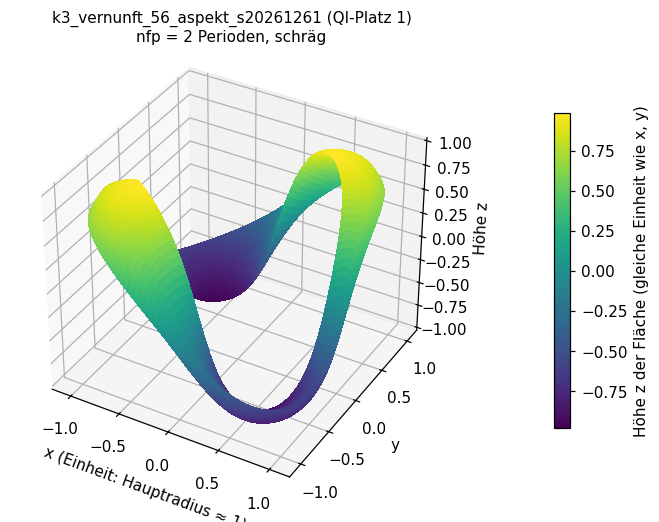 

**Lesehilfe:** links schräg von vorn, rechts senkrecht von oben. Gezählt: **2 Perioden** (nfp = 2), also 2 gleiche Abschnitte um den Ring. Höhenbereich der Fläche z = -0,98 bis 0,98, Radius R = 0,71 bis 1,30 (Einheit Hauptradius ≈ 1). Die Farbe zeigt nur die Höhe z. Achten Sie auf die Wellen von Abschnitt zu Abschnitt (Zahnrad) und darauf, wie sich der Querschnitt beim Umlauf dreht.

### 2. k3_vernunft_34_koef_s20261239 (QI-Platz 2)

 

**Lesehilfe:** links schräg von vorn, rechts senkrecht von oben. Gezählt: **2 Perioden** (nfp = 2), also 2 gleiche Abschnitte um den Ring. Höhenbereich der Fläche z = -0,94 bis 0,94, Radius R = 0,67 bis 1,25 (Einheit Hauptradius ≈ 1). Die Farbe zeigt nur die Höhe z. Achten Sie auf die Wellen von Abschnitt zu Abschnitt (Zahnrad) und darauf, wie sich der Querschnitt beim Umlauf dreht.

### 3. k3_vernunft_32_koef_s20261237 (QI-Platz 3)

 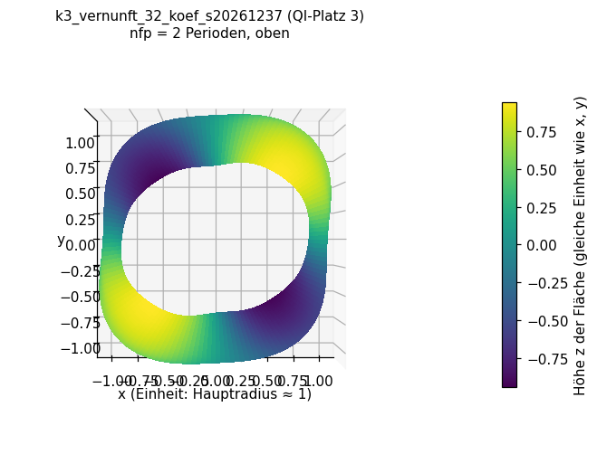

**Lesehilfe:** links schräg von vorn, rechts senkrecht von oben. Gezählt: **2 Perioden** (nfp = 2), also 2 gleiche Abschnitte um den Ring. Höhenbereich der Fläche z = -0,94 bis 0,94, Radius R = 0,68 bis 1,24 (Einheit Hauptradius ≈ 1). Die Farbe zeigt nur die Höhe z. Achten Sie auf die Wellen von Abschnitt zu Abschnitt (Zahnrad) und darauf, wie sich der Querschnitt beim Umlauf dreht.

### 4. do3_vernunft_32_koef_s20261137 (QI-Platz 4)

 

**Lesehilfe:** links schräg von vorn, rechts senkrecht von oben. Gezählt: **2 Perioden** (nfp = 2), also 2 gleiche Abschnitte um den Ring. Höhenbereich der Fläche z = -0,94 bis 0,94, Radius R = 0,68 bis 1,24 (Einheit Hauptradius ≈ 1). Die Farbe zeigt nur die Höhe z. Achten Sie auf die Wellen von Abschnitt zu Abschnitt (Zahnrad) und darauf, wie sich der Querschnitt beim Umlauf dreht.

### 5. do3_vernunft_34_koef_s20261139 (QI-Platz 5)

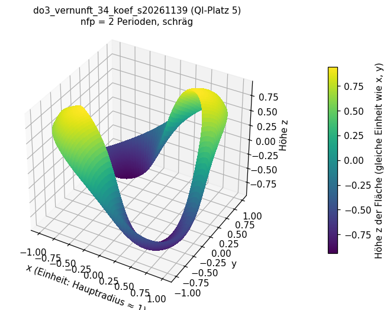 

**Lesehilfe:** links schräg von vorn, rechts senkrecht von oben. Gezählt: **2 Perioden** (nfp = 2), also 2 gleiche Abschnitte um den Ring. Höhenbereich der Fläche z = -0,94 bis 0,94, Radius R = 0,67 bis 1,24 (Einheit Hauptradius ≈ 1). Die Farbe zeigt nur die Höhe z. Achten Sie auf die Wellen von Abschnitt zu Abschnitt (Zahnrad) und darauf, wie sich der Querschnitt beim Umlauf dreht.

### 6. k3_vernunft_40_koef_s20261245 (QI-Platz 6)

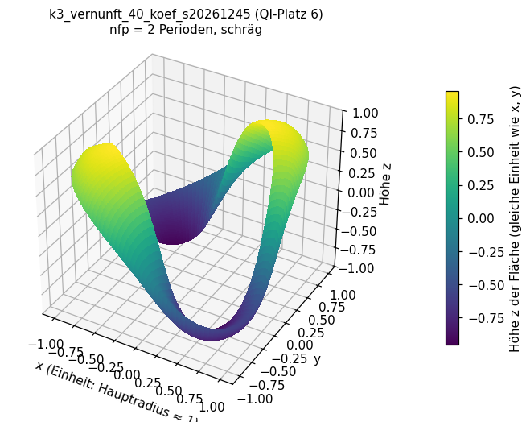 

**Lesehilfe:** links schräg von vorn, rechts senkrecht von oben. Gezählt: **2 Perioden** (nfp = 2), also 2 gleiche Abschnitte um den Ring. Höhenbereich der Fläche z = -0,96 bis 0,96, Radius R = 0,67 bis 1,25 (Einheit Hauptradius ≈ 1). Die Farbe zeigt nur die Höhe z. Achten Sie auf die Wellen von Abschnitt zu Abschnitt (Zahnrad) und darauf, wie sich der Querschnitt beim Umlauf dreht.

### 7. k3_vernunft_51_koef_s20261256 (QI-Platz 7)

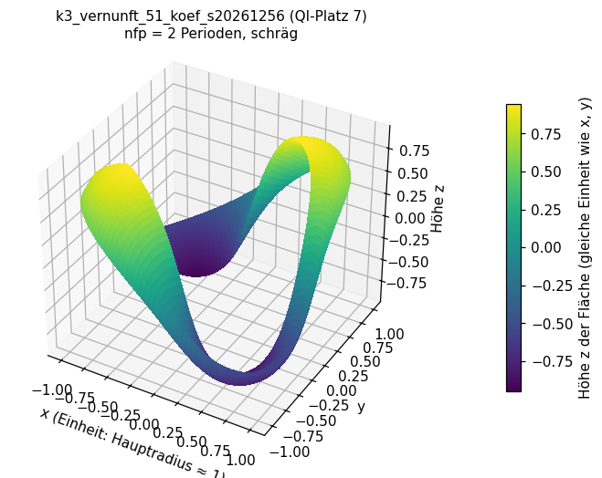 

**Lesehilfe:** links schräg von vorn, rechts senkrecht von oben. Gezählt: **2 Perioden** (nfp = 2), also 2 gleiche Abschnitte um den Ring. Höhenbereich der Fläche z = -0,95 bis 0,95, Radius R = 0,67 bis 1,25 (Einheit Hauptradius ≈ 1). Die Farbe zeigt nur die Höhe z. Achten Sie auf die Wellen von Abschnitt zu Abschnitt (Zahnrad) und darauf, wie sich der Querschnitt beim Umlauf dreht.

### 8. k3_vernunft_28_koef_s20261233 (QI-Platz 8)

 

**Lesehilfe:** links schräg von vorn, rechts senkrecht von oben. Gezählt: **2 Perioden** (nfp = 2), also 2 gleiche Abschnitte um den Ring. Höhenbereich der Fläche z = -0,94 bis 0,94, Radius R = 0,66 bis 1,25 (Einheit Hauptradius ≈ 1). Die Farbe zeigt nur die Höhe z. Achten Sie auf die Wellen von Abschnitt zu Abschnitt (Zahnrad) und darauf, wie sich der Querschnitt beim Umlauf dreht.

### 9. k3_vernunft_38_koef_s20261243 (QI-Platz 9)

 

**Lesehilfe:** links schräg von vorn, rechts senkrecht von oben. Gezählt: **2 Perioden** (nfp = 2), also 2 gleiche Abschnitte um den Ring. Höhenbereich der Fläche z = -0,97 bis 0,97, Radius R = 0,67 bis 1,25 (Einheit Hauptradius ≈ 1). Die Farbe zeigt nur die Höhe z. Achten Sie auf die Wellen von Abschnitt zu Abschnitt (Zahnrad) und darauf, wie sich der Querschnitt beim Umlauf dreht.

### 10. k3_vernunft_03_koef_s20261208 (QI-Platz 10)

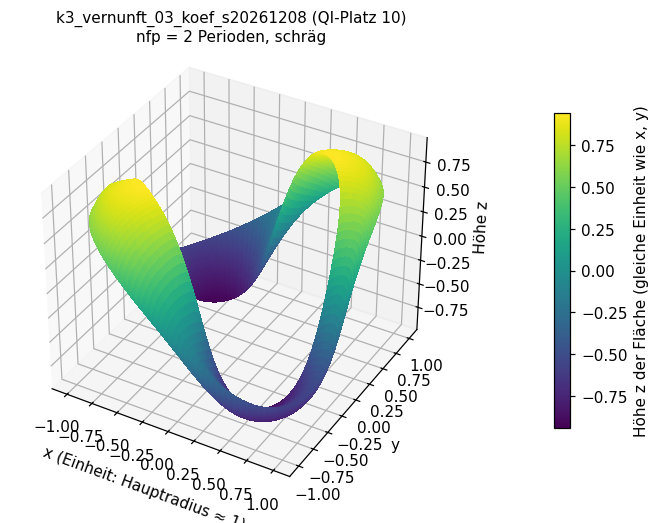 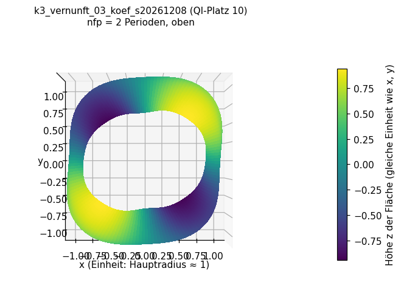

**Lesehilfe:** links schräg von vorn, rechts senkrecht von oben. Gezählt: **2 Perioden** (nfp = 2), also 2 gleiche Abschnitte um den Ring. Höhenbereich der Fläche z = -0,94 bis 0,94, Radius R = 0,66 bis 1,25 (Einheit Hauptradius ≈ 1). Die Farbe zeigt nur die Höhe z. Achten Sie auf die Wellen von Abschnitt zu Abschnitt (Zahnrad) und darauf, wie sich der Querschnitt beim Umlauf dreht.

### 11. DATJ5FCamJ3dNpdKmj8QsfL (Kompromiss-Kandidat)

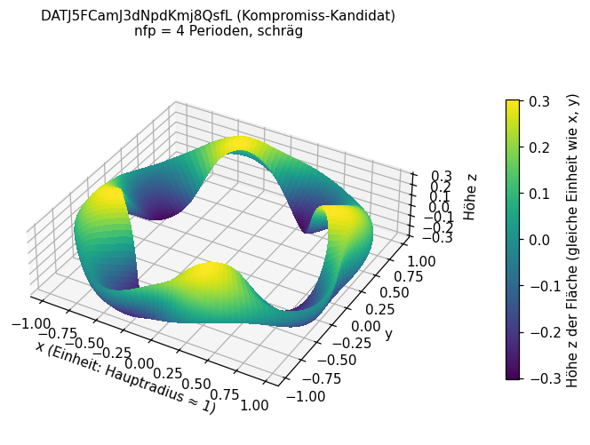 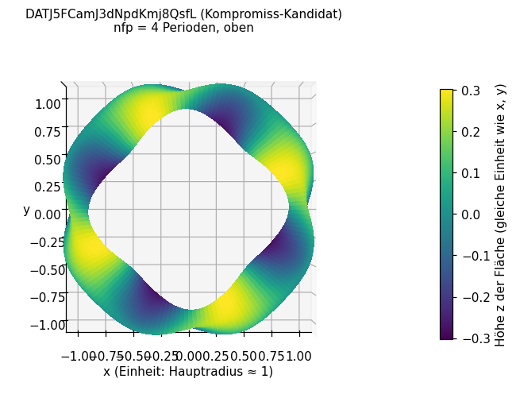

**Lesehilfe:** links schräg von vorn, rechts senkrecht von oben. Gezählt: **4 Perioden** (nfp = 4), also 4 gleiche Abschnitte um den Ring. Höhenbereich der Fläche z = -0,30 bis 0,30, Radius R = 0,73 bis 1,18 (Einheit Hauptradius ≈ 1). Die Farbe zeigt nur die Höhe z. Achten Sie auf die Wellen von Abschnitt zu Abschnitt (Zahnrad) und darauf, wie sich der Querschnitt beim Umlauf dreht.

### 12. Do3QyJbtRhtGhrTiBSBbyKM (Basisform Do3Qy (bester Datensatz))

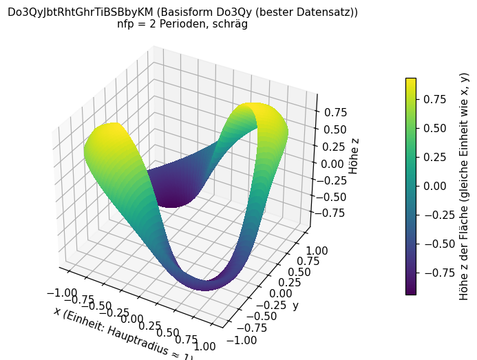 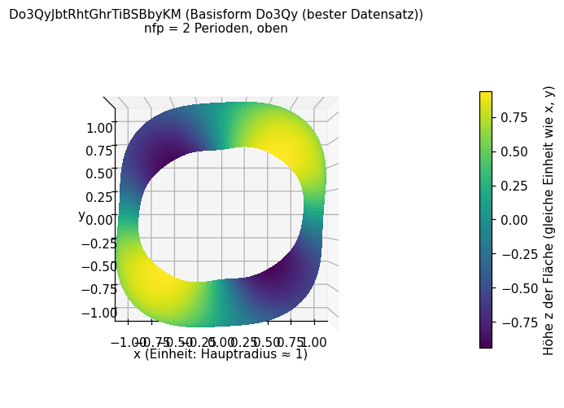

**Lesehilfe:** links schräg von vorn, rechts senkrecht von oben. Gezählt: **2 Perioden** (nfp = 2), also 2 gleiche Abschnitte um den Ring. Höhenbereich der Fläche z = -0,94 bis 0,94, Radius R = 0,67 bis 1,25 (Einheit Hauptradius ≈ 1). Die Farbe zeigt nur die Höhe z. Achten Sie auf die Wellen von Abschnitt zu Abschnitt (Zahnrad) und darauf, wie sich der Querschnitt beim Umlauf dreht.

### 13. k3_halb (Basisform Kandidat 3 halb)

 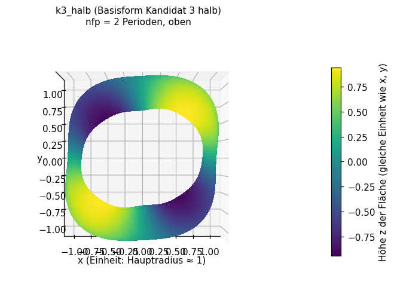

**Lesehilfe:** links schräg von vorn, rechts senkrecht von oben. Gezählt: **2 Perioden** (nfp = 2), also 2 gleiche Abschnitte um den Ring. Höhenbereich der Fläche z = -0,94 bis 0,94, Radius R = 0,67 bis 1,25 (Einheit Hauptradius ≈ 1). Die Farbe zeigt nur die Höhe z. Achten Sie auf die Wellen von Abschnitt zu Abschnitt (Zahnrad) und darauf, wie sich der Querschnitt beim Umlauf dreht.

### 14. DjLe3eL6 (Basisform DjLe3eL6 (Proxima-Spulen))

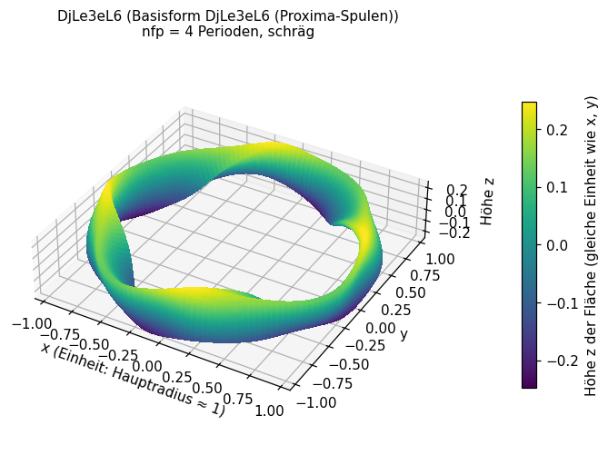 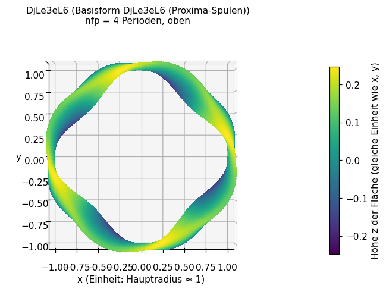

**Lesehilfe:** links schräg von vorn, rechts senkrecht von oben. Gezählt: **4 Perioden** (nfp = 4), also 4 gleiche Abschnitte um den Ring. Höhenbereich der Fläche z = -0,25 bis 0,25, Radius R = 0,79 bis 1,11 (Einheit Hauptradius ≈ 1). Die Farbe zeigt nur die Höhe z. Achten Sie auf die Wellen von Abschnitt zu Abschnitt (Zahnrad) und darauf, wie sich der Querschnitt beim Umlauf dreht.

## Prüfung (Plausibilität, Datenabgleich)

| Form | nicht-null Koeffizienten (Quelle) | in CSV | größte Abweichung r_cos / z_sin |
|---|---|---|---|
| `k3_vernunft_56_aspekt_s20261261` | 81 | 81 | 0.0e+00 / 0.0e+00 |
| `k3_vernunft_34_koef_s20261239` | 81 | 81 | 0.0e+00 / 0.0e+00 |
| `k3_vernunft_32_koef_s20261237` | 81 | 81 | 0.0e+00 / 0.0e+00 |
| `do3_vernunft_32_koef_s20261137` | 81 | 81 | 0.0e+00 / 0.0e+00 |
| `do3_vernunft_34_koef_s20261139` | 81 | 81 | 0.0e+00 / 0.0e+00 |
| `k3_vernunft_40_koef_s20261245` | 81 | 81 | 0.0e+00 / 0.0e+00 |
| `k3_vernunft_51_koef_s20261256` | 81 | 81 | 0.0e+00 / 0.0e+00 |
| `k3_vernunft_28_koef_s20261233` | 81 | 81 | 0.0e+00 / 0.0e+00 |
| `k3_vernunft_38_koef_s20261243` | 81 | 81 | 0.0e+00 / 0.0e+00 |
| `k3_vernunft_03_koef_s20261208` | 81 | 81 | 0.0e+00 / 0.0e+00 |

Flächenschluss (größte Lücke zwischen Anfang und Ende in θ und φ) je Form: `k3_vernunft_56_aspekt_s20261261` 7e-16, `k3_vernunft_34_koef_s20261239` 6e-16, `k3_vernunft_32_koef_s20261237` 6e-16, `do3_vernunft_32_koef_s20261137` 6e-16, `do3_vernunft_34_koef_s20261139` 6e-16, `k3_vernunft_40_koef_s20261245` 6e-16, `k3_vernunft_51_koef_s20261256` 6e-16, `k3_vernunft_28_koef_s20261233` 6e-16, `k3_vernunft_38_koef_s20261243` 7e-16, `k3_vernunft_03_koef_s20261208` 6e-16, `DATJ5FCamJ3dNpdKmj8QsfL` 4e-16, `Do3QyJbtRhtGhrTiBSBbyKM` 6e-16, `k3_halb` 6e-16, `DjLe3eL6` 4e-16.
