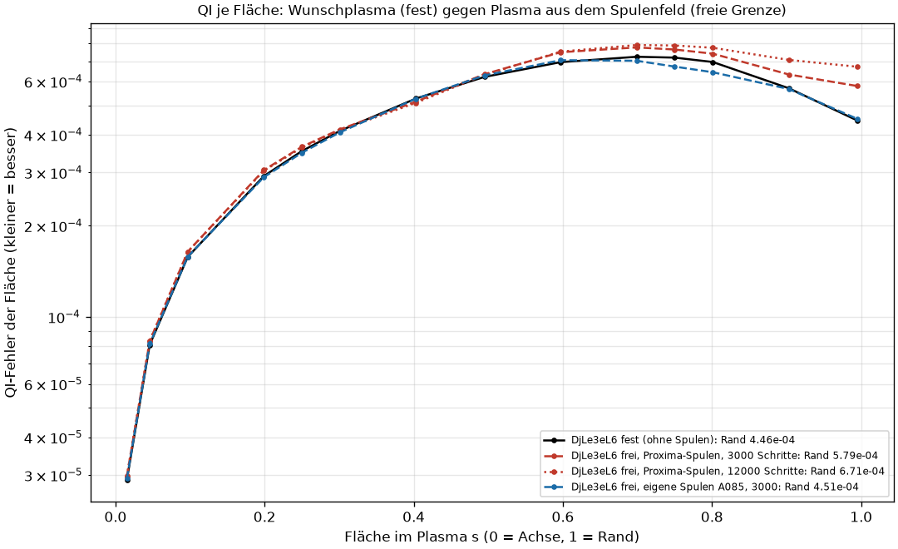
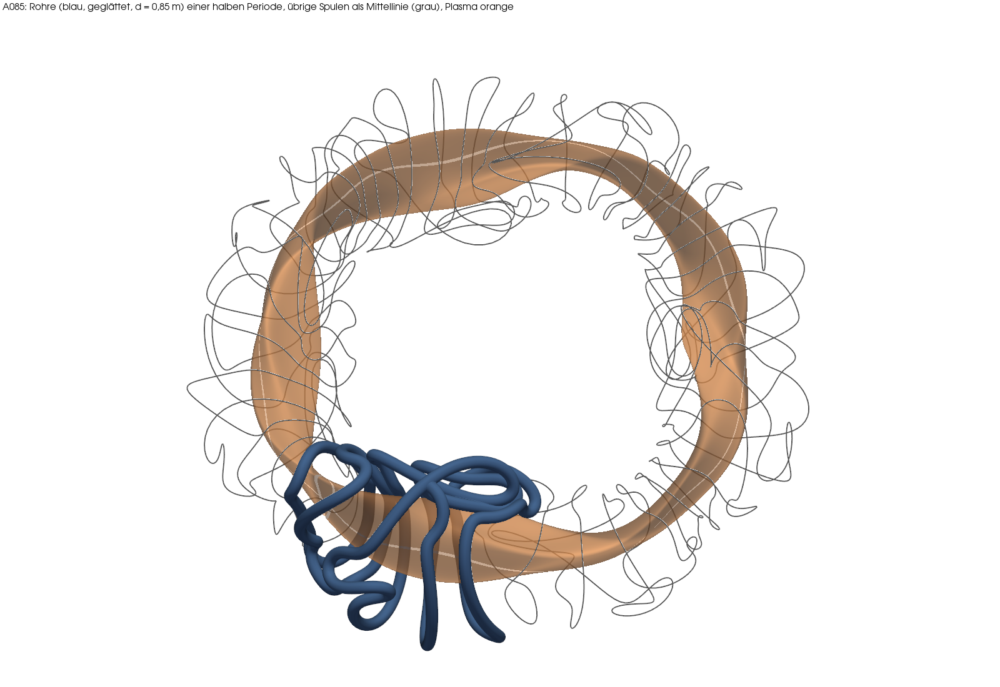
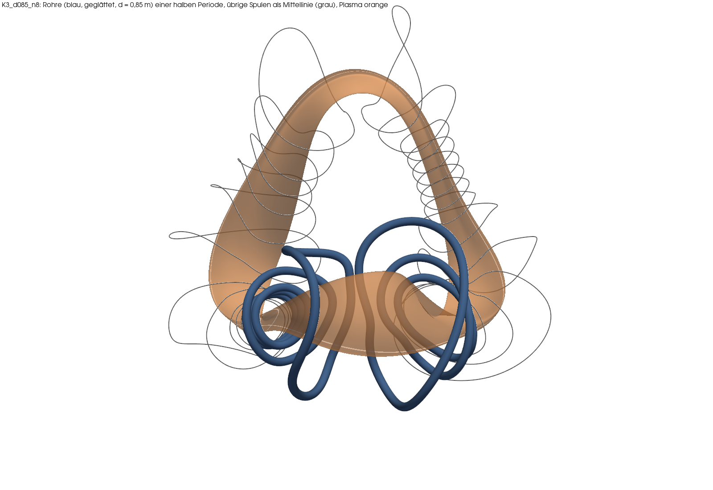
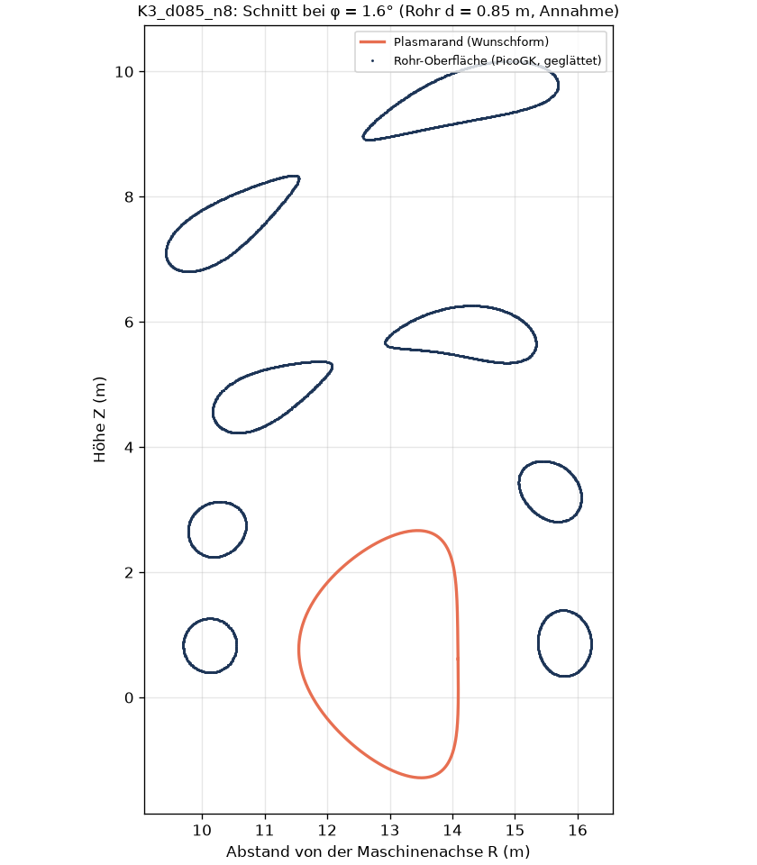
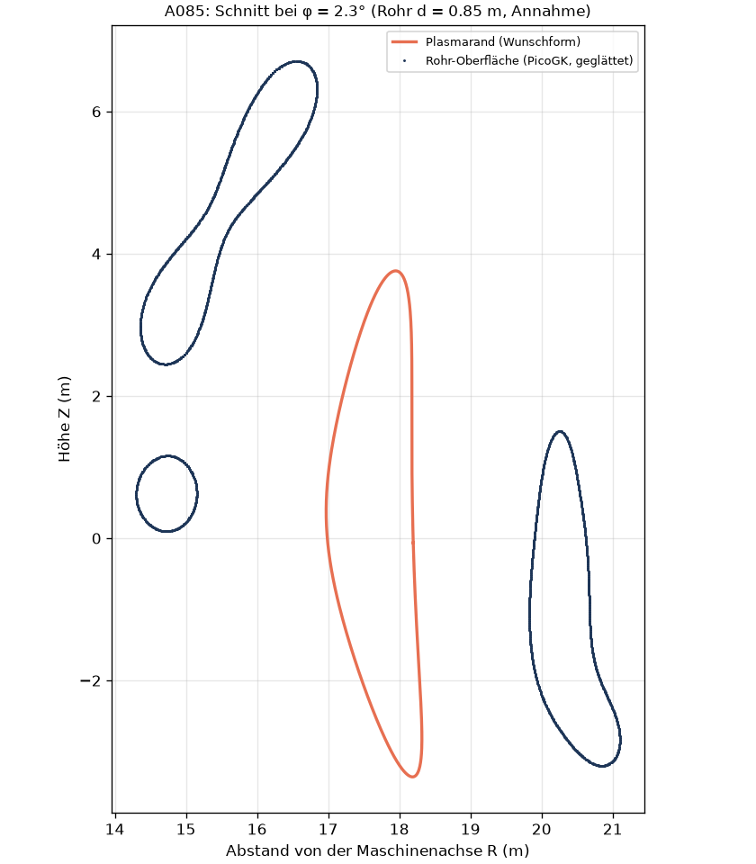

# Kette K3: vom eigenen Plasma zu eigenen Spulen, Rohr und freier Grenze (2026-11-07)

**Frage.** Lässt sich unser bestes eigenes Plasma (Kandidat 3 halb, „K3 halb“, nfp 2) durch die ganze Kette führen: Plasmaform → Spulenkurven (Rückwärtsproblem, „Stage 2“) → Glättung → Wickelpaket als Rohr in PicoGK → STL → Plasma aus dem Spulenfeld (VMEC++ freie Grenze) → Verlustfaktor QI(mit Spulen)/QI(Plasma)?

**Kurzantwort.** STAND_KURZ

Befunde B-059 und B-060, Erwartungen und Ergebnisse im Ereignisprotokoll F-261 bis F-266. Vorarbeit: Machbarkeit B-058 (`spulen_machbarkeit.md`), Kettenbild `kette_plasma_maschine.md`.

## Begriffe (für Maschinentechniker)

- **Feldfehler B·n/|B|**: Anteil des Spulenfeldes, der *durch* die gewünschte Plasmaoberfläche hindurchstößt. Ideal 0: dann laufen die Feldlinien genau an der Wunschfläche entlang. Wie eine Passung: 6,6·10⁻⁴ heißt, das Feld steht im Mittel um 0,04° schief zur Fläche.
- **Stage 2**: die Spulenkurven so verbiegen, dass der Feldfehler klein wird, unter Nebenbedingungen (Abstand zum Plasma, kleinster Biegeradius, Abstand der Spulen untereinander, Länge).
- **Freie Grenze**: VMEC++ bekommt nur die Spulen und sucht selbst, wo das Plasma sitzt. Fest = Plasmaform vorgegeben (Wunsch). Der Vergleich frei/fest zeigt, was die Spulen vom Wunsch übrig lassen.
- **Verlustfaktor**: QI frei / QI fest am Plasmarand. 1 = Spulen treffen das Wunschfeld perfekt.
- **QI**: Maß, wie gut gefangene Teilchen im Feld gehalten werden (kleiner = besser).
- **TripleOffset (PicoGK)**: Körper erst um g nach innen versetzen, dann um 2 g nach außen, dann um g nach innen. Ecken und Kanten unter g verschwinden, der Rest bleibt gleich – wie Entgraten mit einem Kugelfräser vom Radius g.

## Annahmen (gekennzeichnet)

| Größe | Wert | Herkunft |
|---|---|---|
| Anlagenmaßstab | kleiner Radius a = 1,80 m | wie `zwei_ringe.py` (A_REAL), Annahme der Kette |
| Rohrdurchmesser | 0,852 m (Kreis) | flächengleich zum quadratischen Wickelpaket 0,7552 m der Kette (`kopplung.WP_M`, Stufe 0) |
| Voxelgröße / Glättung | 25 mm / TripleOffset 100 mm | eigene Wahl |
| Stage-2-Grenzen | Biegeradius ≥ 0,5 a, Spule–Spule ≥ 0,3 a, mittlere quadr. Krümmung wie Proxima-Satz (maßstabsgerecht), Länge ≤ 1,25 × Startlänge | `zwei_ringe.py`, Länge neu (Annahme) |
| Freie Grenze | 5 Toroidalpunkte je Spulenabstand (nzeta 48 bei 10 Spulen/Periode, 80 bei 16), 3000 Schritte, Ergebnis auch ohne volle Toleranz | Einstellungen k_n3000 aus B-053 |

## Schritt 1: Spulen-Leser und Prüfstein mit eigenen A085-Spulen (DjLe3eL6)

Werkzeug: `stellarator/spulen_satz.py` schreibt einen simsopt-Spulensatz in einen Satz-Ordner (Plasmarand + Basiskurven, Längenfaktor), `stellarator/qi_spulen.py` liest ihn mit `QI_SATZ=<Ordner>` (ohne Variable unverändert Proxima). Die A085-Spulen aus `zwei_ringe.py` lagen im 1,699-fachen Maßstab und wurden zurückgerechnet; der Feldfehler stimmt danach auf fünf Stellen (6,5978·10⁻⁴).

| | QI Rand | Verlustfaktor | Randabweichung mittel / max | iota Rand/nfp |
|---|---|---|---|---|
| fest (Wunsch, nzeta 48) | 0,000446 | 1 | – | 0,0904 |
| frei, Proxima-Spulen (B-053) | 0,000579 | 1,30 | 0,0125 a / – | – |
| frei, eigene A085-Spulen | 0,000451 | **1,013** | 0,010 a / 0,066 a | 0,0968 |
| frei, A085, 12000 Schritte | A085_12000 | | | |
| frei, A085 nach PicoGK-Glättung | A085_GLATT | | | |

**Lesehilfe.** Waagerecht: Lage im Plasma, links die Mitte (Achse), rechts der Rand. Senkrecht: QI-Fehler jeder Fläche, logarithmisch (eine Teilung = Faktor 10, unten ist besser). Schwarz ist das Wunschplasma ohne Spulen. Rot ist das Plasma, das die fremden Proxima-Spulen erzeugen: nach außen hin bis 50 % schlechter. Blau sind unsere eigenen A085-Spulen: fast deckungsgleich mit Schwarz, am Rand nur 1 % schlechter. Gestrichelt und gepunktet sind zwei Rechenlängen (3000/12000 Schritte); liegen sie aufeinander, ist das Ergebnis stabil.

**Belegt:** Die Kette Spulen-JSON → Feldtabelle → VMEC++ freie Grenze → QI läuft mit eigenen Spulen. Ein kleinerer Feldfehler (6,6·10⁻⁴ statt 2,4·10⁻³) gibt hier einen viel kleineren Verlust (1,01 statt 1,30). **Folgerung:** Der große Verlust mit Proxima-Spulen in B-053 lag am Spulensatz, nicht an der freien Grenze.

## Schritt 2: Stage 2 für K3 halb

STAGE2

## Schritt 3: Rohr in PicoGK, Glättung, STL

Ablauf: Jede Basisspule (eine halbe Periode, die anderen sind Spiegel- und Drehkopien) wird in PicoGK als Kette kurzer Balken mit Kreisquerschnitt entlang der Mittellinie (400 Punkte) aufgebaut, voxelisiert (25 mm), mit TripleOffset 100 mm geglättet und als STL je Spule und als Vereinigung geschrieben (`stellarator/k3_rohr.py`, Konsolen-App `picogk/SpulenRohr`, headless, ohne Fenster). Prüfung in Python: offene Kanten, Durchmesser je Querschnitt, Abstand zur Plasmafläche, und die Mittellinie des geglätteten Rohrs wird per Kreisausgleich je Querschnitt zurückgewonnen und erneut als Spule gerechnet. So wird der Verlust durch die Glättung eine eigene Zahl.

Geprüft an zwei Spulensätzen: A085 (DjLe3eL6, 5 Basisspulen) und dem ersten K3-Satz d085_n8 (8 Basisspulen). PicoGK läuft auf diesem Rechner headless: 45 s bzw. 49 s für alle Rohre einer halben Periode.

| Prüfung | A085 (DjLe3eL6) | K3 d085_n8 |
|---|---|---|
| offene Kanten / mannigfaltig | 0 / ja (alle 5) | 0 / ja (alle 8) |
| Durchmesser je Querschnitt (Soll 0,852 m) | 0,851 bis 0,855 m | 0,851 bis 0,853 m |
| Volumen gegen π r² L | −0,14 % | −0,14 % |
| Mittellinie vor der Glättung (Messfehler des Rückgewinnens) | 0,2 bis 0,4 mm mittel | 0,15 bis 0,23 mm mittel |
| Mittellinie nach der Glättung | 0,24 bis 0,52 mm mittel, max 1,7 mm | 0,15 bis 0,23 mm mittel, max 0,6 mm |
| **Feldfehler-Änderung durch die Glättung** | **+0,015 %** | **+0,006 %** |
| Feldfehler Rohr gesamt gegen Kurve | +0,013 % | +0,033 % |
| **QI-Änderung durch die Glättung (freie Grenze, 3000 Schritte)** | **+0,08 % am Rand, −0,07 % bei s = 0,5** | nicht gerechnet |
| kleinster Abstand Rohroberfläche–Plasma | 1,05 m (0,58 a, Spule S3) | 0,97 m (0,54 a, S8) |
| Rohre durchdringen sich (Summe − Vereinigung) | 0,92 m³ | 0 (Spule–Spule 0,76 a = 1,37 m) |
| Rohrlängen | 30 bis 61 m | 17 bis 52 m |

**Lesehilfe.** Blick schräg von oben auf den ganzen Ring. Orange ist das Plasma (Wunschform), blau die geglätteten Rohre einer halben Periode (ein Achtel des Rings), grau die Mittellinien aller übrigen Spulen, die durch Drehen und Spiegeln entstehen. Man sieht: Die A085-Spulen machen Schleifen und Knoten. Rechnerisch treffen sie das Feld gut, gebaut würde man sie so nicht.

**Lesehilfe.** Dasselbe für K3 halb (nfp 2, darum nur zwei Wiederholungen im Ring; die halbe Periode ist ein Viertel des Rings). Das Plasma ist ein stark gestrecktes Band. Die blauen Rohre umschlingen es teils in engen Windungen, teils laufen sie in weiten Bögen weit vom Plasma weg (bis etwa 8 m darüber, siehe Schnitt). Das ist ein Zeichen, dass der Optimierer mit der Form kämpft: Weit entfernte Bögen tragen kaum zum Feld am Plasma bei.

**Lesehilfe.** Senkrechter Schnitt durch die Maschine bei φ = 1,6° (etwa durch die Mitte der ersten Spule), wie ein Schnitt in der Zeichnung. Waagerecht der Abstand von der senkrechten Maschinenachse, senkrecht die Höhe, beides in Metern und im gleichen Maßstab. Orange: Plasmaquerschnitt (gut 4 m hoch, 2,6 m breit). Blau: wo der Schnitt die Rohre trifft. Kreisrund erscheinen Rohre, die senkrecht durch die Schnittebene laufen (unten links und rechts, Abstand zum Plasma etwa 1 m); länglich erscheinen Rohre, die schräg durch die Ebene laufen. Die vier Rohrschnitte über 4 m Höhe gehören zu den weiten Bögen aus dem 3D-Bild.

**Lesehilfe.** Derselbe Schnitt für DjLe3eL6 mit A085-Spulen bei φ = 2,3°. Hier sitzen alle Rohre in 1,5 bis 2 m Abstand um das Plasma, aber auch hier laufen die meisten schräg durch die Ebene.

**Belegt:** PicoGK baut die Rohre geschlossen und maßhaltig (±2 mm bei 25 mm Voxel), die Glättung durch TripleOffset kostet weniger als 0,02 % Feldfehler und 0,1 % QI. Grund: Der kleinste Biegeradius (0,5 a = 0,9 m) ist größer als der Rohrradius (0,43 m), die Glättung nimmt nur Voxelstufen weg. **Folgerung:** Der Verlust der Kette entsteht im Rückwärtsproblem (Stage 2) und in der freien Grenze, nicht in der Glättung. Bei A085 durchdringen sich die Rohre, weil die Spule–Spule-Grenze 0,3 a (0,54 m) kleiner ist als der Rohrdurchmesser (0,85 m); die Grenze müsste mindestens Rohrdurchmesser plus Spalt sein (≈ 0,5 a).
Methodenhinweis (Fehler unterwegs): Die erste Mittellinie aus dem Schwerpunkt der Netzpunkte im Querschnitt lag schon ohne Glättung 7 mm daneben (Feldfehler scheinbar +1,7 %); mit Kreisausgleich je Querschnitt 0,2 bis 0,5 mm.

## Schritt 4: freie Grenze für die K3-Spulen

FREI

## Was offen bleibt

OFFEN

## Laufende Rechnungen, Pause, Neustart

LAEUFE

---

## English summary

SUMMARY
