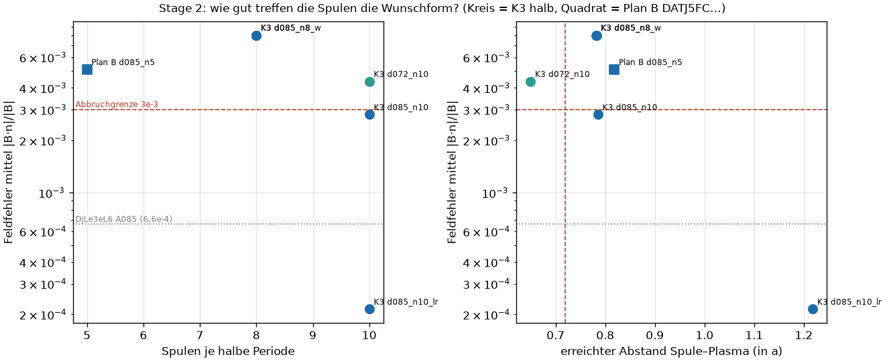
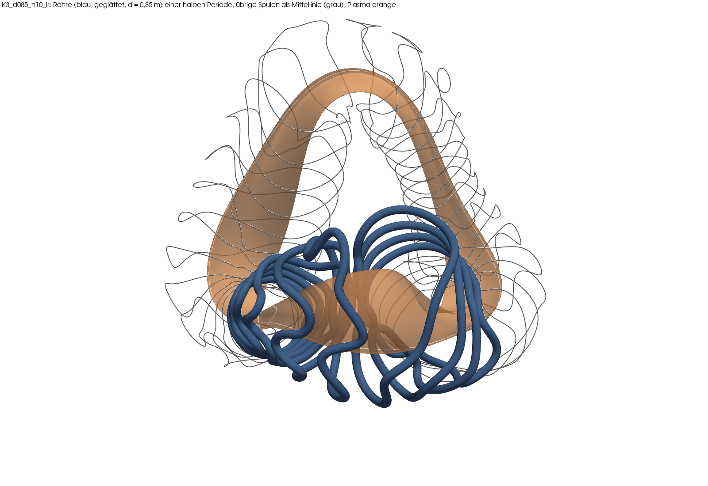
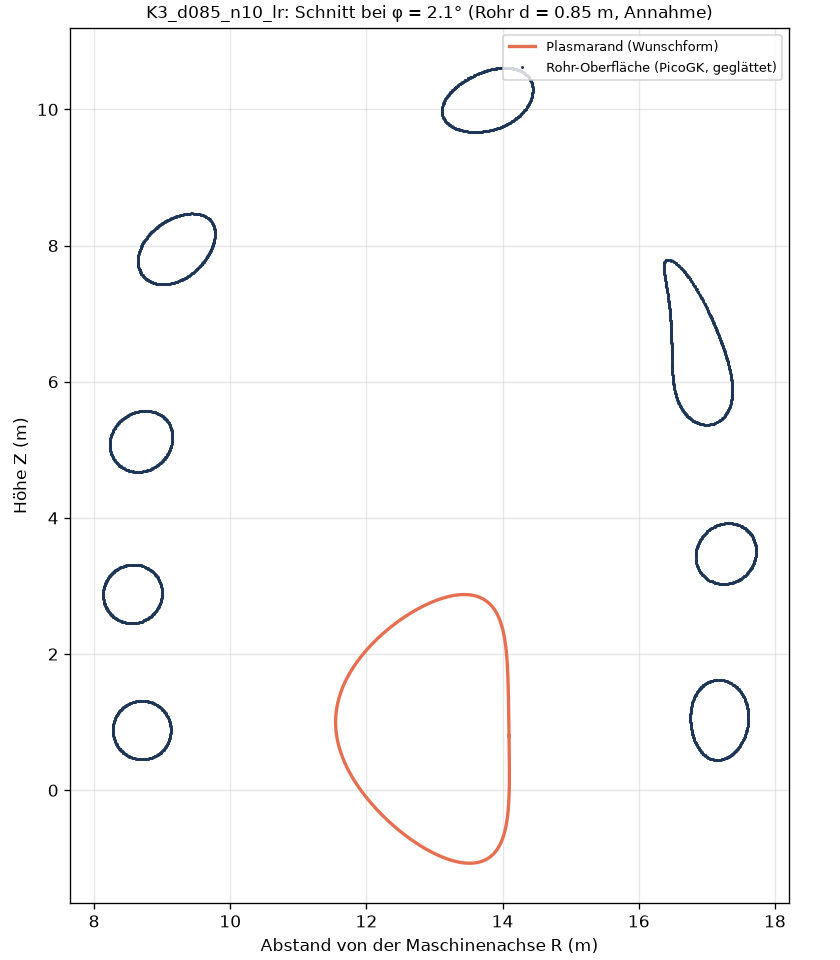

# Kette K3: vom eigenen Plasma zu eigenen Spulen, Rohr und freier Grenze (2026-11-07)

**Frage.** Lässt sich unser bestes eigenes Plasma (Kandidat 3 halb, „K3 halb“, nfp 2) durch die ganze Kette führen: Plasmaform → Spulenkurven (Rückwärtsproblem, „Stage 2“) → Glättung → Wickelpaket als Rohr in PicoGK → STL → Plasma aus dem Spulenfeld (VMEC++ freie Grenze) → Verlustfaktor QI(mit Spulen)/QI(Plasma)?

**Kurzantwort.** Ja. Für K3 halb gibt es jetzt einen eigenen Spulensatz (40 Spulen, Feldfehler 2,1·10⁻⁴, Abstand zum Plasma 1,22 a), daraus geschlossene Rohre als STL (PicoGK, geglättet), und das Plasma aus diesem Spulenfeld hat QI 5,6·10⁻⁵ statt 4,8·10⁻⁵ ohne Spulen: **Verlustfaktor 1,17** am Rand (3000 Rechenschritte; mit 12000 Schritten 1,14), 1,26 in halber Tiefe. Damit bleibt K3 halb auch mit Spulen etwa 8-mal besser als DjLe3eL6 mit eigenen Spulen. Die Glättung kostet praktisch nichts (Feldfehler +0,05 %, QI am Rand +0,02 %). Zwei Einschränkungen: Die Spulen sind lang (27 bis 55 m), stark gewunden und liegen so eng beieinander (0,54 m), dass sich Rohre von 0,85 m Durchmesser durchdringen; und der Randwert der freien Grenze ist rechnerisch nicht ganz sicher (siehe Schritt 1).

> **Einschränkung 2026-11-07 (B-061).** Die Kette läuft, aber dieser Bericht sagt mehr, als er trägt. „Konvergiert“ heißt hier nur: Die Rechnung hat ein Ergebnis geliefert; die Toleranz wurde in keinem Lauf erreicht, und die Verlustfaktoren hängen an der Schrittzahl. Der beste Satz d085_n10_lr passt nicht in den Bauraum (Rohre durchdringen sich), und der Vergleich seines Feldfehlers mit Proxima gilt nicht, weil es verschiedene Formen sind. Alles läuft ohne nennenswerten Plasmadruck. Fortsetzung: `kreis_bericht.md`.

Befunde B-059 und B-060, Erwartungen und Ergebnisse im Ereignisprotokoll F-261 bis F-271. Vorarbeit: Machbarkeit B-058 (`spulen_machbarkeit.md`), Kettenbild `kette_plasma_maschine.md`.

## Begriffe (für Maschinentechniker)

- **Feldfehler B·n/|B|**: Anteil des Spulenfeldes, der *durch* die gewünschte Plasmaoberfläche hindurchstößt. Ideal 0: dann laufen die Feldlinien genau an der Wunschfläche entlang. Wie eine Passung: 2·10⁻⁴ heißt, das Feld steht im Mittel um etwa 0,01° schief zur Fläche.
- **Stage 2**: die Spulenkurven so verbiegen, dass der Feldfehler klein wird, unter Nebenbedingungen (Abstand zum Plasma, kleinster Biegeradius, Abstand der Spulen untereinander, Gesamtlänge).
- **Freie Grenze**: VMEC++ bekommt nur die Spulen und sucht selbst, wo das Plasma sitzt. **Fest** = Plasmaform vorgegeben (Wunsch). Der Vergleich frei/fest zeigt, was die Spulen vom Wunsch übrig lassen.
- **Verlustfaktor**: QI frei / QI fest. 1 = Spulen treffen das Wunschfeld perfekt.
- **QI**: Maß, wie gut gefangene Teilchen im Feld gehalten werden (kleiner = besser).
- **a**: kleiner Plasmaradius (hier als 1,80 m angenommen); Abstände werden in a angegeben, weil sie dann nicht vom Maßstab abhängen.
- **TripleOffset (PicoGK)**: Körper erst um g nach innen versetzen, dann um 2 g nach außen, dann um g nach innen. Ecken und Kanten unter g verschwinden, der Rest bleibt gleich – wie Entgraten mit einem Kugelfräser vom Radius g.

## Annahmen (gekennzeichnet)

| Größe | Wert | Herkunft |
|---|---|---|
| Anlagenmaßstab | kleiner Radius a = 1,80 m | wie `zwei_ringe.py`, Annahme der Kette |
| Rohrdurchmesser | 0,852 m (Kreis) | flächengleich zum quadratischen Wickelpaket 0,7552 m der Kette (`kopplung.WP_M`, Stufe 0) |
| Voxelgröße / Glättung | 25 mm / TripleOffset 100 mm | eigene Wahl |
| Stage-2-Grenzen | Biegeradius ≥ 0,5 a, Spule–Spule ≥ 0,3 a, mittlere quadratische Krümmung wie Proxima-Satz (maßstabsgerecht), Gesamtlänge ≤ 24,9 a je Spule | `zwei_ringe.py` (Länge = Mittel des Proxima-Satzes von DjLe3eL6) |
| Freie Grenze | 5 Toroidalpunkte je Spulenabstand (nzeta 48 bei DjLe3eL6, 100 bei K3), 3000 bzw. 12000 Schritte, Ergebnis auch ohne volle Toleranz | Einstellungen k_n3000/k_n12000 aus B-053 |

## Schritt 1: Spulen-Leser und Prüfstein mit eigenen A085-Spulen (DjLe3eL6)

Werkzeug: `stellarator/spulen_satz.py` schreibt einen simsopt-Spulensatz in einen Satz-Ordner (Plasmarand + Basiskurven, Längenfaktor), `stellarator/qi_spulen.py` liest ihn mit `QI_SATZ=<Ordner>` (ohne Variable unverändert Proxima). Die A085-Spulen aus `zwei_ringe.py` lagen im 1,699-fachen Maßstab und wurden zurückgerechnet; der Feldfehler stimmt danach auf fünf Stellen (6,5978·10⁻⁴). Die feste Rechnung trifft den früheren Wert bitgleich (0,00044558).

| DjLe3eL6 | QI Rand | Verlustfaktor Rand | s = 0,5 | Randabweichung mittel / max | iota Rand/nfp |
|---|---|---|---|---|---|
| fest (Wunsch, nzeta 48) | 0,000446 | 1 | 1 | – | 0,0904 |
| frei, Proxima-Spulen, 3000 / 12000 Schritte (B-053) | 0,000579 / 0,000671 | 1,30 / 1,50 | – | 0,0125 a / – | – |
| frei, eigene A085-Spulen, 3000 Schritte | 0,000451 | **1,013** | 1,011 | 0,010 a / 0,066 a | 0,0968 |
| frei, eigene A085-Spulen, 12000 Schritte | 0,000558 | **1,25** | 1,004 | 0,009 a / 0,089 a | 0,0943 |
| frei, A085 nach PicoGK-Glättung, 3000 Schritte | 0,000452 | 1,013 | 1,010 | 0,010 a / – | – |

**Lesehilfe.** Waagerecht: Lage im Plasma, links die Mitte (Achse), rechts der Rand. Senkrecht: QI-Fehler jeder Fläche, logarithmisch (eine Teilung = Faktor 10, unten ist besser). Oben die Form DjLe3eL6: schwarz ohne Spulen, rot mit den fremden Proxima-Spulen (nach außen bis 50 % schlechter), blau mit unseren A085-Spulen (fast deckungsgleich mit Schwarz), türkis dieselben nach der PicoGK-Glättung (liegt auf Blau). Unten, etwa zehnmal besser, unser Plasma K3 halb: violett ohne Spulen, hellorange mit dem schwächeren K3-Satz d085_n10, rot mit dem besten Satz d085_n10_lr (gepunktet 12000 Schritte, dunkelrot nach der PicoGK-Glättung – liegt genau auf dem roten 3000er-Verlauf und verdeckt ihn). Alle K3-Verläufe mit Spulen liegen nur wenig über Violett: Die Spulen kosten 14 bis 33 % am Rand, die Form gewinnt gegenüber DjLe3eL6 einen Faktor 8. Gestrichelt = 3000, gepunktet = 12000 Rechenschritte; wo sie auseinanderlaufen, ist der Wert nicht sicher.

**Belegt:** Die Kette Spulen-JSON → Feldtabelle → VMEC++ freie Grenze → QI läuft mit eigenen Spulen. Eigene Spulen mit kleinerem Feldfehler (6,6·10⁻⁴ statt 2,4·10⁻³) verlieren 17 bis 22 % weniger als Proxima. **Einschränkung (belegt):** Der Randwert der freien Grenze hängt von der Rechenlänge ab (1,01 bei 3000, 1,25 bei 12000 Schritten), innen nicht (s = 0,5: 1,00 bis 1,01). Der Verlustfaktor am Rand ist darum auf etwa ±10 % unsicher; Vergleiche nur bei gleicher Einstellung, s = 0,5 immer mitmelden.

## Schritt 2: Stage 2 für K3 halb

Werkzeug `stellarator/k3_spulen.py`: der Ansatz von `zwei_ringe.py` (Start an der um den Sollabstand versetzten Randlinie, Fourier-Ordnung 7, Strafen für Abstand, Krümmung, Spule–Spule, Länge), verallgemeinert auf jede Randform. Läufe je 7 bis 19 Minuten, höchstens zwei gleichzeitig, jeder in einem eigenen 6-GB-Scope.

| Lauf | Spulen | Längengrenze | Feldfehler mittel / max | Abstand Spule–Plasma | Spule–Spule |
|---|---|---|---|---|---|
| K3 d085_n8 (+ 2 Runden Fortsetzung) | 32 | 1,25 × Startlänge | 8,0·10⁻³ / 5,0·10⁻² | 0,78 a | 0,76 a |
| K3 d072_n10 | 40 | 1,25 × Startlänge | 4,35·10⁻³ / 2,9·10⁻² | 0,62 a (unter Grenze 0,72 a) | 0,66 a |
| K3 d085_n10 | 40 | 1,25 × Startlänge | 2,80·10⁻³ / 1,8·10⁻² | 0,79 a | 0,56 a |
| **K3 d085_n10_lr** | 40 | 24,9 a je Spule (wie zwei_ringe) | **2,15·10⁻⁴ / 1,7·10⁻³** | **1,22 a** | 0,30 a (Grenze) |
| Plan B DATJ5FC… d085_n5 | 40 | 1,25 × Startlänge | 5,0·10⁻³ / 3,1·10⁻² | 0,82 a | 0,59 a |
| Kontrolle DjLe3eL6 d085_n5 (1 Runde) | 40 | 1,25 × Startlänge | 4,36·10⁻³ | 0,81 a | 0,69 a |
| Kontrolle DjLe3eL6 d085_n5_lr (2 Runden) | 40 | 24,9 a je Spule | 9,0·10⁻⁴ (zwei_ringe A085: 6,6·10⁻⁴) | 0,83 a | 0,30 a |

**Lesehilfe.** Jeder Punkt ist ein Spulenentwurf. Links: Feldfehler über der Zahl der Spulen je halber Periode; rechts: Feldfehler über dem erreichten Abstand Spule–Plasma. Senkrecht logarithmisch, unten ist besser. Rot gestrichelt die Abbruchgrenze 3·10⁻³ (über ihr gilt ein Entwurf als unbrauchbar) und rechts die Mindestabstandsgrenze 0,72 a (≈ 1,3 m Abschirmung). Grau gepunktet der Bezug A085 (DjLe3eL6). Kreise K3 halb, Quadrat Plan B. Der Punkt ganz unten rechts (d085_n10_lr) ist der einzige, der beide Grenzen klar einhält.

**Was schiefging und wie es gefunden wurde.** Die ersten fünf Läufe blieben bei 2,8·10⁻³ bis 8·10⁻³ hängen, auch Plan B, obwohl diese Form der DjLe3eL6 ähnelt, für die Stage 2 schon 6,6·10⁻⁴ erreicht hatte. Ein Kontrolllauf meines Skripts auf DjLe3eL6 ergab 4,4·10⁻³ statt 6,6·10⁻⁴ – also lag es am Skript. Ursache (gemessen): meine eigene Längengrenze (1,25 × Startlänge) war bindend, die Spulen endeten genau an ihr (K3: 172,4 a bei Grenze 172,3 a). Mit der Längenregel aus `zwei_ringe.py` fiel der Feldfehler von K3 auf 2,15·10⁻⁴ (Faktor 13), die Kontrolle auf 9,0·10⁻⁴ (Größenordnung von A085, nicht bitgleich: andere Flächenauflösung). Lehre: ein verallgemeinertes Skript erst am bekannten Fall prüfen.

**Belegt:** K3 halb lässt sich mit Einzelspulen dieses Typs treffen (2,15·10⁻⁴, besser als A085 bei DjLe3eL6). **Folgerung:** Die Befürchtung aus B-058 (gestreckte Form, kleine Gradientenlänge → Spulen müssen sehr nah ran) trifft nicht zu, solange die Spulen lang genug sein dürfen. Der Preis: Gesamtlänge an der Grenze (249 a ≈ 450 m je halbe Periode), Biegeradius und Spule–Spule ebenfalls an ihren Grenzen. Plan B wurde mit der richtigen Längenregel nicht mehr gerechnet (nicht nötig, Zeit).

## Schritt 3: Rohr in PicoGK, Glättung, STL

Ablauf: Jede Basisspule (eine halbe Periode, die anderen sind Spiegel- und Drehkopien) wird in PicoGK als Kette kurzer Balken mit Kreisquerschnitt entlang der Mittellinie (400 Punkte) aufgebaut, voxelisiert (25 mm), mit TripleOffset 100 mm geglättet und als STL je Spule und als Vereinigung geschrieben (`stellarator/k3_rohr.py`, Konsolen-App `picogk/SpulenRohr`, headless, ohne Fenster). Prüfung in Python: offene Kanten, Durchmesser je Querschnitt, Abstand zur Plasmafläche; die Mittellinie des geglätteten Rohrs wird per Kreisausgleich je Querschnitt zurückgewonnen und erneut als Spule gerechnet. So wird der Verlust durch die Glättung eine eigene Zahl. PicoGK läuft auf diesem Rechner ohne Fehler (eine Halbierungssuche war nicht nötig).

| Prüfung | A085 (DjLe3eL6) | K3 d085_n10 | **K3 d085_n10_lr** |
|---|---|---|---|
| Rechenzeit PicoGK | 45 s (5 Rohre) | 62 s (10) | 86 s (10) |
| offene Kanten / mannigfaltig | 0 / ja | 0 / ja | 0 / ja |
| Durchmesser je Querschnitt (Soll 0,852 m) | 0,851 bis 0,855 m | 0,851 bis 0,853 m | 0,851 bis 0,854 m |
| Volumen gegen π r² L | −0,14 % | −0,14 % | −0,14 % (gleiches Verfahren) |
| Mittellinie nach Glättung, Versatz mittel / max | 0,24–0,52 / 1,7 mm | 0,15–0,27 / 0,6 mm | 0,20–0,41 / 1,2 mm |
| **Feldfehler-Änderung durch die Glättung** | **+0,015 %** | **+0,010 %** | **+0,05 %** |
| **QI-Änderung durch die Glättung (frei, 3000)** | **+0,08 % Rand, −0,07 % s = 0,5** | nicht gerechnet | **+0,02 % Rand, −0,4 % s = 0,5** |
| kleinster Abstand Rohroberfläche–Plasma | 1,05 m (0,58 a) | 0,95 m (0,53 a) | 1,76 m (0,98 a) |
| Rohre durchdringen sich (Summe − Vereinigung) | 0,92 m³ | 0 | 0,81 m³ |
| Rohrlängen | 30 bis 61 m | 17 bis 55 m | 27 bis 55 m |

**Lesehilfe.** Blick schräg von oben auf den ganzen Ring. Orange ist das Plasma von K3 halb, ein stark gestrecktes, verdrilltes Band; es wiederholt sich zweimal im Ring (nfp 2). Blau die geglätteten Rohre einer halben Periode (ein Viertel des Rings), grau die Mittellinien aller übrigen Spulen, die durch Drehen und Spiegeln entstehen. Die Spulen laufen nicht als einfache Ringe um das Plasma, sondern in weiten, gewellten Bügeln, dicht gebündelt; dort, wo sie sich fast berühren, durchdringen sich die 0,85-m-Rohre.

**Lesehilfe.** Senkrechter Schnitt durch die Maschine bei φ = 2,1° (durch die Mitte der ersten Spule), wie ein Schnitt in der Zeichnung. Waagerecht der Abstand von der senkrechten Maschinenachse, senkrecht die Höhe, beides in Metern und im gleichen Maßstab. Orange: Plasmaquerschnitt (etwa 4 m hoch, 2,5 m breit). Blau: wo der Schnitt die Rohre trifft. Kreisrund erscheinen Rohre, die senkrecht durch die Ebene laufen (links und rechts vom Plasma, 3 bis 4 m Abstand); länglich erscheinen Rohre, die schräg durch die Ebene laufen. Die Rohrschnitte bis 10 m Höhe zeigen, wie weit die Bügel über das Plasma hinausragen – für ein Tragwerk ein großer Bauraum.

**Lesehilfe.** Zum Vergleich DjLe3eL6 (nfp 4, darum viermal wiederholt) mit A085-Spulen. Auch hier machen die Spulen Schleifen und Knoten; rechnerisch gut, gebaut würde man sie so nicht.

**Lesehilfe.** Der erste K3-Versuch (d085_n8, zu enge Längengrenze, Feldfehler 8·10⁻³): Die Spulen schlingen sich teils eng ums Plasma und laufen teils in weiten Bögen weg – der Optimierer kämpfte gegen die Längengrenze.

**Belegt:** PicoGK baut die Rohre geschlossen und maßhaltig (±2 mm bei 25 mm Voxel), die Glättung durch TripleOffset kostet höchstens 0,05 % Feldfehler und bei A085 0,1 % QI. Grund: Der kleinste Biegeradius (0,5 a = 0,9 m) ist größer als der Rohrradius (0,43 m), die Glättung nimmt nur Voxelstufen weg. **Folgerung:** Der Verlust der Kette entsteht im Rückwärtsproblem und in der freien Grenze, nicht in der Glättung. Wo die Spulen auf die Grenze Spule–Spule 0,3 a (0,54 m) zusammenrücken, durchdringen sich Rohre von 0,85 m; für baubare Rohre muss diese Grenze mindestens Rohrdurchmesser plus Spalt sein (≈ 0,5 a), was den Feldfehler wieder erhöhen wird (nicht gerechnet).
Methodenhinweis (Fehler unterwegs): Die erste Mittellinie aus dem Schwerpunkt der Netzpunkte im Querschnitt lag schon ohne Glättung 7 mm daneben (Feldfehler scheinbar +1,7 %); mit Kreisausgleich je Querschnitt 0,2 bis 0,5 mm.

## Schritt 4: freie Grenze für die K3-Spulen

| K3 halb (nzeta 100) | QI Rand | Verlustfaktor Rand | s = 0,5 | innen (s = 0,1 bis 0,9) | Randabweichung mittel / max | Elongation |
|---|---|---|---|---|---|---|
| fest (Wunsch) | 4,79·10⁻⁵ | 1 | 1 | 1 | – | 7,15 |
| frei, Satz d085_n10 (Feldfehler 2,8·10⁻³), 3000 | 6,37·10⁻⁵ | **1,33** | 1,56 | 1,25 bis 1,58 | 0,019 a / 0,16 a | 6,78 |
| frei, Satz d085_n10_lr (2,15·10⁻⁴), 3000 | 5,61·10⁻⁵ | **1,17** | 1,26 | 0,96 bis 1,30 | 0,018 a / 0,16 a | 6,81 |
| frei, Satz d085_n10_lr, 12000 | 5,45·10⁻⁵ | **1,14** | 1,17 | 0,97 bis 1,20 | 0,014 a / 0,13 a | 6,92 |
| frei, d085_n10_lr nach Glättung, 3000 | 5,61·10⁻⁵ | 1,17 | 1,25 | | 0,018 a / – | |

iota am Rand und Spiegelverhältnis ändern sich um weniger als 1 % (0,0883 → 0,0881; 0,447 → 0,448). Die freie Grenze konvergierte in allen Fällen ohne Abbruch (Restkraft fsqr 2·10⁻¹²); eine Halbierungssuche war nicht nötig.

**Belegt:** Unser Plasma behält mit eigenen Spulen QI 5,6·10⁻⁵ bis 6,4·10⁻⁵. Zum Vergleich DjLe3eL6 mit eigenen A085-Spulen: 4,5·10⁻⁴ bis 5,6·10⁻⁴, also etwa achtmal schlechter. Der Verlustfaktor (1,17 bis 1,33) bleibt deutlich unter der Meldegrenze 3 aus B-058. **Auffällig (Hinweis, nicht geprüft):** Beide K3-Sätze haben bei 3000 Schritten dieselbe Randabweichung (max 0,16 a) und verlieren gleich viel Elongation (7,15 → 6,8), obwohl ihr Feldfehler um Faktor 13 verschieden ist; mit 12000 Schritten schrumpft beides (0,13 a, Elongation 6,92) und QI wird besser (1,14 statt 1,17). Das deutet auf eine Grenze der Rechnung an den spitzen Enden des gestreckten Querschnitts, nicht auf die Spulen. Anders als bei DjLe3eL6 (1,01 → 1,25) wird der K3-Wert mit längerer Rechnung kleiner, nicht größer. Innen ist der Verlust des schlechteren Satzes größer als am Rand (1,56 gegen 1,33).

## Was offen bleibt

- **Baubarkeit der Spulen:** 40 Spulen von 27 bis 55 m Länge, an Biegeradius-, Längen- und Abstandsgrenze; Rohre durchdringen sich. Nächster Schritt: Stage 2 mit Spule–Spule ≥ 0,5 a (Rohr + Spalt) und dann Kräfte/Spannungen in der Tragwerkskette.
- **Randwert der freien Grenze:** hängt von der Rechenlänge ab (DjLe3eL6: 1,01 bis 1,25); Ursache der gleichen Randabweichung beider K3-Sätze offen (Auflösung mpol/ntor der freien Grenze prüfen).
- **Plan B** (DATJ5FC…) nur mit der zu engen Längengrenze gerechnet (5·10⁻³); mit der Regel aus zwei_ringe nicht gerechnet.
- **Kontrolle** von `k3_spulen.py` gegen `zwei_ringe.py` nur in der Größenordnung (9,0·10⁻⁴ gegen 6,6·10⁻⁴, Faktor 1,36).
- **B-057-Verdacht:** Die damals nicht konvergierten Fälle liefen ohne die Sondereinstellungen (nzeta 48, ftol, niter), mit denen alle konvergierten gerechnet wurden – das Scheitern kann daran liegen (nicht nachgerechnet).

## Laufende Rechnungen, Pause, Neustart

Alle Rechnungen dieses Auftrags sind fertig, es läuft nichts mehr (Stand 10:28). Die Ketten sind wieder aufnehmbar, Fertiges wird übersprungen; Start immer aus dem Projektordner:

| Kette | Inhalt | Neustart |
|---|---|---|
| `sim/kette_k3/lauf_schritt1.sh` | A085 frei (fest, 3000, 12000, geglättet) | `setsid nohup bash sim/kette_k3/lauf_schritt1.sh > sim/kette_k3/lauf_schritt1.log 2>&1 &` |
| `sim/kette_k3/lauf_stage2.sh`, `lauf_stage2b.sh` | Stage 2 K3 (erste Fälle), Plan B, Varianten `_o10_k35` (abgebrochen, nicht gerechnet) | ebenso; gestrichene Fälle haben eine Sperre `.claim_<fall>` in `sim/kette_k3/stage2/` (Sperre löschen = Fall wird gerechnet) |
| `sim/kette_k3/lauf_teil2.sh` … `lauf_teil5.sh` | freie Grenze d085_n10, Stage 2 `_lr`, Kontrolle, 12000 Schritte, geglätteter Satz | ebenso |
| `sim/kette_k3/lauf_frei_k3.sh <fall> [<endung> [<nzeta>]]` | freie Grenze für einen beliebigen K3-Satz | direkt |

Jede Rechnung läuft über `sim/kette_k3/slot.sh` (höchstens zwei gleichzeitig, eigener Scope mit 6 GB) und lässt sich mit `~/bin/rechnung pause` anhalten und mit `~/bin/rechnung weiter` fortsetzen; nach einem Neustart des Rechners beginnt eine angefangene Einzelrechnung neu.

---

## English summary

**Question.** Can our own best plasma (candidate 3 half, “K3 half”, nfp 2) be carried through the whole chain: plasma shape → coil curves (stage 2) → smoothing → winding pack as a tube in PicoGK → STL → plasma from the coil field (VMEC++ free boundary) → loss factor QI(coils)/QI(plasma)?

**Answer.** Yes. Step 1: `qi_spulen.py` now reads own simsopt coil sets (`QI_SATZ=<folder>`); the check with the existing A085 coils for DjLe3eL6 gives a free-boundary loss factor of 1.01 (3000 steps) to 1.25 (12000 steps), versus 1.30–1.50 with Proxima's coils; the edge value depends on the solver length, the value at half radius does not (1.00–1.01). Step 2: the generalised stage-2 script first stalled at mean normal-field errors of 2.8e-3 to 8e-3; a control run on DjLe3eL6 showed that my own length limit was binding. With the length rule of `zwei_ringe.py`, K3 half reaches 2.15e-4 at 1.22 a coil–plasma distance with 40 coils (27–55 m long, at the curvature, length and coil–coil limits). Step 3: PicoGK (headless console app) builds closed, dimensionally accurate tubes (0.852 m diameter, assumption: area-equivalent to the 0.7552 m square winding pack; a = 1.80 m); smoothing by triple offset changes the field error by at most 0.05 % and QI by 0.1 % (A085). Tubes interpenetrate where coils come within 0.54 m. Step 4: the free boundary for the K3 coils gives QI 5.6e-5 versus 4.8e-5 for the fixed boundary, a loss factor of 1.17 at the edge and 1.26 at half radius (1.14 and 1.17 with 12000 steps); a worse coil set (2.8e-3) gives 1.33/1.56. K3 half with coils therefore stays about eight times better than DjLe3eL6 with its own coils. Open: buildability (coil–coil limit ≥ tube diameter, forces), edge convergence of the free boundary, plan B with the correct length rule.
