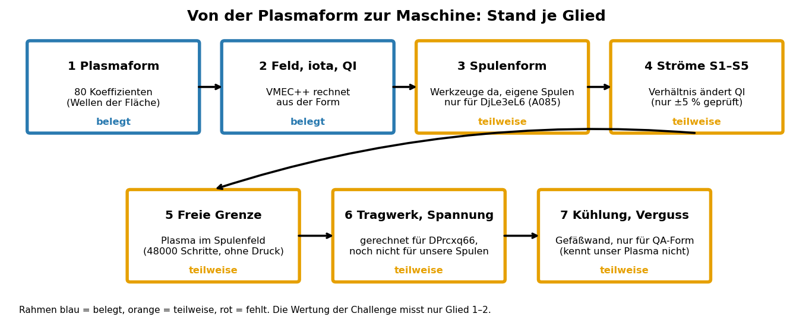

# Von der Plasmaform zur Maschine: die Kette und ihre Lücken (2026-11-07)

**Lesehilfe.** Jeder Kasten ist ein Glied der Kette, die Pfeile zeigen die Richtung: aus der Plasmaform folgt das Feld, aus den Spulen die Bauteile. Der Rahmen zeigt den Stand: blau = belegt (gerechnet und geprüft), orange = teilweise (nur in einem Bereich oder nur für einen Fall), rot = fehlt. Die Wertung der Challenge misst nur die Glieder 1 und 2 (Plasmaform und QI), die Spulen kommen darin nicht vor.

| Glied | Stand | Beleg / Lücke |
|---|---|---|
| 1 Plasmaform | belegt | Koeffizienten der Fläche, Datensatz und eigene Proben |
| 2 Feld, iota, QI | belegt | VMEC++ rechnet aus der Form (B-050 bis B-056) |
| 3 Spulenform | teilweise | Werkzeuge installiert (simsopt, DESC); eigene Spulen A085 nur für DjLe3eL6 (Feldfehler 6,6e-4, Proxima 2,4e-3); für neue Formen nicht gerechnet (B-058, nicht von mir nachgerechnet) |
| 4 Ströme S1–S5 | teilweise | Verhältnis ändert QI; lineares Modell nur bis ±5 % (qi_experiment_bericht.md) |
| 5 Freie Grenze | teilweise | erst ab 48000 Schritten belastbar (Proxima 1,53, A085 1,29, K3 1,07); ohne Plasmadruck (B-061, B-062) |
| 6 Tragwerk, Spannung | teilweise | gerechnet für DPrcxq66 (B-040 bis B-049), noch nicht für unsere Spulen; `kopplung.py` nimmt fremde Formen |
| 7 Kühlung, Verguss | teilweise | Kühlung ist die Gefäßwand; Rand fest auf die QA-Form verdrahtet, kennt kein QI-Plasma (B-061) |

**Kernaussage.** Es gibt keine durchgehende Verbindung von der Plasmaform zu den Bauteilen. Wir wissen, dass die Ströme QI über das Verhältnis der Gruppen steuern, nicht über Nähe oder Lage der Spulen (B-053, B-054). Eine Regel, wie sich die Spulenform bei geänderter Plasmaform ändert, haben wir nicht.

**English summary.** The chain from plasma shape to a built machine has seven links. The challenge score only covers links 1–2 (shape and QI). Link 3 (coil shape from plasma shape, an inverse problem) is only partly done: tools are installed and own coils exist for one shape; links 4–7 exist only partially or for one coil set. We found that currents (ratios between coil groups), not coil proximity, steer QI.

**Nachtrag 2026-11-07 (B-059, B-060).** Glied 3 und 5 sind für unser Plasma K3 halb jetzt durchgerechnet: eigene Spulen (Feldfehler 2,1·10⁻⁴), Rohre als STL aus PicoGK, freie Grenze mit Verlustfaktor 1,14 bis 1,17 (Bericht `kette_k3.md`). Das Bild oben zeigt noch den Stand vor diesem Nachtrag. *Addendum: links 3 and 5 are now computed for our own plasma K3 half (own coils, PicoGK tubes, free-boundary loss factor 1.14–1.17); the figure above predates this.*
