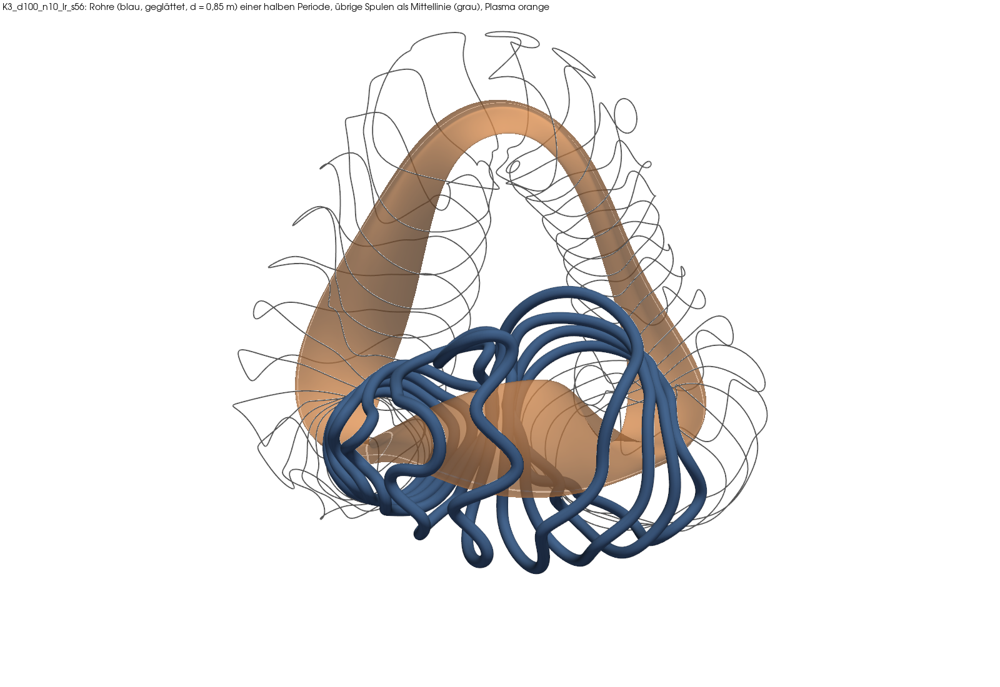
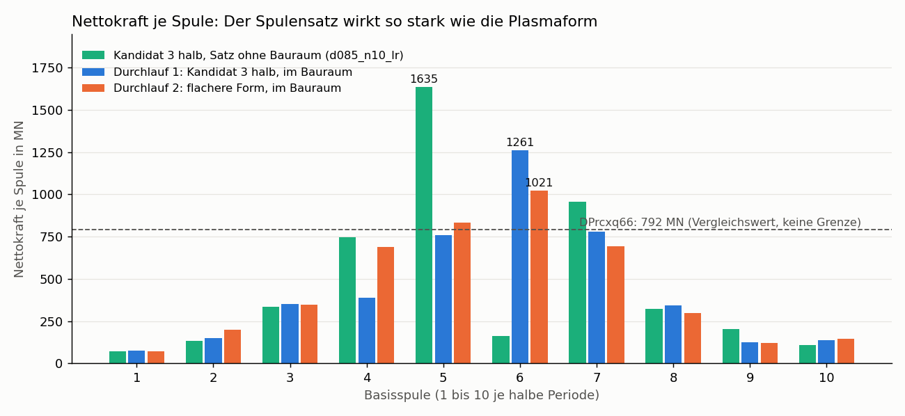
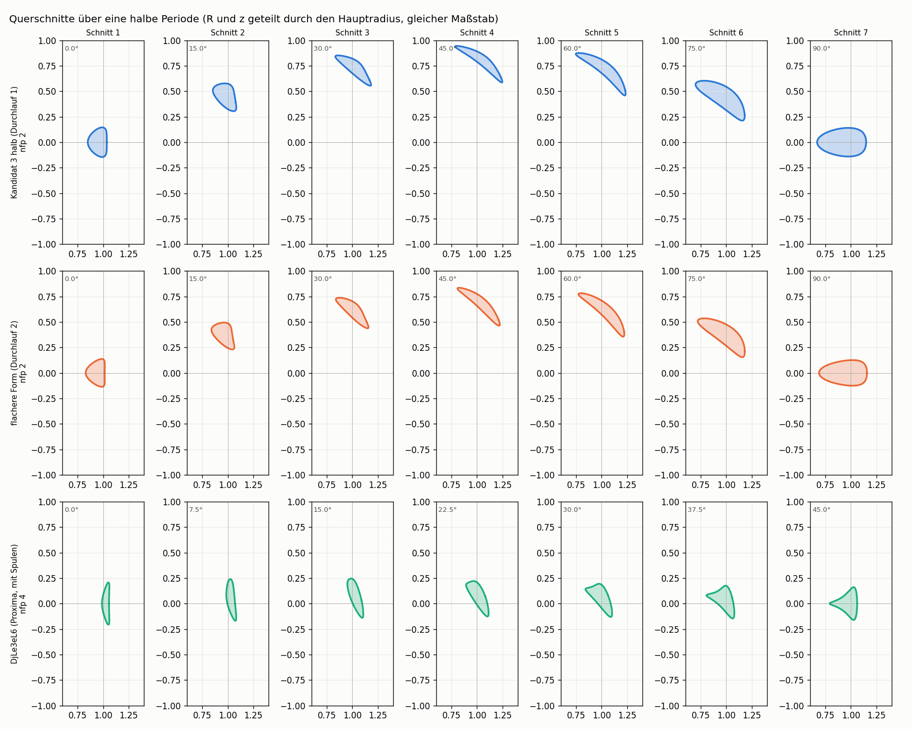

# Der Kreis: Plasma, Spulen, Technik, zurück zum Plasma (2026-11-07)

*English summary at the end.* Befunde B-061, B-062, Ereignisprotokoll F-272 bis F-278. Vorgeschichte: `kette_k3.md`, Prüfung der älteren Zahlen in B-061.

**Frage.** Lässt sich aus einem Plasma, Spulen, Bauraum und Kräften ein geschlossener Kreis bilden, in dem die Technik auf das Plasma zurückwirkt?

**Kurzantwort.** Zwei Durchläufe sind gerechnet. Unser Plasma hat jetzt Spulen, die in den angenommenen Bauraum passen, und verliert dadurch nur etwa 7 % QI. Die Kräfte bleiben der offene Punkt. Die flachere Form hat die größte Spulenkraft um 19 % gesenkt, kostet aber das 2,3-Fache an QI, und wir können nicht belegen, dass die Abflachung der Grund ist. Geschlossen ist der Kreis noch nicht: Tragwerk-FEM, Kühlung und Plasmadruck fehlen. Die Aufgaben 2 und 3 der Challenge erfüllt keine dieser Formen.

## Was ist ein Durchlauf?

| Schritt | Werkzeug | Stand |
|---|---|---|
| Plasmaform festlegen | Koeffizienten, VMEC++ mit fester Grenze | läuft |
| Spulen zur Form (Stage 2) | simsopt, `k3_spulen.py` | läuft, Bauraumgrenzen als Vorgabe |
| Rohr, Glättung | PicoGK, `k3_rohr.py` | läuft (Durchlauf 1) |
| Plasma neu rechnen | VMEC++ mit freier Grenze, `qi_spulen.py` | läuft, **ohne Plasmadruck** |
| Kräfte | `kraft_analyse.py`, `kreis_kraft.py` | läuft |
| Spannung im Tragwerk (FEM) | Kette aus B-040 bis B-049 | **nicht angeschlossen** |
| Kühlung der Gefäßwand | `kuehlung_segment.py` | **nicht angeschlossen**, fest auf alte QA-Form verdrahtet |

**Begriffe.** *Feldfehler*: Anteil des Spulenfeldes, der durch die Wunschfläche stößt, wie ein Passungsfehler; 0 wäre ideal. *Freie Grenze*: Das Plasma sucht sich im Spulenfeld selbst seinen Rand, statt ihn vorgegeben zu bekommen. *Verlustfaktor*: QI mit Spulen geteilt durch QI der Wunschform; 1 heißt kein Verlust. *fsqr*: Restkraft der Rechnung; erst um 1·10⁻¹⁴ ist sie fertig. *Nettokraft*: Summe aller Magnetkräfte auf eine Spule, das, was ihre Lagerung halten muss. *a*: kleiner Plasmaradius, hier angenommen 1,80 m.

## Vorgaben (Annahmen)

a = 1,80 m, B₀ = 6,5 T, Stromdichte wie Stufe 0. Freiraum Plasma–Spule 1,3 m für Blanket und Abschirmung (HELIAS 5-B, B-038 ff.). Spulenpaket 1,0 m. Daraus Spulenmitte mindestens 1,0 a vom Plasma und Spule–Spule mindestens 0,56 a. Vergleichswert Kraft: DPrcxq66 mit 792 MN; das ist keine Grenze.

## Die Rechnung zuerst richtig stellen

Die Werte nach 3 000 Schritten täuschen in beide Richtungen. Erst lange Läufe sind belastbar:

| Spulen, Form | QI fest | 3 000 Schritte | 12 000 | 48 000 | fsqr | Verlustfaktor |
|---|---|---|---|---|---|---|
| Proxima, DjLe3eL6 | 0,000446 | 0,000579 | 0,000671 | 0,000681 | 1,0e-14 | **1,53** |
| A085 (eigene), DjLe3eL6 | 0,000446 | 0,000451 | 0,000558 | 0,000575 | 1,0e-14 | **1,29** |
| d085_n10_lr, Kandidat 3 halb | 4,79e-5 | 5,61e-5 | 5,45e-5 | 5,13e-5 | 3,9e-14 | **1,07** |
| Durchlauf 1, Kandidat 3 halb | 4,79e-5 | 5,64e-5 | – | 5,14e-5 | 4,0e-14 | **1,07** |

Bei Kandidat 3 ist die Toleranz noch nicht ganz erreicht, der Wert fällt noch leicht. Randabweichung und Elongationsverlust aus `kette_k3.md` waren überwiegend Rechenrest (Randabweichung max. 0,16 a auf 0,07 a).

## Durchlauf 1: Kandidat 3 halb, Spulen im Bauraum

Satz `d100_n10_lr_s56`, 40 Spulen: Feldfehler 2,10·10⁻⁴, Spulenmitte–Plasma 1,18 a, Spule–Spule 0,56 a, Biegeradius 0,50 a. Alle Grenzen halten, Länge und Biegeradius liegen an ihrer Grenze. Rohr: geschlossen, keine Durchdringung, Rohr–Plasma 1,70 m. Glättung kostet 0,07 % Feldfehler. QI mit Spulen 5,14·10⁻⁵.

Der Konflikt aus `kette_k3.md` (entweder Durchdringung oder zu wenig Abstand) kam aus der zu engen Längenregel, nicht aus der Plasmaform.

**Lesehilfe.** Orange ist das Plasma, blau sind die geglätteten Rohre einer halben Periode (0,85 m Durchmesser), grau die Mittellinien der übrigen Spulen. Man sieht zwei Dinge: Die Rohre berühren sich nicht mehr, und die Spulen sind weiterhin stark gewunden. Rechnerisch passt der Satz in den Bauraum. Ob man solche Spulen wickeln und abstützen kann, sagt das Bild nicht.

## Durchlauf 2: flachere Form

Rückwirkung aus Durchlauf 1: größte Nettokraft 1261 MN an Spule 6, das 1,6-Fache des Vergleichswerts. Darum Form `k3_wild_91_misch`: 75 % Kandidat 3 halb, 25 % Datensatzform D7oUXRqC9…, Elongation 6,33 statt 7,15. Gleiche Bauraumgrenzen.

| Kennzahl | Durchlauf 1 | Durchlauf 2 |
|---|---|---|
| Elongation (fest) | 7,15 | 6,33 |
| QI fest | 4,79e-5 | 1,12e-4 |
| QI mit Spulen | 5,14e-5 (48 000) | 1,17e-4 (12 000, fsqr 8,3e-14, noch nicht fertig) |
| Verlustfaktor | 1,07 | 1,04 (vorläufig) |
| Feldfehler | 2,10e-4 | 1,79e-4 |
| Spulenmitte–Plasma | 1,18 a | 1,31 a |
| Spule–Spule | 0,56 a | 0,56 a |
| Summe Spulenlängen je halbe Periode | 465 m (an der Grenze) | 465 m (an der Grenze) |
| Größte Spulenlänge | 59,6 m | 56,4 m |
| Größter Strom | 22,6 MA | 19,9 MA |
| Größte Nettokraft | 1261 MN | 1021 MN |
| Summe Nettokräfte | 4361 MN | 4411 MN |
| Spiegelverhältnis Rand | 0,448 | 0,442 |
| Vakuummulde | −0,022 | −0,041 |
| Größte Verletzung Aufgabe 3 (zulässig 0,01) | 0,80 | 0,77 |

Die Verletzungen stammen aus den fest gerechneten Formen. Der Plasmaradius a ist in beiden Fällen 1,80 m; weil die Form schlanker ist, wächst dadurch der Maßstab (R₀ 13,6 m auf 14,1 m).

**Lesehilfe.** Je Spule drei Balken, die Höhe ist die Nettokraft. Grün und Blau sind dieselbe Plasmaform mit zwei verschiedenen Spulensätzen, Orange ist die flachere Form. Die gestrichelte Linie ist der Vergleichswert. Die Zahlen stehen an den drei Höchstwerten.

**Was das Bild zeigt.** Grün und Blau unterscheiden sich an Spule 5 um den Faktor 2, obwohl das Plasma gleich ist. Der Spulensatz allein verschiebt die Kraft also stärker als die Abflachung (Blau gegen Orange). Die Summe der Nettokräfte bleibt praktisch gleich, die Spitze wandert nur. **Damit ist nicht belegt, dass die Abflachung die Kraft senkt.** Die 19 % liegen innerhalb dessen, was ein anderer Spulensatz derselben Form ausmacht. Die Kraft ist bisher auch kein Ziel der Spulensuche, sie fällt nur an.

## Die Formen im Schnitt

**Lesehilfe.** Jede Zeile ist eine Form, jede Spalte ein Schnitt quer zum Ring, wie Schnitte durch ein gebogenes Rohr in einer Zeichnung. Von links nach rechts geht man eine halbe Periode weiter (bei nfp 2 von 0° bis 90°, bei DjLe3eL6 mit nfp 4 von 0° bis 45°). Waagerecht steht der Abstand von der Ringachse, senkrecht die Höhe, beides geteilt durch den Hauptradius; der Maßstab ist überall gleich. Die gepunkteten Linien markieren Hauptradius und Mittelebene.

**Was man sieht.** Kandidat 3 halb steigt innerhalb einer halben Periode von der Mittelebene bis auf etwa 0,9 Hauptradien nach oben und wieder zurück; in der Mitte ist der Querschnitt eine schmale Sichel. Das „hohe Band“ ist also vor allem ein Auf und Ab des ganzen Rohrs, dazu ein sehr schmaler Querschnitt (daher Elongation über 7). Die flachere Form steigt nur bis etwa 0,8 und ist kaum dicker; Abflachen hat die Grundform wenig verändert. DjLe3eL6 bleibt dagegen in der Mittelebene (Höhe höchstens 0,25) und dreht ein dreieckiges Profil. Für die Spulen heißt das: Bei Kandidat 3 müssen sie einem Rohr folgen, das sich weit aus der Ebene hebt; das erklärt die langen, weit ausladenden Spulen (Folgerung, nicht gerechnet).

## Erwartung gegen Ergebnis

| Erwartung | gemessen | Urteil |
|---|---|---|
| Durchlauf 1: Feldfehler 1e-3 bis 5e-3 | 2,10e-4 | verfehlt, deutlich besser |
| Durchlauf 1: Verlust 1,05 bis 1,12 (48 000) | 1,07 | getroffen |
| Rohr: keine Durchdringung, um 1,7 m | 1,70 m | getroffen |
| Kraft Durchlauf 1: 100 bis 800 MN | bis 1261 MN | verfehlt |
| Durchlauf 2: Feldfehler 1e-4 bis 5e-4 | 1,79e-4 | getroffen |
| Durchlauf 2: längste Spule 45 bis 55 m | 56,4 m | knapp verfehlt |
| Durchlauf 2: Kraft 700 bis 1100 MN | 1021 MN | getroffen, Ursache offen |
| Strom i_opt/p008 mit 48 000: 0,00050 bis 0,00058 | 0,000443 und 0,000431 | verfehlt, Vorteil größer |

## Nebenergebnis Ströme

Bei DjLe3eL6 mit Proxima-Spulen hält die Stromtrimmung auch im fertigen Lauf: Basis 0,000681, i_opt 0,000443 (−35 %), Probe 008 0,000431 (−37 %), alle fsqr 1,0e-14. Das Spiegelverhältnis steigt dabei von 0,359 auf 0,375 und 0,376.

## Was als Nächstes

1. **Kraft zum Ziel der Spulensuche machen** statt die Form zu verschlechtern: simsopt bringt mit `LpCurveForce` einen Kraftterm mit. Das sollte vor jeder weiteren Abflachung kommen, weil es kein QI kostet.
2. **Plasmadruck einrechnen.** Alle Läufe haben praktisch keinen Druck (1 Pa). Ohne ihn ist „Plasma neu rechnen“ nur die halbe Rückwirkung.
3. **Tragwerk-FEM anschließen:** `kopplung.py` nimmt mit plasma.json fremde Formen.
4. **Kühlung anschließen:** `gyroid_gefaess.randflaeche` muss die Form als Eingabe nehmen.
5. Durchlauf 2 bis 48 000 Schritte fertig rechnen.

## Offen und nicht geprüft

- Alle Maße hängen an a = 1,80 m und B₀ = 6,5 T.
- Stage 2 ist eine örtliche Suche; je Fall gibt es nur einen Lauf. Die Streuung zwischen Läufen ist nicht gemessen.
- Die Spulen sind nicht auf Wickelbarkeit, Halterung oder Spannung geprüft.
- Durchlauf 2 hat kein Rohr gerechnet.
- Beide Formen sind in der Challenge nicht zulässig, die Vakuummulde ist negativ.
- Die Form bleibt eine Abwandlung von Datensatzformen.

## English summary

Two passes of the loop plasma → coils → tube → free-boundary plasma → forces are computed. With 48,000 solver steps the loss factor is finally reliable: Proxima coils 1.53, our A085 coils 1.29 (both on DjLe3eL6), our coils on candidate 3 half 1.07. Values after 3,000 steps mislead in both directions. **Pass 1** gives a coil set that fits the assumed space (a = 1.80 m, 1.3 m plasma–coil clearance, 1.0 m coil package): field error 2.10e-4, no tube intersection, QI with coils 5.14e-5, largest net force 1261 MN. **Pass 2** uses a flatter shape (elongation 6.33 instead of 7.15): largest net force 1021 MN (−19 %), but QI rises 2.3 times to 1.17e-4 (preliminary) and the sum of net forces stays the same. Two coil sets of the same plasma differ more than that, so the flattening is not shown to be the cause. The loop is not closed yet: FEM structure, cooling and plasma pressure are missing, and no shape meets challenge tasks 2 or 3. Next step: make force an objective of the coil search before giving up more QI.
