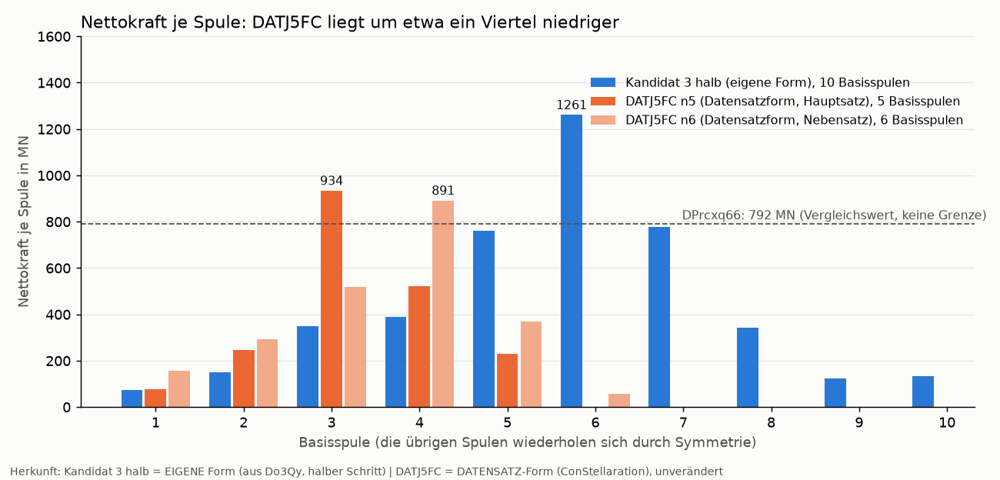
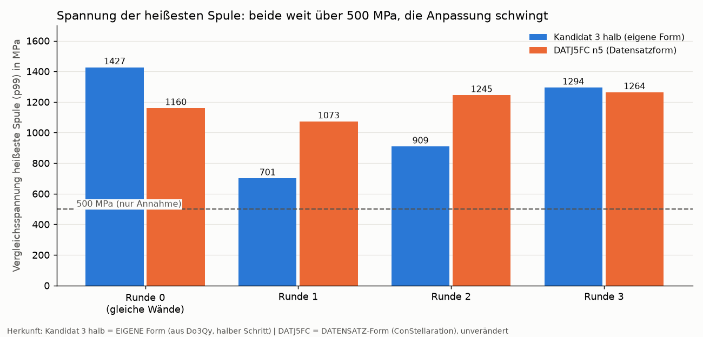
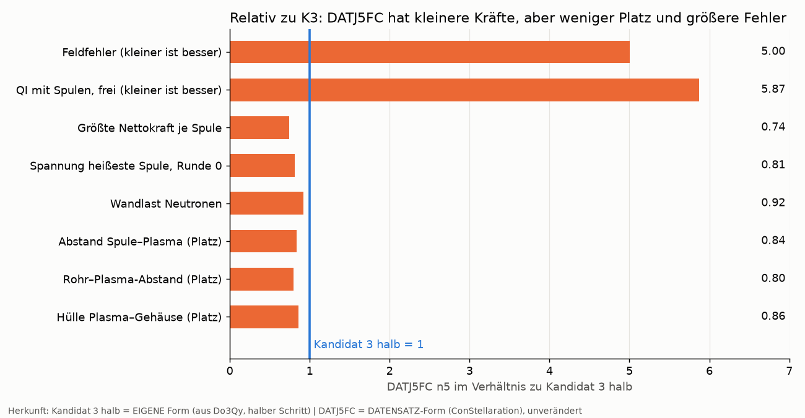
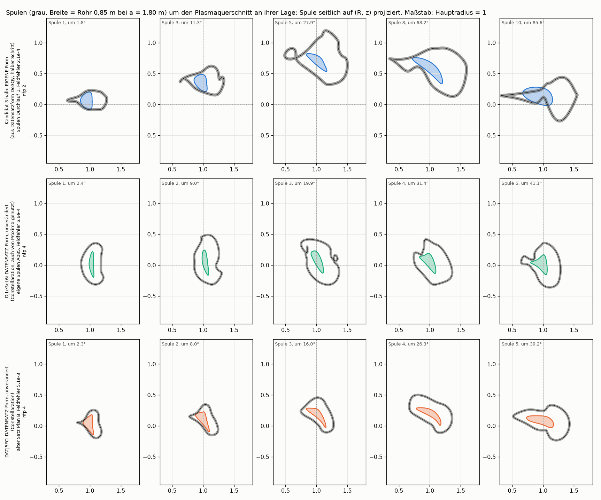

# Vergleich Kandidat 3 halb gegen DATJ5FC: Spulen, Kühlung, Festigkeit, Wärmeabfuhr (2026-11-08)

*English summary at the end.* Ereignisprotokoll F-281 bis F-289. Vorgeschichte und Stil: `../kreis_bericht.md`. Plan der Anschlüsse: `plan_fem_kuehlung.md`. Rechenskript der Bilder: `stellarator/vergleich_bilder.py`.

## Die Frage des Nutzers

> „Beide, also Kandidat 3 halb und DATJ5FC, gegenüberstellen und vergleichen. Also auch mit Spulen und Kühlung, Festigkeit bzw. Wärmeabfuhr."

Anlass: Der Nutzer hielt Kandidat 3 für schwer baubar. Die Frage ist also, ob die Datensatzform DATJ5FC, die auf den ersten Blick ruhigere Spulen hat, bei gleichen Annahmen wirklich leichter zu bauen ist und was sie dafür beim Plasma kostet.

**Kurzantwort.** DATJ5FC hat bei gleichen Annahmen etwa ein Viertel kleinere Spulenkräfte (−26 %) und rund 19 % weniger Spannung in der heißesten Spule. Es lässt aber weniger Platz zwischen Plasma und Gehäuse (1,28 m statt 1,50 m), der Feldfehler der Spulen ist 5-mal größer, und das Plasma wird mit Spulen etwa 6-mal schlechter (QI 3,0e-4 gegen 5,1e-5). Beide Formen liegen mit den angenommenen Wänden weit über der angenommenen Festigkeitsgrenze von 500 MPa. Keine Form ist fertig; es steht Baubarkeit gegen Plasmagüte.

## Woher die Plasmen kommen

| Name | Herkunft | nfp |
|---|---|---|
| Kandidat 3 halb (K3 halb) | **EIGENE Form**: aus der Datensatzform Do3Qy…, halber Schritt unserer Suche; im Datensatz nicht enthalten | 2 |
| DATJ5FC | **DATENSATZ-Form** (ConStellaration), **unverändert** | 4 |

Die Spulensätze sind in beiden Fällen **eigene** Rechnungen (Satz `d100_n10_lr_s56` für K3, `d100_n5_lr_s56` und `d100_n6_lr_s56` für DATJ5FC), mit denselben Grenzen.

**Begriffe.**
- *nfp*: Zahl der gleichen Perioden um den Ring. nfp 2 heißt, die Form wiederholt sich zweimal; bei nfp 4 viermal. Man muss nur eine halbe Periode berechnen, der Rest folgt aus der Symmetrie.
- *Feldfehler*: Anteil des Spulenfeldes, der durch die Wunschfläche des Plasmas stößt, wie ein Passungsfehler; 0 wäre ideal.
- *QI (Quasi-Isodynamik)*: Gütezahl dafür, wie gut das Plasma seine Teilchen hält; kleiner ist besser. Die Aufgabe 3 der Challenge verlangt höchstens 3,2e-4.
- *Freie Grenze*: Das Plasma sucht sich im Feld der echten Spulen selbst seinen Rand, statt ihn vorgegeben zu bekommen. Das ist der ehrliche Test.
- *Verlustfaktor*: QI mit Spulen geteilt durch QI der Wunschform; 1 heißt kein Verlust.
- *Nettokraft*: Summe aller Magnetkräfte auf eine Spule, das, was die Lagerung halten muss.
- *Spannung (von Mises, p99)*: Vergleichsspannung im Stahl der Tragstruktur, so berechnet, dass 99 % des Volumens darunter liegen; Maß für die Beanspruchung wie bei einem Bauteil im FEM-Modell. *Heißeste Spule* ist die Spule mit der höchsten solchen Spannung, ohne Randzone von 0,5 m.
- *Hülle*: kleinster Abstand zwischen Plasma und äußerem Gehäuse; darin müssen Blanket (Brutmantel) und Abschirmung Platz finden.
- *Wandlast*: Wärmeleistung der Neutronen je Quadratmeter Gefäßwand.
- *MHD-Druckverlust*: Flüssiges Blei, das durch ein Magnetfeld strömt, wird gebremst, ähnlich einer Wirbelstrombremse. Das kostet Pumpdruck.

## Gleiche Annahmen für beide

| Annahme | Wert |
|---|---|
| kleiner Plasmaradius a | 1,80 m (damit R0 rund 13,4 m für K3 und 16,3 m für DATJ5FC) |
| Feld auf der Achse B0 | 6,5 T |
| Abstand Spulenmitte–Plasma | mindestens 1,0 a |
| Abstand Spule–Spule | mindestens 0,56 a |
| Längenregel | zwei_ringe (`_lr`) |
| Wände der Tragstruktur | wie Punkt 0012 des Vorgängerlaufs DPrcxq66, Wände × 1,6 |
| Hülle Plasma–Gehäuse | mindestens 1,5 m (Vorgabe) |
| Fusionsleistung | 3053 MW, **angenommen** (kopplung.P_FUS_MW), nicht aus der Form berechnet |
| Festigkeitsgrenze | 500 MPa, **nur Annahme**, nicht belegt |
| Kühlung | 1D-Modell, Bleidruckverlust bei angenommenem Feldwinkel 6° und 6 T oder mit dem Feld der eigenen Spulen |

Die Form wird für beide gleich behandelt. Der Abstand 1,0 a ist für DATJ5FC bindend, für K3 nicht (siehe Tabelle).

## Die große Vergleichstabelle

n5 und n6 sind zwei Spulensätze derselben Form DATJ5FC mit 5 und 6 Basisspulen je halbe Periode (40 und 48 Spulen). **n5 ist der Hauptsatz** (Grenzen eingehalten, kleinerer Verlust); n6 ist Nebensatz.

| Kennzahl | K3 halb (eigene Form) | DATJ5FC n5 (Hauptsatz, Datensatzform) | DATJ5FC n6 (Datensatzform) |
|---|---|---|---|
| nfp | 2 | 4 | 4 |
| R0 (aus Rmajor des freien Plasmas × L) | 13,43 m | 16,33 m | 16,33 m (gleiche Skalierung) |
| Spulen gesamt (Basisspulen) | 40 (10) | 40 (5) | 48 (6) |
| Feldfehler (Mittel) | 2,10e-4 | 1,05e-3 (5,0-fach) | 8,97e-4 (4,3-fach) |
| Abstand Spule–Plasma | 1,18 a | 0,99 a | 0,965 a (unter 1,0 a) |
| Abstand Spule–Spule | 0,560 a | 0,5595 a | 0,5594 a |
| Rohr–Plasma (geglättet) | 1,70 m | 1,35 m | 1,31 m |
| QI fest (Wunschform) | 4,79e-5 | 2,84e-4 | 2,85e-4 |
| QI frei, 48 000 Schritte | 5,14e-5 (fsqr 4,0e-14) | 3,02e-4 (fsqr 1,0e-14) | 3,24e-4 (fsqr 1,0e-14) |
| Verlustfaktor | 1,07 | 1,07 (1,065) | 1,14 |
| Grenze Aufgabe 3 (QI höchstens 3,2e-4) | weit darunter | knapp darunter | knapp darüber |
| Größte Nettokraft je Spule | 1261 MN (Spule 6) | 934 MN (Spule 3), −26 % | 891 MN (Spule 4) |
| FEM Runde 0, heißeste Spule (gleiche Wände) | 1427 MPa | 1160 MPa (−19 %) | nicht gerechnet (Speicher) |
| Spanne der Anpassungsrunden 0 bis 3 | 701 bis 1427 MPa | 1073 bis 1264 MPa | nicht gerechnet |
| Stahl-p99 über alle Spulen, Spanne der Runden | 567 bis 683 MPa | 619 bis 696 MPa | nicht gerechnet |
| u_max (größte Verschiebung) | 284 mm | 262 mm | nicht gerechnet |
| Hülle Plasma–Gehäuse | 1,50 m (erfüllt) | 1,28 m (unter der Vorgabe 1,5 m) | nicht gerechnet |
| Wandlast Neutronen (3053 MW angenommen) | 1,44 MW/m² | 1,32 MW/m² (−8 %) | 1,33 MW/m² |
| Bleidruckverlust, Annahme 6°/6 T, Stahlwand | 65 kPa | 93 kPa (+43 %) | 93 kPa |
| Bleidruckverlust, aus den Spulen, Stahlwand | 106 bis 14 501 kPa (Mittel 4727) | 317 bis 5308 kPa (Mittel 2759) | 318 bis 5305 kPa |
| Bleidruckverlust, aus den Spulen, isolierte Kanalwand | 3,2 bis 32,5 kPa | 6,3 bis 24,7 kPa | 6,3 bis 24,7 kPa |

**Wie die Zahlen zu lesen sind.**
- Die Spannung der heißesten Spule hängt stark davon ab, welche Spule es gerade ist; deshalb zählt Runde 0 als Vergleichswert, weil dort alle Formen dieselben Wände haben.
- Die Kraft in der FEM-Rechnung (K3 1263 MN, n5 907 MN) ist ein anderes Kraftmodell als die Auswertung `kraefte.json` (1261 und 934 MN) und wird deshalb nicht in die Tabelle gemischt.
- Abstand und Hülle sind Platzmaße für Blanket und Abschirmung; weniger heißt weniger Platz.

## Nettokraft je Spule

**Lesehilfe.** Jede Säulengruppe ist eine Basisspule der ersten halben Periode (K3 hat 10, DATJ5FC 5 oder 6). Die Höhe ist die Gesamtkraft in Meganewton, die auf diese Spule wirkt und die ihre Lagerung halten muss. Zum Vergleich ist als gestrichelte Linie die Kraft des Vorgängers DPrcxq66 (792 MN) eingezeichnet; sie ist keine Grenze. Blau ist K3 (eigene Form), orange DATJ5FC (Datensatzform, unverändert), hell orange der Nebensatz n6.

**Was man sieht.** K3 hat eine einzelne Spitze bei Spule 6 (1261 MN) und eine zweite Gruppe um 780 MN bei Spule 7. Bei DATJ5FC liegt die größte Kraft bei 934 MN (n5, Spule 3) beziehungsweise 891 MN (n6, Spule 4). Der Unterschied der Spitzen ist etwa ein Viertel. Die Summe über die Basisspulen ist bei K3 mit 4360 MN höher als bei n5 (2011 MN) und n6 (2290 MN); sie ist aber nicht direkt vergleichbar, weil K3 zehn und DATJ5FC fünf Basisspulen hat und nfp verschieden ist.

## Spannung der heißesten Spule

**Lesehilfe.** Das FEM-Modell (Finite-Elemente-Methode: Das Bauteil wird in kleine Zellen zerlegt, in jeder Zelle wird die Spannung berechnet) rechnet die Tragstruktur in vier Runden. Nach jeder Runde passt das Programm die Wanddicken je Spule an (wand_adapt). Die Säulen zeigen die höchste Vergleichsspannung der heißesten Spule (p99, ohne Randzone). Runde 0 hat für beide dieselben Wände und ist der faire Vergleich. Die gestrichelte Linie ist 500 MPa; sie ist **nur eine Annahme**, kein belegter Grenzwert.

**Was man sieht.** In Runde 0 liegt K3 bei 1427 MPa und DATJ5FC bei 1160 MPa, rund 19 % weniger. Danach schwingen die Werte: K3 fällt auf 701, steigt auf 909 und 1294 MPa; DATJ5FC geht 1073, 1245, 1264. Die heißeste Spule wechselt (K3: Spule 35, 13, 34, 13; DATJ5FC: 30, 30, 30, 20). Die Anpassung hat nicht konvergiert (Abbruch nach der Rundenzahl). Alle acht Werte liegen weit über 500 MPa. Der niedrigste Wert (701 MPa bei K3, Runde 1) ist ein Zwischenstand der schwingenden Anpassung und kein Ergebnis.

## Hauptkennzahlen relativ

**Lesehilfe.** Jeder Balken ist der Wert von DATJ5FC n5 geteilt durch den Wert von K3 halb (blaue Linie bei 1). Bei Feldfehler, QI, Kraft, Spannung und Wandlast ist ein kleiner Wert besser; bei Abständen und Hülle ist ein kleiner Wert weniger Platz.

**Was man sieht.** Drei Balken liegen links von der Linie und sind Vorteile (Kraft 0,74, Spannung 0,81, Wandlast 0,92). Feldfehler (5,0) und QI (5,9) liegen rechts weit darüber, und alle drei Platzmaße (0,80 bis 0,86) sind kleiner als bei K3. Die Technik gewinnt moderat, das Plasma verliert deutlich.

## Spulen im Schnitt

**Lesehilfe.** Jede Zeile ist ein Spulensatz, jede Spalte eine Spule der ersten halben Periode. Die farbige Fläche ist der Plasmaquerschnitt an der Stelle der Spule, der graue Ring die Spule, von der Seite auf eine Ebene (Abstand zur Ringachse, Höhe) projiziert, wie eine Ansicht in einer Zeichnung. Maßstab: Hauptradius = 1.

**Was man sieht.** Die obere Zeile (blau) ist Kandidat 3 halb, eigene Form, mit dem hier verglichenen Satz; die Spulen holen weit aus und haben Knicke und Schlaufen. Die untere Zeile (orange) ist DATJ5FC, Datensatzform; die Spulen sind ruhiger und runder. **Wichtiger Vorbehalt:** Die untere Zeile zeigt den **alten** DATJ5FC-Satz (Plan B, d085_n5, Feldfehler 5,1e-3, ohne die Bauraumgrenzen), nicht die hier verglichenen Sätze n5 und n6. Ein Bild der neuen Sätze liegt noch nicht vor. Die mittlere grüne Zeile ist eine andere Form (DjLe3eL6) und gehört nicht zu diesem Vergleich. Die Aussage „DATJ5FC hat glattere Spulen" stützt sich damit auf das alte Bild und auf die kleineren Kräfte, nicht auf ein Bild der neuen Sätze.

## Erwartung gegen Ergebnis

| Erwartung (Protokoll) | gemessen | Urteil |
|---|---|---|
| F-281.1 Feldfehler DATJ5FC 8e-4 bis 3e-3, schlechter als K3 | 1,05e-3 und 8,97e-4; 5-fach schlechter | getroffen |
| F-281.2 Spulen glatter und kompakter; Spule–Spule erfüllt | Spule–Spule 0,5595 und 0,5594 a (Grenze 0,56 a, Toleranz 2 %); Glätte nur am alten Satz belegt | teilweise, Glätte der neuen Sätze nicht belegt |
| F-281.3 Verlustfaktor 1,2 bis 1,6, QI frei 3,4e-4 bis 4,5e-4, über 3,2e-4 | 1,07 und 1,14; QI frei 3,02e-4 und 3,24e-4 | nicht getroffen: Verlust klein, n5 unter, n6 knapp über der Grenze |
| F-281.4 größte Nettokraft 300 bis 800 MN, kleiner als K3 | 934 und 891 MN, kleiner als K3 (1261) | Bereich knapp überschritten, Richtung getroffen |
| F-283 FEM: K3 halb 400 bis 900 MPa | 1427 MPa (Runde 0) | nicht getroffen, überschritten |
| F-283 FEM: DATJ5FC 250 bis 600 MPa, deutlich unter K3 | 1160 MPa; nur −19 % | nicht getroffen |
| F-283 Wandlast DATJ5FC etwa 8 % kleiner | 1,32 gegen 1,44 MW/m² (−8 %) | getroffen |
| F-283 Bleidruckverlust innerhalb ±30 % gleich | 93 gegen 65 kPa (+43 %) bei Annahme 6°/6 T | knapp verfehlt |
| F-283 Deutung: Liegt K3 über 500 MPa und DATJ5FC darunter … | beide über 500 MPa | Bedingung nicht eingetreten, dickere Wände offen |

## Kühlung und Wärmeabfuhr

Die Wandlast folgt aus der Fläche: DATJ5FC hat eine größere Plasmafläche (1844 gegen 1693 m²) und damit bei gleicher Leistung 8 % weniger Last je Quadratmeter. Die Fusionsleistung 3053 MW ist angenommen.

Der Druckverlust des Bleis hängt vom Winkel zwischen Feld und Kanal und von der Kanalwand ab. Bei der Annahme 6°/6 T mit Stahlwand liegt DATJ5FC höher (93 gegen 65 kPa). Mit dem Feld der eigenen Spulen liegen beide Formen in einer Größenordnung, und der Streubereich ist enorm (K3 106 bis 14 501 kPa, DATJ5FC 317 bis 5308 kPa). Mit isolierter Kanalwand fallen beide auf wenige bis rund 30 kPa. Entscheidend sind also die Isolierung der Kanalwand und eine Führung der Kanäle längs des Feldes, nicht die Plasmaform.

## Deutung (vorsichtig)

- **Spulen.** DATJ5FC hat kleinere Kräfte (−26 %) und rund 19 % weniger Spannung in der heißesten Spule. Beides sind Aussagen über einen einzelnen Satz je Form; die Streuung zwischen Sätzen derselben Form ist nicht gemessen.
- **Platz.** DATJ5FC bietet weniger Platz: Hülle 1,28 m statt 1,5 m. Der Abstand Spule–Plasma ist bei DATJ5FC bindend (0,99 a, n6 0,965 a), bei K3 nicht (1,18 a).
- **Plasma.** Mit Spulen ist DATJ5FC etwa 6-mal schlechter als K3 (QI 3,0e-4 gegen 5,1e-5) und liegt mit n5 noch knapp unter der Grenze von Aufgabe 3 (3,2e-4); n6 liegt knapp darüber. Der Feldfehler ist 5-mal größer. Der mittlere Feldfehler sagt den QI-Verlust nicht sicher voraus (n6 hat den kleineren Feldfehler, aber den größeren Verlust).
- **Festigkeit.** Beide liegen mit den Wänden von Punkt 0012 weit über 500 MPa. Die Anpassung der Wanddicken schwingt und ist nicht konvergiert; ob dickere Wände genügen, ist offen.
- **Kühlung.** Entscheidend sind die Kanalwand-Isolierung und die Führung längs des Feldes, nicht die Form.
- **Fazit.** Baubarkeit gegen Plasmagüte: Der Eindruck des Nutzers, K3 sei schwerer zu bauen, wird durch die Kräfte (−26 %) und die Spannung (−19 %) teilweise gestützt, aber nicht dramatisch. Keine Form ist fertig.

## Was als Nächstes

1. wand_adapt dämpfen oder dickere Wände (Gewicht ist egal), damit die Anpassung konvergiert.
2. Kraft als Ziel der Spulensuche in Stage 2 (simsopt `LpCurveForce`).
3. Hülle für DATJ5FC: Spulenabstand erhöhen, damit 1,5 m erreicht werden.
4. FEM für n6 mit mehr Speicher oder gröberem Netz.
5. Bild der neuen DATJ5FC-Spulen (n5) im Schnitt nachliefern.
6. Danach der Pilot „autoresearch für die Plasmaform" (F-286).

## Offen und Fehler im Ablauf

- **Zwei Pfadfehler (Opus).** Ein relativer Pfad der Eingabeform führte dazu, dass `k3_spulen` nach der Optimierung abstürzte (Rohr und freie Grenze liefen ins Leere); danach hatte `kreis_kraft` denselben Fehler. Beides ist behoben, die Optimierung musste nicht wiederholt werden, nur der Export.
- **Falsche Speicherschätzung (Sonnet).** Der Plan schätzte 6 bis 12 GB für Elmer; K3 brauchte bis 19,7 GB, zwei Läufe mit 11 und 18 GB endeten vorzeitig.
- **OOM-Abbruch bei n6.** Die FEM für n6 (48 Spulen, größeres Netz) endete mit 24 GB wegen Speichermangel; es gibt keine FEM-Werte für n6. Das Lauf-Log meldet trotzdem „rc=0".
- Alle Maße hängen an a = 1,80 m, B0 = 6,5 T und der angenommenen Fusionsleistung; 500 MPa ist nur Annahme.
- Pro Form liegt nur ein Hauptsatz vor; Streuung zwischen Sätzen und Läufen ist nicht gemessen.
- Der Plasmadruck ist praktisch 0 (1 Pa) in der freien Grenze.
- Die Wickelbarkeit ist nicht gerechnet, nur Kräfte und Spannung.

## English summary

Candidate 3 half (our own shape, derived from dataset shape Do3Qy, half step) is compared with DATJ5FC (unmodified ConStellaration dataset shape) under identical assumptions: a = 1.80 m, B0 = 6.5 T, coil-plasma distance at least 1.0 a, coil-coil at least 0.56 a, structure walls as in point 0012, 3053 MW fusion power (assumed), 500 MPa (assumption only). DATJ5FC (main set n5) has a 26 % smaller largest net coil force (934 against 1261 MN) and about 19 % lower stress in the hottest coil in round 0 (1160 against 1427 MPa), and 8 % lower neutron wall load. But it leaves less room (shell 1.28 m instead of 1.5 m), has a 5 times larger field error (1.05e-3 against 2.10e-4), and about 6 times worse QI with coils (3.0e-4 against 5.1e-5), still just under the task 3 limit of 3.2e-4 (set n6 is just above). Both are far above 500 MPa; the wall-thickness adaptation oscillates (K3 701 to 1427 MPa, DATJ5FC 1073 to 1264 MPa) and has not converged. For lead cooling the channel-wall insulation and routing channels along the field matter, not the plasma shape. Conclusion: constructability against plasma quality; neither shape is finished. Next: damp the wall adaptation or thicken walls, make force an objective in stage 2, raise coil distance for DATJ5FC, rerun FEM for n6 with more memory, then the "autoresearch for plasma shape" pilot. The coil cross-section figure shows the old DATJ5FC set (field error 5.1e-3), not the sets compared here. FEM for n6 ran out of memory.
